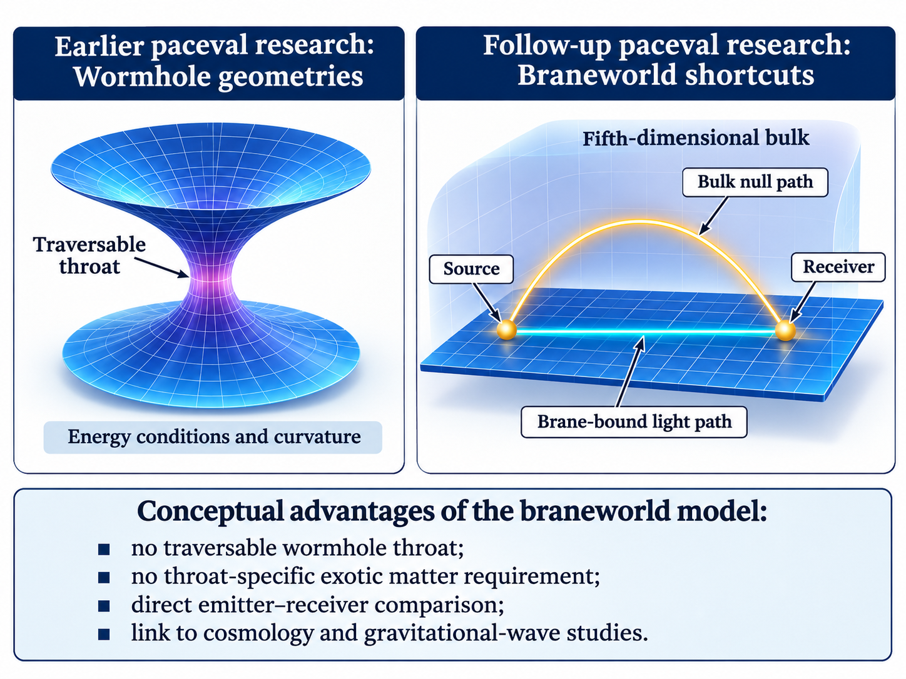
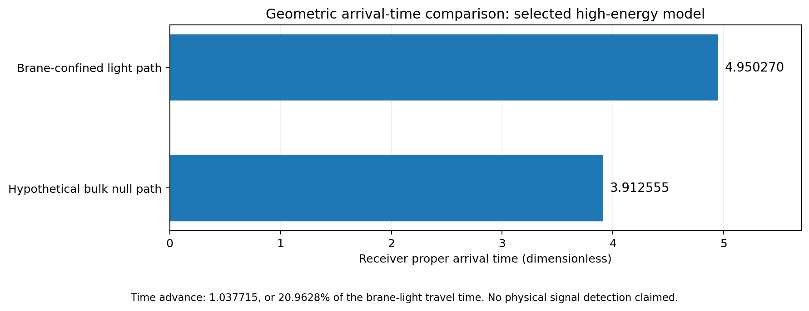
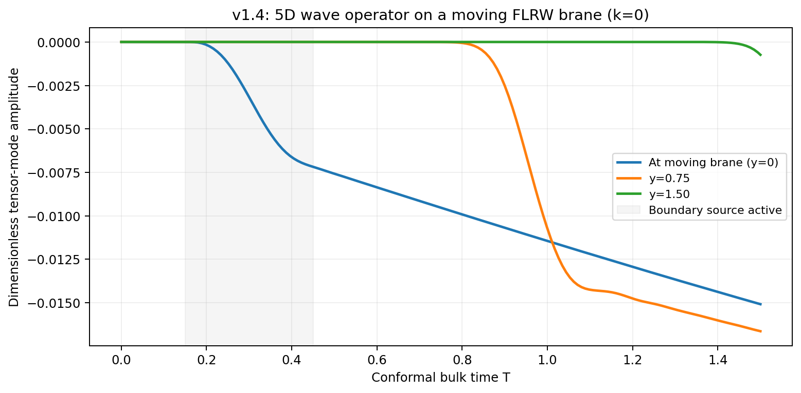
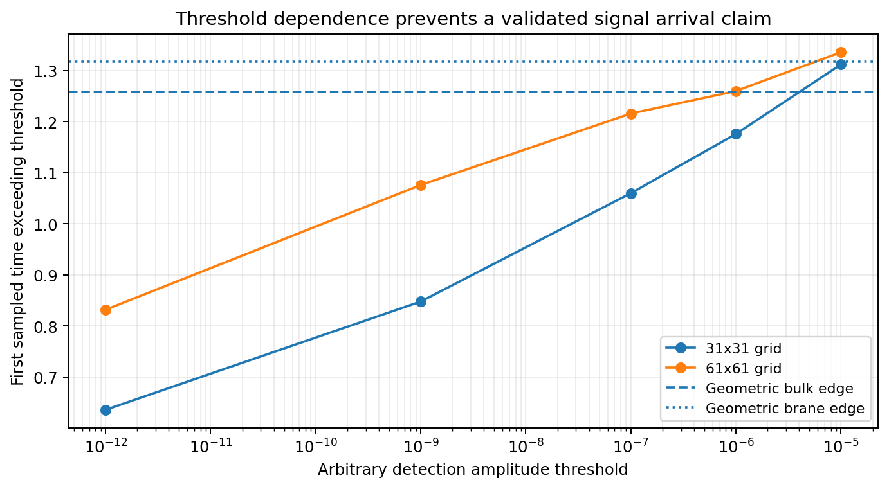
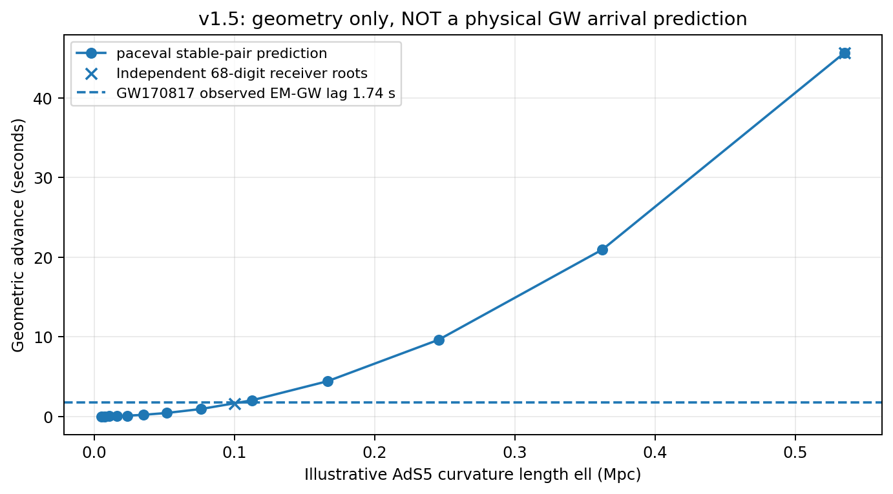

# Braneworld Shortcuts with paceval

**Computational study of geometric bulk null paths, a restricted five-dimensional wave operator, and cosmological travel-time scaling.**  
*Preliminary research, 6 November 2026. Not independently peer-reviewed.*



## Research result in brief

In an idealized pure-AdS₅ spacetime with a moving FLRW brane, a null path through
the five-dimensional bulk can connect the selected source and receiver with
**20.96279244046836% less receiver proper travel time** than a null path
confined to the brane. This is a numerical result for the dimensionless input
`rho0=10, w=-0.5, D=1`, not a real-world minimum, local superluminal velocity,
or demonstrated faster-than-light messaging.

| Geometric quantity (dimensionless) | Reference value |
|---|---:|
| Brane-restricted arrival time | `4.95027024495860766` |
| Bulk null-path arrival time | `3.91255536826567001` |
| Difference | `1.03771487669293765` |
| Relative arrival-time reduction | **`20.96279244046836%`** |
| Corrected receiver-bracketed scan | **50 cases**, including 43 positive non-de-Sitter cases and 7 de-Sitter controls |



### From earlier wormhole research to braneworlds

The earlier paceval wormhole investigation explored hypothetical static
Morris–Thorne geometries and compared violations of energy conditions with
curvature measures. This follow-up instead considers **higher-dimensional null
paths without constructing a traversable wormhole throat**. It therefore
avoids the *throat-specific* exotic-matter requirement familiar from
classical traversable wormholes. This does not mean that all bulk/brane energy
or stability conditions have been verified: AdS₅ has a negative cosmological
constant and the model includes tuned brane tension.

The braneworld approach offers a fixed analytic AdS background, a directly
defined sender–receiver boundary-value problem, and a natural connection to
cosmological expansion and gravitational-wave propagation. The underlying
idea of braneworld shortcuts **predates this study** (Ishihara 2001;
Caldwell & Langlois 2001; Abdalla & Casali 2002).

## Scope of this repository

Four C++ computational programs evaluate mathematical expressions via reusable
**paceval execution graphs**, including scalar and batch evaluation:

| Program | Scientific role | Key result / limitation |
|---|---|---|
| `braneworld_v13` | FLRW-brane and bulk null-path receiver calculation | Reproduces 20.9628% and all 47 prior Python cases; 50-case corrected grid |
| `braneworld_v14` | Linear AdS₅ tensor-mode bulk operator on a moving boundary | Static smooth-mode error reaches ~6.22 × 10⁻¹²; not a fully coupled sourced Einstein–Israel calculation |
| `braneworld_v14_planar` | 2D planar wave-pulse experiment | Arrival thresholds vary with grid and detection amplitude; no confirmed physical wavefront |
| `braneworld_v15` | Cosmologically scaled *geometric* time advances | Independent 68-digit reference at 40 Mpc: ~1.595174 s for ℓ=0.1 Mpc, ~45.657869 s for ℓ=0.535 Mpc |

No third-party numerical libraries are needed inside the C++ programs. Python,
SciPy, MPMath, NumPy, pandas and Matplotlib are used **only for independent
validation and figures**, never linked into the production calculation.





## Read the scientific report

- **[Complete English research report (PDF)](report/Braneworld_Shortcuts_Complete_Research_Report_EN.pdf)**
- [Report source (Markdown)](report/Braneworld_Shortcuts_Complete_Research_Report_EN.md)
- [Rebuilding the report PDF](docs/REPORT_BUILD.md)
- [Scientific scope and supported claims](docs/SUPPORTED_CLAIMS.md)
- [Validation and unresolved scientific issues](docs/SCIENTIFIC_STATUS.md)
- [Publication build, link and numerical QA](docs/FINAL_PUBLICATION_QA.md)
- [Prior full-report review](docs/FINAL_REVIEW.md)

## Build and run

**Environment:** C++17 compiler, CMake >= 3.16, and a compatible paceval 4.25
runtime. The C++ source does not depend on other numerical libraries.

```bash
cmake -S . -B build -DCMAKE_BUILD_TYPE=Release
cmake --build build --parallel 2
```

The public `sdk/paceval_main.h` header is bundled; the paceval runtime binary
is **not** redistributed by this research package. Supply the library
separately from an authorized paceval SDK installation or from the parent
[paceval repository](https://github.com/paceval/paceval) and specify its
absolute path:

```bash
./build/braneworld_v13 --backend both --paceval /path/to/libpaceval.so --steps 2000 --output results/scan_v13
./build/braneworld_v14 --lib /path/to/libpaceval.so --mode static --k 3 --ny 81 --dt 0.003 --tmax 1 --out results/static_example.csv
./build/braneworld_v14_planar --lib /path/to/libpaceval.so --mode constant --nx 31 --ny 31 --dt 0.004 --tmax 0.08 --out results/planar_example.csv
./build/braneworld_v15 --lib /path/to/libpaceval.so --n 100 --ellmin 0.1 --ellmax 0.535 --count 2 --out results/cosmology_example.csv
```

A convenient Linux smoke test runs all four executables:

```bash
bash scripts/run_smoke.sh /path/to/libpaceval.so
```

The optional **full numerical iteration suite** is significantly more
computationally expensive and also uses independent Python checks:

```bash
python3 -m pip install -r requirements-validation.txt
bash scripts/run_full_validation.sh /path/to/libpaceval.so
```

The bundled historic data and test outputs are suitable for comparison;
results may vary in their last few digits across floating-point environments.
See [reproducibility](docs/REPRODUCIBILITY.md) and
[package publication checklist](docs/PUBLISH_CHECKLIST.md).

## Repository contents

```text
README.md                        Main English GitHub landing page
report/                          PDF and complete editable English report
src/                             Four C++ sources and paceval runtime wrapper
sdk/                             paceval header and attribution (no runtime binary)
reference_python/                Original geometry reference (NumPy/SciPy)
validation/                      Independent check scripts and curated outputs
scripts/                         Smoke/full tests and package link validation
results/                         Numerical CSV tables and iteration evidence
figures/                         English illustrations and plot-generation script
data/historical/                 Historical source scan CSV data
docs/                            Scientific status, licensing, publication notes
CMakeLists.txt                    Build four C++ executables
```

## Interpreting the plots



The 20.96% high-energy result, the planar-pulse coordinate time and the 40-Mpc
geometric delay are **three different experimental quantities**. The latter
is not a prediction of what a detector would record. In particular,
GW170817 does not by itself constrain this toy model without a justified
assumption on intrinsic source emission times and a physically normalized
propagating gravity mode.

**Not established:** a navigable fifth dimension, usable photon messaging,
real faster-than-light propagation, a converged detectable gravitational-wave
arrival, or a new physical shortcut mechanism. See the report for exact
assumptions, error figures and references.

## Scientific references (selection)

- [Ishihara, *Causality of the Brane Universe* (2001)](https://doi.org/10.1103/PhysRevLett.86.381)
- [Caldwell & Langlois, *Shortcuts in the Fifth Dimension* (2001)](https://doi.org/10.1016/S0370-2693(01)00631-1)
- [Abdalla & Casali, *Shortcuts in a Dynamical Universe and the Horizon Problem* (2002)](https://arxiv.org/abs/hep-th/0208008)
- [Hiramatsu et al., *Evolution of gravitational waves in the high-energy regime* (2005)](https://doi.org/10.1016/j.physletb.2005.01.024)
- [Seahra, *Gravitational waves and cosmological braneworlds* (2006)](https://doi.org/10.1103/PhysRevD.74.044010)
- [Visinelli, Bolis & Vagnozzi, *Brane-world extra dimensions in light of GW170817* (2018)](https://doi.org/10.1103/PhysRevD.97.064039)

## Licensing

This is intended as a subdirectory of the existing paceval repository; see
that repository's root `LICENSE` (AGPLv3) and the additional source-file
notices. The geometric C++ source retains its historical MIT SPDX declaration.
The separately licensed paceval runtime binary is not included.
Read [licensing and redistribution notes](docs/LICENSE_AND_REDISTRIBUTION.md).

---

Built with **paceval®** · [paceval.com](https://paceval.com) · [info@paceval.com](mailto:info@paceval.com)  
Copyright © 2015–2026 paceval.® All rights reserved.

