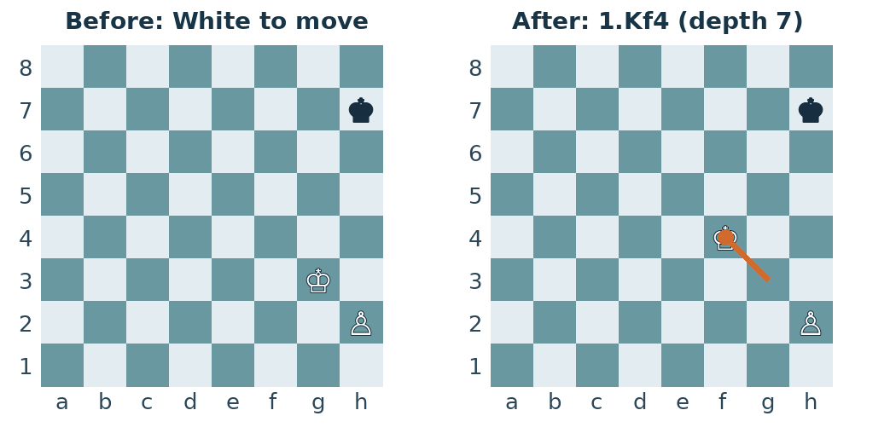
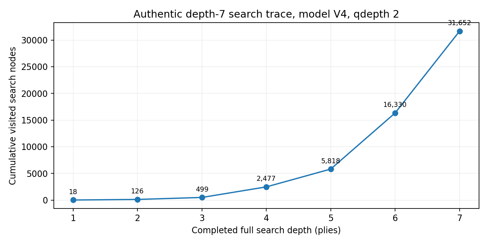

# JOSHUA V13: Depth-7 Chess Search with Reusable and Fused paceval Graphs


**Status: 17 November 2026.** Linux x86-64, C++17, original local paceval Mathematical Engine, versioned adaptive mathematical evaluation, independent C++ chess referee, and optional Stockfish 16 UCI matches. **Depth 7 was actually completed in an authentic paceval test, but not for every opening position and not in a new Stockfish strength tournament.** See the [V13 English whitepaper](JOSHUA_Chess_Research_Whitepaper_EN.pdf), [V13 test results](V13_RELEASE_VALIDATION.md), and [exact source implementation notes](docs/V13_DEPTH7_GRAPH_FUSION.md).

## 1. Scientific use case and current technology

An experimental chess engine repeatedly evaluates many candidate legal positions. The chess state, move generation, repetition policy, Alpha-Beta search, timeout/iteration management and match orchestration are handled by C++. The **original paceval library** executes reusable mathematical position score graphs. The baseline V4 network has twelve sigmoid formula graphs and a fused neural output. V13 additionally offers one **combined graph** for the neural output and the active whitelisted adaptive correction. The final root min/max comparison remains a genuine paceval graph. This research studies the feasibility and correctness of this mathematical organization, not a presumed advantage over Stockfish or Leela Chess Zero.

Stockfish, when installed by the user, is a separate UCI opponent and diagnostic teacher. The C++ referee checks legal moves, FEN continuity, SAN and game termination; it does **not** judge whether a legal move is strategically good. Stockfish's bounded searches also do not prove the mathematical optimality of a move.

## 2. What V13 actually changes in source code

| Mathematical or engine function | Actual owner and implementation |
|---|---|
| V3 weighted classical chess scores | Persistent paceval score graphs |
| Twelve 48-feature neural hidden functions | Twelve persistent paceval sigmoid graphs |
| Final V4 neural + adaptive bounded correction | **One new persistent paceval graph**, when an adaptive model is active |
| Separate comparison/reference path | Previously existing unfused genuine paceval graphs, controlled by `--no-fused-adaptive` |
| Root min/max of completed search | Persistent paceval root-reduction graph |
| Legal moves, pruning, move ordering and iterative depth 1..7 | C++ host, not misrepresented as a paceval graph |
| Previous-iteration root and search move hints | C++ safe move-ordering hints; values remain searched at the requested horizon |
| Node/time budgets | C++ host. Only a fully completed depth is published as `search_depth_actual` |
| Automatic allowed formula candidates | Python controller proposes bounded TSV coefficients, then actual paceval computes candidates |
| Model promotion | Independent tests plus completed frozen-champion color-paired games; no unconditional promotion |

**Crucial:** The full legal seven-ply game tree is **not** compiled into one giant paceval expression. The normal depth-7 path is Alpha-Beta in C++ with paceval leaf-evaluation and root-reduction graphs. The separate `joshua_long_graph` program continues to demonstrate bounded *full-width* graphs and does not have the same depth-7 completion evidence.

## 3. Actual depth-7 validation

One nonterminal king-and-pawn FEN was evaluated by the recompiled authentic paceval engine:

`8/7k/8/8/8/6K1/7P/8 w - - 0 1`

With `--model 4 --depth 7 --quiescence 2` and a nonzero approved `feature.king_tactics` correction, the complete depth-7 search returned `g3f4` (`Kf4`). The recorded experiment visited 31,652 search nodes over all completed iterations; 1,077 unique feature vectors were scored. These are **execution counts**, not performance or chess-strength comparisons. An independent run with the nonfused score path produced matching ranked root evaluations in the separate depth-7 regression. The current dedicated regression is runnable with CTest and writes a JSON evidence file.



A separate start-position test deliberately exhausted a 4,500-node limit. It reported `requested=7`, `actual=2`, `budget_stop=nodes` and returned a legal move from the **completed depth-2 iteration**. In other words, specifying depth 7 is a *target*, not a guarantee that the limit will be reached in complex positions. Time and node limits can be adjusted; do not describe an incomplete search as completed depth 7.



## 4. Install on your existing Linux computer

Use the **separate V13 flat Linux ZIP** for `~/Dropbox/joshua_autoplay`. Stop any running engine first. The private flat archive is designed not to overwrite any of your existing `stockfish_sessions/`, `selfplay_sessions/` or active learned graph.

```bash
cd "$HOME/Dropbox/joshua_autoplay"
unzip -o "$HOME/Downloads/JOSHUA_V13_Flat_Linux_x64.zip"
chmod 755 joshua joshua_referee joshua_selfplay joshua_long_graph run_stockfish_matches.sh
export PACEVAL_RUNTIME="$PWD/libpaceval_linux_sharedLIB.so"
./run_stockfish_matches.sh --stockfish /usr/games/stockfish --max-games 2 \
  --depth 7 --quiescence 2 --verify-extra-depth 0 \
  --joshua-search-ms 65000 --joshua-search-nodes 750000 --progress-seconds 5
```

For continuous matches, after the two actual matches have ended successfully, use the same command with `--max-games 0`. Run without `sudo`. Stockfish is separately installed and is not in either release ZIP. The public GitHub package excludes the proprietary paceval runtime. Place your authorized copy at `runtime/libpaceval_linux_sharedLIB.so` or supply `PACEVAL_RUNTIME`.

For an engine-only control of the seven-ply search with a strict budget:

```bash
./joshua --mode alphabeta --model 4 --depth 7 --quiescence 2 \
 --search-ms 65000 --search-nodes 750000 --plies 1 --no-board \
 --graph-file config/active_graph.tsv --output results/my_depth7_search
```

An independent *functional* equality check for the same FEN uses the same command with `--no-fused-adaptive`. Use this option for audits, not for automatic graph optimization. The run continues to use genuine paceval in both configurations.

## 5. Human-readable mathematical graphs

| File | Meaning |
|---|---|
| `stockfish_sessions/active_graph.tsv` | Version and whitelisted numeric coefficients, not a serialized optimized execution structure |
| `stockfish_sessions/active_graph_expression.txt` | Exact earlier adaptive mathematical expression created by Joshua |
| `stockfish_sessions/active_full_graph_catalog.csv` | Every actually registered paceval expression, its variables and real evaluation-point counts |
| `stockfish_sessions/archives/game_XXXXXX.zip` | Game, move timing, exact graph exports, evaluations and candidate-gate decisions |
| `joshua_ply_*/paceval_v13_fused_score.txt` inside game ZIP | **Exact combined V4 neural-output and adaptive score expression** generated in V13 |
| [`results/v13_depth7/paceval_v13_fused_score.txt`](results/v13_depth7/paceval_v13_fused_score.txt) | Genuine example fused formula, produced during the new depth-7 run |
| [`results/v13_depth7/paceval_all_graphs.csv`](results/v13_depth7/paceval_all_graphs.csv) | Reproduced SDK graph registration and executed-point evidence |
| [`formulas/v4_graph_expressions.tsv`](formulas/v4_graph_expressions.tsv) | Historic literal 12 hidden and one output V4 formula strings |

The V13 combined graph accepts twelve neural hidden outputs, the V3 base score, and all 48 features. It includes the existing trained-neural clipping operation and the whitelisted nonlinear adaptive correction. The genuinely compiled formula is visible as plain text. It is **not** an export of paceval's private optimized internal machine graph.

## 6. Automatic learning and controls

After color-swapped games against fixed Stockfish settings, the controller records legal FEN positions, bounded reference losses, mate alerts, model-version SHA-256 and attempted adjustments. Only whitelisted bounded linear/nonlinear terms can change. Each candidate must pass separate held-out position checks **and** completed champion-vs-challenger games. A longer graph does not automatically qualify. Model snapshots are retained; manual rollback remains available. The current V13 source does not claim automatic algorithm discovery or stronger real-world chess performance.

Stored ZIP logs retain a total archive budget of 25,000,000 bytes and include per-move `delta_s`, `elapsed_s` and `move_s`. In-progress logs and temporary ZIPs can briefly require additional space. Search-budget details and the **actual** achieved depth are included in engine CSV/JSON evidence.

## 7. Build, repeat and limitations

```bash
cmake -S src -B build -DCMAKE_BUILD_TYPE=Release
cmake --build build --target joshua joshua_referee joshua_selfplay joshua_long_graph -j2
export PACEVAL_RUNTIME=/absolute/path/libpaceval_linux_sharedLIB.so
ctest --test-dir build -R 'joshua_v13_depth7_original_paceval|joshua_v11_champion_gate_offline' --output-on-failure
```

The V13 genuine paceval depth-7, combined/uncombined graph equality and budget-fallback tests passed. Six focused tests passed together after updating a historical synthetic comparison fixture to include the new search-budget grouping fields. An older V12 regression batch timed out in the environment and is **not** claimed as passed. The new program has not been validated by a complete depth-7 match against the actual Stockfish executable, and no general Elo gain is established. See [the detailed V13 audit](V13_RELEASE_VALIDATION.md).

Read the [V13 graph and search research notes](docs/V13_DEPTH7_GRAPH_FUSION.md), [V12 historical work](docs/V12_TACTICAL_VALIDATION_AND_GRAPH_EVOLUTION.md), and [official paceval API](https://paceval.com/api/). Stockfish is documented in its [upstream repository](https://github.com/official-stockfish/Stockfish). All earlier comparisons should be regarded as historical experiments with their own distinct settings.
