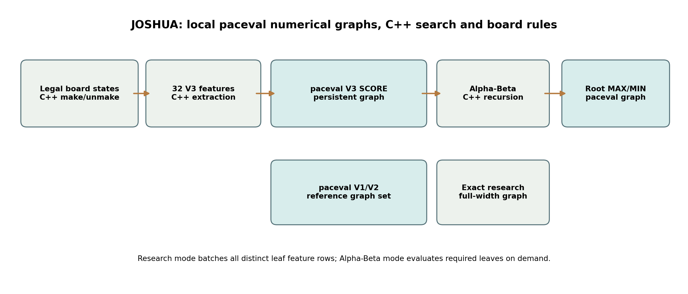

# JOSHUA: Local paceval Chess Research Engine

**An executable, independently checked Linux chess research demonstrator.** Both White and Black are controlled by JOSHUA. All chess positions, move descriptions, console logs, source comments, result columns, and the single consolidated whitepaper are in English. The name **JOSHUA** is a personal homage to the film *WarGames*; the film and its rights holders are not associated with this project.


JOSHUA uses the **real local paceval Mathematical Engine** for reusable numerical graphs, including material and positional scores and dynamically compiled `max`/`min` reductions. The application **does not call the paceval MCP server**, Stockfish, Leela Chess Zero, or a remote chess service. No Stockfish or Leela code, models, or weights are distributed here.

**Research status:** Fully functional proof of concept, not competitive chess strength, training evidence, an exact chess solution, or a fair head-to-head engine benchmark.

## What is new

JOSHUA now includes three explicit evaluation models:

* **V1**: Material only, retained unchanged for regression and controlled tests.
* **V2**: Material plus center, development, pawn advance, and a simple king-zone score, retained unchanged.
* **V3**: Material and positional features using **32 documented inputs**, including piece-square activity, doubled/isolated/passed pawns, bishop pairs, pawn cover around kings, and tempo. Every numerical weight and composite score in V3 is implemented in actual, persistent paceval graph expressions; C++ only extracts the raw position facts.

The Alpha-Beta mode accepts **depths 1 through 10** with iterative deepening, legal move ordering, reversible make/unmake moves, a conservative transposition table, and optional bounded tactical capture/check-evasion extension (`--quiescence 0..4`). The full-width, batched Research mode remains limited to depth 4 for manageable memory usage and mathematical cross-checks. Quiescence is selective and bounded: its horizon score is an estimate, not an exact theorem.

Crucially, **depth 10 has been executed on a constrained legal king-and-pawn endgame**, and depth 6 has been executed on the standard opening position. A depth-10 opening-position search with this implementation has not been demonstrated. Comparing those two cases as if they had equal search complexity would be misleading.

## Linux build

Requires a C++17 compiler, CMake, Python 3, and a separately obtained compatible `libpaceval_linux_sharedLIB.so` (the original local library). The supplied `src/paceval_main.h` and `src/paceval_main.cpp` are the original paceval SDK interface files and must be used with the corresponding library.

```bash
cmake -S src -B build -DCMAKE_BUILD_TYPE=Release \
  -DPACEVAL_RUNTIME=/absolute/path/to/libpaceval_linux_sharedLIB.so
cmake --build build -j
ctest --test-dir build --output-on-failure
```

## Run JOSHUA against itself

The program always plays both colors. It reports a monotonic timestamp in **seconds since start** for each search and move, plus the English piece name, UCI move, SAN, candidate ranking, and FEN.

```bash
# Recommended initial V3 self-play, with a finite tactical extension:
./build/joshua --mode alphabeta --model 3 --depth 5 --quiescence 2 \
  --plies 10 --no-board --output results/my_v3_selfplay

# Deeper demonstration; choose a suitable constrained endgame FEN:
./build/joshua --mode alphabeta --model 3 --depth 10 --quiescence 0 \
  --fen "8/8/8/8/8/7P/2k5/K7 w - - 0 1" --plies 1 --no-board \
  --output results/my_depth10_endgame

# Mathematical full-width reference with the maximum configured batch usage:
./build/joshua --mode research --model 3 --depth 3 --batch-rows 65536 \
  --plies 3 --no-board --output results/my_fullwidth

# Regression model V2:
./build/joshua --mode research --model 2 --depth 3 --plies 2 --no-board \
  --output results/my_v2
```

The batch row setting controls maximum rows per SDK call. `65536` is a **configured ceiling, not proof that all input states fit in one batch**. The full-width mode actually uses `paceval_dGetMultipleComputationsResultsExt` for groups of nonterminal leaves and `paceval_dGetComputationResultExt` for groups of internal min/max nodes. The Alpha-Beta mode instead uses `paceval_dGetComputationResult` at demanded leaves and a final reused root `max`/`min` graph; it does **not** batch every leaf during interactive pruning.

## Mathematics and graph ownership

The V3 mathematical score is:

```math
\begin{aligned}
E_{\mathrm{V3}} =&\;100(P_w-P_b)+320(N_w-N_b)+330(B_w-B_b)\\
&+500(R_w-R_b)+900(Q_w-Q_b)+13(C_w-C_b)\\
&+17(D_w-D_b)+3(A_w-A_b)+18(K_w-K_b)\\
&+(PSQ_w-PSQ_b)-16(DP_w-DP_b)-12(IP_w-IP_b)\\
&+22(PP_w-PP_b)+28(BP_w-BP_b)\\
&+9(SH_w-SH_b)+7\,\mathrm{turn}.
\end{aligned}
```

The full exact source string is `v3_score` in [`src/paceval_math.h`](src/paceval_math.h), alongside the feature extraction and component graphs. The independent 80-digit validation is in [`scripts/check_v3_audit.py`](scripts/check_v3_audit.py). The weights are **illustrative handcrafted design choices**, not learned coefficients and not calibrated Elo gains.

### Two different graph strategies

1. **Research mode:** Construct all legal paths to the fixed horizon within the configured node cap. Convert their feature rows into many local paceval batch evaluations. Group internal `max`/`min` nodes by fan-out and side, then evaluate those dynamically generated paceval expressions in batches. This mode permits exact, independent fixed-horizon minimax comparisons for the chosen heuristic.
2. **Alpha-Beta mode:** Perform iterative deepening and partial tree exploration using C++ for search control, legal moves, alpha/beta cutoffs, move ordering, and transpositions. The actual V3 leaf score is calculated by local paceval, cached by feature vector; after every iteration the final root-reduction graph is also calculated by paceval. Not all internal Alpha-Beta nodes are paceval `min`/`max` graph calls. This distinction is intentional and measured.



## Actual measured executions

| Experiment | Position | Search depth | Tactical extension | Plies played | Elapsed time | Source |
|---|---|---:|---:|---:|---:|---|
| V3 full-width | Standard start | 3 | 0 | 3 | 0.153 s | [Run evidence](results/v3_research_depth3_3ply/run_evidence.json) |
| V3 Alpha-Beta | Standard start | 3 | 0 | 3 | 0.338 s | [Run evidence](results/v3_ab_depth3_3ply/run_evidence.json) |
| V3 Alpha-Beta | Standard start | 4 | 2 | 4 | 6.878 s | [Run evidence](results/v3_ab_depth4_4ply/run_evidence.json) |
| V3 Alpha-Beta | Standard start | 5 | 2 | 2 | 12.228 s | [Run evidence](results/v3_ab_depth5_q2_2ply/run_evidence.json) |
| V3 Alpha-Beta | Standard start | 6 | 0 | 1 | 28.783 s | [Run evidence](results/v3_ab_depth6_initial/run_evidence.json) |
| V3 Alpha-Beta | Constrained king + pawn endgame | 8 | 1 | 2 | 0.072 s | [Run evidence](results/v3_ab_depth8_q1_endgame/run_evidence.json) |
| V3 Alpha-Beta | Constrained king + pawn endgame | 10 | 0 | 1 | 0.114 s | [Run evidence](results/v3_ab_depth10_endgame/run_evidence.json) |
| V3 Alpha-Beta | Standard start | 4 | 1 | 10 | 60.325 s | [Run evidence](results/v3_ab_depth4_q1_10ply/run_evidence.json) |

Observed times are from this container's particular Linux environment, **not directly comparable across different positions, ply budgets, or tactical extensions**. No cross-engine speed or playing-strength claims are made.

The V3 full-width and Alpha-Beta modes agreed on all **62 root moves and their values** across the same three opening halfmoves at depth 3 with quiescence disabled. This is a correctness observation under the same evaluation, not a speed comparison. The ten-position [V3 graph audit](results/v3_audit.csv) passed 420 independently calculated feature/expression comparisons using 80-digit Python Decimal arithmetic.

## Output format

```text
[+5.451066s] JOSHUA BEST WHITE c2c4 | Piece=Pawn c2 -> c4 | SAN=c4 | score_white=16cp
[+12.227797s] JOSHUA BEST BLACK d7d6 | Piece=Pawn d7 -> d6 | SAN=d6 | score_white=-8cp
```

Actual full logs, including [the ten-halfmove English self-play](docs/v3_ab_depth4_q1_10ply_console.txt), are in [`docs/v3_ab_depth5_q2_2ply_console.txt`](docs/v3_ab_depth5_q2_2ply_console.txt) and machine-readable timelines, ranked moves, UCI move lists, and provenance JSON in [`results/v3_ab_depth5_q2_2ply/`](results/v3_ab_depth5_q2_2ply/run_evidence.json).

## Independent validation and limitations

* `joshua --selftest` exercises special chess moves, the original local SDK, reversible make/unmake, and Perft up to depth 4 (197,281 legal continuations).
* `joshua_v3_audit` runs actual local paceval V3 formula batches; Python independently reconstructs the 32 features and ten graph outputs at 80-digit precision.
* Automated mode-equivalence compares every root-move score between full-width and Alpha-Beta (when quiescence is disabled).
* Automatic self-play checks English piece names, correct square transitions, notation, and move-ranking coherence.
* The current fixed-depth search does not incorporate full path-dependent threefold repetition into every search branch. It does handle game-level claim policy; any future playing-strength comparison must correct and further validate path-dependent transposition behavior.
* Bounded quiescence improves some tactical horizons but may still stop in an unstable position and is **not** equivalent to Stockfish's fully developed quiescence implementation.
* Annotations and example board diagrams are generated from **recorded FEN and UCI**. The board is always displayed with White on the bottom.
* No Stockfish, Leela Chess Zero, opening-book, tablebase or neural weights are included. JOSHUA vs JOSHUA remains the only current play mode.

## Whitepaper

Exactly **one consolidated English whitepaper** is released: [JOSHUA Chess Research Engine: Architecture, Graphs and Validation](JOSHUA_Chess_Research_Whitepaper_EN.pdf). It documents formulas, source-derived diagrams, tested depths, measured results, and limitations. Earlier whitepapers/addenda are not bundled.

## Sources

* [Stockfish official documentation](https://stockfishchess.org/documentation) and [public search.cpp](https://github.com/official-stockfish/Stockfish/blob/master/src/search.cpp)
* [Leela Chess Zero, search algorithms and neural backends](https://lczero.org/dev/overview/)
* [paceval developers](https://paceval.com/developers/)

This project is not affiliated with those external engines, the filmmakers or *WarGames* rights holders. See [License notices](LICENSE_NOTICES.md).
