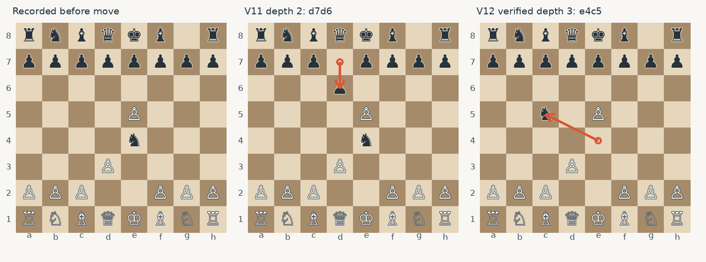
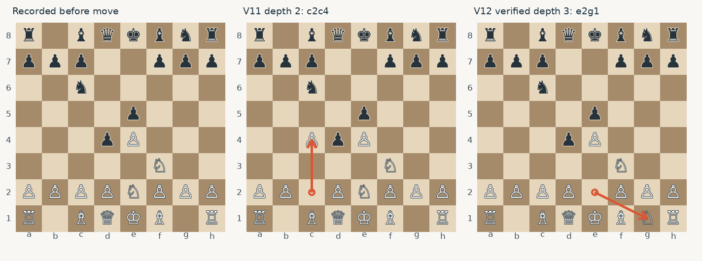
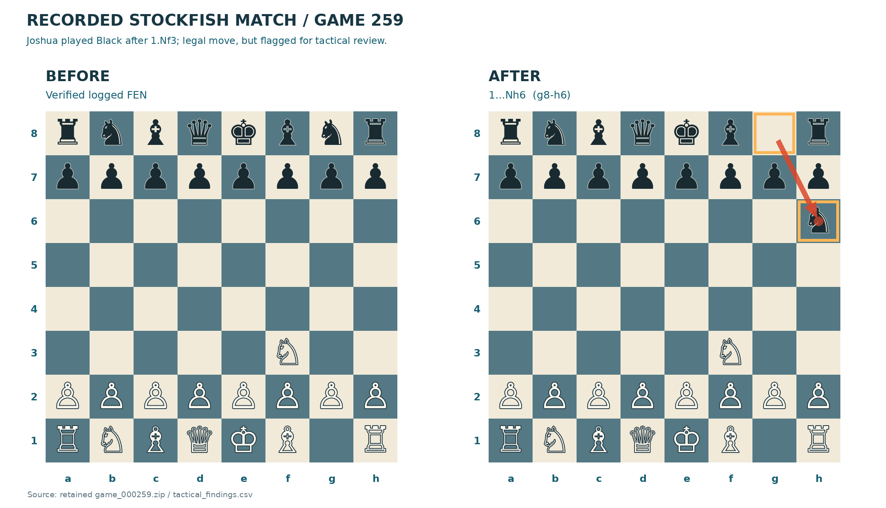
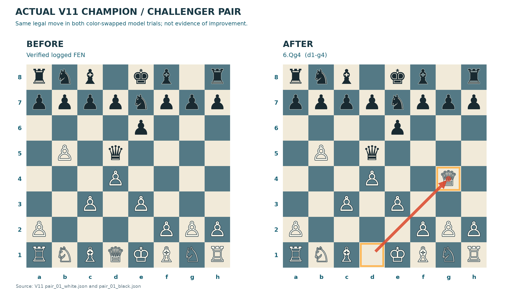

# JOSHUA V12: Tactical Search Verification and Evolving paceval Chess Graphs


**Research release:** 17 November 2026. **Platform:** Linux x86-64. **Implementation:** C++17, genuine paceval Mathematical Engine, Python 3 UCI controller. **Evidence:** Authentic paceval executions and real historical chess positions. **No proven new Stockfish playing-strength gain.**

JOSHUA is a research chess engine. C++ implements the legal game state, alpha-beta search, tactical extension and search policy. The original paceval Mathematical Engine calculates persistent numerical leaf-evaluation graphs, an exported 12-neuron V4 model, whitelisted nonlinear adaptive corrections and root min/max reductions. Stockfish is an external opponent and a separate, imperfect evaluation reference. The C++ referee validates legal moves and game endings but never grades their chess quality.

The [current English research whitepaper](JOSHUA_Chess_Research_Whitepaper_EN.pdf) includes the earlier verified chessboards and the new V12 position-by-position comparisons. Detailed implementation and test sources are in [V12 research notes](docs/V12_TACTICAL_VALIDATION_AND_GRAPH_EVOLUTION.md) and [V12 release evidence](V12_RELEASE_VALIDATION.md).

## 1. What changed in V12?

| Research improvement | What the running program actually does |
|---|---|
| Ambiguous-root verification | If the two best root scores differ by no more than the configurable margin, all legal root moves are independently rescored at the deeper horizon |
| Original paceval retained | The existing V4, adaptive and final min/max graph calculations still execute on the original SDK; search-depth choice remains C++ orchestration |
| Expanded graph trials | The controller now examines up to eight bounded changes by default, across three distinct whitelisted nonlinear templates and linear weights |
| Safer paired-game evidence | A color pair must use the same model SHA-256, opponent identity, opening and search settings |
| Fairer frozen-model gate | Six fixed four-ply opening lines replace unusual single-move V11 test openings; each chosen line is played in both colors |
| Strength accounting | Version comparisons distinguish the V11 search policy from the new V12 depth-verification policy |
| Transparent logs | `V12_VERIFY_START`, `V12_VERIFY_END`, chosen move, original move, actual search depth, `delta_s`, `elapsed_s`, `move_s` and graph version |
| Existing protections retained | 25 MB ZIP log rotation, real C++ referee, model rollback, human-readable formula TXT/CSV |

**V12 changes source code and Linux executables**, not just documentation. It is not a claim that lengthening a graph automatically strengthens chess play. The adaptive model remains unchanged until independent candidate tests and completed champion matches pass.

## 2. Real archived Stockfish cases and three verified move changes

The latest user archive contained two completed Stockfish 16 games (35 and 24 halfmoves). Joshua lost both with nominal search depth 2, quiescence 2, graph version 0 and Stockfish 1,000 nodes per move. No learning version was promoted. From the exact stored FENs, three selected moves changed when the V12 ambiguity rule triggered a depth-3 search. All moves were verified legal by the C++ referee and match an independent full-depth-3 Joshua analysis.

| Case | Recorded depth-2 choice | V12 verified choice | Actual deeper re-search | Independent Stockfish quality proof? |
|---|---|---|---|---|
| Game 1, ply 6, Black | `d7d6` | `e4c5` | Depth 3 | **No** |
| Game 2, ply 9, White | `c2c4` | `e2g1` | Depth 3 | **No** |
| Game 2, ply 15, White | `a4d7` | `a4a5` | Depth 3 | **No** |

The first two comparisons are visualized on real chessboards below. They show **changed decisions**, not verified better decisions. In particular, a deeper move such as `e2g1` must be checked by an independent, stronger chess analysis before it can be considered an improvement.





Source data: [`results/v12_critical_positions.csv`](results/v12_critical_positions.csv), [`results/v12_search_comparison.json`](results/v12_search_comparison.json) and [`results/V12_VERIFIED_CHESSBOARDS.json`](results/V12_VERIFIED_CHESSBOARDS.json).

## 3. Direct Linux x64 installation

For your existing `~/Dropbox/joshua_autoplay`, use the **V12 flat Linux package**, not the entire GitHub archive. Stop running engines with Ctrl+C first. Extract the flat package directly into that directory:

```bash
cd "$HOME/Dropbox/joshua_autoplay"
unzip -o "$HOME/Downloads/JOSHUA_V12_Flat_Linux_x64.zip"
chmod 755 joshua joshua_referee joshua_selfplay joshua_long_graph run_stockfish_matches.sh
export PACEVAL_RUNTIME="$PWD/libpaceval_linux_sharedLIB.so"
./run_stockfish_matches.sh --stockfish /usr/games/stockfish --max-games 2 --progress-seconds 5
```

After confirming two **completed** real Stockfish matches and inspecting their archives, start continuous play with `--max-games 0`. The new defaults are `--depth 2 --quiescence 2 --verify-margin-cp 25 --verify-extra-depth 1 --candidate-budget 8`. For a deterministic V11-style comparison without extra verification use `--verify-margin-cp 0 --verify-extra-depth 0`. To run a full independent deeper search, specify `--depth 3 --verify-margin-cp 0 --verify-extra-depth 0`.

**Preservation:** The install does not modify existing `stockfish_sessions/`, `selfplay_sessions/`, or any existing active model. The private flat package contains the original user-supplied `libpaceval_linux_sharedLIB.so`. Do **not** upload that binary to public GitHub. Stockfish must be installed separately, for instance using `sudo apt install stockfish` on Ubuntu. Run Joshua itself **without sudo**.

From a full GitHub checkout, supply the original runtime separately:

```bash
cmake -S src -B build -DCMAKE_BUILD_TYPE=Release
cmake --build build --target joshua joshua_referee joshua_selfplay joshua_long_graph -j2
export PACEVAL_RUNTIME=/absolute/path/libpaceval_linux_sharedLIB.so
ctest --test-dir build -R 'joshua_v12_|joshua_v11_champion_gate_offline' --output-on-failure
./scripts/run_stockfish_matches.sh --stockfish /usr/games/stockfish --max-games 2
```

## 4. Mathematics and human-readable paceval graphs

For a side-neutral board-derived feature vector $x(s)$, the fixed V4 mathematical score is its classical V3 score plus the trained neural residual. The adaptive model evaluates a white-oriented composite correction:

```math
S_{12}(s)=S_4(s)+\min\left(160,\max\left(-160,\sum_i a_i f_i(s)+\sum_j b_j g_j(s)\right)\right).
```

The C++ host extracts features from the board and chooses the search horizon. paceval evaluates all numerical scoring formulas, including nonlinear combinations, through actual SDK graph handles. The allowed adaptive templates remain finite and documented; the model cannot execute arbitrary source code from a TSV file. Example:

```math
g_{king}(s)=D_b(1+Q_b+R_b)-D_w(1+Q_w+R_w).
```

The math expresses only a heuristic king-danger interaction. No finite feature vector can prove a long forced tactical sequence without the required chess search.

| Actual file | What it contains |
|---|---|
| `stockfish_sessions/active_graph.tsv` | Currently selected version and coefficients. **Not** itself the compiled graph |
| `stockfish_sessions/active_graph_expression.txt` | The actual mathematical expression registered by the running Joshua process |
| `stockfish_sessions/active_graph_terms.csv` | Every active base/nonlinear mathematical term and coefficient |
| `stockfish_sessions/active_full_graph_catalog.csv` | Complete formula and `evaluated_points` for every registered SDK computation in the last Joshua invocation |
| `stockfish_sessions/model_versions/` | Prior immutable accepted model snapshots, when present |
| `stockfish_sessions/archives/game_XXXXXX.zip` | Per-game graph expressions, move scores, FENs, Stockfish diagnostics, challenger decisions and failure reports |
| [`formulas/v4_graph_expressions.tsv`](formulas/v4_graph_expressions.tsv) | Exact historic V4 trained-neural expressions |

Run `cat stockfish_sessions/active_graph_expression.txt` to inspect the current formula in plain text. The original runtime's optimized internal execution structure is not exported as a portable text file. Its **exact input expression**, variable list and verified evaluation counts are preserved so the same formula can be recreated with the matching SDK.

## 5. Model learning, referee and release safety

The controller identifies tactical regression candidates from legal game positions and Stockfish reference scores. It makes up to eight deterministic whitelisted graph variations, executes each candidate with genuine paceval, tests separate held-out positions, and only then starts **actual** frozen-champion versus challenger games. A candidate is activated only after finishing and passing the predeclared color-pair gate; interrupted or artificially truncated games cannot count as success. The controller saves all reasons for acceptance and rejection. There is no automatic editing of C++ source code.

The `joshua_referee` validates legal UCI moves, applies them to FEN positions, emits SAN and detects relevant terminal states. It does **not** evaluate chess strength. Stockfish serves as a separate bounded diagnostic engine, not as a rules arbiter. Importantly, V12 gates now use four-ply, legally verified openings instead of the previous V11 `f3`/`g4`-style single-move choices.

The current auto-learning inputs and results must always be assessed separately from the current search-policy experiment. More candidate graphs do not constitute a successful promotion or an Elo gain. The archived user graph was version **0**, and it remains version **0** here.

## 6. Validation status and limitations

The four Linux x86-64 programs were rebuilt. The exact historical FEN regression was run with the **authentic original paceval runtime**. Eight selected CTest cases passed, including the prior graph/controller mock tests, the actual one-FEN depth-verification test, all six champion opening lines and the multi-template policy test. Two bounded integration games using the genuine Joshua/pac eval engine and a **clearly marked mock UCI opponent** successfully created ZIP logs and timing fields. These were intentionally incomplete and do not count as Stockfish games.

Stockfish itself was not installed in the build environment; no new completed V12 Stockfish strength tournament has been run. Another long replay encountered an execution timeout, so no unsupported full-suite claim is made. Results from distinct hardware or search-depth settings must not be silently compared. The altered search can use more computational work; nothing in this research demonstrates a speed advantage.

See [the complete current V12 explanation](docs/V12_TACTICAL_VALIDATION_AND_GRAPH_EVOLUTION.md), [verification table](V12_RELEASE_VALIDATION.md), [the last-user-archive summary](results/V12_LATEST_UPLOAD_AUDIT.json), and [full PDF with real boards](JOSHUA_Chess_Research_Whitepaper_EN.pdf).

### Historical experimental chessboards

The previous V11 source-derived board sequences remain in the repository for continuity:





These are historical records, not results of the V12 search-verification experiment. [Original FEN and referee audit](results/VERIFIED_CHESSBOARD_SCENES.json).
