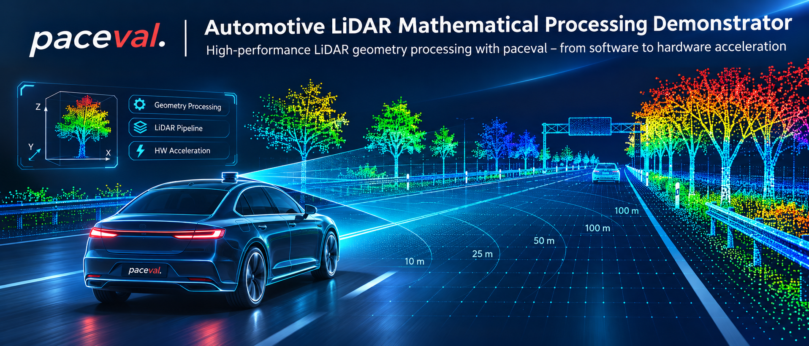
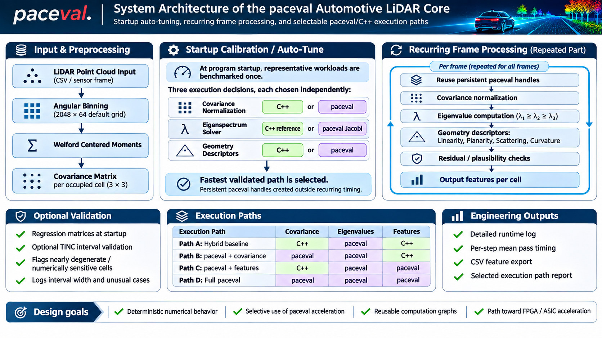

# paceval Automotive LiDAR Mathematical Processing Demonstrator



This repository contains a **Windows Visual C++ LiDAR geometry-processing demonstrator** that evaluates how the **paceval mathematical engine** can be used inside an automotive-style LiDAR pipeline.

The project focuses on the recurring numerical part of the pipeline:

- angular binning,
- online Welford moment accumulation,
- covariance-matrix normalization,
- eigenspectrum computation,
- geometry descriptor extraction,
- and plausibility / residual checks.

The demonstrator is designed to answer a practical engineering question:

> **Where does paceval bring value inside a LiDAR processing core, and how should the architecture be organized if the same mathematical execution path may later be accelerated in hardware?**

---

## Why paceval is interesting for LiDAR

For a LiDAR developer, paceval is most interesting for five reasons:

1. **Reusable computation graphs**  
   Mathematical expressions are created once and then reused across many cells and many frames.

2. **Natural batch execution**  
   The same formulas can be evaluated for large sets of covariance cells, which fits LiDAR workloads well.

3. **Selective acceleration**  
   paceval does not need to replace everything. It can be used where it helps most, for example in eigenspectrum computation, while other steps stay in optimized C++.

4. **Deterministic numerical flow**  
   The demonstrator includes regression matrices, residual checks, and optional TINC-based interval diagnostics for validation-oriented workflows.

5. **Path to hardware**  
   The same persistent mathematical structure can later be mapped toward FPGA / ASIC style acceleration, instead of being only a CPU-side software experiment.

---

## What this demonstrator computes

For each occupied LiDAR cell, the demonstrator computes:

- a **3 × 3 covariance matrix**,
- its **eigenvalues** `λ1 ≥ λ2 ≥ λ3`,
- and standard geometry descriptors:
  - **linearity**
  - **planarity**
  - **scattering**
  - **curvature**

The code uses:

- **Welford centered moments** for numerically stable accumulation,
- a **paceval analytic eigenspectrum path**,
- a **selective paceval Jacobi fallback** for matrices that are analytically sensitive,
- optional **TINC post-validation** for selected matrices.

---

## High-level architecture



### Input and preprocessing

1. Load one LiDAR frame or CSV point cloud.
2. Bin points into the default **2048 × 64** angular grid.
3. Accumulate centered moments with Welford updates.
4. Build one covariance matrix per eligible occupied cell.

### Startup auto-tuning

At program startup, the demonstrator benchmarks four validated execution paths on a representative workload. The same numeric reference is used for all candidates.

The four benchmarked configurations are:

- `evaluateEigenvaluesPaceval`  
  **Covariance:** C++  
  **Eigenvalues:** paceval  
  **Features:** C++

- `evaluateEigenvaluesAndCovariancePaceval`  
  **Covariance:** paceval  
  **Eigenvalues:** paceval  
  **Features:** C++

- `evaluateEigenvaluesAndFeaturesPaceval`  
  **Covariance:** C++  
  **Eigenvalues:** paceval  
  **Features:** paceval

- `evaluateAllMathPhasesPaceval`  
  **Covariance:** paceval  
  **Eigenvalues:** paceval  
  **Features:** paceval

The fastest numerically validated path is selected and then reused for the recurring frame-processing phase.

### Recurring frame processing

After startup calibration, the repeated frame path is:

1. reuse persistent paceval handles,
2. normalize covariance,
3. compute eigenvalues,
4. derive geometry descriptors,
5. run residual / plausibility checks,
6. export per-cell features.

### Validation support

The project also supports:

- startup analytic regression matrices,
- logging of Jacobi fallback usage,
- optional `PACEVAL_LIDAR_VALIDATE_TINC=1` diagnostics,
- flagging of numerically sensitive cells,
- reporting of unusually wide or invalid intervals.

---

## Measured Linux benchmark environment

The most recent Linux verification used the real `libpaceval_linux_sharedLIB.so` in the CAAS benchmark environment:

- **CPU model:** AMD EPYC 9V74 80-Core Processor
- **Visible CPU cores used by the container:** 5
- **Compiler:** GCC, optimized build
- **Library:** original Linux paceval shared library
- **Test frame:** `192,000` points
- **Eligible covariance cells:** `24,000`
- **Angular grid:** `2048 × 64`

All reported values below are from actual Linux runs or from a documented modeled hardware study based on those Linux measurements.

---

## Measured startup auto-tune result

On the 192k-point / 24k-cell benchmark workload, startup phase autotuning selected the **hybrid path**:

- **Selected path:** `evaluateEigenvaluesPaceval`
- **Meaning:** covariance in C++, eigenvalues in paceval, features in C++

Measured median times for the four startup candidates:

| Execution path | Median time (ms) |
|---|---:|
| `evaluateEigenvaluesPaceval` | **7.16** |
| `evaluateEigenvaluesAndCovariancePaceval` | 19.20 |
| `evaluateEigenvaluesAndFeaturesPaceval` | 66.97 |
| `evaluateAllMathPhasesPaceval` | 77.60 |

**Interpretation:** on the current CPU software implementation, paceval clearly provides the best value in the eigenspectrum phase, while moving covariance and feature phases fully into paceval is not yet the fastest software configuration.

---

## Recurring per-frame timing that matters

The following recurring timing is the key engineering result, because it excludes one-time work such as handle creation, startup calibration, and file-oriented startup overhead.

### 192k-point test frame, 24k eligible cells

| Repeated processing step | Mean time per pass (ms) |
|---|---:|
| Angular binning + Welford moments | **17.271** |
| Covariance normalization | **0.194** |
| Hybrid eigenspectrum calculation | **5.043** |
| Geometry descriptors + residual validation | **1.265** |
| **Recurring compute-only total** | **23.773** |
| **Math-only subset** | **6.502** |

Additional observed quality metrics:

- **Analytical regression cases:** 15 / 15 PASS
- **Selected frame:** PASS
- **Unconverged cells:** 0
- **Residual failures:** 0
- **Bad-quality cells:** 0
- **Jacobi fallback usage on the 192k frame:** 2 matrices

### Engineering interpretation

This result is important:

- The **largest recurring cost** is not paceval, but **angular binning plus Welford moment accumulation**.
- The **paceval eigenspectrum path** already operates in only a few milliseconds for the 24,000-cell frame.
- Therefore, further end-to-end speedup will not come only from optimizing the eigensolver. It requires improving the full pipeline architecture.

---

## What the measurements say about paceval

### Main conclusion

The demonstrator shows a clear and useful paceval advantage when it is used **selectively**:

- **Best current software architecture:**  
  **C++ for covariance and features, paceval for eigenspectrum**.

This is a meaningful result for LiDAR developers because it shows that paceval is not just a theoretical add-on. It already provides a practical high-value execution path in the repeated frame loop.

### Why not "all paceval" today?

In the current software-only CPU implementation, pushing **all phases** into paceval is not yet optimal, mainly because:

- covariance normalization in C++ is already extremely cheap,
- feature formulas are relatively short and API overhead becomes more visible,
- the current demonstrator still has CPU-side orchestration and data marshaling around paceval calls.

This means the best current engineering strategy is **selective paceval acceleration**, not indiscriminate replacement.

---

## What to expect from paceval in hardware

To estimate future acceleration, we also evaluated a simple hardware model:

- the **non-paceval CPU part remains unchanged**,
- only the **paceval API work** is accelerated,
- and paceval execution is assumed to become **3× faster** in hardware.

For the 192k-point / 24k-cell benchmark, the following modeled median frame times were obtained:

| Execution path | CPU measured (ms) | Modeled with 3× faster paceval (ms) |
|---|---:|---:|
| Eigenvalues only via paceval (hybrid) | 27.46 | **24.13** |
| Eigenvalues + covariance via paceval | 41.47 | **29.56** |
| Eigenvalues + features via paceval | 89.34 | **46.63** |
| All three math phases via paceval | 99.74 | **50.06** |

### Hardware-oriented conclusion

A simple 3× acceleration of existing separate paceval calls is **helpful**, but it does **not automatically make full-paceval the best path**.

The most promising hardware direction is therefore:

1. keep the **persistent-handle model**,
2. **fuse more math into fewer larger paceval graphs**,
3. reduce CPU-side orchestration,
4. and keep the **startup selection logic** so the system can choose the best path on each target platform.

In other words, the demonstrator already shows a useful software advantage today, and it also provides a realistic architecture for later FPGA / ASIC migration.

---

## Recommended architecture for a future product path

If the goal is a future hardware-backed LiDAR core, the architecture suggested by this work is:

1. **Persistent initialization at startup**  
   Create the required paceval computations once.

2. **Startup execution-path autotuning**  
   Benchmark the available validated paths on a representative frame.

3. **Hybrid recurring frame processing**  
   Use the best validated path for the rest of the run.

4. **Optional engineering validation mode**  
   Enable TINC only for development, diagnostics, and numeric investigation.

5. **Hardware migration by phases or by fused graphs**  
   Start with the eigenspectrum path, then evaluate whether fused covariance + eigenspectrum + feature graphs improve the overall result.

This is a good engineering compromise between:

- performance,
- numerical control,
- modularity,
- and hardware-readiness.

---

## Repository layout

A typical repository layout for the Visual C++ project is:

```text
/Wormholes and paceval/..   (separate project in same SDK tree)
/LiDAR/
├─ LiDAR_Demo.sln
├─ lidar.vcxproj
├─ src/
│  └─ paceval_lidar_autotune.cpp
├─ include/
│  └─ paceval_cCommonData.h
├─ data/
│  ├─ lidar_frame_192k.csv
│  └─ further benchmark CSV files
├─ runtime_x64/
│  ├─ paceval_win64i.dll
│  ├─ libgcc_s_seh-1.dll
│  ├─ libstdc++-6.dll
│  └─ libwinpthread-1.dll
├─ output/
└─ README.md
```

---

## Build and run (Windows Visual C++)

1. Open the Visual Studio solution.
2. Select **Release x64**.
3. Set the working directory to `$(ProjectDir)`.
4. Ensure the required paceval runtime DLLs are available.
5. Run the executable.

The application:

- performs startup validation,
- optionally performs startup phase autotuning,
- processes the LiDAR frame set,
- prints recurring per-pass timing,
- and writes a detailed engineering log.

---

## Key engineering message

This project is a **credible LiDAR demonstrator for paceval** because it shows both:

- **an immediate software benefit** in the eigenspectrum phase, and
- **a plausible hardware migration path** based on persistent mathematical graphs and startup path selection.

The most important measured result is not that "everything should be moved to paceval immediately". Instead, it is that:

> **The best current architecture is a hybrid one, with paceval focused on the eigenspectrum path, while the same software structure remains ready for deeper hardware acceleration later.**

---

## Scope note

This repository is a **numerical engineering demonstrator**. It is not:

- an ISO 26262 safety-certified component,
- a production perception stack,
- or a full real-time automotive ECU implementation.

Its purpose is to evaluate the mathematical processing core and the architectural role of paceval in a LiDAR-oriented workflow.

---

## 🧠 Created with paceval®

This application uses the **paceval® mathematical core engine**, designed for **fast, precise, and symbolic numeric computation**.  
More at: [paceval.com](https://paceval.com)

---

Copyright © 2015–2026 paceval.® All rights reserved.  
[info@paceval.com](mailto:info@paceval.com)
