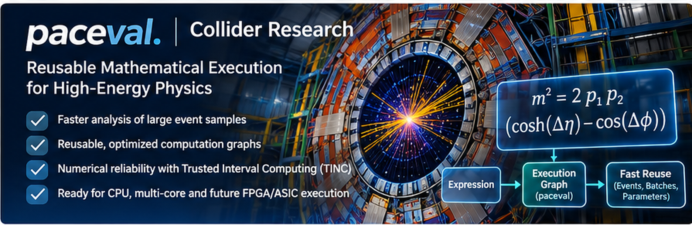
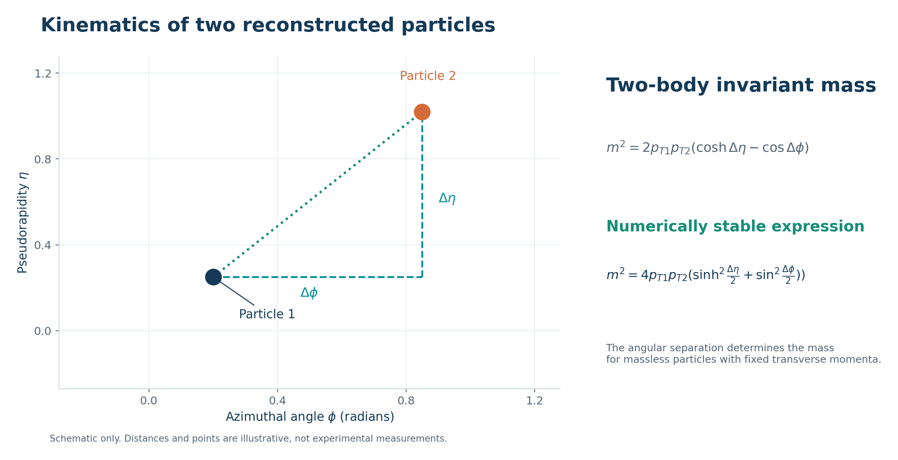
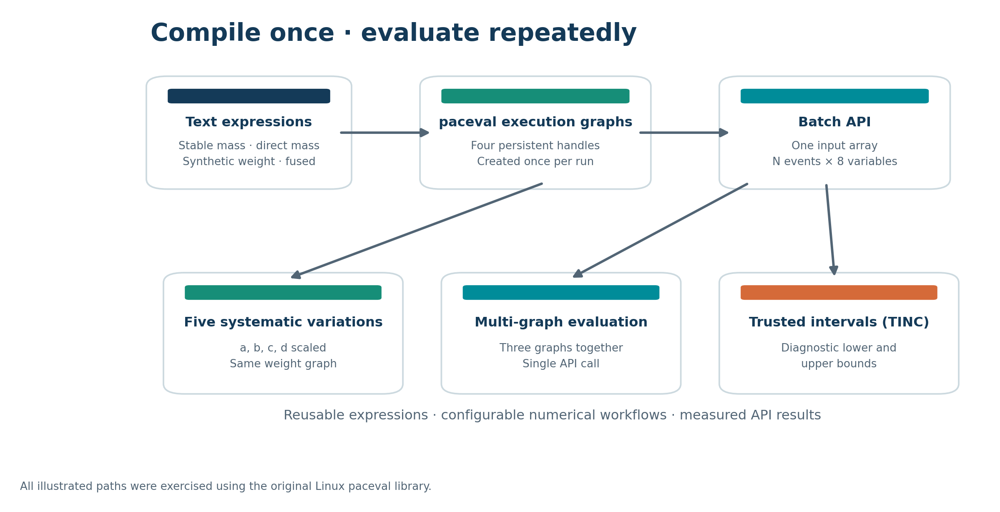
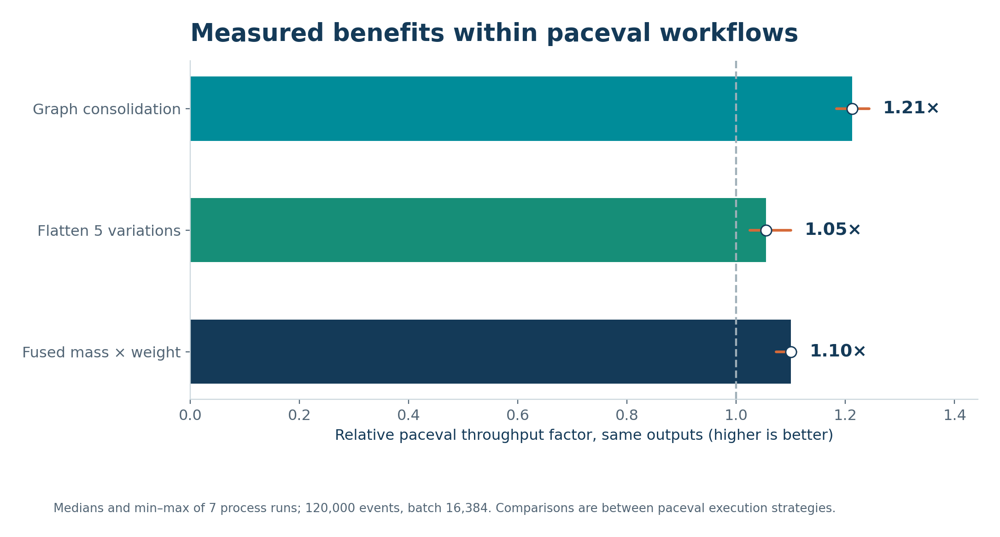
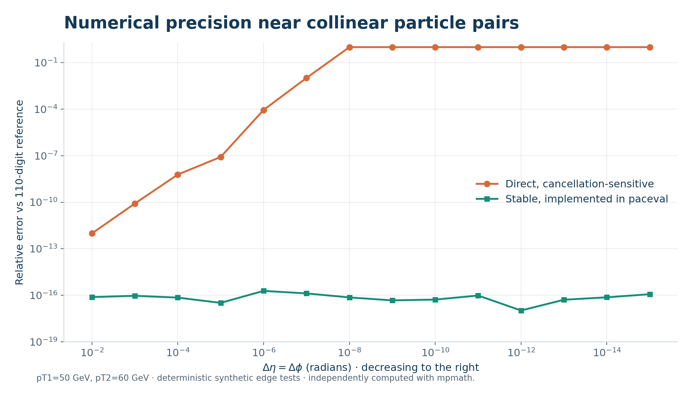
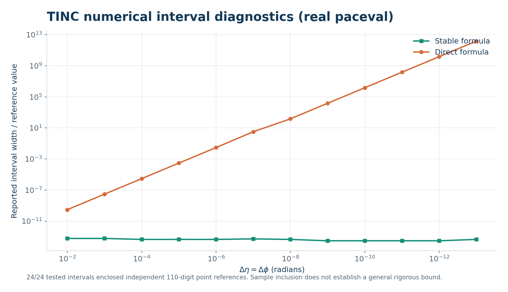
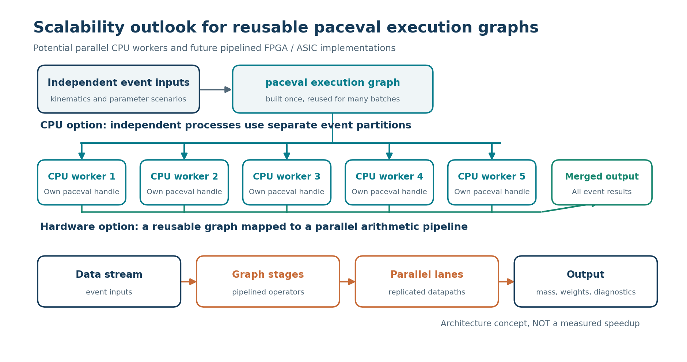
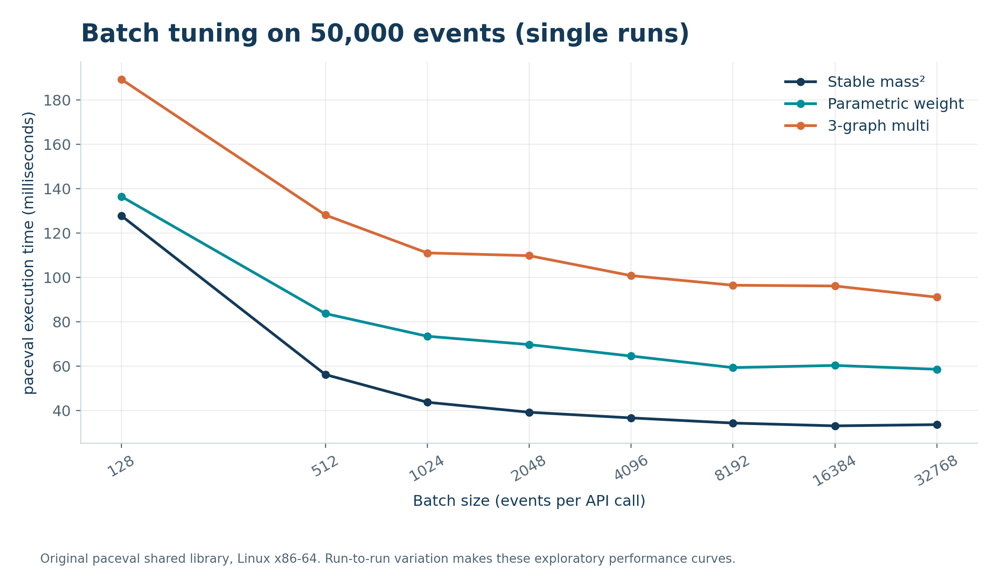

# Collider Research with paceval



*Concept illustration, not a CERN event display. Multi-core and FPGA/ASIC execution are future architecture options, not measured implementations.*

**Reusable mathematical execution graphs for collider-inspired calculations | C++ research demonstrator**  
**Verified on the original paceval Linux runtime | 10 November 2026**

This repository contains a compact, reproducible demonstration of **paceval** for repeated collider-kinematics calculations, parametrized event weights and numerical diagnostics. It includes the original C++ implementation, example inputs, concise measurement evidence, visual explanations, and one updated scientific white paper.

**[Read the scientific white paper (PDF)](paceval_Collider_Research_Whitepaper_EN.pdf)**



## What paceval actually computes

Four persistent mathematical graphs are created **once per program run**, then evaluated for many independent event inputs:

| Graph | Meaning | Concrete computation |
|:--|:--|:--|
| G1 | Direct massless two-particle invariant mass squared | `2*pt1*pt2*(cosh(deta)-cos(dphi))` |
| G2 | Numerically stable, equivalent invariant mass squared | `4*pt1*pt2*(sinh(deta/2)^2+sin(dphi/2)^2)` |
| G3 | Synthetic parameterized event weight | `W(pt1,pt2,deta,dphi,a,b,c,d)` |
| G4 | Fused stable mass squared × weight | `(G2)*(G3)` as a **single explicit expression** |

Two additional graphs enable **Trusted Interval Computing (TINC)** for both mass formulas. `G3` is reused across **five parameter variations** without rebuilding its graph. The weight is a synthetic workload, not a validated detector calibration.

paceval APIs actually executed: `pacevalLibrary_CreateComputation`, `pacevalLibrary_dGetComputationResultExt`, `pacevalLibrary_dGetMultipleComputationsResultsExt`, `pacevalLibrary_dGetComputationResult` (TINC), and the documented initialization, status and cleanup APIs. The correct paceval syntax for natural logarithm is `ln(...)`.



## Measured benefits of the paceval implementation

The **original Linux runtime** was tested on **120,000 deterministic synthetic events** (seed `20261110`) at batch size **16,384**, with **seven independent process runs**. Numbers are paired median ratios between alternative **paceval** execution strategies.

| Verified execution improvement | Median speed factor | Implementation |
|:--|--:|:--|
| Three graphs through one multi-graph API invocation | **1.21×** | `dGetMultipleComputationsResultsExt` |
| Fused mass and weight in one execution graph | **1.10×** | Persistent fused formula |
| Five parameter variations packed into larger input batches | **1.05×** | One reused weight handle; flattened events |

**Additional verification:** no correctness mismatches beyond the defined tolerances; **24/24** sampled TINC intervals enclosed independent 110-digit reference values. All timing inputs are preserved as compact [seven-run measurements](examples/benchmark_runs.csv) and a [summary](examples/benchmark_summary.csv).



The gain factors above measure **better use of paceval**, not an overall paceval-vs-native C++ acceleration. This distinction is important for scientific reproducibility.

## Numerical value in collider-inspired event analysis

Near-collinear particles can lead to cancellation in `cosh(deta)-cos(dphi)`. The stable equivalent avoids this particular subtraction. The source evaluates **both expressions with paceval**, compares them with native C++, and runs independent high-precision checks. A representative synthetic selection test identified eight threshold decisions that changed with the unstable formulation.





TINC was tested on 24 selected points; empirical enclosure is not a general formal proof of rigorous interval arithmetic. Source/reference data: [TINC samples](examples/tinc_samples.csv), [110-digit numerical samples](examples/high_precision_reference.csv).

## Measured environment and scalability outlook

The benchmark was executed on **Debian GNU/Linux 13 (trixie), Linux x86-64**, using a **KVM virtualized AMD EPYC 9V74** with **5 visible virtual CPUs**. The environment also reported a CPU quota corresponding to **4 CPU-equivalents** (`cpu.max: 400000 100000`). The C++ program was built with **GCC 14.2, C++17, `-O3`**; separate compilation checks used **Clang 17**. The paceval runtime hash is recorded in the white paper.

The present benchmark invokes evaluation **sequentially within one process**. Because collider-event batches and many parameter scenarios can be partitioned into independent work units, **multiple CPU workers on machines with more available cores offer a natural path to materially higher aggregate throughput**. This future multicore speedup was **not** measured here and is not implied by the five visible vCPUs.

The same explicit graphs are also promising candidates for **pipelined and replicated FPGA/ASIC mathematical hardware**. Hardware execution could significantly increase throughput when sufficient parallel data and suitable arithmetic resources are available; no FPGA/ASIC speed factor is claimed without implementing and measuring it.



An exploratory real-runtime batch sweep also showed substantial gains from fewer API calls with larger batches:



## Build and run (Linux x86-64)

The project builds with **C++17, GCC or Clang and CMake 3.12+**. The paceval Linux runtime is **not included** in this public-source package. Supply the original `libpaceval_linux_sharedLIB.so` from your authorized paceval installation as an **external file**; the application loads it dynamically with `dlopen`. ROOT is not needed for the supplied demonstration.

At the repository root, set the path to your own library (replace the placeholder with an actual **absolute** path):

```bash
export PACEVAL_LIB=/absolute/path/to/libpaceval_linux_sharedLIB.so
cmake -S src -B build -DCMAKE_BUILD_TYPE=Release -DPACEVAL_RUNTIME="$PACEVAL_LIB"
cmake --build build --parallel
ctest --test-dir build --output-on-failure
```

Providing `PACEVAL_RUNTIME` enables the second CTest case that runs the **real** paceval example. Without it, the code still builds and its native mathematical self-test runs; it cannot demonstrate real paceval performance until a runtime is supplied.

**Full synthetic study (120,000 deterministic events):**

```bash
mkdir -p out
./build/collider --library "$PACEVAL_LIB" --require-paceval \
  --events 120000 --batch 16384 --csv out/benchmark.csv
```

**Example event inputs:**

```bash
./build/collider --library "$PACEVAL_LIB" --require-paceval \
  --input-csv examples/example_events.csv --batch 16 \
  --csv out/example_results.csv
```

The CSV adapter accepts `pt1,pt2,deta,dphi` with optional `a,b,c,d`. `pt1` and `pt2` are in GeV and `dphi` is an azimuthal angle difference in radians. The supplied [four-column sample](examples/example_4col.csv) and [eight-column sample](examples/example_events.csv) require no ROOT installation.

**Independent 110-digit reference check** (requires `python3 -m pip install mpmath`):

```bash
python3 src/high_precision_reference.py \
  --tinc-csv examples/tinc_samples.csv --strict-tinc \
  --out out/precision_check.csv
```

**Repeat the real-runtime benchmark** (standard Python only):

```bash
python3 src/repeat_benchmarks.py \
  --exe build/collider --library "$PACEVAL_LIB" \
  --events 120000 --batch 16384 --repeats 7 --out out/repeats
```

The programs generate their own output CSV files under `out/` (not committed). Benchmark timing changes with the processor, concurrency, virtual-machine quota, numerical settings, and paceval runtime version; the original recorded run data remain in `examples/`.

## Repository contents

```text
README.md                                      Overview, figures and instructions
paceval_Collider_Research_Whitepaper_EN.pdf    Updated scientific white paper
src/CMakeLists.txt                             CMake configuration and CTest integration
src/collider.cpp                               Real paceval C++ demonstrator and native checks
src/high_precision_reference.py               Independent high-precision TINC audit
src/repeat_benchmarks.py                      Reproducible benchmark repetition runner
examples/                                     Event input CSVs and measured/referenced CSV evidence
figures/                                      Marketing hero and seven scientific charts/diagrams
```

### Scientific status and distribution

The demonstrator was previously executed with the **original paceval Linux runtime** and synthetic collider-inspired events, not CMS measurements. The source is independent of ROOT, though the CSV interface can accept preselected exported kinematics. This repository intentionally **does not redistribute the proprietary paceval shared library**. A compatible runtime is necessary for the paceval execution and performance portions of the program.

The five visible virtual CPUs reported for the original environment were not five active benchmark workers: all measured paceval timings use sequential calls. Future CPU-worker parallelism and FPGA/ASIC accelerators are architectural possibilities, not measured speed factors.

Further documentation: [paceval API](https://paceval.com/api/) · [CERN Open Data](https://opendata.cern.ch/) · [ROOT](https://root.cern.ch/).
