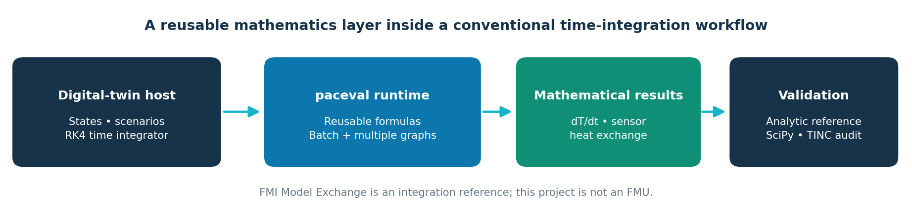
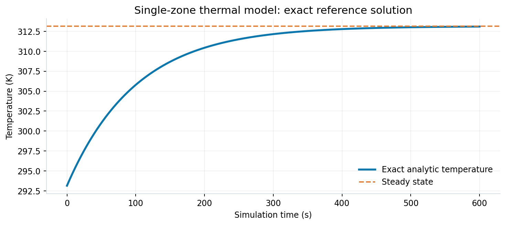
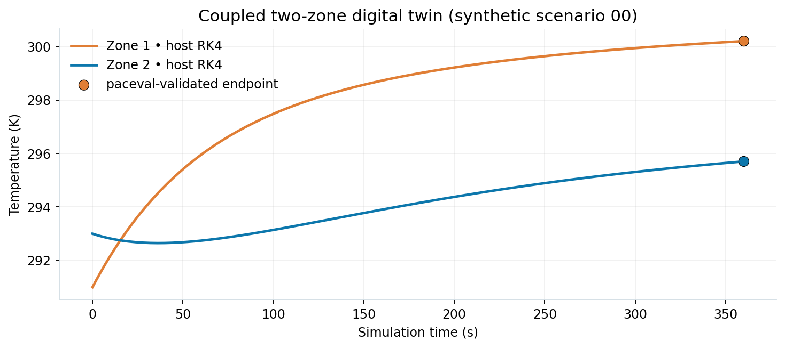
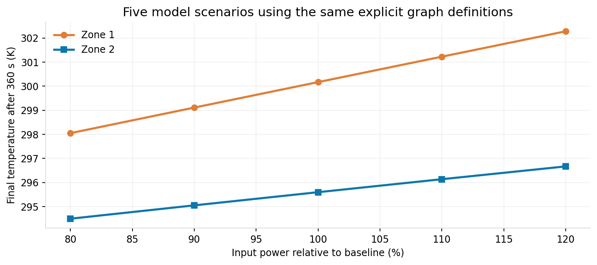
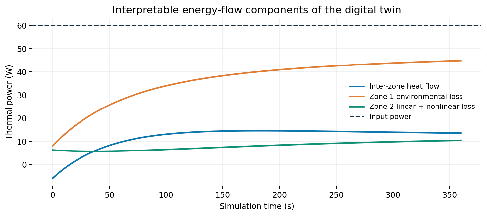
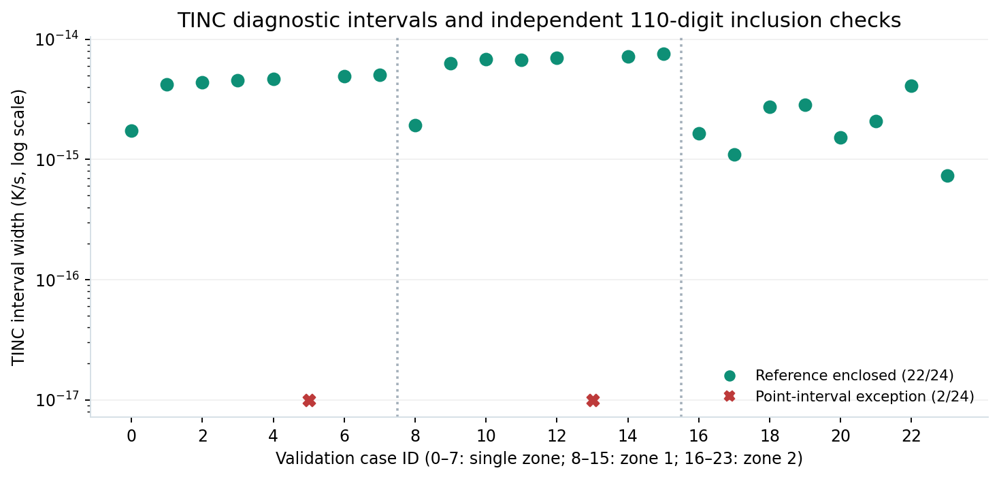

# paceval Digital Twins Research


**Programmable Mathematical Execution for Digital Twins**  
*An independently validated C++ feasibility demonstrator for reusable mathematical models in thermal simulation.*

This repository demonstrates a precisely defined mathematical role for the **paceval engine** within a synthetic thermal digital-twin workflow. It began with the analytically soluble single-zone model in the original research proposal and extends it to two coupled states, fourth-power nonlinear thermal loss, a virtual measurement channel, reusable scenario parameters and a recorded numerical audit.

The implementation is tested with the **actual Linux paceval runtime**, through the **official `paceval_main.h` and `paceval_main.cpp` source interface provided with SDK 4.25**. Five ordinary execution graphs and three additional TINC-enabled graphs are prepared once and reused. The host C++ program, *not paceval*, advances time with RK4, manages states and performs CSV I/O.

**Result:** the software use case was successfully implemented, executed, and checked against independent mathematics. This is not a hardware-device validation, FMI conformance claim, general TINC correctness proof, or claim of a speed advantage. All datasets are deterministic synthetic examples.

## Implemented mathematical models

**One-zone reference.** For thermal capacitance `C1 > 0`, conductance `h1 > 0`, input power `P` and ambient temperature `Ta`:

```text
C1 * dT1/dt = P - h1*(T1-Ta)
T1(t) = Ta + P/h1 + (T1(0)-Ta-P/h1) * exp(-h1*t/C1)
```

**Expanded two-zone thermal twin:**

```text
C1 * dT1/dt = P - k12*(T1-T2) - h1*(T1-Ta)
C2 * dT2/dt = k12*(T1-T2) - h2*(T2-Ta)
             - krad*((T2/300 K)^4 - (Ta/300 K)^4)
virtual_sensor = gain*T2 + offset
```

`T1`, `T2` and `Ta` are in kelvin, `C1`/`C2` in J/K, `k12`/`h1`/`h2` in W/K, and `P`/`krad` in W. The fourth-power heat term is a documented **synthetic surrogate**, not a calibrated device model. Energy balance is independently checked, including the cancellation of internal heat exchange between zones.



## What paceval actually computes

The application [**`src/digital_twin.cpp`**](src/digital_twin.cpp) includes [**`paceval_main.h`**](src/paceval_main.h) and uses the official API implemented by [**`paceval_main.cpp`**](src/paceval_main.cpp). Both C++ files are compiled by [**`src/CMakeLists.txt`**](src/CMakeLists.txt). The latter links the original vendor-supplied `libpaceval_linux_sharedLIB.so` **externally**, rather than redistributing it in this repository.

| Graphs | Responsibility | API path |
|---|---|---|
| 1 ordinary graph | One-zone model derivative | `paceval_dGetComputationResultExt` |
| 2 ordinary graphs | Coupled nonlinear two-zone derivatives | `paceval_dGetMultipleComputationsResultsExt` |
| 2 ordinary graphs | Virtual sensor and second-zone loss | `paceval_dGetMultipleComputationsResultsExt` |
| 3 TINC-enabled graphs | Recorded pointwise results and interval endpoints for the derivatives | `paceval_dGetComputationResult` |

The code calls `paceval_InitializeLibrary`, `paceval_CreateComputation`, `paceval_GetIsError`, `paceval_GetErrorInformation`, `paceval_DeleteComputation` and `paceval_FreeLibrary` to manage lifecycle and errors. It retains computation handles across all integration steps and five variations of the input parameters. Variables shared by all graphs are declared in a common 12-value order and passed in contiguous scenario-major arrays.

**The integration boundary is intentional:** C++ retains the model and physical units, deterministic scenario generation, fourth-order Runge–Kutta integration, state storage, parameter studies, input validation, energy bookkeeping and independent numerical checks. This arrangement is conceptually aligned with host-managed integration in [FMI 3.0.2 Model Exchange](https://fmi-standard.org/docs/3.0.2/), but **no FMU or FMI adapter is implemented**.

## Scientific validation

| Test | Verified outcome |
|---|---|
| Original paceval shared library, linked through the SDK adapter | All five ordinary and three TINC-enabled graphs were created and executed |
| 32 deterministic two-zone scenarios, 180 RK4 steps of 2 s each | Native-versus-paceval audit completed with zero configured tolerance violations |
| Five thermal parameter variations | Prepared graphs reused without re-parsing expressions |
| Analytical one-zone reference and physical energy-balance identity | Native self-tests passed |
| Independent adaptive SciPy DOP853 integration | Maximum final-state deviation ≈ **2.016 × 10⁻⁹ K** across 32 reference scenarios |
| Independent 110-digit audit of 24 pointwise TINC outputs | **22/24 intervals enclosed** the mathematical reference; **2 did not** |
| C++17 build with GCC 14.2 and Clang 17 | Both native and real-runtime CTest tests passed with each compiler |

**Important numerical qualification:** The two non-enclosing TINC intervals are reproducible point-valued outputs in the supplied [sample dataset](examples/tinc_samples.csv). They are not omitted or silently widened. The [110-digit reference checker](src/high_precision_reference.py) deliberately returns a **nonzero status** when it finds an enclosure failure. These cases do **not** invalidate the verified agreement of the thermal trajectories, but they mean that a general rigorous TINC inclusion guarantee is *not established* by this research.

## Scientific figures

**Analytical single-state temperature:**



**Two coupled thermal temperatures:**



**Five reused parameter sets:**



**Thermal energy-flow audit:**



**Pointwise numerical interval assessment:**



## Build and run on Linux

**Requirements:** C++17 compiler (GCC or Clang), CMake ≥3.16, a compatible **original** `libpaceval_linux_sharedLIB.so` provided separately under its own license. The source-level API is included as `src/paceval_main.h` + `src/paceval_main.cpp`; the vendor's compiled mathematics library is **not included**.

From the repository root, set the actual absolute path to the original runtime, then configure and build:

```bash
export PACEVAL_LIB=/absolute/path/to/libpaceval_linux_sharedLIB.so
cmake -S src -B build -DCMAKE_BUILD_TYPE=Release -DPACEVAL_RUNTIME="$PACEVAL_LIB"
cmake --build build -j
ctest --test-dir build --output-on-failure
```

Execute all 32 documented scenarios and write new CSV files into `build/`:

```bash
./build/digital_twin \
  --input-csv examples/scenarios.csv --scenarios 32 --steps 180 --dt 2 \
  --output-csv build/trajectories.csv --tinc-csv build/tinc_samples.csv
```

Run just the native equations and numerical self-tests with `./build/digital_twin --self-test`. **Even this target requires a successful build linked against the external paceval runtime**; it does not exercise graph evaluations. The full integration run exercises the real paceval API and cannot silently fall back to native output. There is no `--library` runtime switch: **the `.so` is specified at CMake configuration/link time**, by `PACEVAL_RUNTIME` or environment variable `PACEVAL_LIB`.

For independent numerical checks (requires Python 3 and the listed packages):

```bash
python3 -m pip install numpy scipy mpmath matplotlib
python3 src/validate_trajectories.py examples/scenarios.csv build/trajectories.csv
python3 src/high_precision_reference.py build/tinc_samples.csv
python3 src/make_figures.py
```

The trajectory checker should pass. The high-precision checker intentionally reports the two original TINC non-enclosures and exits with code 1; this is a **documented scientific result**, not a missing dependency. The figure generator uses the packaged synthetic CSV files and does not need the vendor binary.

## Minimal repository layout

```text
README.md
paceval_Digital_Twins_Whitepaper_EN.pdf
src/
  CMakeLists.txt
  digital_twin.cpp
  paceval_main.h            # supplied vendor SDK API declarations
  paceval_main.cpp          # supplied vendor SDK API implementation
  high_precision_reference.py
  validate_trajectories.py
  make_figures.py
examples/
  scenarios.csv
  trajectories.csv
  tinc_samples.csv
figures/
  00_digital_twin_hero.png
  01_execution_architecture.png
  02_single_zone_analytic.png
  03_two_zone_trajectory.png
  04_parameter_study.png
  05_thermal_energy_flows.png
  06_tinc_reference_audit.png
```

The original SDK files are reproduced with their copyright/AGPL comments. For the stand-alone folder layout, only the include path inside `paceval_main.cpp` was changed from `../source_public/inc/paceval_main.h` to `paceval_main.h`; both uploaded SDK sources were converted from Windows-1252 to UTF-8 for portable compilation. The mathematical API implementations and signatures were not reimplemented. Please review the **GNU Affero General Public License** notices in these source files and the terms of the separately obtained binary before redistribution; see the [official AGPL text](https://www.gnu.org/licenses/agpl-3.0.html).

## Research report and references

The full implementation rationale, equations, data provenance, limitations, and reproducibility protocol are described in the **[English Scientific White Paper](paceval_Digital_Twins_Whitepaper_EN.pdf)**. The conceptual source was the 4 November 2026 research proposal *Programmable Mathematical Execution for Digital Twins*.

External technical references: [paceval C/C++ API](https://paceval.com/api/) · [paceval GitHub SDK overview](https://github.com/paceval/paceval) · [FMI 3.0.2](https://fmi-standard.org/docs/3.0.2/) · [SciPy DOP853](https://docs.scipy.org/doc/scipy/reference/generated/scipy.integrate.solve_ivp.html).

Research contact: [paceval UG](https://paceval.com/) · [info@paceval.com](mailto:info@paceval.com)
