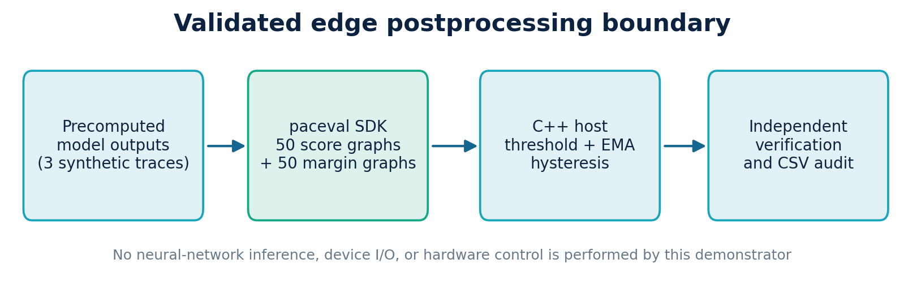
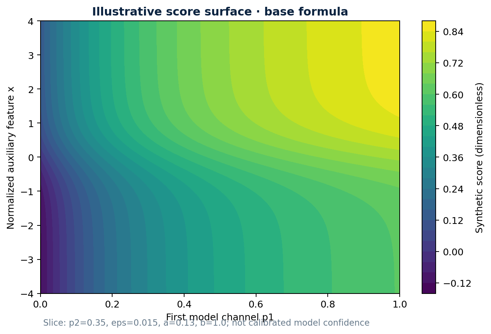
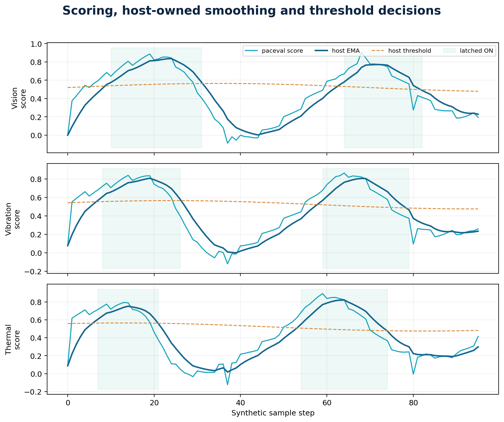
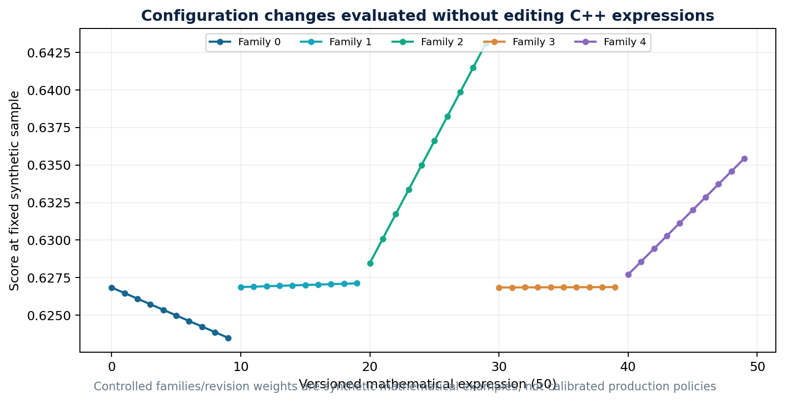
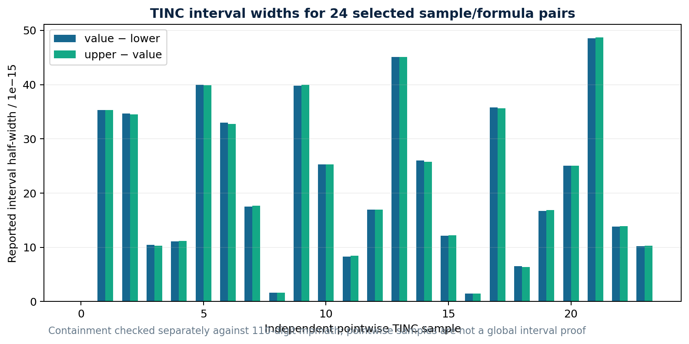
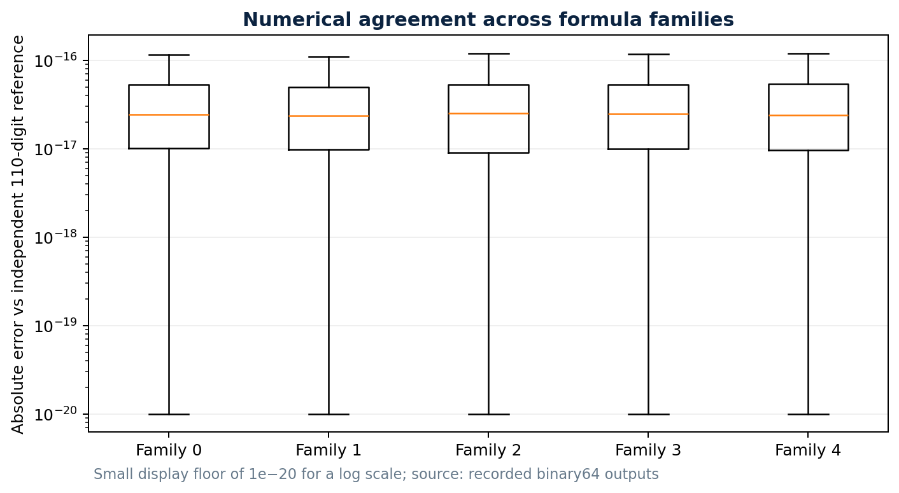
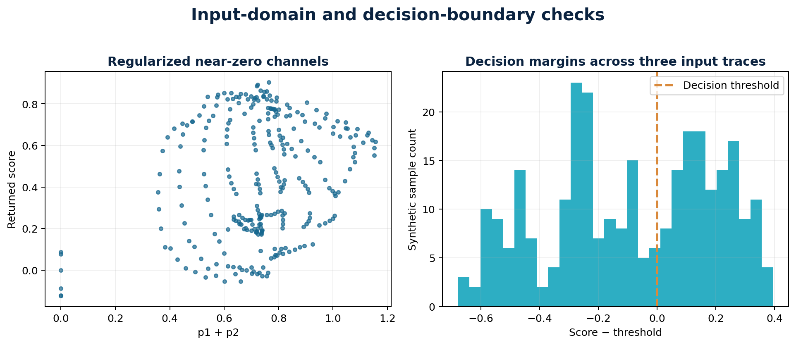

# paceval | Configurable Edge-AI Postprocessing Research


**A reproducible C++17 research demonstrator for configurable mathematical scoring after edge inference.** The original paceval 4.25 SDK (`paceval_main.h` and `paceval_main.cpp`) is compiled directly with the application and linked to a separately supplied Linux runtime. The program demonstrates that precomputed model outputs can be scored and assessed using persistent mathematical execution graphs, with independent native C++ and 110-digit numerical reference checks. This is an offline mathematical feasibility study, not an industrial deployment or a neural-network inference benchmark.

**[Scientific whitepaper (PDF)](paceval_Edge_AI_Postprocessing_Whitepaper_EN.pdf)** · [C++ implementation](src/edge_ai.cpp) · [CMake build](src/CMakeLists.txt) · [High-precision audit](src/validate_outputs.py)

## Verified research result

| Validated capability | Implementation / observed result |
|---|---|
| Three independently identified synthetic inference-output traces | Vision-inspection, vibration, and thermal examples; 96 samples each |
| Configurable mathematical rule registry | 50 persistent **score** expressions from five explicit families and ten version revisions |
| Corresponding threshold margin | 50 additional paceval expressions compute `score - threshold` |
| Additional numeric diagnostics | Two TINC-enabled graph handles and 24 independently audited pointwise intervals |
| Repeated evaluation | 14,400 synthetic score decisions, i.e. 28,800 score/margin mathematical results |
| Independent validation | All **28,800** results agree with 110-digit mathematical references within tolerance |
| TINC containment, selected pointwise samples | **24/24** independently verified on this input set; not a general interval certification |
| Formula update test | A changed version modifies exactly its own 288 results, leaving other versions unchanged |
| Batch-order regression | Complete results byte-identical at batch sizes 37 and 64 in the tested runtime |
| Build and memory checks | GCC 14.2, Clang 17, AddressSanitizer, UndefinedBehaviorSanitizer passed |

All percentages, latency comparisons, energy comparisons and extrapolated hardware claims are deliberately **excluded** from this report. The result is proof that the **defined mathematical pipeline was implemented and numerically verified** with paceval on the documented platform.

## What was implemented with paceval

The input to the demonstrator is a set of **already computed** two-channel inference outputs `p1`, `p2`, an auxiliary normalized feature `x`, and a quality indicator `quality`. The basic formula is taken from the supplied research proposal:

\[
s_0 = \frac{p_1}{p_1+p_2+\varepsilon} + a\tanh(bx).
\]

**The score is a synthetic scalar, not a calibrated probability.** The denominator regularizer `eps` is strictly positive and checked at input. Its purpose is numerical stability, not an assertion of model validity. Five controlled additional terms extend the reference rule with quality, channel difference, bounded feature magnitude, squared channel difference, and a smooth feature correction. A validated CSV manifest selects which family and coefficient each version uses.

The application creates **50 reusable score handles**, **50 threshold-margin handles**, and **two TINC handles** through `paceval_CreateComputation`. Batched, multi-graph evaluation uses `paceval_dGetMultipleComputationsResultsExt`, while `paceval_dGetComputationResult` retrieves selected interval-enabled results. Handles are reused across all sample batches and freed before `paceval_FreeLibrary`.

The **C++ host**, not paceval, owns CSV input validation, formula registry policy, temporal exponential smoothing, hysteresis and final symbolic alert decisions. No neural inference, NMS, device actuation, safety control, or model training is performed here.



## Input traces and versioning

The [three trace files](examples/trace_vision.csv) use the same schema: `trace_id,step,p1,p2,x,quality,a,b,eps,threshold`. Values are dimensionless and synthetic; `p1,p2` are bounded numeric model channels and **not** assumed to be complementary calibrated probabilities. The other traces are [vibration](examples/trace_vibration.csv) and [thermal](examples/trace_thermal.csv).

The [50-rule manifest](examples/formulas.csv) has `version_id,family,revision,weight`. Revision names are immutable identifiers within each run. This manifest supports controlled configuration **within five audited template families**, not an unrestricted expression language. A representative [modified manifest](examples/formulas_updated.csv) changes one version; both manifests are checked against the same independent mathematical oracle.

The host explicitly rejects missing/nonfinite/out-of-range inputs. For example, `p1` and `p2` lie in `[0,1]`, `x` in `[-4,4]`, `quality` in `[0,1]`, `eps` in `[0.001,0.05]` and `a,b,threshold` have documented numeric bounds in [the C++ source](src/edge_ai.cpp).



## Deterministic decisions and graph updates

A host-owned exponential moving average uses `EMA_ALPHA=0.25` and a symmetric `0.025` hysteresis band around each sample's threshold. The state belongs to a **(trace, formula-version)** pair and is reset for each new run; the score and margin themselves are evaluated by paceval. These decision rules are **illustrative postprocessing**, not a safety or product-quality decision rule.





## Independent numerical quality assurance

The application compares every paceval score and margin to an independently coded native C++ formula, with an explicit floating-point tolerance. [The Python verification script](src/validate_outputs.py) additionally recomputes all 28,800 results with `mpmath` at 110 decimal digits, checks the host's stateful EMA and latching decisions, and checks enclosure for 24 independent TINC sample evaluations.

**The TINC evidence is deliberately pointwise:** all 24 selected values were enclosed by the reported intervals. Finite test sets are not proof that all real-valued expressions, parameter ranges or future paceval builds receive rigorous enclosures.







## Build and run (Linux)

A compatible **original paceval Linux shared library** is required and is intentionally **not distributed** in this GitHub package. The SDK facade sources `src/paceval_main.h` and `src/paceval_main.cpp` are included, preserving their original AGPL notices. CMake is inside `src/` as requested.

```bash
cmake -S src -B build -DCMAKE_BUILD_TYPE=Release \
  -DPACEVAL_RUNTIME=/absolute/path/libpaceval_linux_sharedLIB.so
cmake --build build -j
ctest --test-dir build --output-on-failure

mkdir -p results
./build/edge_ai \
  --catalog examples/formulas.csv --traces examples \
  --limit 96 --batch 64 \
  --output results/scores.csv --tinc results/tinc_samples.csv

python3 -m pip install mpmath numpy matplotlib
python3 src/validate_outputs.py \
  --scores results/scores.csv --tinc results/tinc_samples.csv
```

To demonstrate one controlled formula update, switch to `--catalog examples/formulas_updated.csv`, save to different result filenames and re-run `validate_outputs.py`. To re-create the seven numbered figures from the **published unmodified reference CSV data**, run:

```bash
python3 src/make_figures.py --examples examples --figures figures
```

The outputs [scores.csv](examples/scores.csv) and [tinc_samples.csv](examples/tinc_samples.csv) included in `examples/` are actual outputs from the supplied runtime. They allow scientific checking without recompiling, while a fresh run still requires the original `.so`.

## Published project structure

```text
paceval_Edge_AI_Postprocessing/
├── README.md
├── paceval_Edge_AI_Postprocessing_Whitepaper_EN.pdf
├── .gitignore
├── src/
│   ├── CMakeLists.txt
│   ├── edge_ai.cpp
│   ├── paceval_main.h
│   ├── paceval_main.cpp
│   ├── validate_outputs.py
│   └── make_figures.py
├── examples/
│   ├── formulas.csv
│   ├── formulas_updated.csv
│   ├── trace_vision.csv
│   ├── trace_vibration.csv
│   ├── trace_thermal.csv
│   ├── scores.csv
│   └── tinc_samples.csv
└── figures/
    ├── 00_edge_ai_hero.png
    └── 01..07 scientific figures
```

## Reproduction environment and interpretation

The baseline run used Linux x86-64, GCC 14.2.0, the paceval SDK 4.25 interface and a shared runtime with SHA-256 `acf63a87df0ee822b467edbca887393d31ec0ea03562e1abf802d2512a5bfb12`. Clang 17 and compiler sanitizers were also used for testing. No quantitative throughput or timing claim is made; resource measurements and any integration into an actual edge device would be a separate study.

The source's C++17/API integration is portable in principle, but this repository's reproducibility evidence and CMake target specifically concern Linux with the supplied matching `.so`. Other compiler/runtime combinations require their own validation. The original vendor sources retain their AGPL header notices; no permission to redistribute the runtime is implied.

## Scientific framing and external background

This project advances the attached proposal *Configurable Edge-AI Postprocessing* from a hypothesis into a reproducible **mathematical feasibility demonstrator**, but does not establish actual detector accuracy, industrial compliance or neural-network speed improvements. Integrating a real ONNX Runtime, OpenVINO or LiteRT inference pipeline would require a frozen model output contract and externally collected validation data.

For postprocessing and embedded inference interfaces, see the following official or primary sources:

- [paceval C/C++ API documentation](https://paceval.com/api/)
- [OpenVINO 2026 preprocessing and postprocessing reference](https://docs.openvino.ai/2026/openvino-workflow/running-inference/optimize-inference/optimize-preprocessing/preprocessing-api-details.html)
- [ONNX Runtime deployment on mobile and edge devices](https://onnxruntime.ai/docs/tutorials/mobile/)
- [TensorFlow Lite object detection: score thresholds and result filtering](https://github.com/tensorflow/tensorflow/blob/master/tensorflow/lite/g3doc/examples/object_detection/overview.md)
- [NIST AI Risk Management Framework](https://www.nist.gov/itl/ai-risk-management-framework)

**Disclaimer:** All inference-output traces and rule families are synthetic. The artwork depicts a prospective use case, not an experiment performed with a real industrial device. This is an offline research demonstrator, not a certified decision or safety system.
