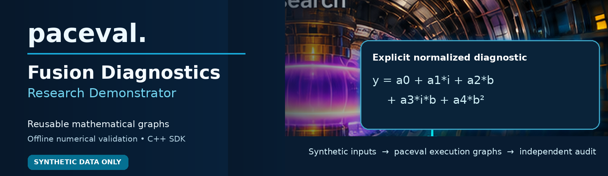
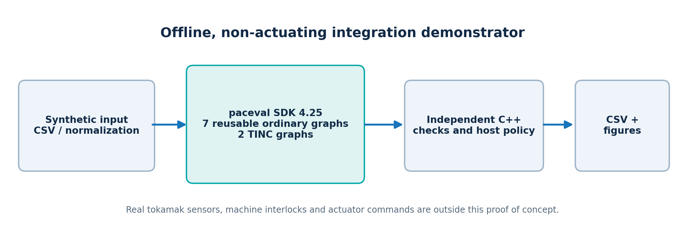
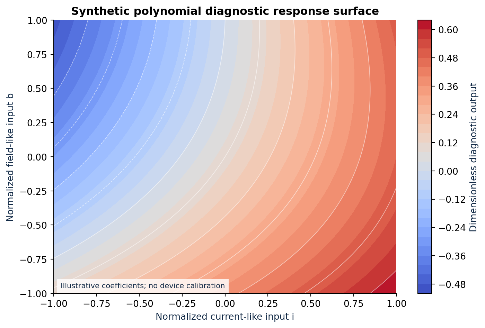
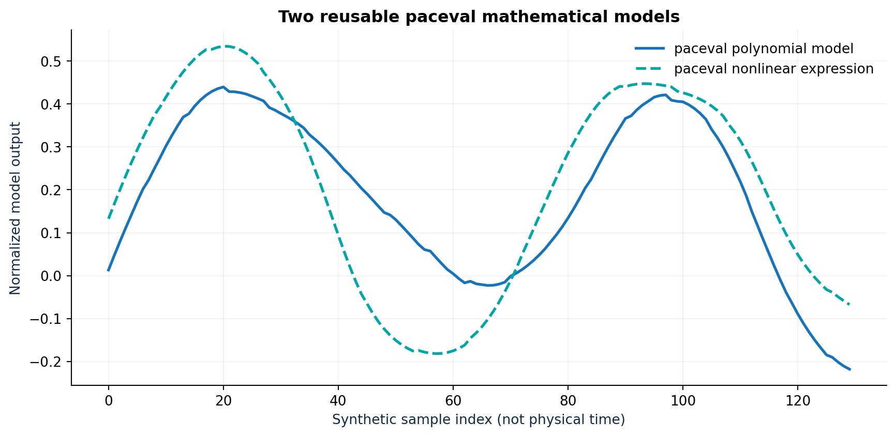
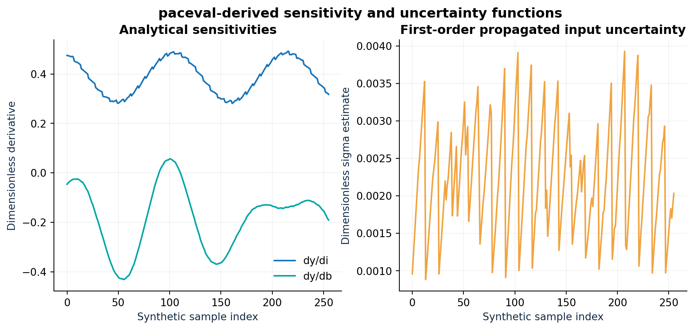
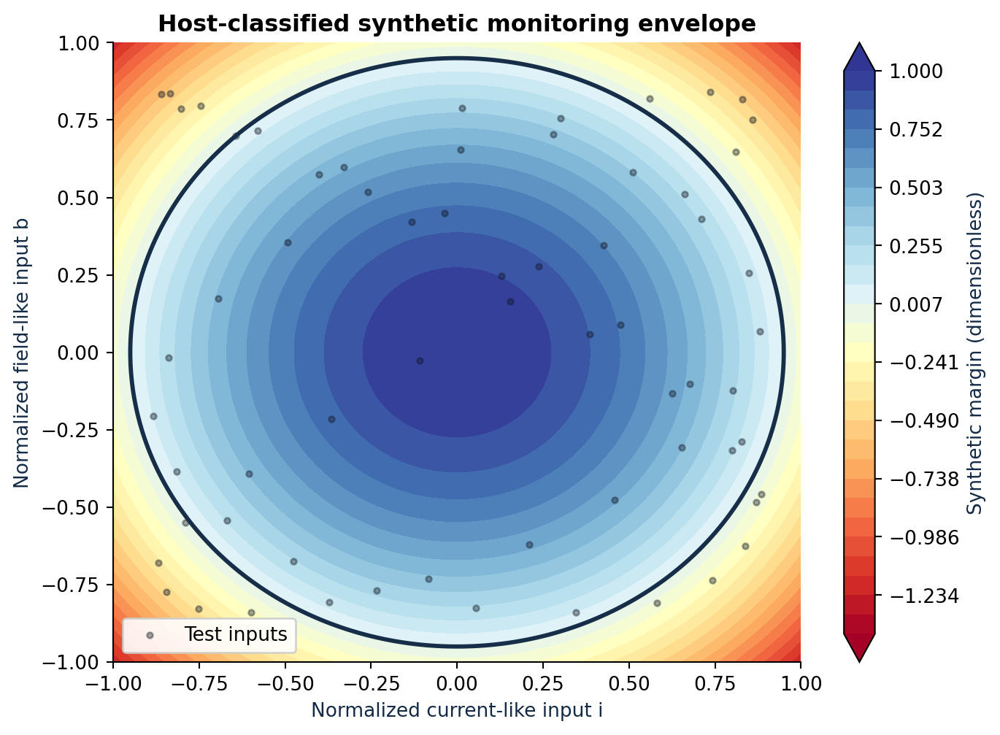
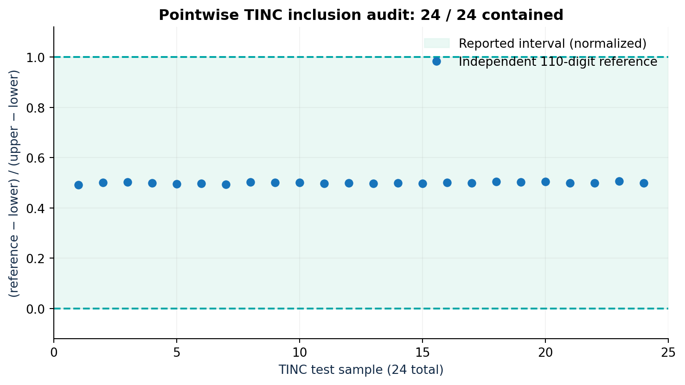

# paceval Fusion Diagnostics Research



**Reusable Mathematical Models for Fusion Diagnostics**  
*An implemented and independently validated C++ feasibility demonstrator using the original paceval SDK 4.25.*

This repository demonstrates that explicitly specified **diagnostic, model-checking and control-related mathematical functions** can be prepared as reusable **paceval execution graphs**, evaluated across many normalized input samples, and independently validated. It extends the [original short scientific proposal](paceval_Fusion_Diagnostics_Whitepaper_EN.pdf) from one illustrative polynomial to a focused **seven-function offline research demonstrator**.

**Verified scope:** seven ordinary paceval graphs, two additional TINC-enabled graphs, synthetic CSV input, graph reuse, batch and multi-graph evaluation, independent C++ comparisons, multiprecision references, numerical derivatives and simple host-owned envelope classification. All measurements and parameters are **synthetic and dimensionless**. No real tokamak data, plasma-physics calibration, hardware actuator interface or real-time control validation is claimed. No processor-speed comparison is presented.

## Implemented mathematical use cases

The input variables `i` and `b` represent normalized current-like and magnetic-field-like signals; they are **not calibrated plasma current or magnetic-field measurements**. The parameters `a*`, `b*`, `k`, `c`, `ilim`, `blim`, `kp`, and `kd` are similarly illustrative coefficients. The following functions are represented as persistent paceval graphs:

| Graph | Implemented mathematical purpose | Formula |
|---|---|---|
| 1 | Polynomial diagnostic response | `y = a0 + a1*i + a2*b + a3*i*b + a4*b^2` |
| 2 | Nonlinear response surrogate | `z = b0 + b1*tanh(k*i) + b2*exp(-c*b^2)` |
| 3 | Current-input sensitivity | `dy/di = a1 + a3*b` |
| 4 | Field-input sensitivity | `dy/db = a2 + a3*i + 2*a4*b` |
| 5 | First-order propagated uncertainty | `sigma_y = sqrt((dy/di)^2*si^2 + (dy/db)^2*sb^2)` |
| 6 | Synthetic monitoring margin | `m = 1 - (i/ilim)^2 - (b/blim)^2` |
| 7 | Non-actuating advisory expression | `u = kp*(target-y) - kd*di` |

The propagated uncertainty assumes small, independent input perturbations with standard deviations `si` and `sb`. The ellipse margin is **only a synthetic example** of a mathematical constraint, not a physically established operating boundary. `u` is an **offline numerical output only**: the program cannot command an actuator.



## What paceval actually implements

[`src/fusion.cpp`](src/fusion.cpp) uses the supplied [`paceval_main.h`](src/paceval_main.h) directly. [`src/paceval_main.cpp`](src/paceval_main.cpp), the vendor API forwarding implementation, is compiled with `fusion.cpp` by [`src/CMakeLists.txt`](src/CMakeLists.txt). CMake links an **externally supplied original** `libpaceval_linux_sharedLIB.so` at build time. Neither the `.so` nor a replacement mathematical runtime is bundled in this repository.

The real execution uses `paceval_InitializeLibrary`, `paceval_CreateComputation`, `paceval_dGetMultipleComputationsResultsExt` (seven graphs in one batch), `paceval_dGetComputationResult` (pointwise TINC outputs), `paceval_GetIsError`, `paceval_GetErrorInformation`, `paceval_DeleteComputation`, and `paceval_FreeLibrary`. The formula handles are created once, reused across batches and cleaned up before library shutdown using RAII. All graphs use the **same ordered 20-variable schema**, and the program correctly interprets paceval's graph-major output layout. All API and per-result errors are checked.

The **C++ host** remains responsible for domain checks, file handling, generating synthetic inputs, interpreting the illustrative margin, independent reference calculations and determining what constitutes a test failure. This is intentionally an **offline evaluation component**, rather than a substitute for plasma simulation or an experiment's safety control architecture.

## Reproducible scientific validation

| Check | Actual verified outcome |
|---|---|
| Original paceval SDK 4.25 source files and actual Linux runtime | 7 ordinary and 2 TINC graphs constructed and executed |
| 256 deterministically defined synthetic input rows | 1,792 outputs checked against independent native C++; no configured tolerance failures |
| Independent high-precision reference, 85 decimal digits | All 1,792 values and host classifications passed; largest absolute output difference about `1.99e-16` |
| Analytically derived gradients vs central finite differences | Native C++ self-tests passed |
| Original TINC outputs checked with 110 decimal digits | 24/24 **tested pointwise values** were enclosed by their reported intervals |
| C++17 compiler integration | GCC 14.2 and Clang 17: both automated tests passed |
| Instrumented C++ tests | AddressSanitizer / UndefinedBehaviorSanitizer passed (leak detection disabled for the external library test) |

The 24 TINC checks provide evidence for these **specific samples**, not a general certification of interval correctness. The numerical tests validate the implementation of the explicit mathematical models; real scientific or supervisory usefulness requires a fusion-domain partner to provide a physically calibrated expression and device-specific requirements.

## Scientific diagrams

**Synthetic polynomial surface:**



**Computed mathematical models across synthetic samples:**



**Sensitivity and input-uncertainty propagation:**



**Synthetic normalized monitoring envelope:**



**Independent TINC evaluation:**



## Build and run on Linux

Prerequisites: CMake ≥3.16, GCC or Clang supporting C++17, and a **compatible original Linux paceval shared library** under its own usage terms. `paceval_main.h` and `paceval_main.cpp` are already in `src/`; CMake must be supplied the *external vendor binary* when configuring.

```bash
export PACEVAL_LIB=/absolute/path/to/libpaceval_linux_sharedLIB.so
cmake -S src -B build -DCMAKE_BUILD_TYPE=Release -DPACEVAL_RUNTIME="$PACEVAL_LIB"
cmake --build build -j
ctest --test-dir build --output-on-failure
```

From the repository root, process all 256 committed synthetic samples and save reproducible CSV results:

```bash
./build/fusion --input-csv examples/sensors.csv --samples 256 --batch 32 \
  --output-csv build/evaluations.csv --tinc-csv build/tinc_samples.csv
```

The self-test can be run as `./build/fusion --self-test`. The main integration run **cannot silently fall back** to the native C++ implementation: paceval creation, evaluation and error checks must all succeed.

Independent multiprecision checks require Python 3 and `mpmath`:

```bash
python3 -m pip install mpmath
python3 src/validate_outputs.py examples/sensors.csv build/evaluations.csv
python3 src/high_precision_reference.py build/tinc_samples.csv
```

To regenerate the scientific plots, install `numpy`, `pandas`, `matplotlib` and `mpmath` and run [`src/make_figures.py`](src/make_figures.py). The marketing banner is a separately prepared illustrative design asset and is not a photograph of a specific tokamak experiment.

## Files in this repository

```text
README.md
paceval_Fusion_Diagnostics_Whitepaper_EN.pdf
.gitignore
src/
  CMakeLists.txt                 C++17 Linux build and CTest definitions
  fusion.cpp                     Main offline demonstrator, detailed comments
  paceval_main.h                 Vendor-supplied SDK declarations (AGPL)
  paceval_main.cpp               Vendor-supplied SDK forwarding source (AGPL)
  validate_outputs.py            Independent 85-digit mathematical audit
  high_precision_reference.py   Independent 110-digit TINC pointwise audit
  make_figures.py                Recreate scientific charts from CSVs
examples/
  sensors.csv                    256 synthetic normalized input rows
  evaluations.csv                Real paceval evaluation results
  tinc_samples.csv               Real paceval interval outputs
figures/
  00_fusion_research_hero.png
  01_architecture.png
  02_diagnostic_surface.png
  03_synthetic_model_series.png
  04_sensitivity_uncertainty.png
  05_synthetic_envelope.png
  06_tinc_reference_audit.png
```

The updated English [**scientific whitepaper**](paceval_Fusion_Diagnostics_Whitepaper_EN.pdf) is placed beside this README and explains the original proposal, expanded models, API architecture, independent checks, limitations and research outlook.

## Research context and responsible interpretation

In a real research facility, sensor preprocessing, real-time scheduling, machine interlocks, actuators and independently certified operational constraints remain in the established tokamak infrastructure. A possible future collaboration can substitute a **fusion-expert-defined explicit diagnostic expression**, validate it on approved recordings and consider an **isolated shadow-mode integration**, before any engineering discussion of physical deployment. Published magnetic-control research such as [Degrave et al., *Nature* (2022)](https://doi.org/10.1038/s41586-021-04301-9) provides broader context but **does not validate this synthetic model**. The [paceval C/C++ API](https://paceval.com/api/) describes the technical evaluation interfaces used here.

**Licensing:** The supplied `paceval_main.h` and `paceval_main.cpp` retain their GNU Affero General Public License notices. Their source text has been normalized to UTF-8 and the header include adapted to this standalone directory; no ABI declarations or mathematical behavior were altered. Check the AGPL requirements when redistributing these SDK source files, and the separate conditions applicable to the vendor runtime binary.

**Project scope:** Research feasibility and mathematical reproducibility, not real-time operational qualification. No hardware-throughput claim is made.
