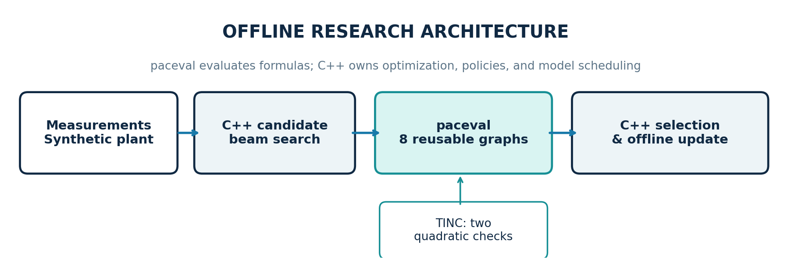
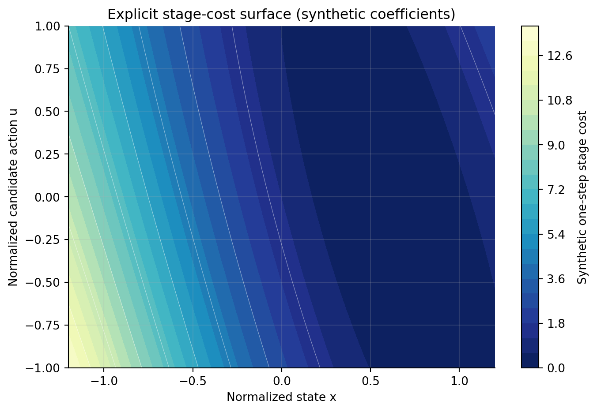
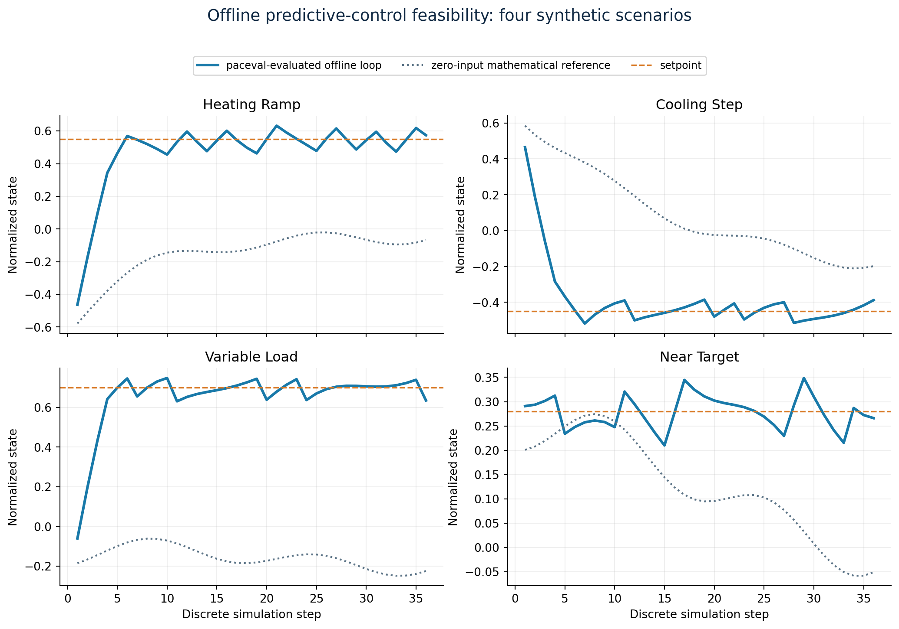
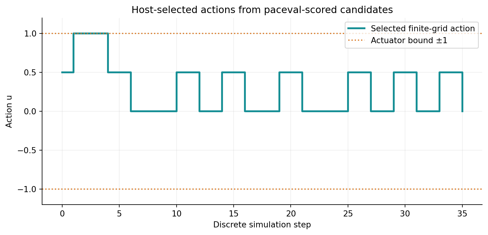
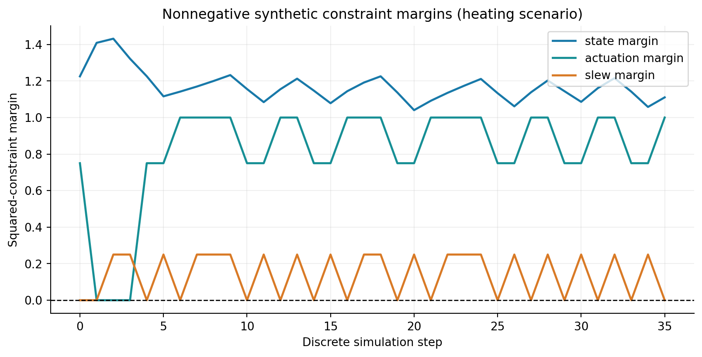
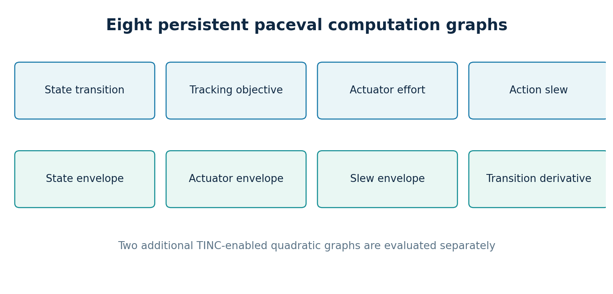
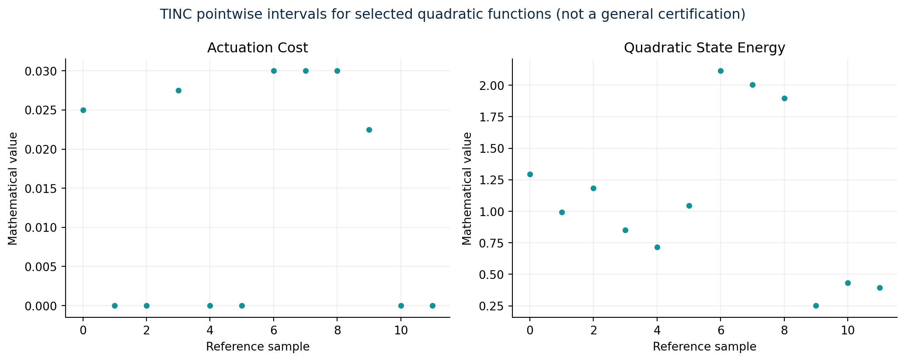

# paceval Industrial Control Research


**Reusable mathematical graphs for an offline model-predictive-control (MPC) feasibility demonstrator**  
*A reproducible C++17 study using the official paceval SDK 4.25 and an externally supplied original Linux runtime.*

This repository takes the selected objective and constraint functions from the original **“Programmable Mathematics for Industrial Real-Time Control”** research proposal and implements a larger but carefully scoped **synthetic offline MPC experiment**. It demonstrates repeatable graph construction, batch evaluation of model and cost expressions, finite-action candidate searches, receding-horizon closed-loop simulation, three explicit constraint checks, and independently verified numerical results.

**Scientific scope:** This is **not** a production controller, real-time-certified solver, safety system, industrial-device interface, or acados/CasADi integration. All quantities and operating limits are **synthetic and dimensionless**. No speedup, minimum execution time, hardware acceleration, or physical plant performance is claimed.

**[Read the updated scientific whitepaper (PDF)](paceval_Industrial_Control_Whitepaper_EN.pdf)**

## Verified use case

The host simulates the scalar nonlinear discrete-time process

\[
x_{k+1}=a x_k+b u_k+d_k+c x_k^3.
\]

At every control step, C++ builds a finite set of candidate action sequences over a short predictive horizon. It asks **paceval**, through its original C/C++ API, to evaluate **eight reusable mathematical graphs** for each candidate:

| Graph | Explicit expression | Function |
|---|---|---|
| 1 | `a*x+b*u+d+c*x^3` | Predicted next state |
| 2 | `q*(a*x+b*u+d+c*x^3-target)^2` | Predicted tracking cost |
| 3 | `ru*u^2` | Input effort |
| 4 | `slew*(u-uprev)^2` | Input-change cost |
| 5 | `xlim^2-(a*x+b*u+d+c*x^3)^2` | State-envelope margin |
| 6 | `umax^2-u^2` | Input-envelope margin |
| 7 | `dumax^2-(u-uprev)^2` | Input-rate envelope margin |
| 8 | `a+3*c*x^2` | Analytic transition sensitivity |

All eight mathematical expressions use the **same ordered 14-variable schema**, and all have persistent graph handles. For each set of candidate input rows the program calls `paceval_dGetMultipleComputationsResultsExt`. paceval returns the eight numerical quantities; the **C++ host** applies the admissibility policy, maintains the beam-search candidates, selects a control, advances the simulated process, and exports results. Two **additional TINC-enabled graphs** inspect the pointwise results of `ru*u^2` and `q*x^2`.



### Deliberate extension beyond a single cost function

The original proposal introduced the standard MPC objective \(\sum_k (x_k-x_{ref})^TQ(x_k-x_{ref}) + u_k^TRu_k\). This implementation adds a nonlinear transition, action-rate penalty, state/input/rate constraints, analytic sensitivity, four preset scenarios and an actual offline **receding-horizon loop**. The host optimizer uses a **finite control grid** `{-1, -0.5, 0, 0.5, 1}` and **beam search**, which is an intentionally simple *approximate* discrete optimizer. It is not a general nonlinear programming solver and does not guarantee a global optimum when pruning is active.



## Observed feasibility results with the original paceval runtime

The repository includes the exact synthetic inputs and saved outputs from the verified Linux run. No processor-speed comparison is made.

| Verification | Actual result |
|---|---|
| Direct original SDK API integration | `paceval_main.h` included; `paceval_main.cpp` compiled; external original Linux `.so` linked |
| Reusable mathematical execution | 8 normal graphs + 2 TINC graphs successfully created and evaluated |
| Offline control scenarios | 4 scenarios × 36 simulation steps (144 applied actions) |
| Independently checked batch outputs | **273,760** C++ comparisons, **zero** configured tolerance violations |
| Independent high-precision review | **1,152** saved outputs checked at 110 decimal digits, zero tolerance violations |
| Constraint checks on applied actions | **0 violations** of the synthetic state, input or rate envelopes |
| Pointwise TINC review | **24 of 24** tested intervals contained independent 110-digit values |
| Optimizer cross-check | The unpruned three-step candidate search matched an independent exhaustive native C++ oracle on all 4 scenarios |
| Compiler and diagnostic runs | GCC 14.2, Clang 17, AddressSanitizer and UndefinedBehaviorSanitizer: all three automated tests passed |

**Interpretation:** TINC results are pointwise sample evidence, not certification that every mathematical interval is rigorous in all inputs. The numerical reference checks prove this demonstrator's calculations on these test cases; they do **not** establish physical model validity or hard real-time feasibility.



The figures below show the **host-selected control actions** and the three paceval-evaluated nonnegative constraint margins in one published scenario.





## How paceval is integrated

[`src/industrial_control.cpp`](src/industrial_control.cpp) directly includes [`src/paceval_main.h`](src/paceval_main.h). The supplied official [`src/paceval_main.cpp`](src/paceval_main.cpp) is compiled as another translation unit using [`src/CMakeLists.txt`](src/CMakeLists.txt). This SDK forwarding layer **is not the mathematical runtime**: you must supply your own compatible original `libpaceval_linux_sharedLIB.so` at build time. The shared library is deliberately **not** stored in this repository.

The application calls `paceval_InitializeLibrary`, `paceval_CreateComputation`, `paceval_dGetMultipleComputationsResultsExt`, `paceval_dGetComputationResult`, `paceval_GetIsError`, `paceval_GetErrorInformation`, `paceval_DeleteComputation`, and `paceval_FreeLibrary`. Graph handles are released before library shutdown using C++ RAII. The source comments document the sample-major input layout, graph-major output layout, per-result error checks and exact role of the host.



## Build and reproduce on Linux

Requires a Linux C++17 compiler, CMake ≥3.16, and an **original compatible paceval SDK 4.25 Linux shared runtime** obtained separately from paceval. Run from the repository root:

```bash
export PACEVAL_LIB="/absolute/path/to/libpaceval_linux_sharedLIB.so"
cmake -S src -B build -DCMAKE_BUILD_TYPE=Release
cmake --build build -j
ctest --test-dir build --output-on-failure

./build/industrial_control \
  --scenarios-csv examples/scenarios.csv \
  --steps 36 --horizon 6 --beam 24 --batch 256 \
  --out-csv closed_loop.csv --tinc-csv tinc_samples.csv

python3 src/validate_outputs.py \
  --trajectory closed_loop.csv --tinc tinc_samples.csv
```

The Python high-precision review requires `mpmath`. Regenerating the charts additionally requires `matplotlib` and `numpy`:

```bash
python3 src/make_figures.py \
  --trajectory examples/closed_loop.csv --out-dir figures
```

For a native-only smoke test run `./build/industrial_control --self-test`; for the independently exhaustive three-step oracle test run `./build/industrial_control --oracle-test` (both require the built executable; the first does not initialize the paceval library).

## Project contents

```text
paceval_Industrial_Control/
├── README.md
├── paceval_Industrial_Control_Whitepaper_EN.pdf
├── .gitignore
├── src/
│   ├── CMakeLists.txt
│   ├── industrial_control.cpp
│   ├── paceval_main.h
│   ├── paceval_main.cpp
│   ├── validate_outputs.py
│   └── make_figures.py
├── examples/
│   ├── scenarios.csv
│   ├── closed_loop.csv
│   └── tinc_samples.csv
└── figures/
    ├── 00_industrial_control_hero.png
    ├── 01_execution_architecture.png
    ├── 02_stage_cost_surface.png
    ├── 03_closed_loop_trajectories.png
    ├── 04_control_actions.png
    ├── 05_constraint_margins.png
    ├── 06_tinc_pointwise.png
    └── 07_graph_inventory.png
```

The output CSV files are **synthetic generated examples**, not sensor records. The high-precision reference function uses exact binary representations recovered from the published 17-digit floating-point CSV. This avoids conflating decimal text rounding with the original floating-point inputs.



## Scientific boundary and next research stage

This demonstration keeps the host optimizer, sensor/plant model, actuator output and safety policy separate from paceval's explicit mathematical evaluation. Deployment in a real control loop would require a validated physical model, integration with established solvers such as **acados** or **CasADi**, derivative and optimizer interfaces, machine-specific safety design, timing and concurrency verification, and independent hardware-in-the-loop studies. FPGA/ASIC implementations are a possible research direction, **not a measured result of this software**.

Resources: [paceval C/C++ API](https://paceval.com/api/) · [acados documentation](https://docs.acados.org/) · [CasADi documentation](https://web.casadi.org/docs/).

**Licensing:** The official `paceval_main.h` and `paceval_main.cpp` contain their original copyright and AGPL notices. Verify the license obligations for redistribution or modification and obtain the separate runtime under its applicable terms. This repository does not bundle the `.so`.
