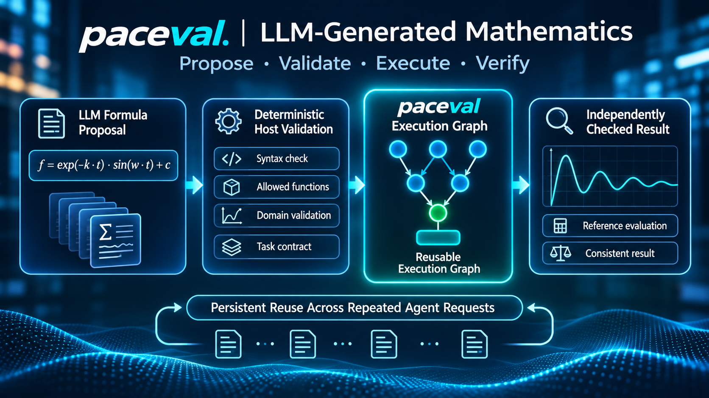
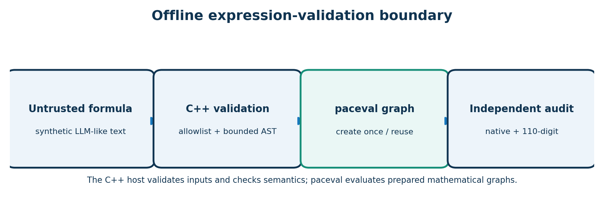
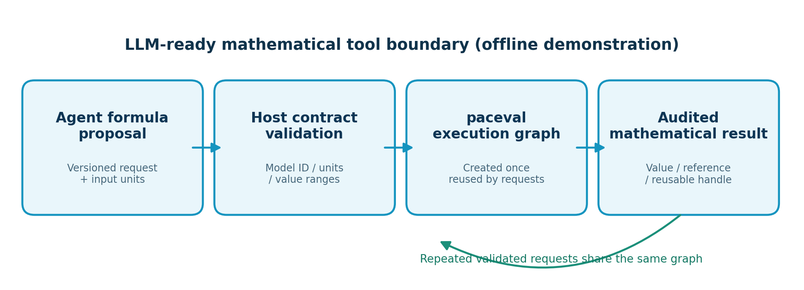
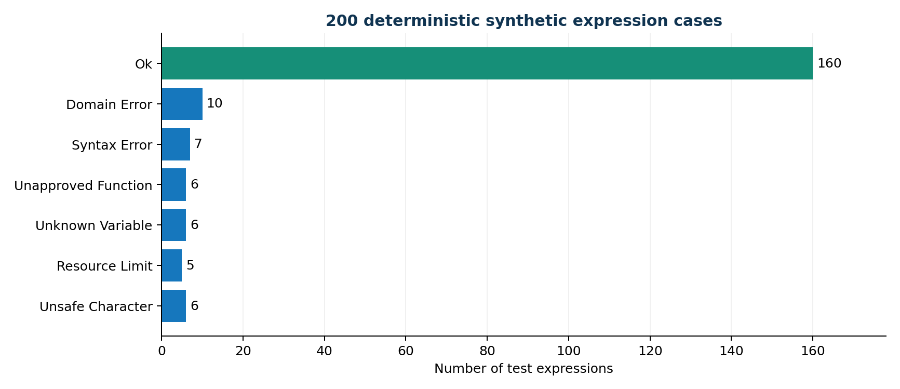
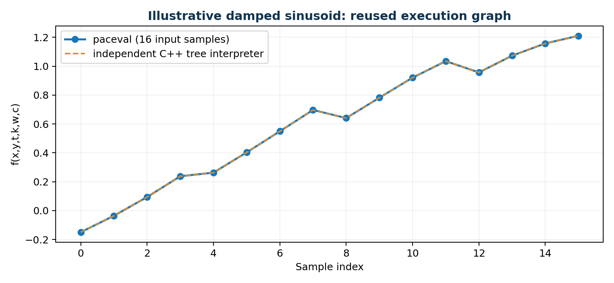
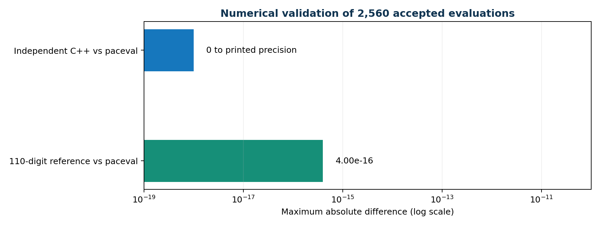
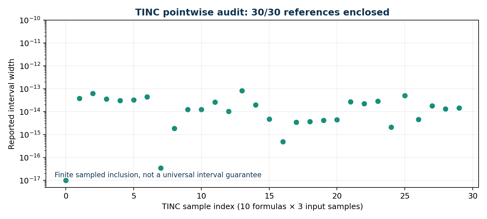
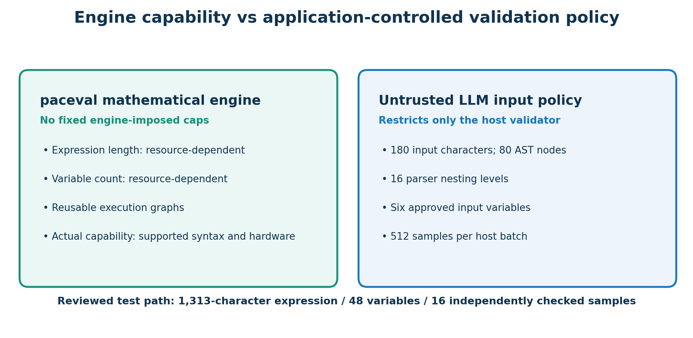
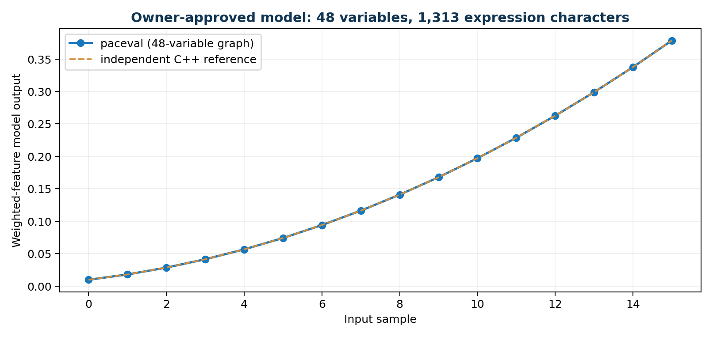

# paceval · Evaluating LLM-Generated Mathematical Expressions



**Validate · Execute · Verify**  
**C++17 · Linux · original paceval SDK 4.25 · reproducible offline research demonstrator**

This project provides a reproducible mathematical tool backend **for engineering and scientific LLM agents**. An agent can propose a mathematical expression, but a deterministic host validates the expression, binds it to an approved model contract, verifies units and parameter ranges, and then evaluates it using reusable paceval execution graphs. A new persistent local tool session reuses graphs across multiple structured requests. A separate corpus test audits the numerical engine with 110-digit reference arithmetic.

**Verified scalability extension:** An owner-reviewed formula with **1,313 characters and 48 variables** is now evaluated using the original paceval runtime and independently checked on 16 inputs with a 110-decimal arithmetic oracle. Its formula is longer than the untrusted-agent policy allows, by design. The existing LLM request-validation rules remain unchanged.

**Research outcome:** The demonstrator correctly evaluated **2,560 accepted mathematical instances**, rejected **40 deliberately invalid expressions**, and enclosed the independent 110-digit reference in **30 of 30 sampled paceval TINC intervals**. The evaluation ran against the original external paceval Linux library. An additional nine-request **LLM-oriented contract workflow** accepted five valid proposals, rejected four mismatches, and demonstrated actual cross-request graph reuse. Both test collections are deterministic; a live LLM is not included. No speed comparisons are presented.

**[Read the scientific whitepaper (PDF)](paceval_LLM_Math_Expressions_Whitepaper_EN.pdf)**

## Use case and execution boundary

An LLM's strongest role here is to **propose a candidate formula and parameters**. The host retains responsibility for deciding which mathematical model is approved, whether the declared units match its contract and whether values lie in the operating domain. Only validated expressions reach paceval. The model contracts are exact, versioned examples, not automatic scientific interpretation of arbitrary LLM output.





| Responsibility | Implementation |
|---|---|
| Formulas to exercise | Deterministically generated *LLM-like* expression corpus in [`examples/expressions.csv`](examples/expressions.csv) |
| Untrusted agent validation | A bounded, independent C++ AST and explicit allowed functions and symbols; **these bounds are application policy, not paceval engine limits** |
| Input envelope and numeric domains | Finite bounded values, guarded division, logarithm, square root, and exponential in the host |
| Mathematical evaluation | Original [`paceval_main.h`](src/paceval_main.h) and [`paceval_main.cpp`](src/paceval_main.cpp), linked against a separately provided Linux `.so` |
| Graph reuse and batches | 160 accepted formula graphs, each reused for 16 input samples, through `paceval_dGetComputationResultExt` |
| Interval investigation | 10 separate TINC-enabled graphs, assessed at 3 input points each |
| Independent checks | C++ AST evaluator and [`src/high_precision_reference.py`](src/high_precision_reference.py), using `mpmath` at 110 decimal digits |
| Original single-call tool interface | [`src/agent_tool_adapter.py`](src/agent_tool_adapter.py), an offline JSONL adapter for individual formulas |
| **LLM-oriented contract workflow** | [`src/llm_contract_adapter.py`](src/llm_contract_adapter.py), with model identity, dimensional unit labels, bounded parameters, and persistent graph reuse via `--stream` |
| Contract regression test | [`src/validate_llm_workflow.py`](src/validate_llm_workflow.py): five valid and four deliberately invalid proposal cases |
| Owner-approved larger model | [`examples/approved_48_variable_model.txt`](examples/approved_48_variable_model.txt): exact reviewed expression, 48 variables and 1,313 formula characters; 16 reused input sets |
| Large-model numerical audit | [`src/validate_approved_model.py`](src/validate_approved_model.py): independent 110-decimal reference and rejection of altered/untrusted models |

## Results from the actual Linux runtime

The **200-case corpus** consists of 160 admissible formula variants from 10 explicitly specified mathematical families, and 40 adversarial/invalid cases designed to exercise syntax, symbols, functions, resources and sampled domains. This is not an independently sampled LLM benchmark.

| Check | Verified result |
|---|---|
| Valid formula proposals | 160 / 160 accepted |
| Deliberately invalid proposals | 40 / 40 rejected with the expected category |
| Repeated formula evaluations | 160 × 16 = **2,560** |
| Results outside the declared numerical tolerance | **0** |
| Independent high-precision audit | **2,560 / 2,560 passed**, max absolute difference approximately 4.0 × 10⁻¹⁶ |
| TINC interval samples enclosing the reference | **30 / 30**, sampled only |
| Automated CTest checks | **7 / 7 passed** with GCC, including independent approved-model and policy checks; also exercised with Clang and sanitizers |
| Batch size reproducibility | Full CSV outputs identical for batch sizes 1, 37 and 512 |









**Scope of the numerical audit:** 30 fixed TINC intervals were compared with independent high-precision values and all 30 contained their corresponding reference. The contract workflow adds explicit unit labels and approved model identities; its declared constraints apply to the tested requests, not to arbitrary scientific equations.

## paceval engine capabilities versus application policy

The official [paceval developer documentation](https://paceval.com/developers/) and [Product Brief](https://paceval.com/product-brief/) state that the engine does **not impose fixed limits on expression length or variable count**. Actual practical limits are set by available memory, computing resources, supported mathematical syntax, and the environment. This is an architectural property described by the vendor, **not** a claim of infinite hardware resources or evidence that every arbitrary formula is well-conditioned.

**The 180-character, 80-AST-node, 16-level, six-variable and 512-sample limits shown below belong solely to this demonstrator's untrusted LLM input policy.** They protect an offline experimental interface exposed to potentially unreviewed expression text. They do not describe what `paceval_CreateComputation` supports.



The project now tests an entirely separate **owner-approved mathematical model**. The reviewed manifest must match a versioned formula generated by the host source exactly, preventing callers from presenting arbitrary untrusted formulas as approved. The original paceval C/C++ API receives a dynamic variable list with 48 variables. The one-time graph is evaluated for 16 different sets of input values. This illustrates more complex calculations without relaxing any agent-facing validation.

| Path | Mathematical expression | Host safeguards | Verified |
|---|---|---|---|
| Untrusted LLM proposals | Up to 180 characters; six allowlisted variables | Independent AST, function/symbol whitelist, numeric checks | 200-case corpus and nine contract requests |
| Owner-approved model `weighted_features_v1` | **1,313 characters; 48 distinct variables** | Exact versioned manifest match, finite inputs, independently audited result | **16/16** values within tolerance against 110-decimal arithmetic |
| paceval engine, in general | No fixed engine-imposed formula-length or variable-count cap according to its documentation | Practical limits depend on resources and supported syntax | Not a claim of exhaustive large-model coverage |



The approved example uses a transparent weighted linear/quadratic sum, not a physically validated machine-learning model. It is a deterministic capability and integration test. A different application-specific model would require its own separate review, resource policy, domain specification and scientific reference.

**Try the longer model from the repository root:**

```bash
./build/llm_math \
  --approved-model examples/approved_48_variable_model.txt \
  --approved-output build/approved_large_model_results.csv
python3 src/validate_approved_model.py \
  --binary build/llm_math \
  --manifest examples/approved_48_variable_model.txt
```

The test also deliberately modifies the reviewed manifest and verifies that the modified model is rejected. It additionally feeds the large expression to the **untrusted** interface and confirms that its 180-character policy still rejects it. No bypass is made available to the JSONL agent adapter.

## Build on Linux

**Prerequisites:** Linux x86-64, GCC or Clang with C++17, CMake >= 3.16, and a compatible original paceval Linux shared library. The runtime `.so` is **not** included in this public package. `paceval_main.h` and `paceval_main.cpp` are included from the original paceval SDK and retain their upstream notices.

From the repository root:

```bash
export PACEVAL_LIB=/absolute/path/to/libpaceval_linux_sharedLIB.so
cmake -S src -B build -DCMAKE_BUILD_TYPE=Release -DPACEVAL_RUNTIME="$PACEVAL_LIB"
cmake --build build -j
ctest --test-dir build --output-on-failure
```

**Run the full corpus** (the executable reads the included 200-case dataset and 16-point sweep):

```bash
./build/llm_math \
  --cases examples/expressions.csv \
  --sweep examples/sweep.csv \
  --batch 37 \
  --output build/evaluation.csv \
  --tinc build/tinc_samples.csv
```

**Independent 110-digit audit:**

```bash
python3 -m pip install mpmath
python3 src/high_precision_reference.py \
  --cases examples/expressions.csv \
  --sweep examples/sweep.csv \
  --results build/evaluation.csv \
  --tinc build/tinc_samples.csv \
  --summary build/validation_summary.json
```

**Single checked formula, for testing an agent-like request:**

```bash
./build/llm_math \
  --formula 'exp(-k*t)*sin(w*t)+c' \
  --values '0.2,-0.1,0.5,0.3,1.2,0.1'
```

**Offline JSONL tool-call adapter** (requires Python 3, no Python web or LLM dependencies):

```bash
python3 src/agent_tool_adapter.py \
  --binary build/llm_math \
  --input examples/tool_calls.jsonl \
  --output build/tool_responses.jsonl
```

The illustrative [tool schema](examples/tool_schema.json) corresponds to the input shape, but the adapter is **not** an implementation of the MCP server protocol. The C++ backend is spawned without using a shell. The example [requests](examples/tool_calls.jsonl) yield [responses](examples/tool_responses.jsonl) showing valid execution and rejected invalid operations.

## LLM-agent workflow: validated proposals and persistent graph reuse

A practical agent integration separates **model proposal** from **execution authority**. The new offline adapter accepts structured formula proposals and checks each request against a reviewed model contract. Two illustrative contract IDs are included: `damped_signal_v1` and `harmonic_signal_v1`. Their formulas use the same physical unit convention (`t` in seconds; `k` and `w` in inverse seconds; `x`, `y`, and `c` dimensionless). This is contract-level unit verification, not a general-purpose symbolic dimensional-analysis engine.

```json
{
  "request_id":"approved_first",
  "contract_id":"damped_signal_v1",
  "expression":"exp(-k*t)*sin(w*t)+c",
  "units":{"x":"1","y":"1","t":"s","k":"1/s","w":"1/s","c":"1"},
  "variables":{"x":0.2,"y":-0.1,"t":0.5,"k":0.3,"w":1.2,"c":0.1}
}
```

The same C++ process stays active while the adapter submits multiple approved requests. A `reused_graph` field reveals whether an existing paceval handle was used. Incorrect units, formulas inconsistent with the selected contract, out-of-range parameters, and unknown contract IDs are rejected **before** creating a paceval graph.

```bash
python3 src/llm_contract_adapter.py \
  --binary build/llm_math \
  --input examples/llm_proposals.jsonl \
  --output build/llm_responses.jsonl
```

| Workflow test | Observed outcome |
|---|---|
| Structured sample requests | 9 |
| Correctly evaluated | 5 |
| Rejected for model, units, domain or unknown contract | 4 |
| Cross-request reuse of existing graph | Confirmed for both model contracts |
| Independently checked numerical results | All 5 accepted requests |

The published [contract tool schema](examples/llm_contract_schema.json), [proposal set](examples/llm_proposals.jsonl) and [verified responses](examples/llm_responses.jsonl) make this reproducible. Use `ctest --test-dir build --output-on-failure` to run the contract regression, numerical corpus checks, and reviewed-model tests together. The adapter is an **offline structured tool component**; connection to a particular LLM provider and a real MCP server are separate integration tasks.

## Validation policy

The [engine-versus-policy diagram](figures/06_validation_policy.png) above distinguishes this host-level screening from the mathematical engine. In the **untrusted LLM interface only**, the host accepts the variables `x y t k w c`, arithmetic `+ - * /`, powers 2 and 3, and the functions `sin`, `cos`, `exp`, `ln`, `sqrt`, and `tanh`. Its **application-specific** resource policy enforces **180 expression characters**, **80 AST nodes**, **16 recursive levels**, and a host batch size of **512**. The owner-approved model path uses 48 named inputs and is deliberately independent of these policy values. The fixed sweep exercises bounded finite inputs. Invalid samples return explicit statuses such as `SYNTAX_ERROR`, `UNKNOWN_VARIABLE`, `UNAPPROVED_FUNCTION`, `UNSAFE_CHARACTER`, `RESOURCE_LIMIT`, and `DOMAIN_ERROR`.

The exact unit signatures in the approved model contracts are checked; arbitrary formula unit inference is not implemented. A production agent integration additionally needs isolated execution, authentication, quotas, and reviewed permissions. Here the focus is an independently testable mathematical tool boundary.

## Repository files

| Path | Purpose |
|---|---|
| [`src/llm_math.cpp`](src/llm_math.cpp) | Extensively commented C++ validator, independent AST interpreter, paceval SDK integration and CLI |
| [`src/paceval_main.h`](src/paceval_main.h) and [`src/paceval_main.cpp`](src/paceval_main.cpp) | Original SDK API declaration and implementation; the external library is linked, not bundled |
| [`src/CMakeLists.txt`](src/CMakeLists.txt) | Linux build, runtime library discovery and seven automated tests |
| [`src/high_precision_reference.py`](src/high_precision_reference.py) | Independent mpmath audit at 110 decimal digits |
| [`src/agent_tool_adapter.py`](src/agent_tool_adapter.py) | Original offline individual-expression adapter |
| [`src/llm_contract_adapter.py`](src/llm_contract_adapter.py) | Versioned model-contract and unit-signature verification; persistent local C++ execution |
| [`src/validate_llm_workflow.py`](src/validate_llm_workflow.py) | Automated end-to-end contract/regression test |
| [`src/validate_approved_model.py`](src/validate_approved_model.py) | Independent 110-decimal reference and authorization-boundary regression for a long formula |
| [`examples/approved_48_variable_model.txt`](examples/approved_48_variable_model.txt), [`examples/approved_large_model_results.csv`](examples/approved_large_model_results.csv) | Versioned 48-variable formula and audited results |
| [`figures/08_approved_large_model.png`](figures/08_approved_large_model.png) | Verified long-expression numerical study |
| [`src/make_figures.py`](src/make_figures.py) | Recreate six scientific diagrams (requires NumPy and Matplotlib) |
| [`examples/expressions.csv`](examples/expressions.csv), [`examples/sweep.csv`](examples/sweep.csv) | Reproducible mathematical corpus and input sweep |
| [`examples/evaluation.csv`](examples/evaluation.csv), [`examples/tinc_samples.csv`](examples/tinc_samples.csv), [`examples/validation_summary.json`](examples/validation_summary.json) | Published run outputs and independent audit |
| [`examples/tool_schema.json`](examples/tool_schema.json), [`examples/tool_calls.jsonl`](examples/tool_calls.jsonl), [`examples/tool_responses.jsonl`](examples/tool_responses.jsonl) | Original open-formula tool schema and sample calls |
| [`examples/llm_contract_schema.json`](examples/llm_contract_schema.json), [`examples/llm_proposals.jsonl`](examples/llm_proposals.jsonl), [`examples/llm_responses.jsonl`](examples/llm_responses.jsonl) | Reviewed contract schema, agent-like proposals, and audited tool responses |
| [`figures/07_llm_contract_reuse.png`](figures/07_llm_contract_reuse.png) | Validated model-contract workflow and graph lifetime |
| [`paceval_LLM_Math_Expressions_Whitepaper_EN.pdf`](paceval_LLM_Math_Expressions_Whitepaper_EN.pdf) | Scientific background, methods, results and limits |

To regenerate the scientific figures after reproducing data, install NumPy and Matplotlib and run `python3 src/make_figures.py --root .` from the repository root.

## Sources and scientific interpretation

This implementation is derived from the research idea in *WP_003: Evaluating LLM-Generated Mathematical Expressions*. It also uses contemporary public integration and security guidance:

- [paceval public API](https://paceval.com/api/), [official developer explanation of expression length and variable count](https://paceval.com/developers/), and [Product Brief](https://paceval.com/product-brief/)
- [Model Context Protocol: tools specification](https://modelcontextprotocol.io/specification/2026-07-28/server/tools)
- [OWASP: LLM Prompt Injection Prevention Cheat Sheet](https://cheatsheetseries.owasp.org/cheatsheets/LLM_Prompt_Injection_Prevention_Cheat_Sheet.html)
- [NIST Generative AI Profile (AI 600-1)](https://www.nist.gov/publications/artificial-intelligence-risk-management-framework-generative-artificial-intelligence)

The demonstrated result is a **working, reusable mathematical evaluation component for structured LLM tool proposals**, plus a real, independently audited **1,313-character, 48-variable** reviewed-model computation. Scientific model approval remains a separate engineering responsibility. External libraries must be licensed and provided separately; preserve the notices in the included SDK sources when redistributing them.
