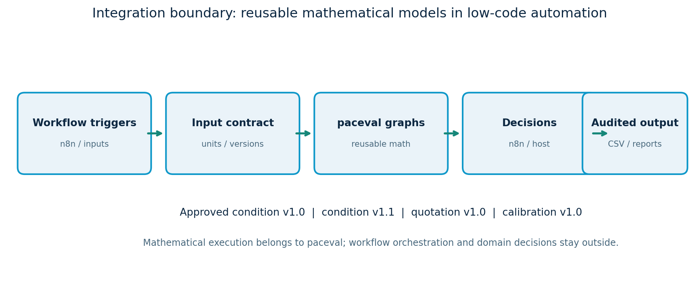
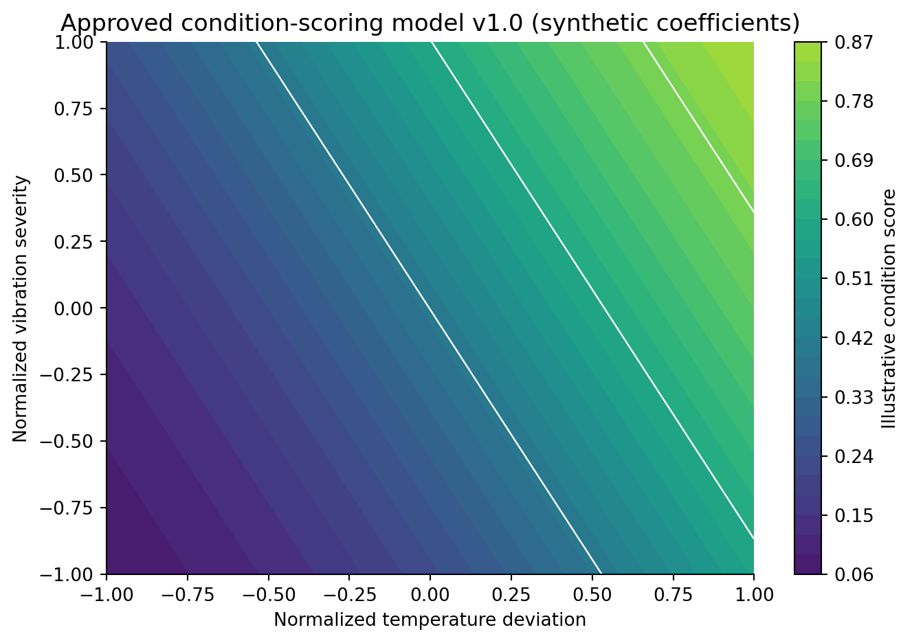
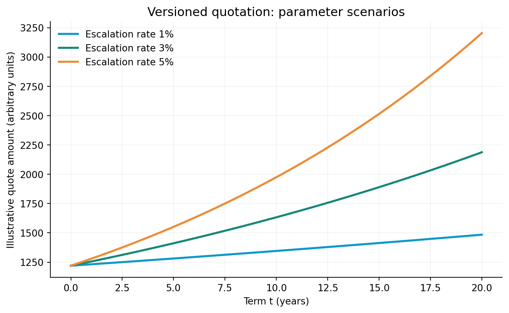
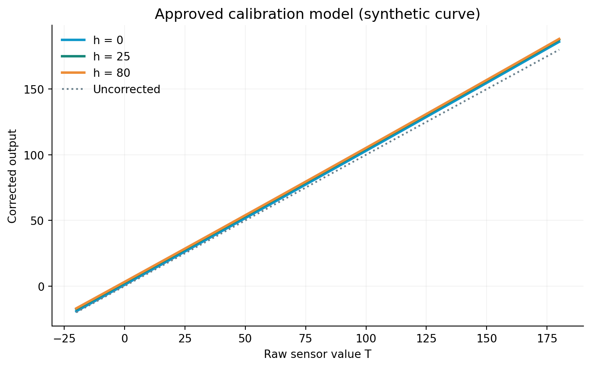
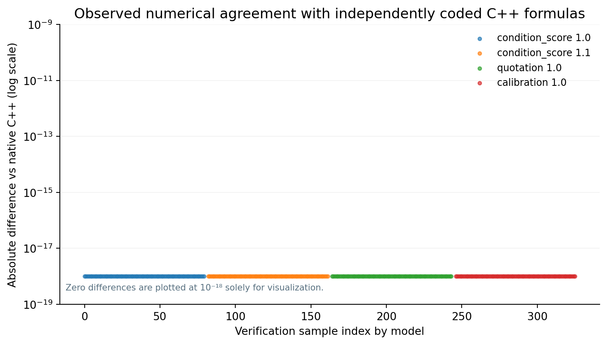
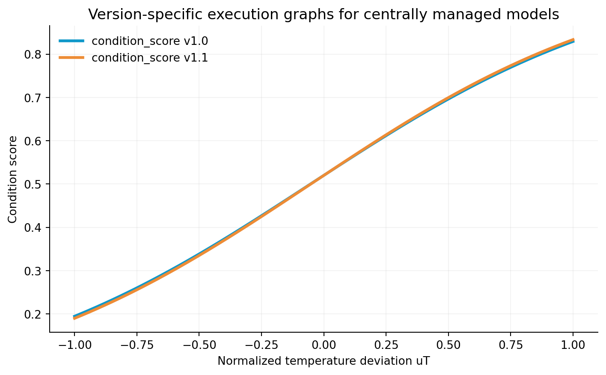
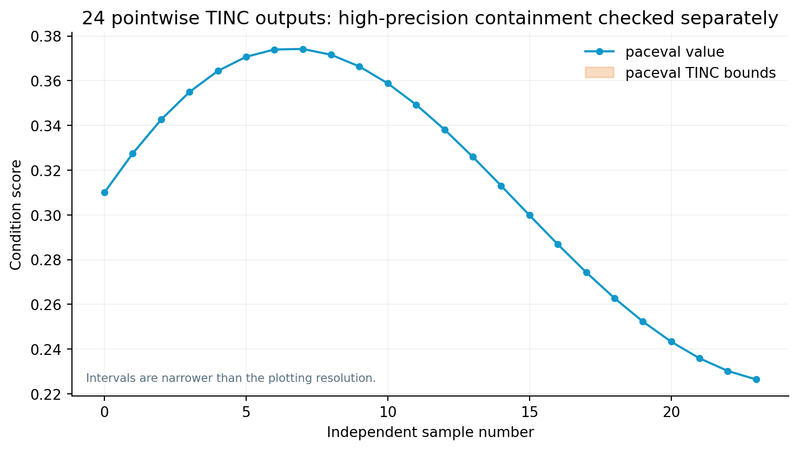

# paceval | Reusable Mathematical Execution in Low-Code Automation


**A reproducible C++17 research demonstrator for centrally versioned mathematical models in n8n-style workflows.** It demonstrates reusable paceval computation graphs, a persistent local JSON/HTTP integration adapter, three approved model families, independently audited numerical results, and optional n8n workflow import templates. **The project documents feasibility, not a runtime speedup.**

[**Scientific white paper (PDF)**](paceval_Low_Code_Automation_Whitepaper_EN.pdf) · [**C++ implementation**](src/lowcode_math.cpp) · [**Importable n8n workflow examples**](workflows/01_condition_scoring_alert.json)

## Research result

The **real paceval Linux runtime** successfully executed **four approved, reusable model graphs**: industrial condition scoring v1.0 and v1.1, configurable quotation v1.0, and illustrative sensor calibration v1.0. Each graph is created once, reused across batches and consecutive client requests, and released on shutdown. An additional TINC-enabled graph is used for selected pointwise numerical checks.

| Verified component | Outcome |
|---|---|
| Local C++ / paceval batch tests | 320 / 320 results within declared tolerance |
| Independent 80-digit Decimal verification | 320 / 320 within tolerance |
| Selected pointwise TINC audit | 24 / 24 reference results enclosed |
| Persistent HTTP adapter | Tested with four approved model versions, batching, repeated requests, negative inputs and version isolation |
| GCC and Clang / sanitizer builds | See reproducibility section; regenerate on your environment |
| n8n workflow JSON examples | Structurally checked; **not executed inside a live n8n instance** |

**Scientific scope:** all inputs, coefficients and workflow triggers are synthetic. The condition score is not a calibrated failure probability; the quotation is not a legally approved price; calibration coefficients are not derived from a device. Tested pointwise TINC inclusion is not a universal enclosure proof. No customer deployment, real n8n interoperability or production MCP connection is asserted.

## Architecture



n8n-style workflows provide triggers, data mapping, authorization and business decisions. The **paceval layer** evaluates approved mathematical expressions and preserves graph handles across requests. The HTTP bridge is a research adapter, not paceval's cloud REST API and not a production access-control boundary.

| Approved model / version | Inputs (strict order) | Executed expression |
|---|---|---|
| `condition_score` / `1.0` | `uT uV uI b0 bT bV bI` | `1/(1+exp(-(b0+bT*uT+bV*uV+bI*uI)))` |
| `condition_score` / `1.1` | same | v1.0 with an added `0.05*uT*uV` term |
| `quotation` / `1.0` | `C m r t F` | `C*(1+m)*((1+r)^t)+F` |
| `calibration` / `1.0` | `T a0 a1 a2 b h` | `T+a0+a1*T+a2*T*T+b*ln(1+h)` |

The mathematical formulas are compiled into computation handles via `paceval_CreateComputation`; values are evaluated in batches using `paceval_dGetComputationResultExt`. The host performs model/version selection, bound validation, HTTP/JSON handling, and final actions. Variable ordering is part of the model contract. All values must be finite.

## Scientific figures

| Model | Figure | Research interpretation |
|---|---|---|
| Condition scoring |  | Normalized input response; coefficients are illustrative |
| Quotation studies |  | Controlled reuse across escalating parameter values |
| Calibration |  | Reusable nonlinear correction expression |
| Independent checks |  | Observed numerical agreement in the published sample |
| Formula governance |  | Two immutable model versions coexist |
| TINC |  | Sample-specific interval results; 80-digit reference audit |

## Build with the original paceval SDK

`src/paceval_main.h` and `src/paceval_main.cpp` are the original API forwarding source files and **are compiled as part of the project**, without `dlopen`/`dlsym` substitutions. The original Linux mathematical runtime `.so` must be supplied separately; it is not bundled with this repository.

Required: Linux x86-64 for the supplied test environment, C++17 compiler (GCC/Clang), CMake 3.16+, Python 3.10+. `matplotlib` and `numpy` are needed only to regenerate figures. Python's HTTP adapter and 80-digit validation use only the standard library.

```bash
export PACEVAL_LIB=/absolute/path/to/libpaceval_linux_sharedLIB.so
cmake -S src -B build -DCMAKE_BUILD_TYPE=Release
cmake --build build -j
ctest --test-dir build --output-on-failure
./build/lowcode_math --demo examples/reproduced_results.csv
./build/lowcode_math --tinc examples/reproduced_tinc.csv
python3 src/high_precision_reference.py \
  --results examples/reproduced_results.csv --tinc examples/reproduced_tinc.csv
```

To reproduce the repository's frozen examples without overwriting them, omit the two `--demo`/`--tinc` commands and run `python3 src/high_precision_reference.py` alone. The committed reference outputs are [batch_results.csv](examples/batch_results.csv) and [tinc_samples.csv](examples/tinc_samples.csv).

## Start the local REST research adapter

```bash
python3 src/http_bridge.py --engine ./build/lowcode_math --port 8787
```

In another terminal:

```bash
curl -sS http://127.0.0.1:8787/health
curl -sS http://127.0.0.1:8787/api/v1/models
curl -sS -H 'Content-Type: application/json' \
  -d @examples/http_request_example.json \
  http://127.0.0.1:8787/api/v1/evaluate
python3 src/test_http_bridge.py ./build/lowcode_math
```

The bridge **only binds to loopback** and accepts `POST /api/v1/evaluate` with exactly `{"model":"condition_score","version":"1.0","rows":[[uT,uV,uI,b0,bT,bV,bI],...]}`. The batch limit of 512 is a **host-side policy, not a fixed limit of the paceval engine**. Unrecognized versions, nonfinite numbers, wrong variable counts and inputs outside declared model domains are rejected. The C++ process persists and reuses prepared graphs; graph handles are recreated upon restart.

The HTTP server is for a local research setup only. It has no access authentication, TLS, tenant separation or production service controls. Do not expose the port publicly. If n8n is containerized, `127.0.0.1` inside n8n refers to the container; use an intentionally secured container/host network route instead of making this demonstration service public.

## Importable n8n-style workflows

The workflow files below are **illustrative importable templates** built from n8n's documented Manual Trigger, Code and HTTP Request node types. Their JSON syntax and connections were checked, **but they were not imported or run in a live n8n instance**. After import, set the HTTP Request node URL to the address reachable from your own n8n instance.

- [Condition scoring with downstream alert](workflows/01_condition_scoring_alert.json)
- [Same approved condition model in a dashboard workflow](workflows/02_condition_dashboard_same_version.json)
- [Versioned quotation scenarios](workflows/03_quotation.json)
- [Versioned sensor calibration](workflows/04_calibration.json)
- [Independent native JavaScript workflow baseline](workflows/05_native_js_condition_reference.json)

The first two workflows intentionally use **the same approved model ID and version**, illustrating mathematical model governance across workflows. The native JavaScript example provides a fair numerical reference instead of comparing paceval to an LLM doing arithmetic in natural language.

n8n's existing Expressions, Code and Calculator features already solve elementary arithmetic. The present experiment investigates shared, auditable **versioned models**. The official paceval MCP endpoint and n8n's MCP Client Tool form a separate potential agent integration route; **no live MCP transport or n8n-agent handshake was tested here**.

## Files and reproducibility

| File | Purpose |
|---|---|
| [src/CMakeLists.txt](src/CMakeLists.txt) | Verified Linux build configuration; external SDK runtime |
| [src/lowcode_math.cpp](src/lowcode_math.cpp) | Versioned model catalog, paceval execution, batch/domain validation, CLI / persistent stdio |
| [src/paceval_main.h](src/paceval_main.h), [src/paceval_main.cpp](src/paceval_main.cpp) | Original paceval C/C++ SDK interface; retains vendor AGPL notices |
| [src/http_bridge.py](src/http_bridge.py) | Loopback-only HTTP/JSON adapter to the persistent C++ process |
| [src/test_http_bridge.py](src/test_http_bridge.py) | Real-process HTTP integration tests |
| [src/high_precision_reference.py](src/high_precision_reference.py) | 80-digit independent Decimal reference and pointwise TINC audit |
| [src/make_figures.py](src/make_figures.py) | Rebuilds scientific figures from included data |
| [examples/http_request_example.json](examples/http_request_example.json) | Example API request |
| [examples/batch_results.csv](examples/batch_results.csv) | Published deterministic model results |
| [examples/tinc_samples.csv](examples/tinc_samples.csv) | Published pointwise interval samples |
| [paceval_Low_Code_Automation_Whitepaper_EN.pdf](paceval_Low_Code_Automation_Whitepaper_EN.pdf) | Scientific results, methods, source references and scope |

## Further investigation

Real workflow integration should independently test n8n node version compatibility, retries, restarts, credentials, request sequencing, network latency and governance across projects, alongside the native expression and JavaScript baselines. An agent/MCP workflow is a distinct experiment. Hardware/FPGA execution graphs are a possible future backend but are not claimed to have been measured here.

## Sources and license boundary

The SDK source files retain their embedded AGPL notices; this repository deliberately does not include the proprietary Linux runtime. Before redistribution and commercial embedding, review the applicable paceval SDK conditions and n8n's **Sustainable Use License** (especially if exposing workflow editing to customers). No separate `LICENSE_NOTICE.md` is created.

- [paceval C/C++ API](https://paceval.com/api/) and [paceval GitHub](https://github.com/paceval/paceval)
- [n8n HTTP Request node](https://docs.n8n.io/integrations/builtin/core-nodes/n8n-nodes-base.httprequest/)
- [n8n MCP Client Tool node](https://docs.n8n.io/integrations/builtin/cluster-nodes/sub-nodes/n8n-nodes-langchain.toolmcp/)
- [n8n licensing FAQ](https://support.n8n.io/article/can-i-use-your-license-for-my-use-case)
