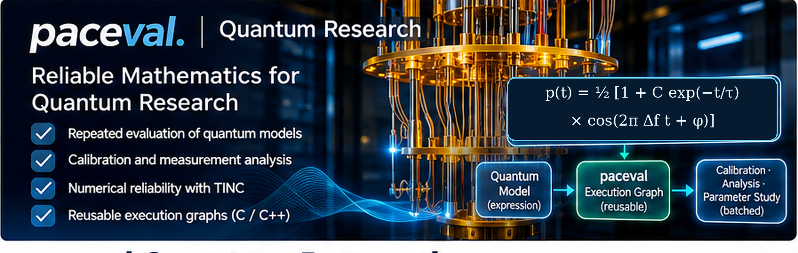
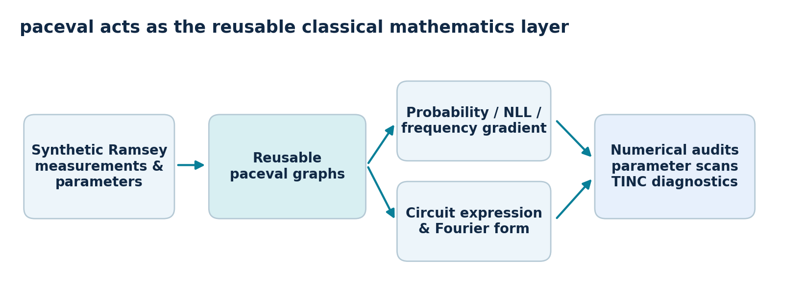
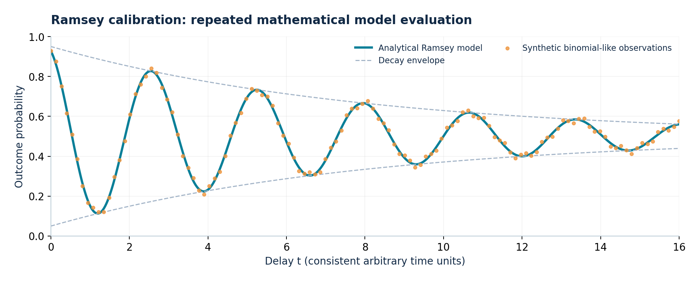
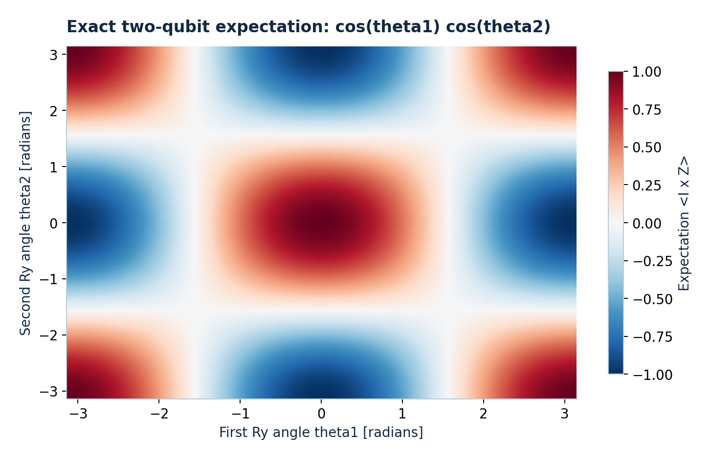
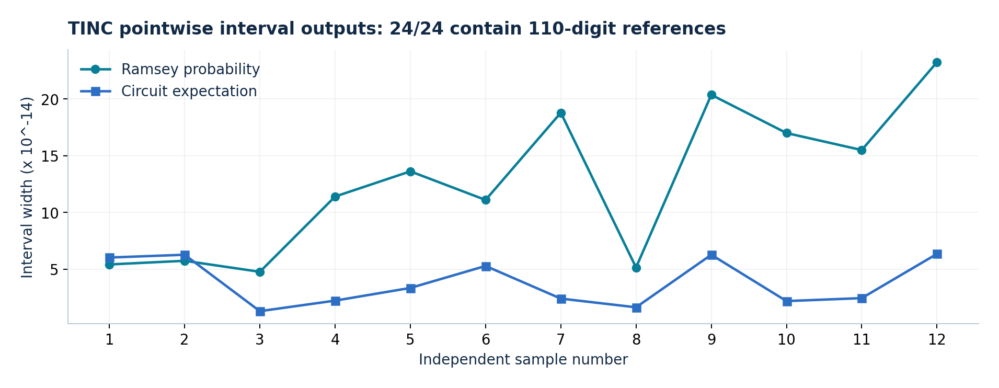

# paceval Quantum Research



**Reliable Mathematics for Quantum Research — a successfully implemented and independently verified C++ demonstrator using the original paceval mathematical engine.**

This project demonstrates the **technical feasibility** of using reusable paceval execution graphs for explicit classical mathematics in quantum research: a synthetic **Ramsey calibration model**, its binomial likelihood and frequency derivative, and the **exact expectation value of a two-qubit quantum circuit**. The computations use the actual paceval Linux runtime and are checked against independently implemented mathematical references. The project does not claim real quantum-device measurements, a complete calibration fit, or classical simulation of arbitrary quantum circuits.

**[Scientific whitepaper: implemented and verified use cases (PDF)](paceval_Quantum_Research_Whitepaper_EN.pdf)**

## Verified implementation

| Implemented capability | Verified result |
| --- | --- |
| Reusable paceval mathematical execution | **Five graphs** created and evaluated with the original runtime |
| Combined Ramsey computation | Probability, likelihood contribution and frequency derivative evaluated using the **multi-graph API** |
| Parameter exploration | The same likelihood graph reused for **five detuning-frequency hypotheses**, in separate and flattened batches |
| Explicit quantum circuit | Two mathematically equivalent expressions validated using an independent **four-amplitude statevector** calculation |
| Numerical cross-checks | Native C++ reference calculations and derivative finite-difference tests completed successfully |
| Trusted Interval Computing (TINC) | **24 of 24 sampled point intervals** contained independently computed **110-decimal-digit reference values** |

The TINC result is a **pointwise test** for the stated inputs, not a general mathematical proof that every interval encloses the exact answer for arbitrary inputs. The conclusion is limited to implementation and validation of these selected mathematical workloads.



## Use case A: Ramsey calibration mathematics

A commonly used phenomenological model for a Ramsey measurement is

$$
P(t) = \frac{1}{2}\left[1 + C e^{-t/\tau}\cos(2\pi\Delta f\,t+\phi)\right],
$$

where $t$ is delay, $C$ is contrast, $\tau$ is an effective dephasing time, $\Delta f$ is detuning frequency and $\phi$ is phase. For $k_i$ observed positive outcomes among $N_i$ trials, the implementation evaluates each binomial negative log-likelihood contribution without its parameter-independent combinatorial constant:

$$
\ell_i=-\left[k_i\ln P(t_i) + (N_i-k_i)\ln(1-P(t_i))\right].
$$

The derivative with respect to detuning frequency is also implemented and independently checked:

$$
\frac{\partial P}{\partial \Delta f}=-\pi C t e^{-t/\tau}\sin(2\pi\Delta f\,t+\phi).
$$

The demonstrator uses deterministic synthetic data (512 Bernoulli trials at each sampled delay), evaluates all three Ramsey expressions with paceval, and reuses the likelihood graph for five frequency hypotheses. **It evaluates the building blocks of a fit, but it does not perform a complete parameter-estimation fit.**



## Use case B: explicit quantum-circuit expectation value

Starting from $|00\rangle$, the specified circuit applies $R_y(\theta_1)$ and $R_y(\theta_2)$, followed by CNOT with the first qubit as control and the second as target. For the observable $I\otimes Z$, the exact result is

$$
\langle I\otimes Z\rangle = \cos\theta_1\cos\theta_2
=\frac{\cos(\theta_1-\theta_2)+\cos(\theta_1+\theta_2)}{2}.
$$

paceval evaluates **both equivalent formulas as persistent execution graphs**. A separate native C++ implementation computes the four real state amplitudes after the rotations and CNOT, then evaluates the observable independently. This shows that a **known, compact formula** arising from a quantum circuit can be reused as classical mathematical software. It does not imply that arbitrary circuits have efficient classical closed-form representations.



## What paceval specifically does

The [C++ source](src/quantum.cpp) dynamically loads an **externally supplied original** paceval Linux shared library and calls these C-API entry points:

| paceval API | Implemented operation |
| --- | --- |
| `pacevalLibrary_CreateComputation` | Construct five persistent computational graphs and two additional TINC graphs |
| `pacevalLibrary_dGetComputationResultExt` | Batch-evaluate Ramsey, likelihood, frequency-derivative and circuit formulas; reuse a graph for frequency studies |
| `pacevalLibrary_dGetMultipleComputationsResultsExt` | Evaluate three Ramsey graphs with one combined API call |
| `pacevalLibrary_dGetComputationResult` | Obtain value, lower bound and upper bound for TINC sample checks |
| `pacevalLibrary_GetIsError`, `pacevalLibrary_GetErrorInformation` | Check and report engine errors |
| `pacevalLibrary_DeleteComputation`, `pacevalLibrary_Initialize`, `pacevalLibrary_Free` | Manage engine initialization and graph lifetimes |

The high-precision interval check is implemented **independently in Python**, not by reusing paceval to verify itself. The two-qubit statevector check is implemented **independently in C++**.

## Build and verify on Linux

Requirements are CMake 3.12 or later, a C++17 compiler, and a compatible **original paceval Linux shared library supplied by the user**. The proprietary `.so` is not distributed in this repository. Python 3 and the third-party [`mpmath`](https://mpmath.org/) package are needed only for the additional independent high-precision check.

```bash
# From the repository root; CMakeLists.txt is in src/:
cmake -S src -B build -DCMAKE_BUILD_TYPE=Release \\
  -DPACEVAL_RUNTIME=/absolute/path/to/libpaceval_linux_sharedLIB.so
cmake --build build -j
ctest --test-dir build --output-on-failure

# Run the actual paceval runtime on the included example events:
./build/quantum \\
  --library /absolute/path/to/libpaceval_linux_sharedLIB.so \\
  --require-paceval --input-csv examples/ramsey_circuit_sample.csv \\
  --events 120 --batch 32 --csv example_results.csv

# Independently validate the 24 TINC intervals generated next to the output CSV:
python3 -m pip install mpmath
python3 src/high_precision_reference.py tinc_samples.csv
```

The integration test requires `PACEVAL_RUNTIME` to be an absolute path to an existing shared library. Alternatively, set the environment variable `PACEVAL_LIB` before configuring CMake. If the library is not available, the native C++ self-test can be compiled and run independently:

```bash
cmake -S src -B build -DCMAKE_BUILD_TYPE=Release
cmake --build build -j
ctest --test-dir build --output-on-failure
```

When reusing an existing `build/` folder, reconfigure it after changing the runtime path. The demonstrator also writes an auxiliary evaluation CSV for reproducible numerical auditing.

## Independently checked numerical results

The [high-precision verification script](src/high_precision_reference.py) evaluates the same mathematical expressions using 110-decimal-digit `mpmath` arithmetic. It promotes the **actual stored binary64 input values** and the graph's rounded numerical constants before comparison with the paceval interval endpoints. The previous real-runtime experiment produced **24 of 24 contained point references**, archived in [the supplied TINC sample CSV](examples/tinc_samples.csv). The script can rerun this independent check on the archived samples or new outputs generated by the C++ program.



This does not certify the general rigorous interval properties of TINC. Statistical measurement uncertainty, physical-model uncertainty and floating-point numerical uncertainty remain distinct.

## Reproducible project contents

```text
paceval_Quantum_Research/
├── README.md
├── paceval_Quantum_Research_Whitepaper_EN.pdf
├── .gitignore
├── src/
│   ├── CMakeLists.txt
│   ├── quantum.cpp
│   └── high_precision_reference.py
├── examples/
│   ├── ramsey_circuit_sample.csv
│   └── tinc_samples.csv
└── figures/
    ├── 00_quantum_research_hero.png
    ├── 01_ramsey_calibration.png
    ├── 02_quantum_circuit_fourier.png
    ├── 03_execution_graph_architecture.png
    └── 04_tinc_validation.png
```

The [CMake project](src/CMakeLists.txt), [source code](src/quantum.cpp), [example input](examples/ramsey_circuit_sample.csv), [high-precision checker](src/high_precision_reference.py), [archived TINC results](examples/tinc_samples.csv), and all embedded figures are included. The original paceval runtime is intentionally external.

## Scope and scientific background

This is a **validated classical mathematical research demonstrator** for selected quantum-research workflows, not a quantum-processor or a full experimental reconstruction system. All measurements are **synthetic**. Scientific background includes [Qiskit Experiments Ramsey characterization](https://qiskit-community.github.io/qiskit-experiments/stable/0.8/manuals/characterization/t2ramsey.html) and [PennyLane's Fourier-analysis documentation](https://docs.pennylane.ai/en/stable/code/qp_fourier.html).

The demonstrated success is concrete: the original paceval library **constructed and evaluated the intended formulas**, the independent native references agreed within configured numerical tolerances, and all 24 high-precision point-containment checks passed. The implementation and numerical validation establish the stated feasibility result without relying on any claim about quantum hardware acceleration.
