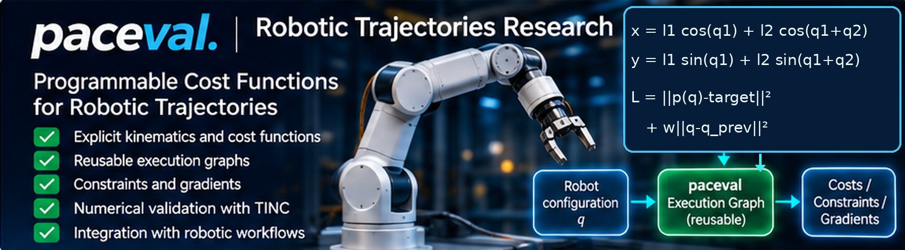
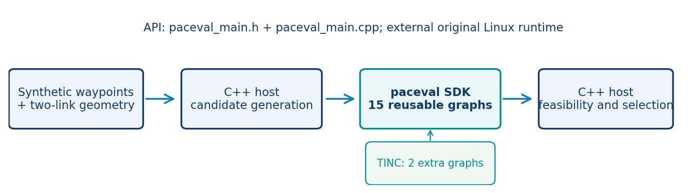
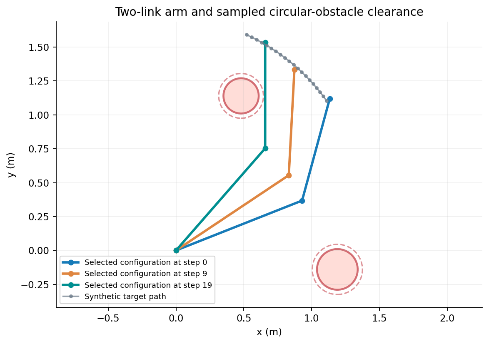
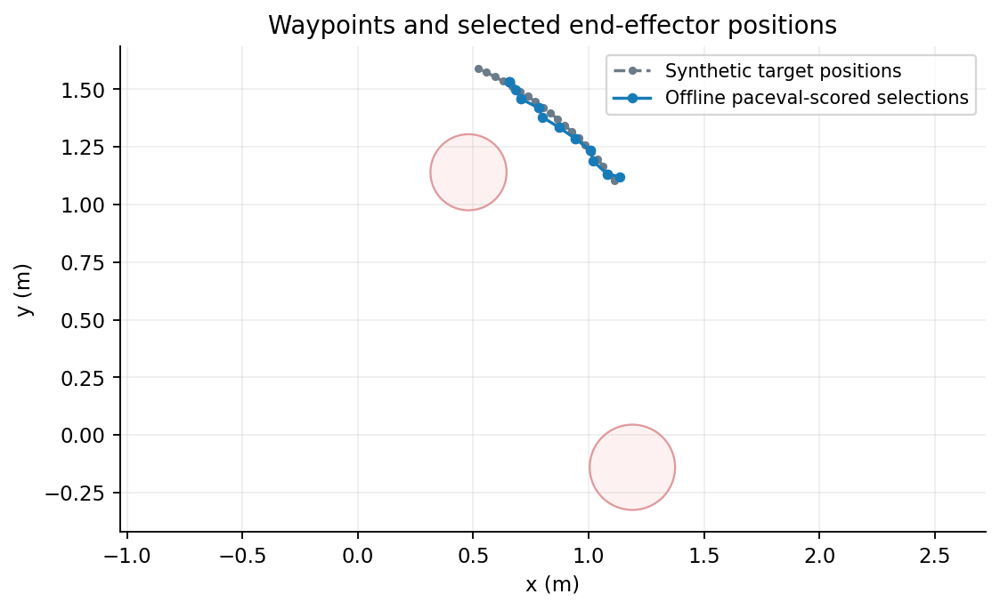
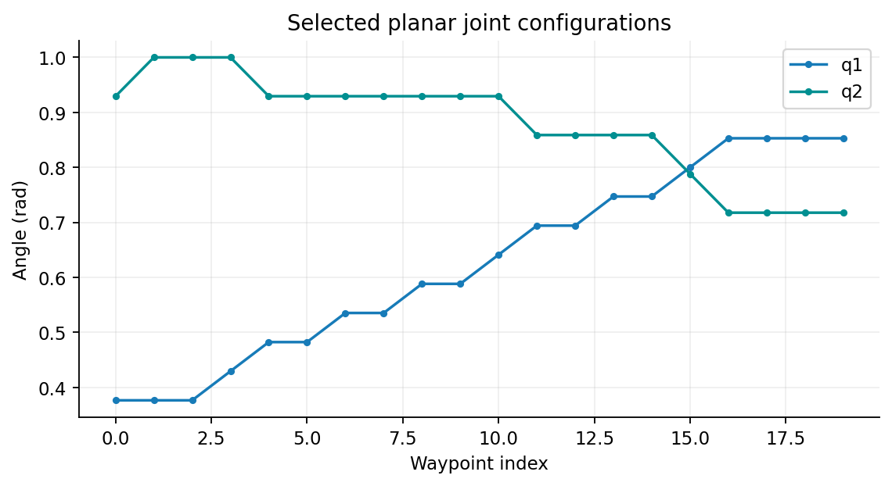
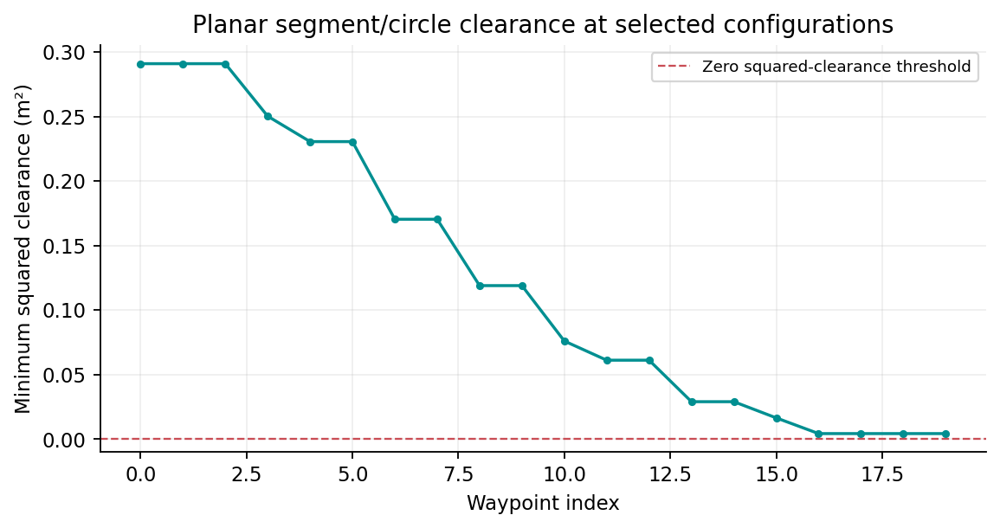
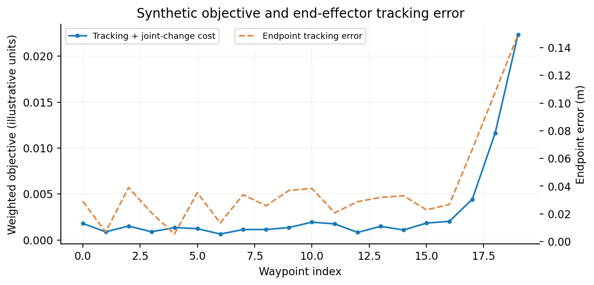
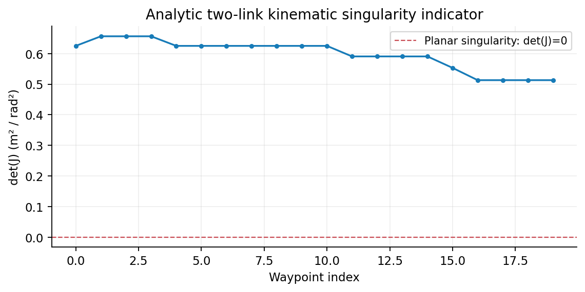
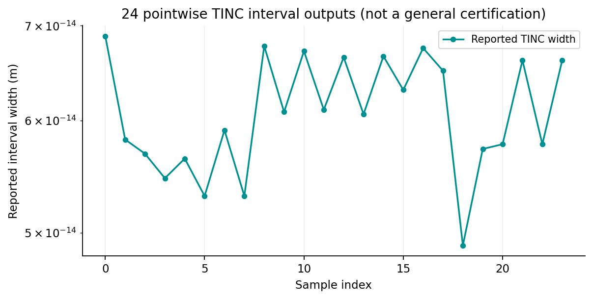

# paceval Robotic Trajectories Research



**Programmable kinematics, trajectory scores, gradients, and simplified obstacle constraints with paceval.**  
*A reproducible English-language, C++17, offline feasibility study using the original paceval SDK 4.25 and an externally supplied original Linux runtime.*

This GitHub demonstrator implements and extends the research proposal **“Programmable Cost Functions for Robotic Trajectories.”** It confirms that mathematical components of a **synthetic planar two-link robot** can be represented as persistent paceval execution graphs, evaluated together across candidate configurations, and checked independently. Its C++ host performs a small discrete, greedy waypoint-selection experiment and geometric admissibility checks.

**Scientific scope:** The pictured industrial robot is a marketing illustration; the evaluated model is a **two-dimensional, two-link centerline arm**. This is not a MoveIt 2 or Pinocchio integration, not a general-purpose robot planner, not a rigid-body dynamics model, not full 3D self/environment collision checking, and not a safety-certified actuator controller. The 12-substep interpolation is a *sampled check*, not a continuous-path proof. All inputs are synthetic. No performance advantage is asserted.

**[Read the updated, verified scientific whitepaper (PDF)](paceval_Robotic_Trajectories_Whitepaper_EN.pdf)**

## What was actually implemented with paceval

Fifteen regular graphs use exactly the same ordered input schema: `q1 q2 l1 l2 tx ty p1 p2 w ox oy radius t1 t2`. The host prepares persistent handles once and calls **`paceval_dGetMultipleComputationsResultsExt`** to evaluate graph-major results across batches of sample-major input rows. Two additional interval-enabled graphs evaluate end-effector x and y for a pointwise **TINC** audit.

| Graphs | Actual mathematical outputs | Purpose |
|---|---|---|
| 1–4 | Elbow coordinates and endpoint `x, y` | Two-link forward kinematics |
| 5–8 | Four entries of the planar endpoint Jacobian | Analytic kinematic sensitivities |
| 9 | `l1*l2*sin(q2)` | Singularity-related determinant |
| 10 | `(x-tx)^2+(y-ty)^2+w*((q1-p1)^2+(q2-p2)^2)` | Waypoint-tracking and joint-change cost |
| 11 | `(x-ox)^2+(y-oy)^2-radius^2` | Endpoint-to-circle squared clearance |
| 12–13 | Nearest-point squared clearance of **both centerline segments** | Bounded planar geometry proxies |
| 14–15 | Analytic partial derivatives of graph 10 | Cost gradients with respect to both joint angles |
| TINC A–B | Interval-enabled endpoint x and endpoint y | Independent numerical inspection |

For each obstacle, the C++ host computes *clamped* segment projection scalars `t1, t2` in `[0,1]`. paceval then evaluates the corresponding explicit **squared-clearance formulas**. A candidate is accepted only when these modeled margins are nonnegative, its angular change is within the synthetic limit, and 13 sampled configurations along the angular transition pass the same host-owned centerline/circle check. This is a more substantive planar test than the original whitepaper's **endpoint-only** circle test, but does **not** constitute a general robot-collision guarantee.



## Verified offline trajectory example

The supplied [synthetic waypoint inputs](examples/waypoints.csv) trace an ideal reference curve generated from a known two-link configuration. For each of its 20 targets, the host creates a 35 × 35 candidate grid of joint angles, prepares separate input rows for two static circular obstacles, and requests the 15 graph values from paceval in batches. It chooses the **minimum objective among admissible candidates at that waypoint**, updates the previous joint configuration, and moves to the next target.

The host uses a **greedy discrete search**, not a globally optimal multi-waypoint solver. The full reference path may be infeasible under the synthetic obstacle geometry, so deviation from a waypoint can be a legitimate constraint-driven outcome. No real motor, sensor, or robotic middleware is connected.









The related quantities can be inspected in the included [trajectory output CSV](examples/trajectory.csv), and reproduced from source without changing any of the graph formulas.





## Verified results on the supplied original Linux runtime

| Independent check | Observed result |
|---|---|
| Original API binding | `paceval_main.h` included, `paceval_main.cpp` compiled, external `.so` linked |
| Regular mathematical graphs | **15** successfully created and evaluated |
| Additional TINC graphs | **2** successfully created and queried |
| Complete synthetic offline run | **20** target waypoints, 35 × 35 candidate joint grid, two circular obstacles |
| Independent native C++ numerical comparisons | **735,000** scalar graph checks, **0 configured tolerance violations** |
| Independent one-waypoint grid oracle | **20 of 20** selected candidates matched the independently evaluated best admissible grid cost |
| Independent 110-digit reference for TINC | **24 of 24** pointwise intervals contained the reference value |
| Direct Jacobian and objective gradient checks | Passed central finite-difference self-tests |
| C++ toolchain and diagnostics | GCC 14.2, Clang 17, AddressSanitizer and UndefinedBehaviorSanitizer tests passed |
| Input batching reproducibility | Batch sizes **256 and 37** produced byte-identical published output CSVs |

All comparisons are for the **specified synthetic geometry and finite input sample**. In particular, 24 pointwise TINC inclusions are encouraging evidence, **not a proof of rigorous interval enclosure for all possible inputs**.



## Correct original SDK integration

[`src/robotics.cpp`](src/robotics.cpp) includes the supplied [`src/paceval_main.h`](src/paceval_main.h); [`src/paceval_main.cpp`](src/paceval_main.cpp) is compiled as a separate source through [`src/CMakeLists.txt`](src/CMakeLists.txt). This is the original vendor **C/C++ interface forwarding layer**, not the mathematical runtime. The original `libpaceval_linux_sharedLIB.so` must be provided externally.

The demonstrator calls `paceval_InitializeLibrary`, `paceval_CreateComputation`, `paceval_dGetMultipleComputationsResultsExt`, `paceval_dGetComputationResult`, `paceval_GetIsError`, `paceval_GetErrorInformation`, `paceval_DeleteComputation`, and `paceval_FreeLibrary`. Handle ownership is managed with C++ RAII. The C++ comments describe input/output memory layouts, numerical tolerances, obstacle projection, and host/paceval responsibilities.

## Build and reproduce

Requires Linux, CMake 3.16 or newer, a C++17 compiler, and a compatible **original paceval 4.25 Linux shared runtime** supplied separately. From the repository root:

```bash
export PACEVAL_LIB="/absolute/path/to/libpaceval_linux_sharedLIB.so"
cmake -S src -B build -DCMAKE_BUILD_TYPE=Release
cmake --build build -j
ctest --test-dir build --output-on-failure

./build/robotics --waypoints examples/waypoints.csv \
  --grid 35 --batch 256 \
  --out-csv trajectory.csv --tinc-csv tinc_samples.csv
```

The independent verification requires Python 3 with `mpmath`:

```bash
python3 src/validate_outputs.py \
  --trajectory trajectory.csv --tinc tinc_samples.csv --grid 35
```

To regenerate figures, install `matplotlib` and `numpy` and run:

```bash
python3 src/make_figures.py \
  --trajectory examples/trajectory.csv \
  --tinc examples/tinc_samples.csv --out-dir figures
```

A native C++ mathematical self-test is available as `./build/robotics --self-test`. To reproduce the published results, use the complete 20-row input and grid size 35 as shown above; the smaller CTest sample deliberately has only eight waypoints and a 19 × 19 grid. Built binaries, intermediate files, and the externally supplied `.so` are **not** included in the repository.

## Repository contents

```text
paceval_Robotics_Trajectories/
├── README.md
├── paceval_Robotic_Trajectories_Whitepaper_EN.pdf
├── .gitignore
├── src/
│   ├── CMakeLists.txt
│   ├── robotics.cpp
│   ├── paceval_main.h
│   ├── paceval_main.cpp
│   ├── validate_outputs.py
│   └── make_figures.py
├── examples/
│   ├── waypoints.csv
│   ├── trajectory.csv
│   └── tinc_samples.csv
└── figures/
    ├── 00_robotics_hero.png
    ├── 01_execution_architecture.png
    ├── 02_planar_robot_geometry.png
    ├── 03_waypoint_tracking.png
    ├── 04_joint_angles.png
    ├── 05_clearance_margins.png
    ├── 06_cost_and_tracking_error.png
    ├── 07_jacobian_determinant.png
    └── 08_tinc_widths.png
```

## Scientific interpretation and extensions

This implementation demonstrates the **feasibility of reusable paceval mathematical execution** as one separable, explicit component of a robotics scoring pipeline. The C++ host is responsible for obstacle geometry and waypoint selection. A production study would have to replace the simplified geometries and search with a verified planning scene, full robot-body collision checking, appropriate dynamics, kinematic limits, trajectory interpolation certification and safety engineering.

A realistic follow-on study could connect a validated mathematical cost callback to established frameworks such as [MoveIt 2](https://moveit.picknik.ai/) or [Pinocchio](https://github.com/stack-of-tasks/pinocchio), test larger documented robot models, and assess suitable FPGA/ASIC execution **in separate measured experiments**. Neither library, nor hardware implementation, is included or claimed to have been tested here.

References: [paceval API 4.25](https://paceval.com/api/) · [MoveIt 2 planning-scene code](https://github.com/moveit/moveit2/blob/main/moveit_core/planning_scene/include/moveit/planning_scene/planning_scene.hpp) · [Pinocchio documentation](https://gepetto.github.io/doc/pinocchio/doxygen-html/).

**Licensing:** The provided original `paceval_main.h` and `paceval_main.cpp` preserve paceval's original copyright and AGPL notices (with their relative SDK include adjusted to the local directory). Verify AGPL obligations for publication and obtain the proprietary runtime separately under its applicable terms.
