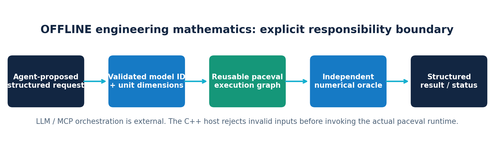
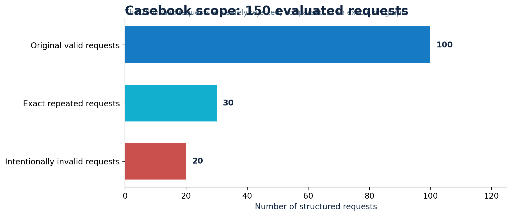
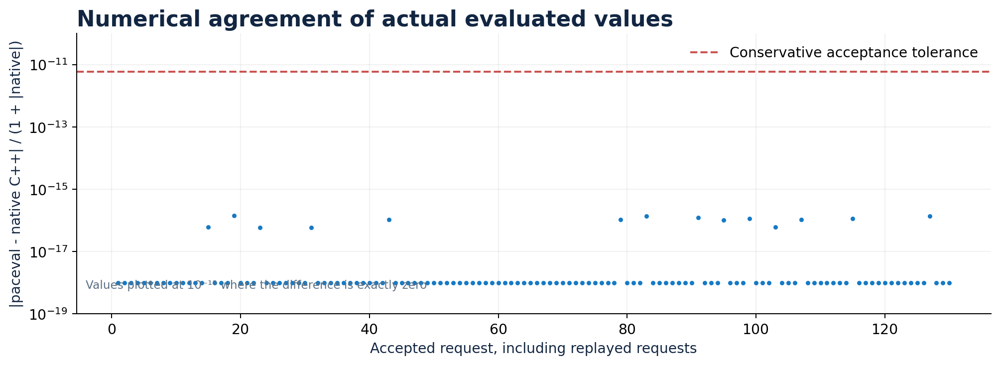
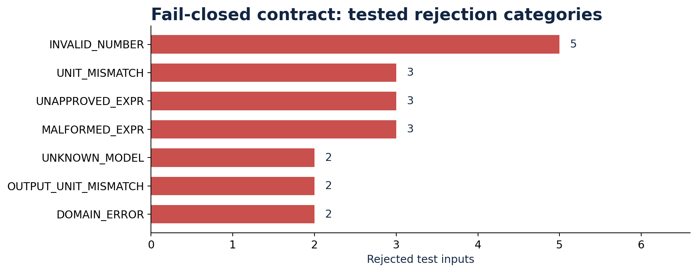
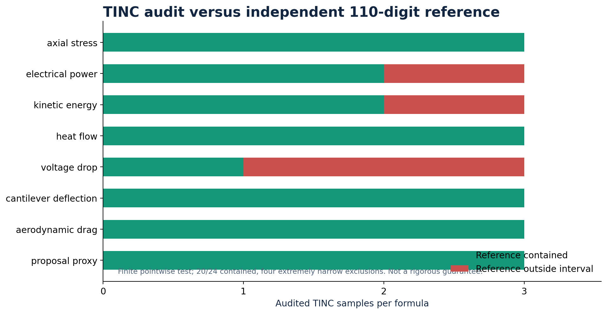
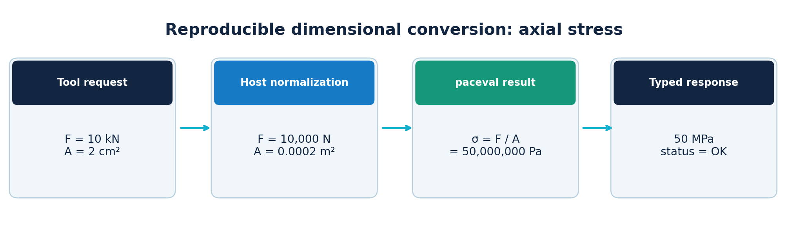

# paceval Technical AI Agents Research


**Deterministic engineering mathematics for tool-using AI agents: a tested offline C++ feasibility demonstrator.**

This public research demonstrator implements a **strict, unit-checked mathematical tool boundary** suitable for integration into a technical AI-agent workflow. It uses the original `paceval_main.h` and `paceval_main.cpp` SDK code, links to the original paceval Linux runtime supplied separately by the user, constructs reusable mathematical execution graphs, and evaluates approved engineering formulas in batches. It also provides an offline JSONL tool-call adapter as an integration example.

The current package **does not include an LLM, live MCP server, industrial certification or remote deployment**. No claims about acceleration, p95 latency, energy reduction, or agent language understanding are made. Every published result concerns synthetic, explicitly specified engineering inputs.

[**Read the scientific whitepaper (PDF)**](paceval_Technical_AI_Agents_Whitepaper_EN.pdf) · [C++ application](src/technical_agent.cpp) · [SDK facade](src/paceval_main.h) · [SDK implementation](src/paceval_main.cpp) · [All 150 test requests](examples/requests.csv)

## Demonstrated functionality

- Eight approved engineering formula families: axial stress, electrical power, kinetic energy, thermal conductance heat flow, Ohmic voltage drop, small-deflection cantilever formula, simplified aerodynamic drag, and the supplied whitepaper's dimensionally specified synthetic expression.
- `paceval_CreateComputation()` initializes reusable handles once; `paceval_dGetComputationResultExt()` evaluates grouped engineering questions; `paceval_dGetComputationResult()` evaluates selected TINC-enabled graphs; handles are always released before the library is freed.
- An independent **host-owned dimension check** uses the SI-base exponent tuple `(kg,m,s,A,K)` and a deliberately small, explicit set of conversions. The paceval mathematical engine is **not** claimed to validate units.
- Model-specific domain checks and fail-closed handling of unknown model IDs, unapproved formulas, malformed text, missing and nonfinite values, dimensional mismatches, output-unit mismatches, and division by zero.
- Structured JSONL agent-tool examples with a [machine-readable input schema](examples/tool_schema.json), a [local JSONL adapter](src/agent_tool_adapter.py) and [example tool calls](examples/agent_calls.jsonl). The Python adapter runs the C++ backend in one batch, allowing reuse within that batch; it is **not a deployed MCP tool**.
- An independent native C++ reference in the demonstrator and a separate [110-digit mpmath audit](src/high_precision_reference.py). TINC is evaluated independently rather than assumed rigorous.

## Verified results

| Check | Observed result with the provided original Linux paceval runtime |
|---|---|
| Structured synthetic test requests | **150** processed |
| New approved engineering questions | **100** |
| Repeated requests with new identifiers | **30** |
| Deliberately invalid requests | **20 of 20 rejected with expected codes** |
| Accepted numerical evaluations | **130 of 130 within the stated tolerance** |
| Separate 110-digit oracle for accepted outputs | **130 of 130 within tolerance** |
| Reusable paceval graph handles | **8 regular + 8 TINC-enabled** |
| TINC intervals containing the exact 110-digit reference | **20 of 24** |
| GCC / Clang / ASan / UBSan | All executed automated tests passed |

**TINC precision qualification:** Four selected test intervals did **not** enclose the independent 110-digit result: `Q018` (electrical power), `Q011` (kinetic energy), `Q013` and `Q021` (Ohmic voltage drop). In these cases, narrow point-like bounds are not a rigorous enclosure. See [the numerical audit figure](figures/05_tinc_reference_audit.png) and [the raw interval samples](examples/tinc_samples.csv). This does not invalidate the separate ordinary double-precision value checks, but it does prohibit a blanket interval guarantee.

## Scientific figures













The [figure generator](src/make_figures.py) uses the included [observed results](examples/agent_results.csv) and [TINC samples](examples/tinc_samples.csv).

## Quick start (Linux)

The exact proprietary `.so` is intentionally **not** distributed in this repository. Provide your own compatible Linux library using an **absolute file path**. The official vendor SDK source files are included in `src/` and retain the license notice.

```bash
cd paceval_Technical_AI_Agents
export PACEVAL_LIB=/absolute/path/to/libpaceval_linux_sharedLIB.so
cmake -S src -B build -DCMAKE_BUILD_TYPE=Release
cmake --build build -j
ctest --test-dir build --output-on-failure

./build/technical_agent --cases examples/requests.csv \
  --output build/agent_results.csv --tinc build/tinc_samples.csv --batch 29

python3 src/high_precision_reference.py \
  --cases examples/requests.csv \
  --results build/agent_results.csv --tinc build/tinc_samples.csv
```

Independent audit requires `pip install mpmath`; chart regeneration additionally requires `matplotlib` and `numpy`.

### Example: structured calls from an AI-agent host

```bash
python3 src/agent_tool_adapter.py \
  --requests examples/agent_calls.jsonl \
  --engine build/technical_agent \
  --output build/agent_responses.jsonl
```

The [sample response](examples/agent_responses.jsonl) includes a correctly converted stress result `50 MPa`, an electrical power result `36 W`, a rejected dimensional mismatch, and a rejected malformed structured tool call. The host must still arrange authorization, rate limiting, timeouts, safe exposure and genuine LLM/MCP connectivity before deployment.

## Reference model registry

| Model ID | Approved expression (`x0..x5`) | Output SI unit |
|---|---|---|
| `axial_stress` | `x0/x1` | Pa |
| `electrical_power` | `x0*x1` | W |
| `kinetic_energy` | `0.5*x0*x1^2` | J |
| `heat_flow` | `x0*(x1-x2)` | W |
| `voltage_drop` | `x0*x1` | V |
| `cantilever_deflection` | `x0*x1^3/(3*x2*x3)` | m |
| `aerodynamic_drag` | `0.5*x0*x1*x2*x3^2` | N |
| `proposal_proxy` | `(x0*x1)/(x2+x3)+x4*sqrt(x5*x5)` | N/m |

Physical assumptions and required input dimensions are defined and commented in the C++ [model registry](src/technical_agent.cpp). In particular, `proposal_proxy` is a **synthetic expression** based on the original proposal, not a validated engineering law; the coefficient `x4` has the unit `N*s/m2` to keep both terms dimensionally consistent. Cantilever deflection assumes a linear elastic Euler-Bernoulli beam with a tip point load, and aerodynamic drag assumes a simplified steady quadratic law. These are mathematical examples, not validated equipment models.

### Security / unit interpretation

The registry only accepts approved equations. **Untrusted expression strings are never passed to paceval for execution.** The static unit list is intentionally restricted and does not implement the full UCUM standard. Celsius and other offset units are unsupported; Kelvin is interpreted as absolute temperature. For real deployments, replace this illustrative policy with an independently reviewed unit and dimension library, explicit physical envelopes, access controls and independent tests.

## Reproducibility

The test environment used Linux x86-64, GCC 14.2 and Clang 17.0, linked against the original paceval library supplied separately (`SHA-256: acf63a87df0ee822b467edbca887393d31ec0ea03562e1abf802d2512a5bfb12`). The test casebook and output files are deterministic; numerical tolerances do not imply bitwise identity across platforms. No application-level timing comparisons are reported.

To reproduce the included CSV files, use the commands above, then compare the output to [published numerical results](examples/agent_results.csv) and [interval results](examples/tinc_samples.csv). The 110-digit audit reads the *actual binary64 input values* as exact inputs to each mathematical expression when checking TINC inclusion.

## Integration perspective and references

The [Model Context Protocol tools specification](https://modelcontextprotocol.io/specification/2025-11-25/server/tools) describes tool `inputSchema`, tool responses and input validation. The [OpenAI function calling guide](https://developers.openai.com/api/docs/guides/function-calling) describes structured, schema-constrained arguments. The [paceval API](https://paceval.com/api/) describes reusable computation handles and batched results. These sources inform this **offline prototype**, but do not imply any official integration, vendor endorsement or deployment.

## Distribution and limitations

The included vendor SDK files have original AGPL headers. Respect their license and the proprietary Linux runtime's licensing terms. No `.so` is packaged. The demonstration intentionally excludes natural-language interpretation, autonomous engineering judgment, general-dimensional symbolic inference, physical-model validation, production monitoring, a production MCP endpoint, and safety certification. Incorrect model selection remains an agent-host/engineering responsibility even when a calculation returns `OK`.
