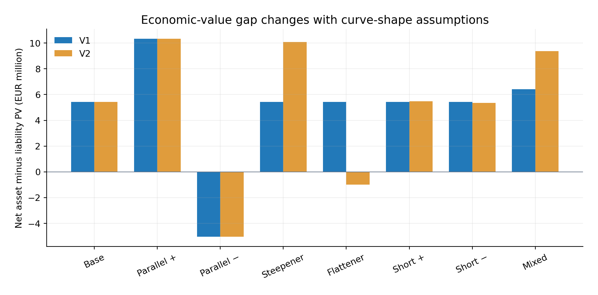
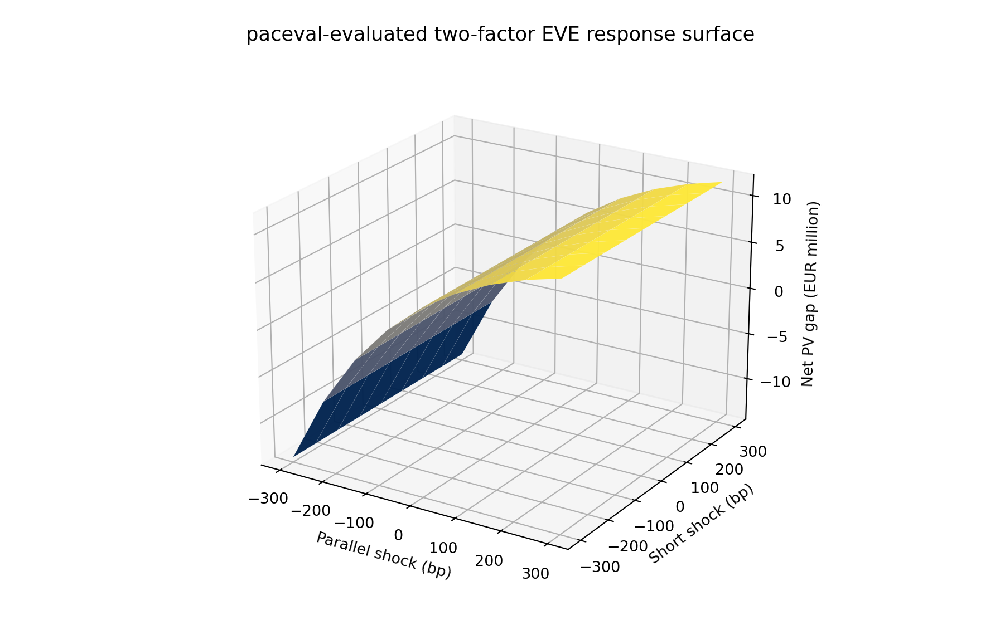

# paceval. | Asset-Liability Cash Flows and Interest-Rate Stress


**An independently checked C++ mathematical research demonstrator using original paceval 4.25 graphs.** This project evaluates the fixed cash flows of a hypothetical EUR asset and liability portfolio under alternative continuously compounded zero-rate curves. The results are synthetic financial-model outputs, not real assets, regulatory results or investment recommendations.

## 1. Industrial use case and current state of the art

Banks and insurers must compare the timing of incoming asset cash flows with obligations paid to depositors, policyholders or other creditors. A balance sheet can look approximately matched at today's interest rates yet become economically mismatched when the shape of the yield curve changes. A practical asset-liability management (ALM) system therefore reprices dated payments under multiple rate curves and reports present values, maturity buckets, duration, convexity and stress-driven changes in economic value.

Modern bank IRRBB practice considers both economic-value and earnings perspectives. The Basel Committee's revised shock methodology became effective on **1 January 2026**; the six standardized economic-value stress shapes include parallel, steepener/flattener and short-rate shocks. Actual regulatory implementations require currency-specific shock calibration, behavioral optionality, capital denominators and supervisory assumptions that are **not** implemented in this demonstrator. Insurance ALM uses different supervisory conventions. EIOPA publishes euro and other risk-free term structures, including a technical update dated 6 November 2026. Contemporary established quantitative software includes OpenGamma Strata and QuantLib, which support calibrated curves and instrument-level sensitivities. See [research references](docs/literature_sources.md).

In this project, paceval takes the **formula execution** role inside a wider ALM pipeline. The C++ host owns safe CSV handling, scenario enumeration, variable-length portfolio aggregation and status classification. This deliberate split makes the actual mathematics and the application architecture auditable.

## 2. Financial example and mathematical models

A hypothetical treasury team has 512 contractual asset payment lines and 512 liability lines, all denominated in EUR millions and using explicit year fractions. The portfolio is valued under **eight illustrative stress scenarios**. No cash flows are dynamically repriced by customer behavior and no market-data calibration is claimed. The synthetically constructed curves are continuously compounded zero rates, not directly retrieved EIOPA market curves.

The base curve is

```math
r_0(t) = L + S(1-e^{-t/\tau})+H(t/\tau)e^{-t/\tau}.
```

The two simultaneously retrievable graph versions are:

```math
r_{V1}(t)=r_0(t)+p,
```

```math
r_{V2}(t)=r_0(t)+p+s\,e^{-t/4}+\ell\,(1-e^{-t/4}).
```

Here $p$ is the parallel perturbation and $s,\ell$ are short- and long-tenor shape parameters. The numerical shock amplitudes are **not** the Basel-prescribed EUR shock table and the mathematical time scale of 4 years is illustrative. V1 ignores shape parameters by design; V2 uses both, while keeping the two graph sets alive at once.

For every cash flow $CF_i>0$ at maturity $t_i>0$, the graph evaluates:

```math
PV_i=CF_i\exp[-r(t_i)t_i], \qquad
\frac{\partial PV_i}{\partial p}=-t_iPV_i, \qquad
\frac{\partial^2 PV_i}{\partial p^2}=t_i^2PV_i.
```

Asset values enter the economic-value gap positively and liability values negatively. The host aggregates finite cash-flow vectors, then dedicated paceval summary graphs calculate the **net economic-value gap**, asset/liability durations, duration mismatch, net DV01, net convexity numerator, scenario change in economic value, illustrative loss margins and quality guards. The short and long shock-factor derivatives use $e^{-t/4}$ and $1-e^{-t/4}$ as chain-rule weights. The host does not pretend this is a calibrated or supervisory key-rate PV01 implementation.

## 3. Verified mathematical execution and responsibilities

The actual C++ main path calls `paceval_CreateComputation`, persistent scalar handles, `paceval_dGetMultipleComputationsResultsExt`, and `paceval_dGetComputationResultExt`. It uses explicit parser checks and both original `paceval_dConvertStringToFloat` and `paceval_dConvertFloatToString` for numerical CSV input/output. It rejects formula-like fields such as `1+2`, `NaN` and malformed scientific notation before invoking the numeric parser. The actual API verifies the multigraph result layout.

| Mathematical function / industrial purpose | Actual implementation | Graph or rationale |
|---|---|---|
| Zero-rate curve, parallel/shape stresses, forward rate | paceval | `V1_*`, `V2_*` persistent graphs |
| Discount factor, PV and signed asset/liability cash-flow PV | paceval | `DISCOUNT_FACTOR`, `PV`, `SIGNED_PV` |
| Analytic parallel first/second derivatives and per-cashflow DV01 | paceval | `DPV_PAR`, `D2PV_PAR`, `DV01` |
| Short/long shock-factor derivatives, PV against base curve | paceval | `D_PV_SHORT`, `D_PV_LONG`, `DELTA_PV_BASE` |
| Continuous validity margins and logical domain guard | paceval + host prechecks | `RATE_MARGIN`, `QUALITY_GUARD` |
| Net gap, durations, mismatch, convexity, sensitivities and stress response | paceval | `SUM_*` after host sum |
| Alternate model comparisons and joint stress guard | paceval | `COMPARE_*` |
| Cash-flow vector aggregation and maturity-bucket grouping | C++ host | Variable-length reduction and bookkeeping |
| Scenario enumeration, output, final research status | C++ host | Stateful orchestration; not a supervisory rule |
| Independent full-reference recomputation | Python/C++ | Never substituted for the productive paceval path |

The exhaustive formula register is [results/math_execution_inventory.csv](results/math_execution_inventory.csv). The actual [execution_evidence.json](results/execution_evidence.json) distinguishes unique graphs from calls, graph-point evaluations, cash flows and scenarios. A successful graph creation alone is not counted as execution.

## 4. Reproducible experimental design and findings

The [fixed-seed generator](scripts/generate_input.py) emits 1,024 positive cash flows and eight scenario copies, for **8,192 input rows**. Both graphs are evaluated on all rows. A genuine paceval single-graph batch also computes an **81-point two-factor stress surface** from the same base payments. Eight prescribed Basel supervisory shocks are **not** claimed; these are eight illustrative research scenarios (base, two parallel, two rotations, two short-rate changes and mixed).

The base case shows a positive EUR-denominated asset-liability PV gap despite a longer liability PV-weighted duration. The parallel-down test can reverse the net gap; V2 further exposes differences under a nonparallel flattener and steepener. Figures and values below were produced from original saved paceval-result CSV files, not independently regenerated graphics:





The full English whitepaper [paceval_ALM_Interest_Rate_Stress_Whitepaper_EN.pdf](paceval_ALM_Interest_Rate_Stress_Whitepaper_EN.pdf) presents all ten result figures and interpretation. Detailed row results, aggregate results, bucket profiles and two-factor surface are under [result inventory](results/math_execution_inventory.csv).

## 5. Independent validation and acceptance scope

The core implementation runs with the **original paceval 4.25 Linux x86-64 library**. Tests verify real scalar and multigraph SDK paths, actual CSV roundtrips, a native C++ independent reference, a separate high-precision Python reference (85 decimal digits) over the full cash-flow sample, aggregate cross-checks, a subset of stress-surface grid points, and invariants of the asset-liability reductions. Exact audit comparison values are only in `results/high_precision_audit.json` and `results/native_audit.csv`, not treated as public performance or comparative accuracy claims.

The mathematics is a deterministic fixed-cashflow discounting model. In an industrial system, cash-flow forecasting, credit and liquidity assumptions, behavioral optionality, stochastic/Monte Carlo simulations, market curve calibration, curve-basis risk, currency aggregation, regulatory stress amplitudes, accounting treatment, NII projections, and model governance require separate components. The illustrative loss guard is **not** a capital-adequacy conclusion or a supervisory outlier test.

## 6. Build and reproduce

Linux x86-64, C++17, CMake, Python 3 with `mpmath`, `numpy`, `pandas`, `matplotlib`, `markdown-it-py`, and ReportLab (for documentation only). Provide the separately obtained original compatible paceval shared library. It is **not included in the public ZIP**.

```bash
cmake -S src -B build -DCMAKE_BUILD_TYPE=Release \
  -DPACEVAL_RUNTIME=/absolute/path/to/libpaceval_linux_sharedLIB.so
cmake --build build -j
ctest --test-dir build --output-on-failure
./build/alm_stress --run input/cashflows_scenarios.csv results-reproduced
python scripts/generate_input.py --check
python scripts/check_markdown.py .
python scripts/check_markdown.py --selftest
```

CSV is UTF-8, comma-delimited, period decimal separator, one row per original amount/maturity/scenario and without implicit formula expressions. Reproducibility audit records distinguish the generated text serializations from exact binary floating-point state. The project does not claim bit-identical roundtrips for arbitrary doubles unless a specific test demonstrates it.

## 7. Status, documentation and references

The experiment demonstrates **executable mathematics for static cash-flow ALM screening**, not bank/insurer deployment or an actuarial liability projection engine. Its domain-specific limitations and source scope are expanded in [RESEARCH_VALIDATION.md](RESEARCH_VALIDATION.md), [FORMULA_SCOPE.md](docs/FORMULA_SCOPE.md), [CSV_SCHEMA.md](docs/CSV_SCHEMA.md), and [literature sources](docs/literature_sources.md). The original proposal is [included unchanged](docs/source_WP33_proposal.pdf). Copyright and SDK handling are described in [LICENSE_NOTICES.md](LICENSE_NOTICES.md).
