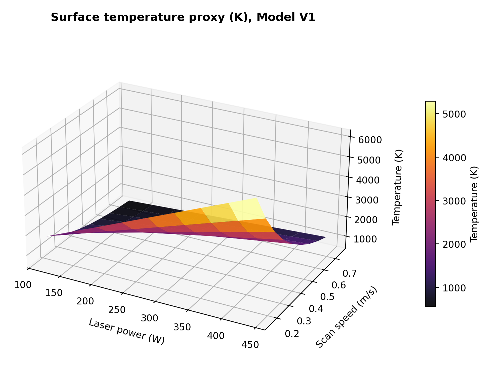
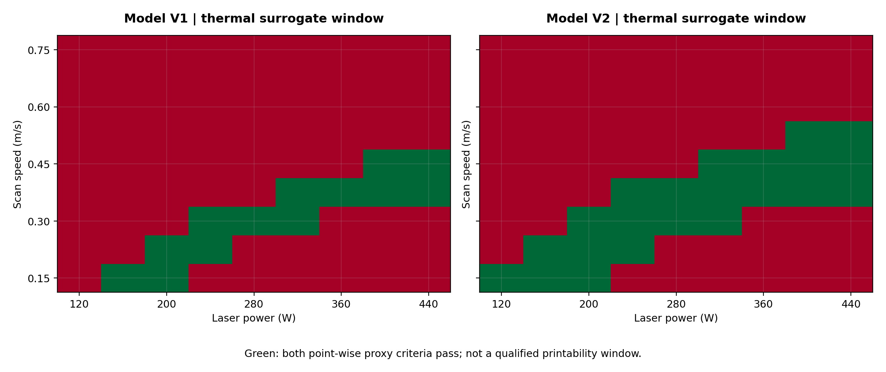
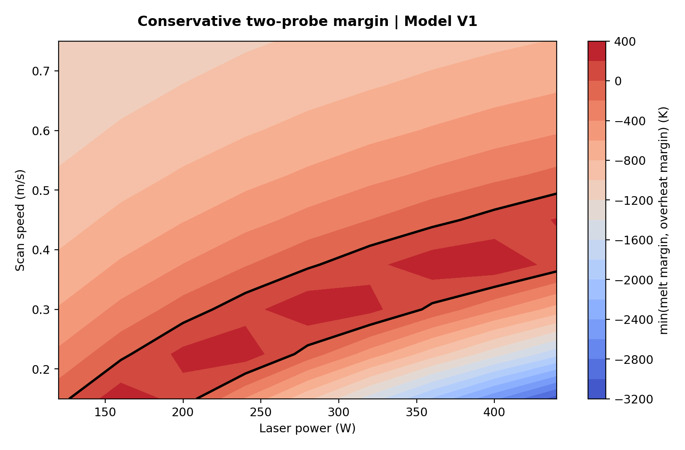
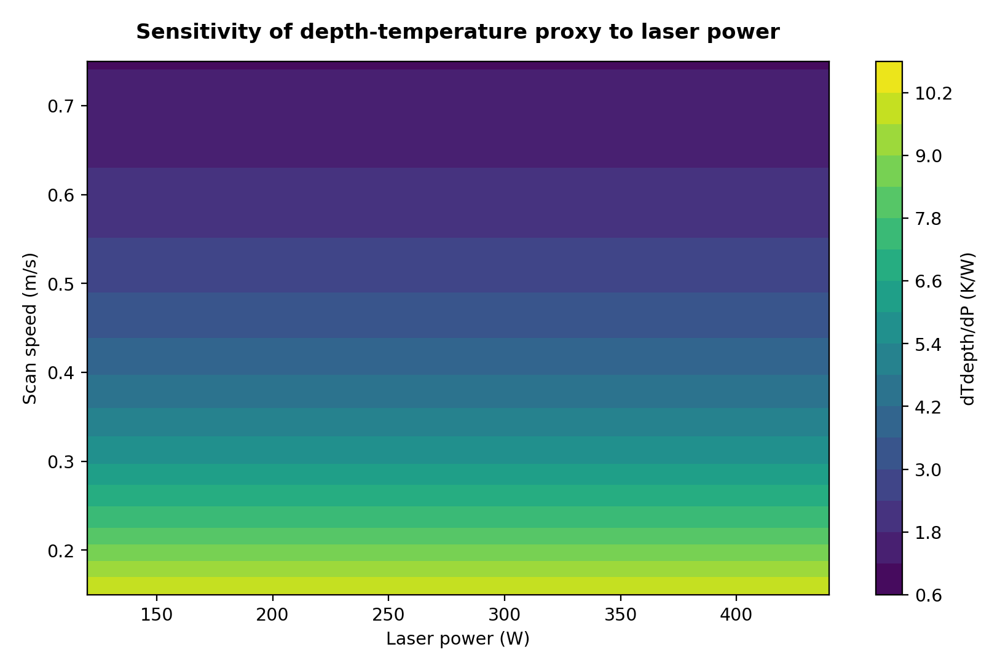
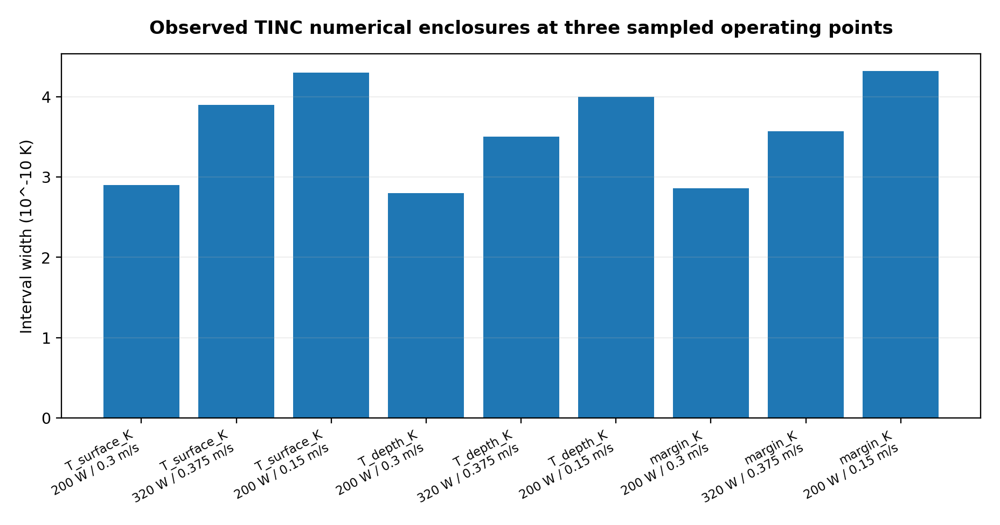

# Programmable Thermal Process Windows for Laser Powder Bed Fusion with paceval


*Concept illustration; not a computed research result or a photograph of a qualified industrial process.*

**Scientific functionality demonstrator | 14 November 2026 | Executed paceval MCP 4.26 mathematical graphs**

This research project investigates reusable, version-controlled mathematical expression graphs for thermal screening of candidate laser power and scan-speed settings in metal powder bed fusion. The original two-page [WP 02 proposal](docs/Original_WP02_Thermal_Process_Window.pdf) defines a regularized moving-source temperature equation. This release implements and independently checks an expanded two-probe, two-version thermal process-window example. It does **not** establish a qualified machine setting, a full melt-pool model, or a demonstrated industrial benefit.

**[Read the English research whitepaper (PDF)](paceval_Additive_Manufacturing_Thermal_Window_Whitepaper_EN.pdf)** · [C++ implementation](src/am_thermal_paceval.cpp) · [Formula manifest](src/formula_manifest.json) · [Execution evidence](results/execution_evidence.json) · [Independent numerical audit](results/high_precision_audit.json)

## 1. Industrial use case and current state of the art

Laser powder bed fusion (PBF-LB/M) builds a metal component by scanning a focused heat source over successive powder layers. Engineers screen laser power, travel speed, material properties, layer conditions and geometrical constraints before carrying out expensive experimental and multiphysics qualification. Thermal models are one part of this screening. A useful model should identify whether selected locations are hot enough to melt while avoiding an illustrative upper-temperature limit. It must also state where its predictions stop being physically reliable.

The **NIST Additive Manufacturing Benchmark Test Series** supplies independent challenges involving melt-pool geometry, thermography, cooling and solidification, including alloy 718 datasets in 2022 and more detailed challenge problems in 2025. A July 2026 NIST overview describes a continuing programme of controlled experimental benchmarks. Modern process simulation spans analytic Rosenthal-type conduction surrogates, finite-element and finite-volume thermal solvers, and high-fidelity multiphysics models. The methods differ in which phenomena they represent. Analytical screening cannot, by itself, predict keyhole stability, melt convection, phase transformation, real porosity or finished-part quality. See [NIST AM Bench](https://www.nist.gov/ambench), [NIST 2026 overview](https://www.nist.gov/publications/enabling-modelers-test-their-simulations-against-rigorous-highly-controlled-additive), [NIST direct data links](https://www.nist.gov/ambench/direct-am-bench-data-links-and-referencing-guidance), and the [2026 review of powder-bed fusion modeling](https://pmc.ncbi.nlm.nih.gov/articles/PMC12843373/).

The concrete research question here is narrower than industrial certification: can a real paceval engine evaluate the complete, parameterized analytical screening formula, versioned alternative geometry, sensitivities, logical acceptance flags, and thermal margins for a reproducible scenario set? The answer for the **remote paceval MCP execution** is yes. Reproduction using the **locally linked C++ SDK** is supplied but not recorded as executed because the required compatible Linux `.so` was unavailable in this environment.

## 2. Defined thermal process-window model

The original WP 02 mathematical specification introduces thermal diffusivity and a regularized moving-point-source surrogate. Using SI units:

$$
\alpha=\frac{k}{\rho c_p},\qquad
r_1=\sqrt{x^2+y^2+z^2+r_0^2},
$$

$$
T_1(x,y,z)=T_0+\frac{\eta P}{2\pi k r_1}
\exp\left[-\frac{v(x+r_1)}{2\alpha}\right].
$$

Version V2 is a controlled **exploratory anisotropic effective-radius model**, not an exact solution of an anisotropic heat equation:

$$
r_2=\sqrt{x^2+(y/\beta)^2+(z/\gamma)^2+r_0^2},\quad
T_2=T_0+\frac{\eta P}{2\pi k r_2}\exp\left[-\frac{v(x+r_2)}{2\alpha}\right].
$$

The host defines two synthetic probe locations: surface `(0,0,0)` metres and subsurface `(-15,10,45)` micrometres. For each model version, paceval computes the temperature at each probe and then the composite conservative margin:

$$g_{\mathrm{melt}}=T_{\mathrm{depth}}-T_{\mathrm{liquidus}},\qquad
g_{\mathrm{hot}}=T_{\mathrm{upper}}-T_{\mathrm{surface}},$$

$$g_{\mathrm{window}}=\min(g_{\mathrm{melt}},g_{\mathrm{hot}}).$$

The corresponding paceval graph evaluates `(g_melt >= 0) AND (g_hot >= 0)`. It returns `1` for these two mathematical criteria and `0` otherwise. This is a **two-probe thermal screen**, not a prediction that the melt pool is defect-free, nor a claim that all points in a three-dimensional volume satisfy the bounds. The host is responsible for input/domain checks and any eventual nonmathematical ACCEPT/REVIEW/REJECT policy.

All model values are **illustrative**, including `Tliq = 1600 K`, upper proxy threshold `3100 K`, effective radius `r0 = 60 µm`, conductivity `35 W/(m·K)`, density `8200 kg/m³`, heat capacity `500 J/(kg·K)`, and absorptivity `0.3`. They do not constitute a material card or measured properties of NIST alloy 718.

## 3. What actually executed in paceval

The genuine **paceval MCP 4.26 service** created **12 persistent mathematical graphs**, and a multi-graph batch evaluated **81 operating conditions**, with **972 graph-point evaluations** and no reported per-value errors. A second actual MCP run created **three TINC-enabled graphs** and evaluated **nine graph-point intervals**. A separate operator test evaluated **six graphs** at three input sets each. These are distinct execution groups; the counts must not be conflated. The graph IDs, formulas, numerical provenance and verification paths are retained in [`results/`](results/execution_evidence.json).

| Mathematical function / industrial purpose | Actual execution | Graph version or rationale |
|---|---|---|
| Thermal diffusivity and model temperature, two probe locations | paceval MCP | `thermal_diffusivity`, `temp_surface_v1`, `temp_depth_v1` |
| Controlled alternative anisotropic surrogate | paceval MCP | `temp_surface_v2`, `temp_depth_v2` |
| Combined melting/overheating temperature margins | paceval MCP | `window_margin_v1`, `window_margin_v2`, infix `min` |
| Discrete two-condition thermal flags | paceval MCP | `window_flag_v1`, `window_flag_v2`, comparisons and `AND` |
| Sensitivity to laser power and scan speed | paceval MCP | `gradient_power_depth_v1`, `gradient_speed_surface_v1` |
| Model revision delta | paceval MCP | `delta_depth_v2_v1` |
| TINC sampled numerical enclosures | paceval MCP | Three separately TINC-enabled graphs |
| Candidate generation, strict CSV parsing, lifecycle and output | C++ host | Provided source; original local SDK not executed |
| Independent reference and output reconstruction audit | Python mpmath | Separate, independently coded reference, not paceval |

The main V1 and V2 formulas coexist as independent graph handles and are never silently overwritten. Input parameters are shared, enabling controlled comparisons. The TINC demonstration refers to rounding-related numerical enclosures for selected deterministic floating-point inputs. It does not propagate material-property or measurement uncertainty through full input intervals, and does not prove global interval inclusion.

## 4. Reproducible synthetic research workload

[`data/synthetic_process_inputs.csv`](data/synthetic_process_inputs.csv) contains 9 laser powers (120–440 W) by 9 scan speeds (0.15–0.75 m/s), with fixed hypothetical thermal properties and two probe locations. The original WP 02 suggests a far larger future spatial and parameter scan. The present **81-scenario functionality study** intentionally does not represent that proposed full experiment as completed.

**Data transfer qualification:** the complete 81×12 MCP batch was executed and returned with error status 0, but its full machine-readable response could not be exported directly into the execution container. [`mcp_grid_reconstructed_from_recorded_endpoints.csv`](results/mcp_grid_reconstructed_from_recorded_endpoints.csv) reconstructs the intermediate laser-power points from transcribed actual MCP endpoint outputs using the model's exactly affine dependence on power. It is **not a byte-for-byte raw MCP export**. All 81 scenarios were separately actually evaluated, and additional internal operating points were cross-checked against the returned MCP response. See [`mcp_anchor_record.json`](results/mcp_anchor_record.json). The figure script regenerates its scientific plots from this explicitly qualified derived dataset, rather than claiming the curves are untouched raw exports.

## 5. Scientific diagrams

All experimental plots use the recorded paceval MCP results or their explicitly documented affine reconstruction; the workflow diagram and hero are clearly non-computational illustrations.



*Figure 2. Model V1 surface-temperature surrogate across the executed operating grid; derived from actual paceval MCP endpoint records.*



*Figure 5. Green regions indicate only the modeled two-point thermal criteria. This is not industrial qualification.*



*Figure 6. Combined thermal margin for V1. Zero marks the two-probe threshold boundary.*



*Figure 7. Analytically defined sensitivity, also executed as an individual paceval graph.*



*Figure 9. Real sampled paceval TINC intervals, not estimated uncertainty envelopes.*

Additional figures: [V1 depth surface](figures/03_depth_temperature_v1.png), [V2 depth surface](figures/04_depth_temperature_v2.png), [controlled V2−V1 difference](figures/08_model_revision_delta.png), [thermal probe profiles](figures/10_probe_profiles.png), and [schematic workflow](figures/01_workflow_schematic.png).

## 6. Build and execute the ORIGINAL local SDK

The genuine SDK files [`src/paceval_main.h`](src/paceval_main.h) and [`src/paceval_main.cpp`](src/paceval_main.cpp) are supplied unchanged with the original license notices. The compatible external shared library must be obtained separately and **is not included in this public ZIP**.

```bash
cmake -S src -B build -DCMAKE_BUILD_TYPE=Release \
  -DPACEVAL_RUNTIME=/absolute/path/to/libpaceval_linux_sharedLIB.so
cmake --build build -j
ctest --test-dir build --output-on-failure
./build/am_thermal_paceval .
```

The program validates the exact numeric CSV schema before using `paceval_dConvertStringToFloat`; mathematical expressions such as `1+2` in numeric CSV fields are rejected. It uses `paceval_dConvertFloatToString` for numerical result output. It checks scalar and batch APIs, multi-graph result ordering, per-point errors, TINC bounds, formula versions, and independently coded C++ reference values. A CTest exercises operator semantics and conversion boundaries. **Only C++ syntax validation, not actual linking, SDK conversion or CTest execution, was possible in this authoring environment**. The original runtime is therefore a genuine reproduction dependency, not a claimed completed test.

## 7. Validation and data integrity

Run the available standalone verification and graphics scripts:

```bash
python3 validation/high_precision_reference.py .
python3 validation/check_project.py .
python3 src/make_figures.py .
```

The high-precision reference uses independent mpmath equations and exact reconstructions of the binary64 input values. It checks all 81 reconstructed grid points, decision flags, transfer checkpoints, and the nine real TINC enclosures. The detailed audit is stored in [`results/high_precision_audit.json`](results/high_precision_audit.json), not in numerical engine-comparison tables here. The README checker uses a Markdown parser, validates relative links and math markers, and runs deliberate negative tests to ensure broken links and malformed markup are rejected.

For a real production pilot, next steps must include calibrated material-property characterization, actual laser energy absorption, layer/powder influences, phase change and high-fidelity validation against available [NIST AM Bench datasets](https://www.nist.gov/ambench/direct-am-bench-data-links-and-referencing-guidance) with per-dataset license and attribution checks. No actual NIST measurement series was downloaded or compared in this release.

## 8. Limitations and scientific interpretation

This is a mathematically reproducible **conduction-dominated research surrogate** and a demonstrator of versioned reusable expression evaluation. The governing point-source equation is deliberately regularized, and the anisotropic radius variant has no independent full PDE derivation. A good match between two numerical implementations confirms only that those implementations evaluate the defined equations consistently. It cannot establish melt pool depth accuracy, lack-of-fusion freedom, vaporization behavior, porosity, process stability, regulatory acceptance, or overall cost savings. The temperature thresholds and model coefficient choices were not fitted to material data.

The historical requirement for large parameter sweeps in the original WP 02 is a proposed research direction, not completed experimental evidence. The current result supports a subsequent, properly calibrated validation pilot, not immediate manufacturing deployment.

## 9. Scientific and technical references

- NIST, [Additive Manufacturing Benchmark Test Series](https://www.nist.gov/ambench), updated benchmark descriptions for 2022 and 2025.
- NIST, [AM Bench direct data links and referencing guidance](https://www.nist.gov/ambench/direct-am-bench-data-links-and-referencing-guidance), updated 6 November 2026.
- NIST (2026), [Enabling Modelers to Test Their Simulations against Highly Controlled Additive Manufacturing Benchmark Data](https://www.nist.gov/publications/enabling-modelers-test-their-simulations-against-rigorous-highly-controlled-additive).
- [On Characterizing Uncertainty Sources in Laser Powder Bed Fusion Additive Manufacturing Models](https://tsapps.nist.gov/publication/get_pdf.cfm?pub_id=928087), NIST-hosted research paper.
- [Advanced Numerical Modeling of Powder Bed Fusion: From Physics-Based Simulations to AI-Augmented Digital Twins](https://pmc.ncbi.nlm.nih.gov/articles/PMC12843373/), 2026 review.
- [ISO/ASTM 52900:2021](https://www.iso.org/standard/74514.html), additive manufacturing fundamentals and vocabulary, confirmed 2025.
- [paceval original API documentation](https://paceval.com/api/) and [product brief](https://paceval.com/product-brief/).

Copyright and license notices for original paceval SDK files are retained. The conceptual title image is original project artwork; it does not show experimental measurement data.
