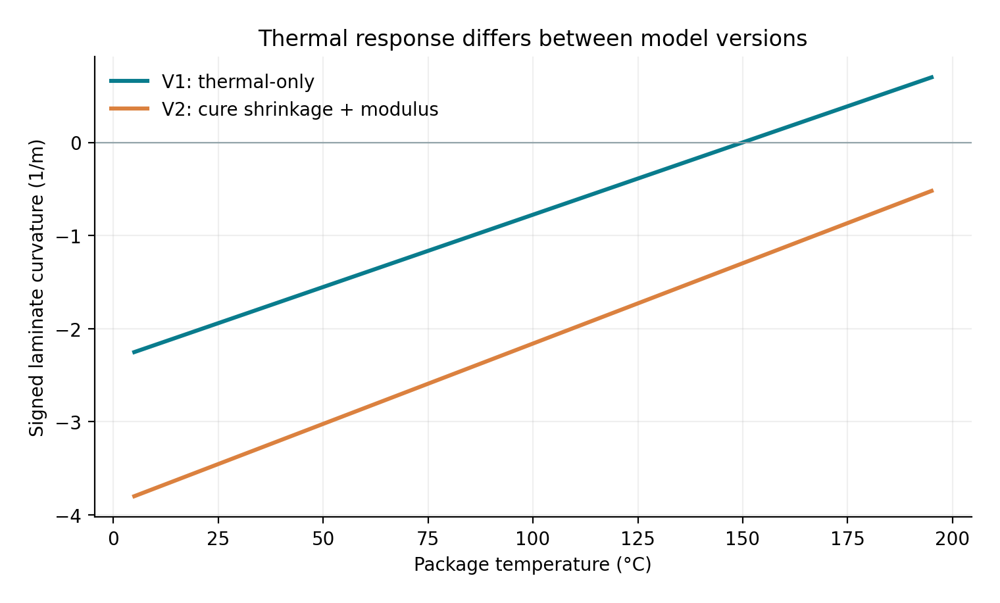
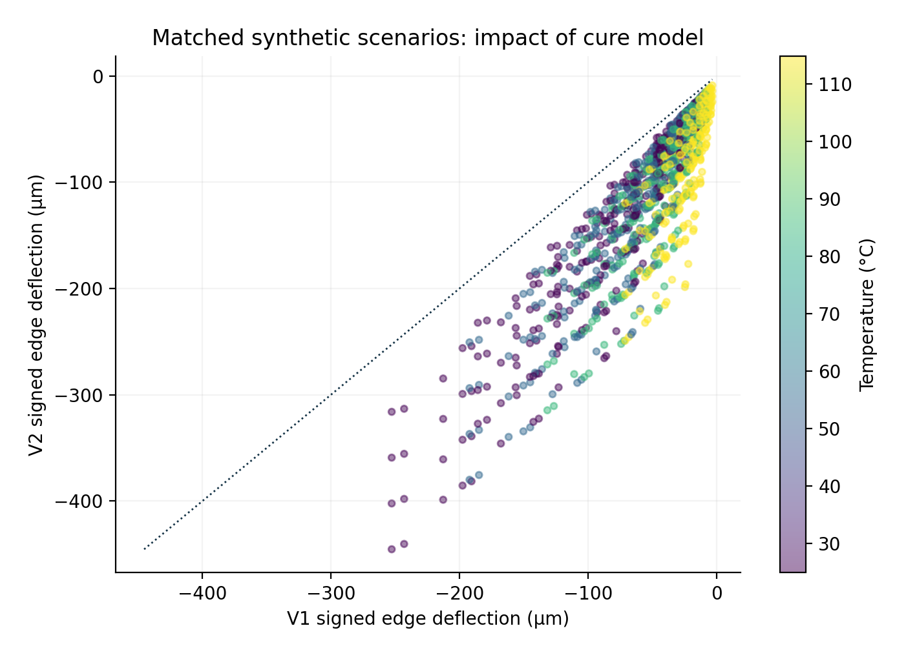
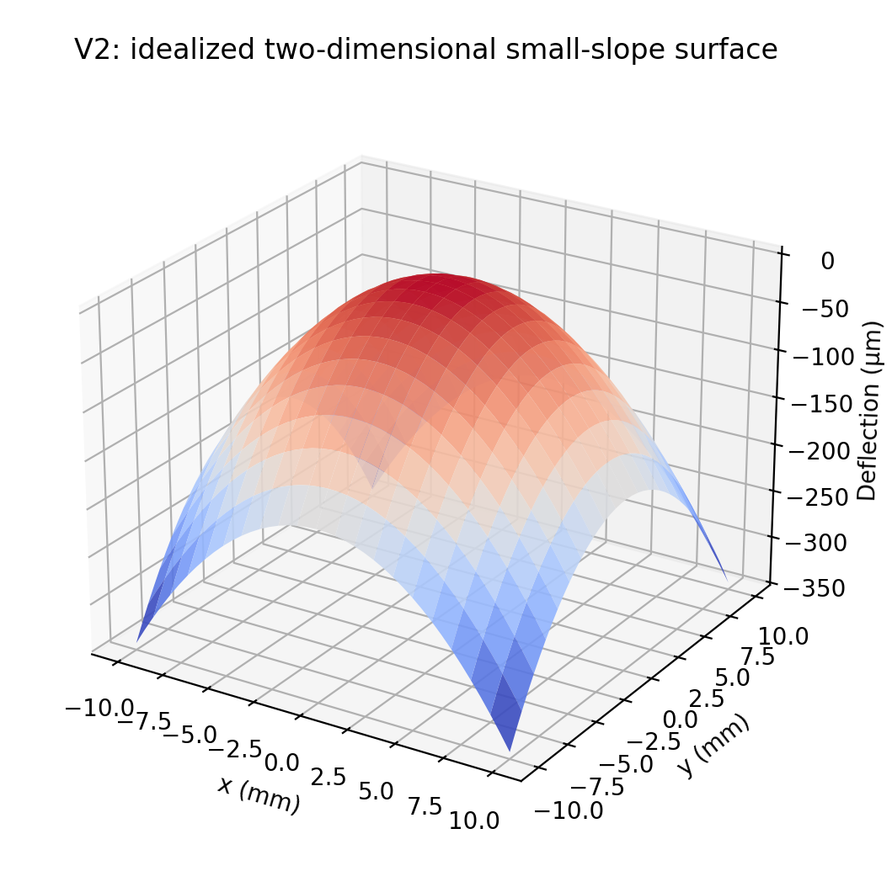

# Advanced Chip Packaging: Warpage and Cure Stress Screening with paceval


*A conceptual cover illustration. It is not a photograph of an experimental specimen, a measured stress field, or a simulation result.*

This repository provides a fully executed, reproducible **Linux C++ mathematical research demonstrator** of thermomechanical screening in an idealized heterogeneous semiconductor package. All significant explicit constitutive, kinetic, stress, curvature, sensitivity, numerical-margin and version-comparison expressions are run through the **original paceval Mathematical Engine 4.25**. A C++ host manages input validation, the staged execution workflow, the cure-history integrator, and output files. Native C++ and 90-digit Python/mathematical references independently audit the resulting physical observables.

The research question is functional: can a real program use persistent mathematical execution graphs to produce auditable, versioned packaging-mechanics outputs? **This is not a FEM validation, supplier-material qualification, JEDEC warpage measurement, or prediction of actual manufacturing yield.** No execution-speed or hardware-efficiency claim is made.

## 1. Industrial use case and current state of the art

Advanced chip packaging combines silicon, polymeric encapsulants, underfill or bonding layers, redistribution structures, substrates, and interconnects. They undergo processing and use temperatures that create mismatched expansion, while thermosetting materials undergo chemical cure shrinkage. Mechanical stresses generated by mismatch can bend the package and challenge assembly and reliability. Engineers therefore need to examine material combinations, curing recipes and temperature conditions before committing to expensive fabrication, test articles and detailed nonlinear simulations.

Real design and qualification use material metrology, process-dependent constitutive behavior and 3D finite-element mechanics. The US National Institute of Standards and Technology (NIST) **CHIPS AWACKSM** project (updated October 2026) studies cure kinetics, polymer properties, residual stress and warpage, and makes material metadata/datasets available for follow-on research [1,2]. Published experimental and simulation studies in 2024, 2025 and 2026 emphasize the need to consider cure history, shrinkage, viscoelastic effects and thermal excursions [3-6]. Industrial modeling environments, such as Siemens Simcenter and Ansys Mechanical, offer more comprehensive mechanical analyses [7,8]. **JEDEC JESD22-B112C (November 2023)** concerns measurement of package warpage at elevated temperature [9].

The industrial application examined here is a deliberately narrower *pre-FEM screening kernel*. A hypothetical process-engineering team varies encapsulant thickness, package width, effective expansion coefficient, cure shrinkage and operating temperature. For each case the program evaluates the strain field, three-layer laminate force and moment resultants, signed curvature, representative interface stresses and mathematical screening margins. This information can guide which *hypothetical candidates* deserve experimentally calibrated FEM or physical metrology. No published value is represented as NIST-measured or supplied by a customer.

## 2. The scientific model

The source WP 07 proposed thermal strain, a linear stress proxy and a simple curvature factor. Here, that geometrical factor is replaced by an explicit, **three-layer laminate** solution. Each layer is homogeneous, perfectly bonded, isotropic for the simplified equi-biaxial response, and linearly elastic. Small strain, uniform temperature, free plate bending, and a uniform effective cure degree are assumed. The simplified geometry is a flat substrate, a representative bonding/die region, and a molding/encapsulant region. The model does not resolve individual chips, bumps, anisotropic single-crystal silicon, package edge effects or 3D interfaces.

Let the laminate thickness coordinates be $z_0=0$, $z_1=h_1$, $z_2=h_1+h_2$, and $z_3=h_1+h_2+h_3$. For layer $i$, use biaxial modulus $\bar E_i=E_i/(1-\nu_i)$. Thermal eigenstrain is $\epsilon_i^*=\alpha_i(T-T_r)$, with $T_r$ an **assumed effective stress-free reference temperature**, not an experimentally inferred real-process gel temperature. Model V2 adds a post-gel effective encapsulant cure shrinkage strain and a phenomenological cure-modulus factor:

```math
\begin{aligned}
\epsilon_{3,\mathrm{V2}}^* &= \alpha_3(T-T_r) - \beta\,\frac{\max(a-a_g,0)}{1-a_g},\\
\bar E_{3,\mathrm{V2}} &= \frac{E_3[1+g_E(a-a_g)]}{1-\nu_3},\\
\epsilon_{3,\mathrm{V1}}^* &= \alpha_3(T-T_r),\qquad
\bar E_{3,\mathrm{V1}}=\frac{E_3}{1-\nu_3}.
\end{aligned}
```

The force and moment balance is derived by integrating the linear stress $\sigma_i(z)=\bar E_i(\epsilon_0+z\kappa-\epsilon_i^*)$ through each layer:

```math
\begin{aligned}
A &= \sum_i \bar E_i(z_i-z_{i-1}), &
B &= \frac{1}{2}\sum_i\bar E_i(z_i^2-z_{i-1}^2),\\
D &= \frac{1}{3}\sum_i\bar E_i(z_i^3-z_{i-1}^3), &
N^* &= \sum_i\bar E_i\epsilon_i^*(z_i-z_{i-1}),\\
M^* &= \frac{1}{2}\sum_i\bar E_i\epsilon_i^*(z_i^2-z_{i-1}^2).
\end{aligned}
```

```math
\begin{aligned}
\Delta &= AD-B^2 >0,\\
\epsilon_0 &= \frac{DN^*-BM^*}{\Delta},\\
\kappa &= \frac{AM^*-BN^*}{\Delta},\\
w_{\mathrm{edge}} &= \kappa W^2/8.
\end{aligned}
```

The signed center-to-edge deflection $w_{\mathrm{edge}}$ is a **one-dimensional small-slope surrogate** and is **not equivalent to a JEDEC-measured whole-package peak-to-valley warpage**. The separately evaluated two-dimensional idealized shape $w(x,y)=\kappa(x^2+y^2)/2$ is a conceptual equi-biaxial surface and likewise not a measured 3D deformation.

A demonstrator-only cure trajectory uses the first-order/autocatalytic kinetic special case

```math
\frac{da}{dt} = \left[k_1(T)+k_2(T)a\right](1-a), \qquad
k_j(T)=k_{j,r}\exp\left[-\frac{E_{a,j}}{R}\left(\frac{1}{T}-\frac{1}{T_{r}}\right)\right].
```

paceval evaluates the full nonlinear RHS, while the **C++ host** performs RK4 integration through a synthetic 423.15 K dwell, cooling to 298.15 K and a final room-temperature hold. This history is illustrative and does not model viscoelastic memory, cure-exotherm feedback or physical gel-point determination. Material properties and kinetics are intentionally synthetic. Sensitivities $\partial\kappa/\partial T|_a$ and (for V2) $\partial\kappa/\partial\beta|_a$ are analytically derived and executed as paceval graphs, **not presented as automatic differentiation**.

## 3. Executed results

The C++ main program successfully evaluated **40 distinct domain graphs** including its explicit deflection-surface graph, on **1,280 synthetic input scenarios** and **2,560 model/scenario combinations**. Its machine-readable [execution evidence](results/execution_evidence.json) records the graph registration/evaluation counts, the actual batch and scalar API paths, and the generated files. The predefined illustrative guard $|w_{\mathrm{edge}}|\leq100\,\mu\mathrm{m}$ and peak sampled elastic stress $\leq150\,\mathrm{MPa}$ is satisfied by **1,112 V1** and **630 V2** cases. **These are mathematical thresholds for testing, not industrial safety or acceptance limits.**

For the transparent reference configuration, evaluated at 298.15 K with $h_3=550\,\mu\mathrm{m}$ and $W=20\,\mathrm{mm}$, the actually executed graphs yield the following values:

| Observable | V1 thermal-only | V2 with cure contribution |
| --- | ---: | ---: |
| Signed curvature, m⁻¹ | −1.942268 | −3.456160 |
| Signed center-to-edge deflection, µm | −97.1134 | −172.8080 |
| Maximum layer-endpoint stress proxy, MPa | 102.325 | 181.606 |
| Illustrative guard | 1 | 0 |

This illustrates how ignoring a hypothetical post-gel shrinkage term would change candidate rankings **within the chosen simplified model**. The two versions coexist as separate persistent, testable formula graphs. Their numerical differences are **model contrasts**, not an accuracy benchmark between software engines.



*Signed curvature versus temperature at fixed effective cure degree. Values come from the actual C++/paceval result files.*



*Each point represents the same synthetic input package evaluated by V1 and V2. Color denotes temperature.*



*Idealized small-slope deflection surface evaluated by a dedicated paceval graph. It does not depict real chiplet geometry, FEM meshing or measured warpage.*

Ten reproducible result figures as both PNG and vector PDF are provided under [figures/](figures/). Other plots show thermal deflection and sampled stress, the thickness/shrinkage design map, cure state and warpage over time, temperature sensitivity, and mathematical limit-mask counts. Their source files are all generated from actual paceval output CSVs by [make_figures.py](scripts/make_figures.py).

## 4. Actual mathematics execution and responsibilities

The program creates each graph once and reuses its handle. Multi-graph batches first compute the physical eigenstrains and effective moduli, then laminate stiffness resultants and moments, then curvature, endpoint stresses and analytic sensitivities, and finally margins/guards/scores. Intermediate graph values are transferred unmodified by C++ into subsequent graph input arrays. The version comparison is itself a paceval graph, rather than unrecorded host arithmetic. See the complete [formula manifest](results/formula_manifest.csv) and the [function-by-function execution inventory](results/math_execution_inventory.csv).

| Mathematical function / purpose | Actual execution | Graphs or reason |
| --- | --- | --- |
| Cure Arrhenius terms, post-gel rate, kinetic sensitivity | paceval | `KIN1`, `KIN2`, `CURE_RATE`, `CURE_SENS_A` |
| Material eigenstrains, cure shrinkage and cure-modulus factor | paceval | `EIGEN1/2`, `V1_EIGEN3`, `V2_EIGEN3`, `SHRINKAGE`, `MODULUS_FACTOR` |
| Three layer biaxial moduli | paceval | `EBAR1/2`, `V1_EBAR3`, `V2_EBAR3` |
| Force/moment laminate integrals | paceval | `EXTENSION_A`, `COUPLING_B`, `BENDING_D`, `EIGEN_FORCE_N`, `EIGEN_MOMENT_M` |
| Mid-plane strain, determinant and signed curvature | paceval | `LAMINATE_DET`, `MEMBRANE_STRAIN`, `SIGNED_CURVATURE` |
| Deflection and all six layer endpoint stresses | paceval | `EDGE_WARPAGE`, `STRESS1/2/3_LOWER/UPPER`, `SHAPE_DEFLECTION` |
| Analytic temperature and shrinkage sensitivities | paceval | `D_CURV_D_T`, `V2_D_CURV_D_BETA` |
| Stress maxima, continuous margins, composite logical test, scoring | paceval | `MAX_STRESS`, `WARP_MARGIN`, `STRESS_MARGIN`, `SCREEN_GUARD`, `SCREEN_SCORE` |
| Model changes / V1 versus V2 | paceval | `DELTA_CURVATURE`, `DELTA_WARPAGE`, `RELATIVE_WARPAGE` |
| Time integration, range checks, CSV schema and candidate enumeration | C++ host | Stateful RK4, file and dataset orchestration |
| Independent physical result reference | native C++ / Python | Audits only; neither substitutes for paceval output |

The original SDK functions `paceval_CreateComputation`, `paceval_dGetComputationResult`, `paceval_dGetMultipleComputationsResultsExt`, `paceval_dConvertStringToFloat` and `paceval_dConvertFloatToString` are invoked. A non-symmetric batch-layout probe checks input/output ordering. The C++ tests check used arithmetic, relational, logical, signed remainder and `mod`, infix `min`/`max` behavior. CSV numeric input fields must first pass a strict decimal-literal grammar, rejecting formula strings such as `1+2` before they reach the SDK parser. The SDK floating-point text representation is used for research CSV presentation; bit-identical round trips are **not** asserted. Full numerical details stay in the separate technical audits, not in the public report tables.

## 5. Build and reproduce (Linux)

Requirements: CMake 3.16+, C++17 compiler, Python 3 with `mpmath`, `matplotlib`, `numpy`, `reportlab` and `Pillow` for validation, figures and PDF. Place an **original compatible** external paceval Linux shared object on the machine; it is purposely not distributed in this repository. The supplied original SDK interface files `src/paceval_main.h` and `src/paceval_main.cpp` are included with their license headers unchanged except for the local include path.

```bash
cmake -S src -B build -DCMAKE_BUILD_TYPE=Release \
  -DPACEVAL_RUNTIME=/absolute/path/to/libpaceval_linux_sharedLIB.so
cmake --build build -j
ctest --test-dir build --output-on-failure
./build/chip_warpage --run input/scenarios.csv results/
python3 scripts/verify_high_precision.py results/
python3 scripts/make_figures.py
python3 scripts/make_whitepaper.py
```

[Reproduce the full workflow](scripts/reproduce.sh) uses an external runtime argument and writes the current research outputs. `input/scenarios.csv` is generated with `python3 scripts/create_scenarios.py`. Output CSVs use `.` as decimal and `,` as separator, canonical UTF-8, and stable LF. Row/column errors and nonfinite values fail loudly. Scenario IDs are not interpreted as formulas. Provenance and numeric-field units are defined in [RESEARCH_VALIDATION.md](RESEARCH_VALIDATION.md).

The technical audit files contain **702 independently checked native C++ end-value quantities** and **2,324 independently checked 90-digit Python quantities** across 305 selected screening rows, supplemental model and surface checks, and the independently integrated curing history. The official [scientific audit](results/scientific_audit.json) contains exact counts and detailed error records. The public description does not present cross-engine accuracy differences. Five CTests cover graph/CSV/operator regression, Markdown mathematics validation with negative tests, the complete file-to-graph-to-file pipeline and the independent high-precision audit. A passing local Markdown checker is not a claim that GitHub's online renderer was inspected.

## 6. Limitations and future work

The research validates actual **mathematical functionality** for a deliberately idealized laminate. Real advanced packages require spatially resolved geometry, boundary supports, anisotropic and nonlinear material behavior, creep and stress relaxation, moisture, temperature gradients, cure-dependent chemistry, processing history, adhesion and fracture mechanics. The modulus and shrinkage laws in V2 are transparent illustrative choices, not fitted supplier data. A reference state chosen at one temperature does not establish a stress-free real gel point. The output screen score/guard is not a yield forecast, mechanical-design pass/fail, JEDEC-compliant test or regulator-approved safety decision. Uncertainty here is parameter exploration, not statistically calibrated material uncertainty.

A scientific continuation should calibrate from published NIST CHIPS-AWACKSM or licensed supplier data, compare signed deflection and stress against independent, experimentally validated finite-element predictions, include nonlinear viscoelastic internal variables and distributed thermal/cure fields, and define measured thresholds before any engineering decision. A hardware implementation might evaluate reusable mathematical graphs differently but **has not** been measured here.

## 7. References and provenance

1. NIST, *Accurate Cure Kinetics, Stress, Mechanical Properties and Warpage* (started 2023; updated 2 October 2026). https://www.nist.gov/programs-projects/accurate-cure-kinetics-stress-mechanical-properties-and-warpage
2. NIST, *CHIPS-AWACKSM Data*, 2025–2026 research data and metadata index. https://pages.nist.gov/CHIPS-AWACKSM-data/
3. Centellas et al., *Advanced Metrology Suite for Linking Residual Stress to Fundamental Properties of Thermoset Packaging Materials*, ECTC 2025. https://doi.org/10.1109/ECTC51687.2025.00078
4. Um et al., *Reduced warpage in semiconductor packages: Optimizing post-cure temperature profile considering cure shrinkage and viscoelasticity*, *Materials & Design* 245, 2024. https://doi.org/10.1016/j.matdes.2024.113265
5. Baek et al., *Multi-physics coupled modeling of process-induced warpage in advanced fan-out wafer-level semiconductor packages*, *Journal of Manufacturing Processes*, 2026. https://doi.org/10.1016/j.jmapro.2026.07.036
6. NIST, Centellas et al., *Controlling the Reaction Pathway to Tune Packaging Epoxy Properties*, ECTC 2026. https://www.nist.gov/publications/controlling-reaction-pathway-tune-packaging-epoxy-properties
7. Siemens, *Simcenter Simlab for PCB and electronic packaging analysis*. https://www.siemens.com/en-us/products/simcenter/simulation-modeling-visualization/simlab/
8. Ansys, *Mechanical Help: Structural example — Substrate Warpage* (Ansys 2025 R2). https://ansyshelp.ansys.com/public/Views/Secured/Electronics/v252/en/PDFs/Mechanical.pdf
9. JEDEC, *JESD22-B112C: Package Warpage Measurement of Surface-Mount Integrated Circuits at Elevated Temperature*, November 2023. https://standards.globalspec.com/std/14647106/jesd22-b112c
10. paceval, *Official API reference, SDK 4.25*. https://paceval.com/api/

The source WP 07 PDF is retained under [docs](docs/original_WP07_proposal.pdf) to distinguish original research intentions from the **executed** present implementation. The present repository's input material, model constants, equations and actual test results are the sole sources of its reported numbers. Source code license notices are retained. This project is a synthetic scientific demonstration without performance comparisons.
