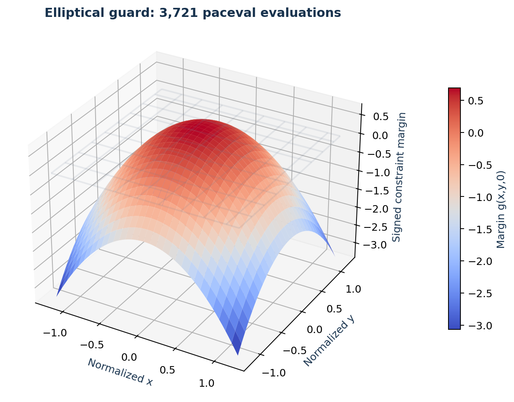
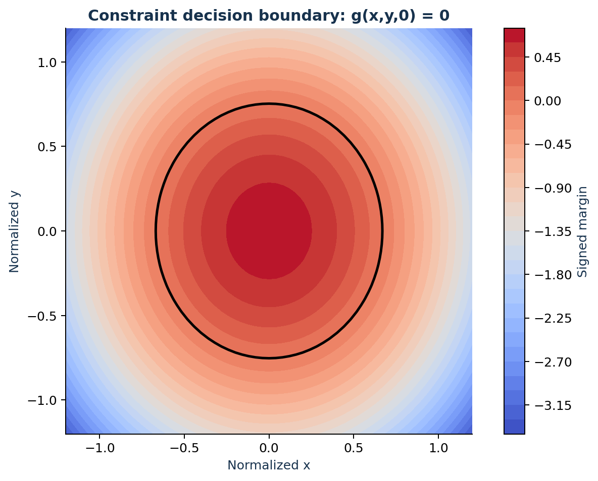

# paceval. | Automatic Verification of Agent-Generated Constraints


**A reproducible industrial research demonstrator that executes 1,000 versioned mathematical inequality guards with the original paceval C/C++ engine.** It verifies normalized industrial setpoints produced by an allowlisted constraint-generation workflow, and routes each request to **ACCEPT**, **REJECT**, or **REVIEW** rather than granting automatic authority to a language model.

**Evidence:** The supplied C++ application was built and executed against a compatible external paceval runtime. The released workload consists of 100,000 deterministic guard-input evaluations plus a 3,721-point numerical constraint surface. Independently coded numerical checks are included in the technical audit files. No free-form language-model output, production industrial controller, or general-purpose formal proof system was evaluated.

[English research whitepaper](paceval_Agent_Constraint_Verification_Whitepaper_EN.pdf) · [C++ source](src/agent_constraints.cpp) · [CMake](src/CMakeLists.txt) · [SDK header](src/paceval_main.h) · [SDK facade](src/paceval_main.cpp) · [Reproduction checker](src/verify_results.py)

## 1. Industrial use case and current state of the art

Manufacturing engineers increasingly configure robotic workcells, actuators, inspection machinery, and process setpoints through higher-level planning tools. A language-model agent may suggest a speed, thermal threshold, workspace point, or operating range, but an agent's textual assertion that a proposed action is safe is not independent evidence that the numeric conditions are satisfied. In a practical machine-setting workflow, control software must validate the request's schema, units, authorization and permissible numerical range before any mathematical constraint is considered.

This project models a **hypothetical automated manufacturing cell** with dimensionless normalized setpoints $x$, $y$, and $z$. An allowlisted template generator supplies inequality guards. The C++ host validates types, units, ranges and operation permissions; the reusable paceval graphs then calculate a signed margin for each guard. Requests near the boundary are routed to review and are *not* silently approved. The resulting decision can inform a downstream gate but is not an authorization or physical safety certificate.

The technical context is informed by the [NIST Generative AI Risk Management Profile](https://www.nist.gov/publications/artificial-intelligence-risk-management-framework-generative-artificial-intelligence), [SMT-LIB 2.7](https://smt-lib.org/papers/smt-lib-reference-v2.7-r2025-07-07.pdf), [Microsoft Z3 nonlinear arithmetic documentation](https://github.com/microsoft/z3guide/blob/main/website/docs-smtlib/02%20-%20theories/01%20-%20Arithmetic.md), the [MCP tool specification (2026-07-28)](https://github.com/modelcontextprotocol/modelcontextprotocol/blob/main/docs/specification/2026-07-28/server/tools.mdx), and the [paceval C/C++ interface](https://paceval.com/api/). Unlike SMT solvers, the present program assesses specified sampled inputs and does not prove a guard for all possible values.

## 2. Mathematical models and paceval execution

For an admissible, finite input vector $\mathbf{u}=(x,y,z)$ the numerical convention is to compute a signed margin $g(\mathbf{u})$. A positive margin indicates that an inequality is satisfied, and a negative margin indicates violation. The actual host decision has a separate review band:

```math
\mathrm{route}(g)=
\begin{cases}
\mathrm{ACCEPT}, & g>\tau,\\
\mathrm{REVIEW}, & -\tau\leq g\leq\tau,\\
\mathrm{REJECT}, & g<-\tau,
\end{cases}\qquad \tau=10^{-8}.
```

The tolerance is a **demonstration policy parameter**, not a rigorously certified floating-point error enclosure. The host rejects nonfinite or out-of-contract inputs before evaluating a guard.

Five meaningful mathematical guard families are instantiated with 200 distinct parameter configurations each:

```math
\begin{aligned}
g_1(x)&=c-x &&\text{(upper-bound threshold)},\\
g_2(x,y)&=c-(x/a)^2-(y/b)^2 &&\text{(elliptical operating region)},\\
g_3(x,y,z)&=c-x^2-ky^2-0.1z^2 &&\text{(quadratic budget)},\\
g_4(x,y,z)&=c+ax-by+kz &&\text{(affine setting envelope)},\\
g_5(x,y,z)&=c-e^{kx}+a\cos(y)-bz^2 &&\text{(nonlinear response envelope)}.
\end{aligned}
```

The 1,000 computation handles are created once through `paceval_CreateComputation` and reused for the deterministic input sequences via `paceval_dGetComputationResult`. A controlled revision of one formula creates an additional handle instead of modifying the existing graph. The packed batch test calls `paceval_dGetComputationResultExt`. Guard generation, request validation, decision routing, policy authorization, state management and CSV export all remain in C++.


## 3. Executed application results

| Research item | Actual recorded outcome |
|---|---:|
| Distinct guarded expressions | 1,000 |
| Persistent paceval graph handles, including one immutable revision | 1,001 |
| Adversarial and boundary-focused inputs | 100,000 |
| ACCEPT decisions | 50,758 |
| REJECT decisions | 31,123 |
| REVIEW decisions | 18,119 |
| Packed batch results checked | 8,000 |
| 3D elliptical guard evaluation points | 3,721 |
| Independent 80-digit sample calculations | 632, passed |
| Host contract rejection tests | 4 |
| CMake/CTest SDK integration | 1 / 1 passed |

These results demonstrate how a large set of agent-proposed, template-constrained mathematical guards can be evaluated with a reusable computation engine. The independent numerical reference, including the raw numerical diagnostics, is available under [`results/`](results/) and in the reproducible source files. A passed sample audit is **not** a proof of global correctness.

## 4. Scientific and industrial graphics

All numbered result graphics use released paceval output CSVs; the architectural diagram describes the actual software boundary. The cover is a conceptual illustration, not measurement data.

| Figure | Industrial or mathematical interpretation | Reproducible files |
|---|---|---|
| 1 | Host authorization and paceval computation boundary | [PNG](figures/01_execution_architecture.png) · [PDF](figures/01_execution_architecture.pdf) |
| 2 | Decision distribution for 100,000 requests | [PNG](figures/02_decision_distribution.png) · [PDF](figures/02_decision_distribution.pdf) |
| 3 | Inputs deliberately concentrated near the boundary | [PNG](figures/03_boundary_analysis.png) · [PDF](figures/03_boundary_analysis.pdf) |
| 4 | Industrial routing profile across adversarial input positions | [PNG](figures/04_decision_routing_profile.png) · [PDF](figures/04_decision_routing_profile.pdf) |
| 5 | 3D elliptical admissibility margin from 3,721 paceval values | [PNG](figures/05_elliptical_guard_3d.png) · [PDF](figures/05_elliptical_guard_3d.pdf) |
| 6 | Two-dimensional contour and zero-margin decision boundary | [PNG](figures/06_elliptical_guard_contours.png) · [PDF](figures/06_elliptical_guard_contours.pdf) |
| 7 | Accept/reject/review results per guard family | [PNG](figures/07_family_decisions.png) · [PDF](figures/07_family_decisions.pdf) |
| 8 | Boundary-review fraction across sampled positions | [PNG](figures/08_review_pattern.png) · [PDF](figures/08_review_pattern.pdf) |





Input/decision data: [guard registry](examples/guard_registry.csv) · [100,000 input evaluations](examples/constraint_evaluations.csv) · [surface data](examples/ellipse_surface.csv) · [host policy tests](examples/host_contract_tests.csv) · [run summary](examples/execution_summary.txt).

## 5. Compile and reproduce

The repository contains the original `paceval_main.h` and `paceval_main.cpp` SDK facade, with the adjacent include path adapted for this layout. The ABI-compatible shared Linux runtime is supplied **externally** and is not redistributed.

```bash
cmake -S src -B build -DCMAKE_BUILD_TYPE=Release \
  -DPACEVAL_RUNTIME=/absolute/path/to/libpaceval_linux_sharedLIB.so
cmake --build build -j
ctest --test-dir build --output-on-failure
./build/agent_constraints --out reproduced
python3 src/verify_results.py
python3 src/high_precision_reference.py
python3 src/make_figures.py
python3 src/make_whitepaper.py
python3 src/check_readme_math.py
```

**Reproduction note:** the Python verification and figure scripts consume the shipped `examples/` datasets. To validate a fresh `reproduced/` run against the released data, compare the two directories or use a clean working copy. Regenerating the published figures does not silently substitute alternate inputs.

Python plotting requires `numpy`, `pandas`, `matplotlib`, and whitepaper creation requires `reportlab` and `Pillow`; high-precision validation requires `mpmath`. The C++ executable itself needs C++17, CMake, and the supplied compatible paceval runtime.

## 6. Limitations and research interpretation

This is a deterministic **pointwise mathematical constraint checker**, not a general theorem prover, full SMT solver, certified interval verifier, live LLM, live MCP endpoint, or machine-safety controller. No formal proof over continuous input sets or real robot-system validation is claimed. The review band is a policy demonstration, not an interval guarantee. Real deployments require strict schemas, safety controllers, authorization, independent functional-safety engineering, hardware interlocks, and testing against actual plant constraints. A model's mathematical result does not grant permission for an industrial action.

The actual contribution of paceval demonstrated here is reusable execution of an extensive, versioned set of nonlinear mathematical guards inside a controlled application workflow. No processing-speed, hardware, cost, or market advantage is claimed.
