# paceval | Agent-Controlled Production-Planning Scores


*Concept illustration; not a computed research result. Source image: 2400 × 1200 pixels, 2:1.*

A **reproducible, independently checked C++ research demonstrator** for mathematical scoring and controlled reconfiguration of a small manufacturing job-shop plan. It uses the **original paceval Mathematical Engine 4.25**, executable persistent computation graphs, multi-graph batch evaluation, synthetic agent policy requests and an exhaustive combinatorial scheduler. This is an industrial research demonstrator, **not a production MES, a live LLM agent, a CP-SAT integration, or a proof of superior industrial optimization performance**.

[Scientific whitepaper (PDF)](paceval_Agent_Controlled_Production_Planning_Scores_Whitepaper_EN.pdf) · [Actual C++ implementation](src/production_planning.cpp) · [Original graph-function inventory](results/math_execution_inventory.csv) · [Independent audits](results/independent_schedule_audit.json)

## 1. Industrial use case and current state of the art

A job shop receives production orders requiring a sequence of machining, inspection or assembly tasks. Each operation uses a particular machine for a known duration. The production planner must respect the specified order of operations inside each job and prevent overlapping tasks on the same machine. Changes of product family may require cleaning, tooling changes or other **sequence-dependent setups**. Production-management teams also care about promised delivery dates, manufacturing electricity and equipment occupation. A good result must satisfy machine and job constraints **before** it is judged by a numerical score.

Modern scheduling systems use established mathematical optimization such as constraint programming, integer programming, heuristics and metaheuristics; [Google OR-Tools CP-SAT](https://developers.google.com/optimization/scheduling/job_shop) is an accessible reference for precedence constraints, non-overlapping machine intervals and makespan minimization. The **ISA-95 / IEC 62264** framework provides a broader context for integration between enterprise planning and manufacturing operations. **ISO 22400** supplies manufacturing KPI terminology rather than certification of this particular numerical model.

Research increasingly explores language-model agents that translate business instructions or shop-floor disturbances into scheduling formulations and parameter changes. A 2025 paper studied multi-agent scheduling optimization (Wang et al., *Computers & Industrial Engineering*, DOI 10.1016/j.cie.2025.111197). A 2026 process-verification study (Hu et al., *Journal of Manufacturing Systems*, DOI 10.1016/j.jmsy.2026.08.009) found that checking only the final objective value can conceal structural constraint omissions. A November 2026 survey (Xiang et al., *Advanced Engineering Informatics*, DOI 10.1016/j.aei.2026.104946) discusses the divide between language-based formulation and reliable numerical optimization.

**This project isolates one useful integration boundary.** An upstream agent submits *structured, bounded planning preferences*; the C++ host constructs and checks feasible machine-order schedules; persistent paceval graphs evaluate tardiness, setups, modeled energy, schedule margins, composite costs and analytic priority sensitivities; the host selects the lowest-scoring feasible candidate. The scenario inputs and resulting decisions can then be audited by an independent program. Here, agent inputs are deterministic CSV fixtures rather than outputs of a connected language model.

A hypothetical engineer might ask a scheduling assistant to emphasize on-time delivery while a second planner emphasizes reducing family changeovers. The same shop-floor tasks are enumerated under both preferences. Each candidate is passed to the original paceval graphs, which return its relevant costs. The C++ host identifies the best candidate under each declared policy and exports a machine-by-machine schedule. **No claimed customer deployment or industrial financial saving is implied.**

## 2. Research question and validated scope

**Can the real original paceval SDK repeatedly evaluate complete, version-controlled mathematical production-planning scores from validated structured agent requests while the host provides independently verified feasible schedules?**

The deterministic main instance has **four jobs, twelve operations and three machines**; every job visits each machine exactly once. Family-dependent setups, nominal and rush due dates, four agent priority vectors and two formula versions form **32 scheduled policy/version conditions**. For each of two setup regimes the host enumerates all **13,824 machine-order assignments**, detects cycles and identifies **1,860 feasible orderings**. The earliest-start schedule is computed for each feasible ordering. This is an exhaustive result *within this small instance, fixed routes, fixed durations, no machine breakdowns, and no preemption*. It is not a general-purpose optimizer for arbitrary factories.

For each of the 32 cases, the independently implemented Python oracle exhaustively checks the selected winner and complete operation schedule. **52 registered original paceval mathematical graphs** were actually executed and reused, with scalar control calls and multi-graph batches. The model includes mathematically explicit feasible-domain margins but does not certify any industrial safety or quality decision.

## 3. Mathematical scheduling model

Let operation $o$ have start $s_o$, duration $p_o$ and completion $e_o$. For successive operations inside the same job and successive machine operations under a chosen machine order, the host enforces:

```math
e_o=s_o+p_o,\qquad s_{o+1}\ge e_o,\qquad s_{v}\ge e_u+\sigma_{uv}.
```

The sequence-dependent setup for different production families is evaluated by a real paceval graph:

```math
\sigma_{uv}=\sigma_0\,(f_u-f_v)^2,\quad f_u,f_v\in\{0,1\}.
```

For job $j$ with due time $d_j$, completion time $C_j$ and priority $q_j$, the **paceval** lateness and tardiness functions are:

```math
L_j=C_j-d_j,\qquad T_j=\max(0,L_j),\qquad W_T=\sum_{j=0}^{3}q_jT_j.
```

The model includes a synthetic processing-electricity estimate $E_{\mathrm{proc}}$ derived from fixed machine-specific rates and a setup adjustment $0.25 S$ kWh. The score does **not** represent metered factory energy. Two actual, simultaneously available paceval objective versions are:

```math
J_1= w_M\frac{M}{30}+w_T\frac{W_T}{25}+w_S\frac{S+0.5N_S}{20}
+w_E\frac{E_{\mathrm{proc}}+0.25S}{60}.
```

```math
J_2=J_1+w_T\frac{0.15}{250}\sum_jq_jT_j^2
+0.06\frac{I}{60}+0.04\left(\frac{\max_jT_j}{15}\right)^2.
```

Here $M$ is the makespan in hours, $S$ the setup hours, $N_S$ the count of family changes, and $I=3M-\sum_op_o-S$ the machine time not occupied by processing or setup. The four weights $w_M,w_T,w_S,w_E$ are individually bounded to [0,1] and must sum to 1. Both scores are **dimensionless synthetic preferences** with explicit normalization scales, not accounting costs in currency. The host constructs schedules; paceval computes $J_1$, $J_2$, the version difference, their components, due-date and budget margins, and analytical sensitivities. These are carefully separated from the independent native reference computations.

A score budget $B$ is only an illustrative numerical criterion. The original paceval graph computes the signed margin $g=B-J_v$ and the host applies the explicit decision rule:

```math
\mathrm{decision}(g)=\begin{cases}
\mathrm{ACCEPT},&g>0.03,\\
\mathrm{REVIEW},&-0.03\leq g\leq0.03,\\
\mathrm{REJECT},&g<-0.03.
\end{cases}
```

These labels are synthetic workflow outcomes, **not authorizations to execute a manufacturing order**.

## 4. Actual original paceval execution architecture

The main program uses `paceval_InitializeLibrary`, `paceval_CreateComputation`, `paceval_dGetComputationResult`, `paceval_dGetMultipleComputationsResultsExt`, `paceval_DeleteComputation` and `paceval_FreeLibrary`. The [original, minimally integrated SDK files](src/paceval_main.cpp) preserve their upstream copyright and AGPL notices. The external Linux runtime is **not redistributed**.

| Mathematical function / industrial purpose | Actual implementation | Graph/version or rationale |
|---|---|---|
| Family-change setup hours | **paceval** | `sequence_changeover_hours`, shared; actually used for the scheduling lookup table |
| Signed lateness, positive tardiness, earliness, job priority costs | **paceval** | `lateness_job*`, `tardiness_job*`, `earliness_job*`, `weighted_tardiness_job*` |
| Complete weighted customer tardiness and squared delay risk | **paceval** | `weighted_tardiness_total`, `weighted_tardiness_squared` |
| Modeled electricity and changeover surcharge | **paceval** | `energy_total`, `setup_units` |
| Makespan/energy/setup/delivery cost components | **paceval** | `*_component`, shared and v2 risk functions |
| Full weighted cost, score revision, budget and horizon margins | **paceval** | `policy_objective_v1/v2`, `objective_revision_v2_minus_v1`, `risk_budget_margin_v1/v2`, `operating_horizon_margin` |
| Analytical sensitivity of the objective to agent priorities | **paceval** | `d_objective_d_*_v1/v2` |
| Operational schedule creation and machine sequencing | C++ host | Deterministic topological/earliest-start scheduler and exhaustive small-instance enumerator |
| Machine resource and job precedence checking | C++ host | Integer/discrete feasibility checks, repeated independently |
| Agent request ingestion, sorting, final ACCEPT/REVIEW/REJECT | C++ host | Whitelist and bounded CSV parsing; finite-state decision from paceval margin |
| Independent whole-schedule validation and high precision | Python | Validation only, never substituted for production paceval graph outputs |

All actual graph registrations and definitions are in [formula_registry.csv](results/formula_registry.csv); the required [math_execution_inventory.csv](results/math_execution_inventory.csv) records ownership; [graph_probe_values.csv](results/graph_probe_values.csv) records actual executed outputs for every case. The graph results in the plotted surfaces come directly from the real SDK output CSV files.

## 5. Executed results

The recorded main execution uses **52** persistent original paceval graphs, **643** actual multi-graph batch calls, and **3,095,426** graph output values. It evaluates **32** planning cases. The independent Python verifier passed **32 complete independently selected schedule results** and checked **768 operation interval values**. Separately, an independent 80-decimal mathematical reference validated **1,664 actual graph values** from the recorded output. Detailed machine-readable numbers and test limits are in the provided technical audit files; the focus here is industrial decision meaning, not precision comparison tables or performance claims.

Representative results from the **2-hour-changeover, nominal-due-date, v2** instance:

| Structured agent policy | Makespan | Priority-weighted tardiness | Setup | Synthetic electricity | paceval objective |
|---|---:|---:|---:|---:|---:|
| Delivery-focused | 17 h | 0 h | 10 h | 46.2 kWh | 0.2631 |
| Changeover-focused | 20 h | 6.2 weighted h | 6 h | 45.2 kWh | 0.4791 |

The values refer to **different objective weights**, so the two scores are not an interpersonal or cross-policy measure of optimization quality. The changeover-oriented policy accepts a longer completion time and some weighted lateness to reduce setup. For the 2-hour-changeover rush-date scenario, the recorded delivery-focused v2 result has a makespan of **17 hours**, weighted tardiness **12.1**, and a model score of **0.5700**. The illustrative budget margin then leads to REJECT under the synthetic rule. Across all runs, the host recorded **19 ACCEPT, 5 REVIEW and 8 REJECT** labels.

See [scenario_summary.csv](results/scenario_summary.csv), [best_schedules.csv](examples/best_schedules.csv), [agent_outcomes.csv](results/agent_outcomes.csv), [candidate_scores.csv](results/candidate_scores.csv) and [policy_weight_surface.csv](results/policy_weight_surface.csv).

## 6. Scientific visualizations

The first drawing below is a **conceptual architecture diagram**. The remaining ten plots are generated only from recorded original paceval results and the C++-selected machine schedules. All source calculations and Python plotting code are supplied; vector-PDF alternatives are in `figures/`.

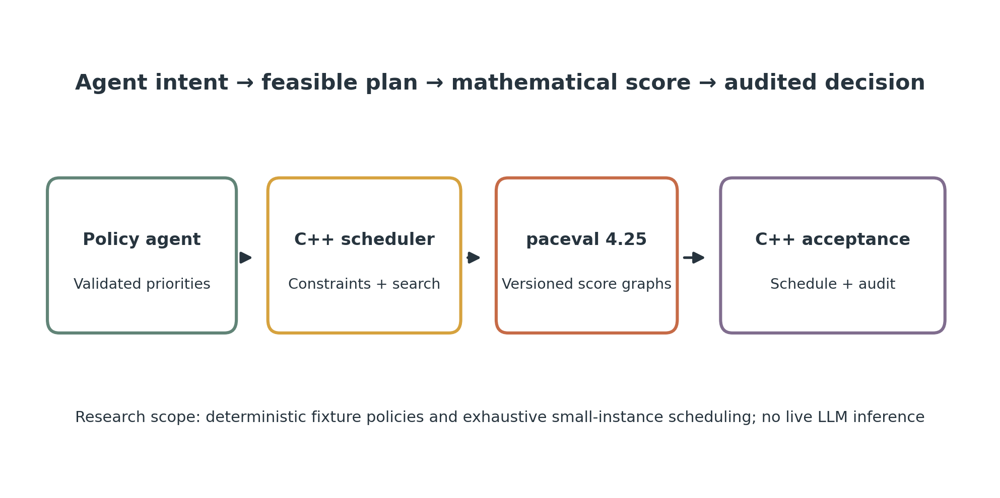

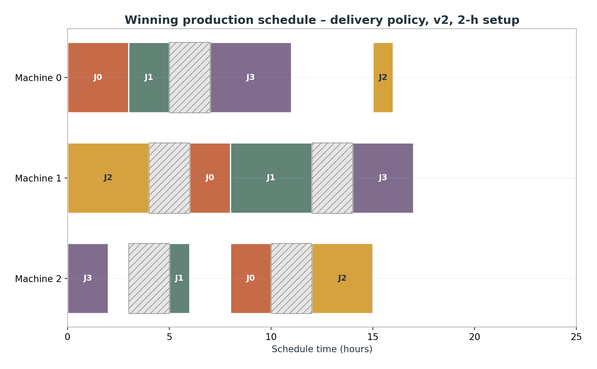

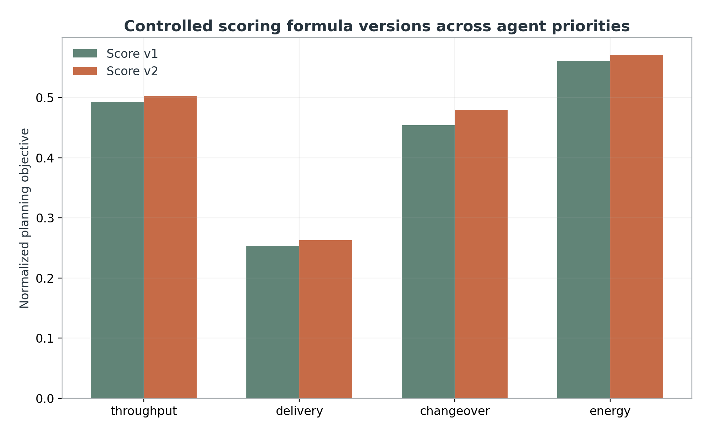

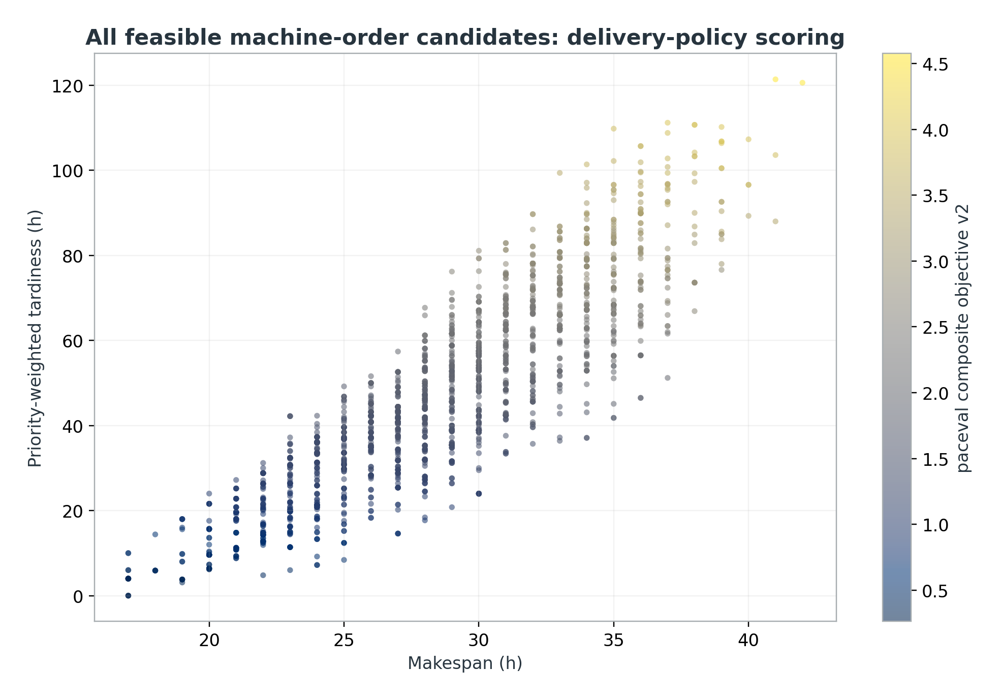

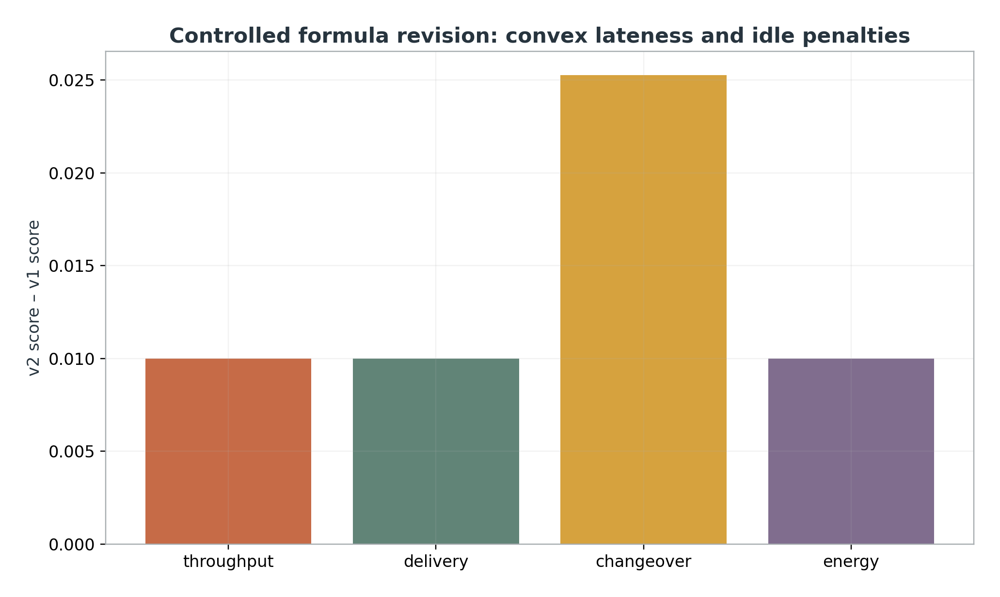

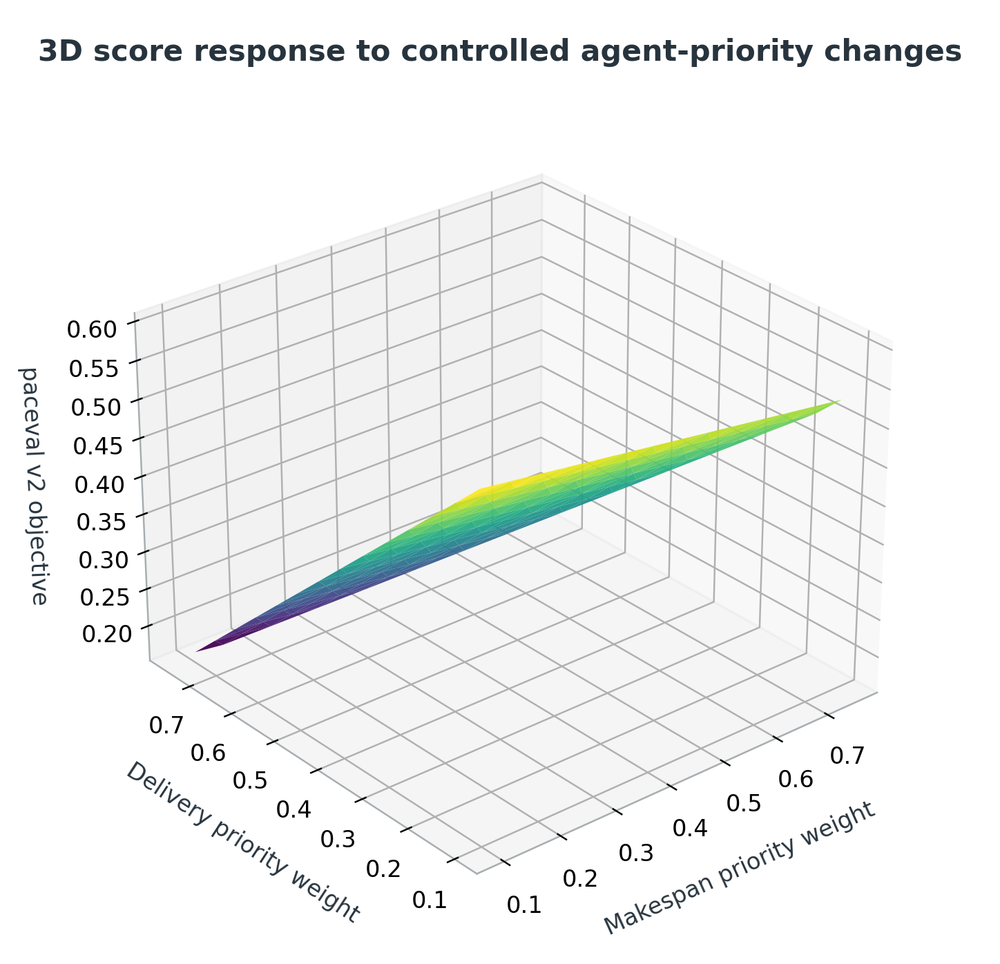

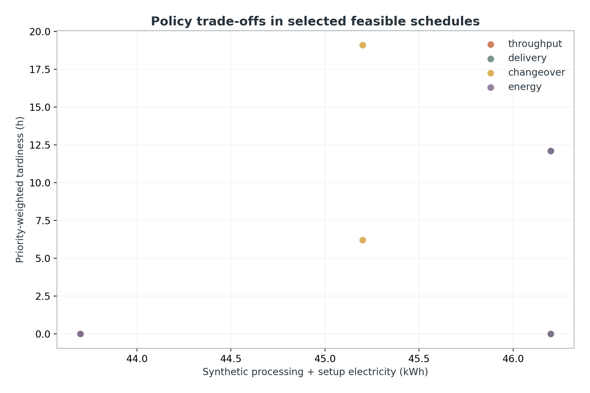

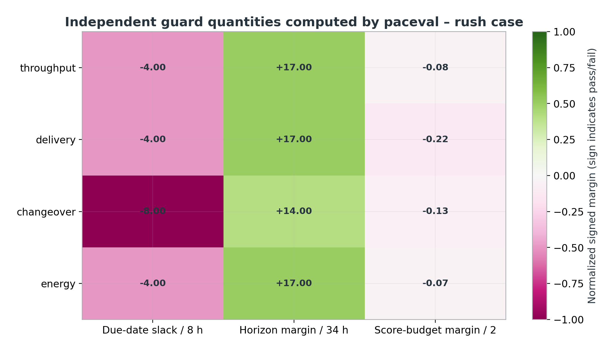

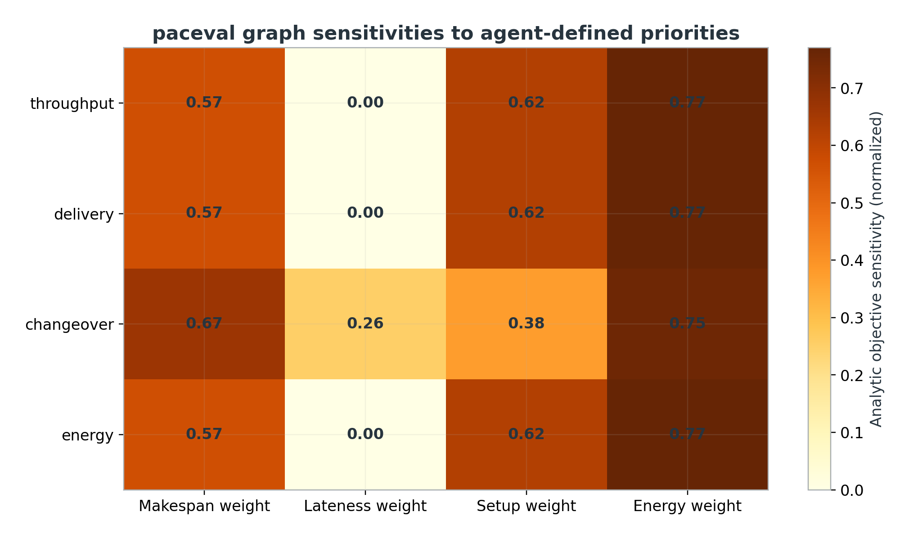

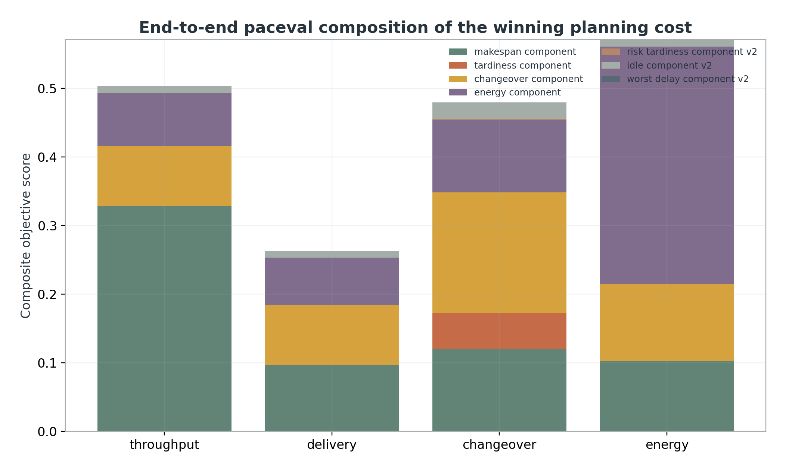

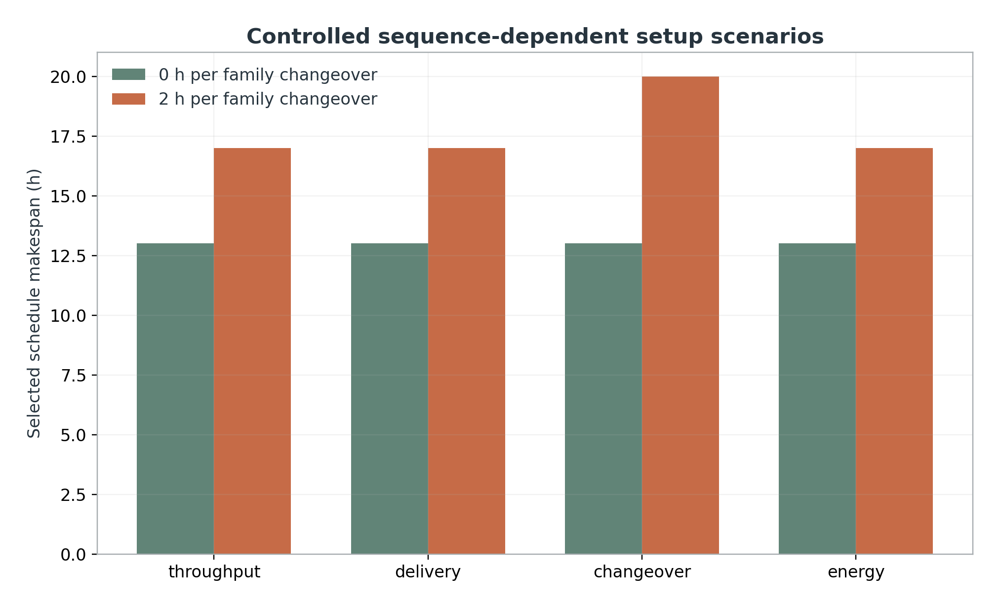

## 7. Build and run (Linux x86-64)

Requirements: C++17, CMake 3.16+, a compatible **original paceval 4.25 Linux shared library** supplied separately, Python 3 with NumPy, Matplotlib, `mpmath` and ReportLab for the audit/figures/PDF. No proprietary or third-party C++ scheduling library is required. The release does not package the external `.so` runtime.

```bash
cmake -S src -B build -DCMAKE_BUILD_TYPE=Release \
  -DPACEVAL_RUNTIME=/absolute/path/to/libpaceval_linux_sharedLIB.so
cmake --build build -j
ctest --test-dir build --output-on-failure
./build/production_planning --out .
python3 src/verify_results.py --root .
python3 src/high_precision_reference.py --root .
python3 src/make_figures.py --root .
python3 src/make_whitepaper.py --root .
python3 src/check_readme_math.py
```

A single command is also supplied in [reproduce.sh](src/reproduce.sh). **The user must supply an authorized, compatible paceval runtime**. The program validates the four structured policies in [agent_requests.csv](examples/agent_requests.csv). Editing the bounded weights and budgets is a repeatable controlled experiment; it cannot introduce arbitrary code execution via this CSV. Agent tokens, LLM invocation cost, language-model reliability and MCP transport were not measured because the demonstrator contains no live LLM connection.

### Verification and release artifacts

- [SDK execution log](results/sdk_execution.txt), [CTest report](results/ctest_sdk.txt), [reproducibility manifest](results/reproducibility.txt) and [SHA-256 checksums](SHA256SUMS.txt)
- [Independent exhaustive scheduling verification](results/independent_schedule_audit.json) and [80-decimal formula verification](results/high_precision_audit.json)
- [Negative agent-input regression script](src/test_negative_agent_input.py), [README math/links checker](src/check_readme_math.py), [original paceval header](src/paceval_main.h)

## 8. Scientific interpretation and limitations

The original paceval API successfully executes **nontrivial, reusable, parameterized mathematical planning functions** inside a well-defined deterministic workflow. The schedule enumerator proves best scoring **within one small, fixed-routing exhaustive search space**, not for general NP-hard industrial schedules. The test instance and energy rates are synthetic, due dates and budgets are illustrative, and the named agent policies are scripted structured requests rather than LLM-provided live decisions. Changeover times are symmetric and depend only on binary job family, not on actual tools or cleaning operations. The model excludes machine calendars, shifts, breakdowns, setup crews, lot splitting, routing alternatives, multi-resource coupling and real MES data. No measured runtime, industrial savings or third-party optimizer advantage is claimed.

The outcome labels do not authorize physical production. TINC was not used; no global certified interval claim is made. External paceval SDK licensing and the upstream AGPL obligations must be reviewed before republishing the original SDK files. GitHub math/link checks are structural; live GitHub visual rendering is not claimed unless inspected independently.

## 9. Scientific references

1. Google OR-Tools: [Job-shop scheduling with CP-SAT](https://developers.google.com/optimization/scheduling/job_shop), including the published 3-job example with optimum makespan 11 (reference only, **not** the 4-job research instance solved here).
2. Wang, Y., Wang, J., Chu, Z. (2025). [Multi-agent large language models as evolutionary optimizers for scheduling optimization](https://doi.org/10.1016/j.cie.2025.111197), *Computers & Industrial Engineering*, 206, 111197.
3. Hu, K., Yao, X., Qiao, F., Xie, T. (2026). [FJSP-E2E: A process-verified framework for automatic scheduling-model reconfiguration in smart manufacturing](https://doi.org/10.1016/j.jmsy.2026.08.009), *Journal of Manufacturing Systems*, online publication 2026.
4. Xiang, W. et al. (2026). [A survey on large language models for scheduling: From problem modeling to optimization algorithm generation](https://doi.org/10.1016/j.aei.2026.104946), *Advanced Engineering Informatics*, 76, 104946.
5. ISO: [ISO 22400-1:2014, KPIs for manufacturing operations management](https://www.iso.org/standard/56847.html), confirmed in 2025.
6. ISA: [ISA-95 / IEC 62264 Enterprise–Control System Integration](https://www.isa.org/standards-and-publications/isa-standards/isa-95-standard).
7. paceval: [Original Mathematical Engine and C/C++ API](https://github.com/paceval/paceval).

**Publication status:** complete reproducible original-paceval research demonstrator with synthetic, non-industrially validated case data, independent mathematical and combinatorial audits, and controlled executable formula versions.
