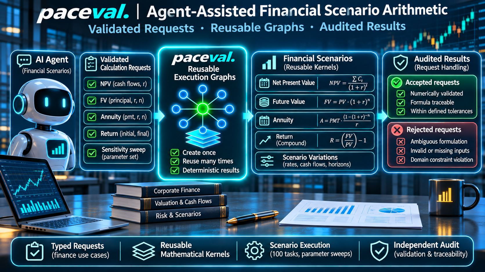
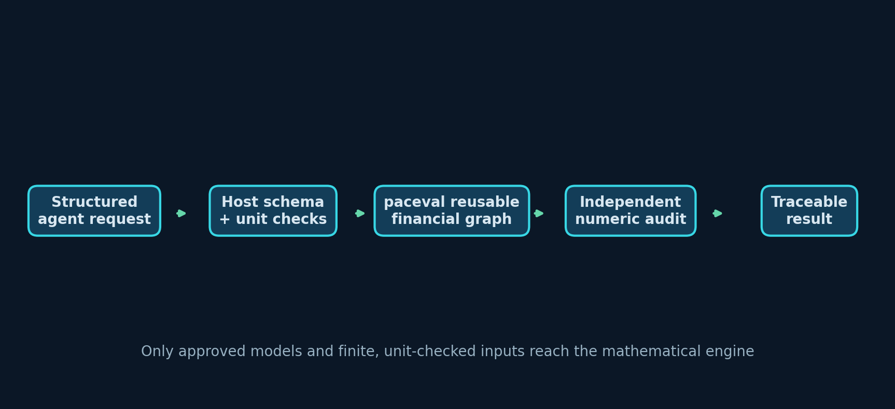
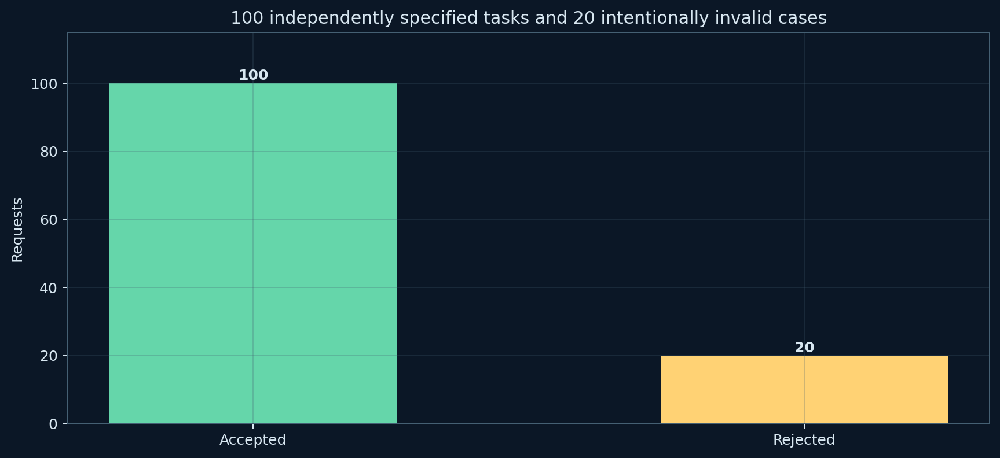
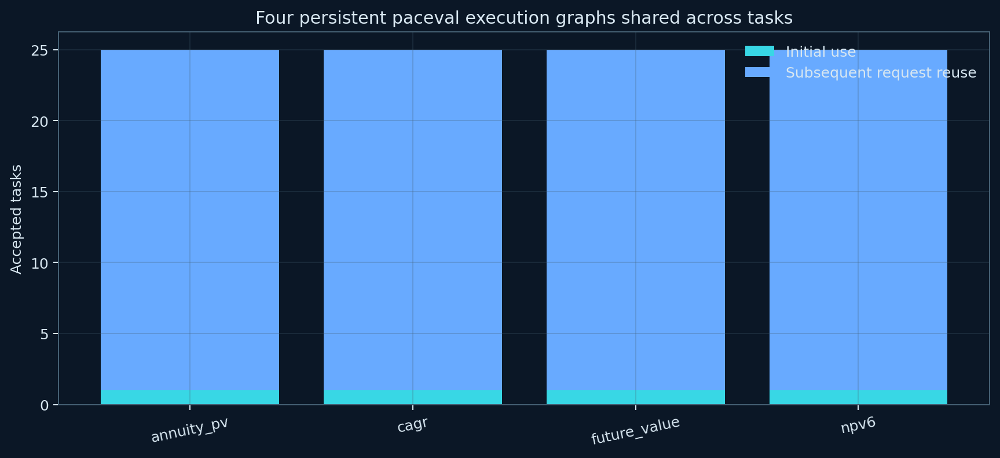

# paceval. | Agent-Assisted Financial Scenario Arithmetic



**A reproducible C++ feasibility demonstrator for typed financial arithmetic requests using the original paceval mathematical engine.** The project replaces ad-hoc numeric answers in an AI-agent workflow with fixed, versioned mathematical contracts, explicit input validation, reusable paceval execution graphs, sensitivity sweeps and independent numerical auditing. No LLM model, live market feed, investment recommendation, or production MCP server is claimed.

[English research whitepaper (PDF)](paceval_Agent_Financial_Arithmetic_Whitepaper_EN.pdf) · [C++ source](src/financial_agent.cpp) · [CMake build](src/CMakeLists.txt) · [Local JSONL tool contract](examples/tool_schema.json)

## 1. Verified research scope

The implementation is based on the research hypothesis in WP-011, *Agent-Assisted Financial Scenario Arithmetic*. The original starting point was discounted cash-flow arithmetic. This executable version implements four mathematical kernels and a model-aware tool adapter:

| Model ID | Definition | Output unit |
|---|---|---|
| `npv6` | `c0 + c1/(1+r) + ... + c5/(1+r)^5`, dated at six annual intervals `t=0,...,5` | Input currency |
| `future_value` | `principal × exp(years × ln(1+r))` | Input currency |
| `annuity_pv` | `payment × (1 − exp(−years × ln(1+r))) / r`, payments at **year-end** | Input currency |
| `cagr` | `exp(ln(final/principal)/years) − 1` | Decimal annual return (dimensionless ratio) |

The C++ host accepts only a named approved model, *never arbitrary LLM-written code or expressions*. It validates ISO-like currency selection (EUR or USD), the annual timeline, decimal annual rates, finite numbers, plausible research-domain bounds and mandatory model-specific input fields. An annual rate of `0.05` denotes **5%**, not the number `5`. Currency conversion and reconciliation of mixed currencies are intentionally not performed.

**paceval owns** the four reusable calculation graphs, their repeated execution with new input vectors, and the batched arithmetic used in each sensitivity study. **The host owns** request interpretation and rejection, parameter-sweep generation, schema enforcement, provenance, native checks and CSV/JSONL output. Graph v1 objects remain unchanged when an independently checked NPV v2 graph is constructed.



## 2. Reproducible results (Linux x86-64)

| Verified operation | Recorded result |
|---|---:|
| Pre-approved financial models | 4 persistent paceval graphs |
| Generated research requests | 120 (100 accepted; 20 correctly rejected) |
| Sensitivity calculations | 1,600 / 1,600 within reference tolerance |
| Independent 100-decimal-place numerical audit | 1,600 / 1,600 within tolerance |
| Controlled NPV v2 update | 16 / 16 new values verified independently |
| Structured JSONL calls through one persistent C++ process | 12 accepted, 4 rejected |
| Graph reuse on subsequent valid JSONL calls | 8 true, 4 initial uses false |
| Reformulated raw TINC intervals containing exact-binary-input reference | **24 / 24** fixed samples, **1,500 / 1,500** additional samples |
| Original direct-division TINC baseline (retained for transparency) | 22 / 24 fixed samples, 1,486 / 1,500 additional samples |
| Native C++ tests and SDK checks | 3 / 3 passed under GCC and Clang |

These are observations on controlled **synthetic** inputs. The raw TINC audit uses the exact IEEE-754 binary64 input values represented by the exported decimal strings. For rates greater than −1, `principal/(1+rate)` equals `principal*exp(-ln(1+rate))` as a real-valued expression. The direct-division graph sometimes returned overly narrow raw TINC intervals; the reformulated graph enclosed all independently computed reference values in the published test suite, without artificial endpoint widening. This sample-specific result does not establish a general rigorous interval guarantee. No performance advantage, production suitability or financial model accuracy is inferred from arithmetic agreement.

[Request outcomes](examples/requests_results.csv) · [1,600 numerical results](examples/sensitivity_results.csv) · [100-digit audit](examples/high_precision_audit.json) · [Fixed TINC comparison](examples/tinc_samples.csv) · [1,500-point TINC audit](examples/tinc_stress_samples.csv)



## 3. Compile with the official paceval C/C++ SDK

The project compiles the bundled SDK interface [`paceval_main.cpp`](src/paceval_main.cpp) alongside [`financial_agent.cpp`](src/financial_agent.cpp) and includes [`paceval_main.h`](src/paceval_main.h). It links an **external**, compatible architecture-specific paceval Linux `.so`. It does *not* ship that runtime, use `dlopen`/`dlsym`, or reimplement paceval.

```bash
cmake -S src -B build -DCMAKE_BUILD_TYPE=Release \
  -DPACEVAL_RUNTIME=/absolute/path/to/libpaceval_linux_sharedLIB.so
cmake --build build -j
ctest --test-dir build --output-on-failure
./build/financial_agent --input examples/requests.csv --batch 37 --out reproduced
python3 src/high_precision_reference.py reproduced
```

The previously tested native environment was Debian Linux on x86-64, GCC 14.2, Clang 17, with the compatible provided `libpaceval_linux_sharedLIB.so`. AddressSanitizer and UndefinedBehaviorSanitizer were also used. A device-specific ARM runtime and real-world financial data were **not** tested in this release.

The SDK retains its upstream copyright and license notices in the original files. No separate `LICENSE_NOTICE.md` is included. **Check the upstream licensing terms before public reuse or distribution.**

## 4. Structured agent-tool interface

This is a local demonstration of a **typed tool boundary**, not an MCP network server. Its JSON-schema-like contract is in [tool_schema.json](examples/tool_schema.json); the executable [Python adapter](src/agent_tool_adapter.py) translates model-specific JSON requests to a persistent line-oriented C++ process.

Sample request:

```json
{
  "request_id": "DEMO_NPV", "model": "npv6", "version": "1",
  "currency": "EUR", "rate_unit": "decimal_per_year", "period": "annual",
  "parameters": {"rate": 0.05, "cashflows": [-10000, 2500, 2750, 3000, 3250, 3500]}
}
```

The other models use only their required parameters: `future_value` takes `principal`, `rate`, `years`; `annuity_pv` takes `payment`, `rate`, `years`; and `cagr` takes `principal`, `final`, `years`. The C++ graph ABI uses 11 named variables uniformly, with fixed values for unused slots; *the agent is not required to supply irrelevant financial inputs*. Every financial assumption used by the selected model must be supplied explicitly.

```bash
python3 src/agent_tool_adapter.py \
  --binary build/financial_agent \
  --input examples/agent_calls.jsonl \
  --output reproduced_agent_responses.jsonl
```

[Example JSONL requests](examples/agent_calls.jsonl) · [Verified JSONL responses](examples/agent_responses.jsonl) · [Example regeneration script](src/generate_agent_examples.py)

A valid request returns `status=OK`, the numerical result, its unit and a true/false graph-reuse indicator. A rejected request gives a machine-readable reason (e.g. missing parameter, unapproved model, ambiguous percent unit, invalid domain or unsupported version). JSON strings are *never evaluated as programs or general mathematical formulas*.



## 5. Independent verification, controlled updates and figures

The numerical oracle [`high_precision_reference.py`](src/high_precision_reference.py) uses Python `Decimal` at precision 100, separately evaluating each financial formula and all 16 updated NPV results. For TINC, the oracle instead reconstructs the **exact binary64 inputs and interval endpoints** using `Decimal.from_float` and checks all 1,524 exported samples; an inclusion failure exits nonzero. Both the direct and reformulated raw paceval intervals are preserved. It checks against tolerance `1e−9 × (1 + |reference|)`. A native C++ reference uses its own scalar formulas in the executable, and the generated cases were also run with distinct batch sizes. Financial arithmetic semantics (rate definitions, timing, payments) are held fixed within each evaluation.

The deliberate version update changes the year-five (`c5`) term in NPV to `0.98 × c5`, yielding a **new** graph after validation; the original remains intact. No algorithm silently substitutes a new version for previous results.

- [NPV sensitivity sweep](figures/02_npv_rate_sweep.png)
- [Four-model sensitivity comparison](figures/03_four_models_sensitivity.png)
- [Native numerical difference distribution](figures/06_native_reference_accuracy.png)
- [Controlled NPV version update](figures/07_model_version_change.png)
- [TINC comparison of mathematically equivalent discount expressions](figures/08_tinc_point_audit.png)
- [Version-update numeric audit](examples/model_update.csv)
- [Machine-readable model registry](examples/models.csv)

The vector editions of every numbered scientific figure are in the same [`figures/`](figures/) folder. You can reproduce the figures with [`make_figures.py`](src/make_figures.py) (requires Matplotlib and NumPy). The released raw TINC files contain both graph outputs and can be regenerated by the executable; [the 1,500-point sample audit](examples/tinc_stress_samples.csv) uses a fixed integer recurrence rather than implementation-specific random distributions. The research PDF can be rebuilt with [`make_whitepaper.py`](src/make_whitepaper.py) (requires ReportLab).

## 6. Scientific interpretation and external references

This is a **controlled synthetic proof of concept**, not a live financial agent or an investment decision system. It does not derive discount rates, choose contractual cash-flow assumptions, solve for optimal investments, recommend trades, perform transfers, or certify financial risk models. It demonstrates numerical execution of predefined finance models with traceable inputs and explicit rejection rules.

Relevant external materials: [paceval C/C++ API](https://paceval.com/api/), [Model Context Protocol tool contracts](https://modelcontextprotocol.io/specification/2025-11-25/server/tools), [OWASP prompt-injection guidance](https://genai.owasp.org/llmrisk/llm01-prompt-injection/), and [SEC discussion of discounted cash-flow valuation](https://www.sec.gov/Archives/edgar/vprr/0800/08002077.pdf). These sources inform architecture and mathematics, not a claim that the local adapter is MCP-compliant or production-secure.
