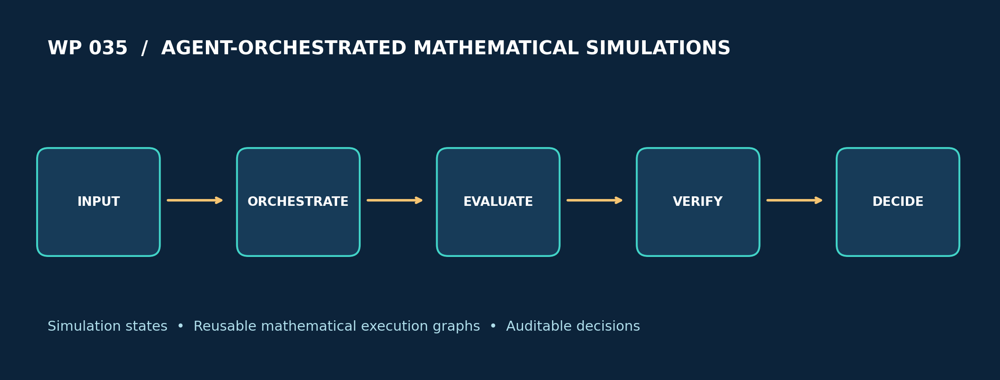

# WP_035 — Agent-Orchestrated Mathematical Simulations with paceval



**Scientific research demonstrator, November 2026.** A deterministic scientific workflow controller coordinates three simulation families, six reusable paceval expression graphs, numerical residual assessment, one optional retry, immutable expression revisions and fully logged technical decisions. The cover is a conceptual schematic, not a measured result.

**[English research whitepaper](paceval_Agent_Orchestrated_Mathematical_Simulations_Whitepaper_EN.pdf)** · **[C++ implementation](src/agent_simulations.cpp)** · **[CMake](src/CMakeLists.txt)** · **[Numerical result data](examples/scenario_summary.csv)**

## 1. Industrial application and state of the art

Industrial research teams repeatedly execute calculations that form parts of a larger simulation, compare the outcomes against reference measurements or specification targets, and decide whether to accept, reconfigure, or rerun a particular scenario. Examples include engineering digital-twin calibration, process design studies, software-in-the-loop testing and model-based quality analysis. Today's scientific workflow environments support task scheduling, provenance, validation and sometimes automated AI-directed execution. An orchestration system is distinct from its mathematical kernel: the first chooses and records actions; the second evaluates precisely defined expressions.

The Model Context Protocol specification dated **28 July 2026** describes typed tools, explicit output structures and security requirements relevant to integration of computational capabilities into AI applications. This project **does not implement the MCP transport, a network service or a live LLM**. It verifies the smaller, reproducible mathematical layer beneath an agent-orchestrated workflow using a deterministic C++ controller.

A realistic production architecture would add access-control and user-approval controls, model/provenance registries, sandboxing, tool argument schemas, workload limits, independent checks and versioned audit trails. None of those capabilities should be inferred from a successful mathematical prototype alone.

Sources: [MCP tools specification (2026-07-28)](https://github.com/modelcontextprotocol/modelcontextprotocol/blob/main/docs/specification/2026-07-28/server/tools.mdx), [MCP specification publication](https://blog.modelcontextprotocol.io/posts/2026-07-28/), [AI-driven scientific workflows review, 2026 (preprint)](https://arxiv.org/abs/2609.21162), [NIST AI RMF](https://www.nist.gov/itl/ai-risk-management-framework).

## 2. Mathematical model and paceval execution

Three toy differential-equation models exercise different reusable mathematical operators. The C++ host advances their state using the same fixed-step explicit Euler method, while **paceval computes every right-hand-side value**. All quantities in this pilot are dimensionless; `t` is a synthetic simulation coordinate, not a measured physical time.

```math
\frac{dx}{dt}=-p(x-q) \qquad \text{(thermal-relaxation analogue)}
```

```math
\frac{dx}{dt}=-px+q\sin(t) \qquad \text{(damped forced response)}
```

```math
\frac{dx}{dt}=px\left(1-\frac{x}{q}\right) \qquad \text{(logistic analogue)}
```

A repeated observation-comparison step evaluates two separate paceval expressions:

```math
r(x,y,\sigma)=\frac{\sqrt{(x-y)^2}}{\sigma+10^{-6}},\qquad
J(x,y,\sigma)=\left(\frac{x-y}{\sigma+10^{-6}}\right)^2.
```

The positive constant is a *declared demonstration denominator guard*, not a statistically justified uncertainty model. The host averages `J` over 64 steps for the final scenario decision. In addition, a new immutable version of the first graph adds a cubic correction:

```math
f_{\mathrm{thermal},v2}=-p(x-q)-0.02(x-q)^3.
```

`paceval_CreateComputation` prepares six persistent graphs; `paceval_dGetComputationResult` evaluates their scalar values; `paceval_dGetComputationResultExt` executes batch evaluations. The C++ controller owns scenario creation, an observation-based parameter revision, the Euler state update, policy thresholds, error handling and CSV output. The second attempt estimates a parameter **from the first synthetic observation**, never from a hidden ground-truth field. It is not a general inverse solver.

## 3. Reproducible experimental findings

| Verified item | Executed result |
|---|---:|
| Model families | 3 |
| Persistent paceval graphs, including immutable revision | 6 |
| Deterministic scenarios | 100 |
| Simulated output trace rows | 6,400 |
| Scalar paceval evaluations | 38,562 |
| Batch paceval evaluations | 5,257 |
| Independent numerical reference checks (SDK audit) | 43,657 |
| Observation-triggered extra attempts | 52 |
| ACCEPT / REVIEW (synthetic rule) | 79 / 21 |
| Separately validated 80-digit reference outputs | 449 |
| CMake/CTest | 1/1 passed |

The threshold `0.005` is a fixed experimental policy, not a scientifically calibrated manufacturing or clinical threshold. These results establish reproducible mathematics and a clearly auditable decision path, not industrial autonomy, calibration quality or real-world reliability.

## 4. Scientific figures

Each numbered result figure is generated by `src/make_figures.py` from the **real C++/paceval CSVs**, except figure 01 which diagrams the verified workflow structure. The figure PDFs are exported as vector plots.

| Figure | PNG | PDF |
|---|---|---|
| Execution workflow | [01](figures/01_workflow.png) | [PDF](figures/01_workflow.pdf) |
| Three simulation families | [02](figures/02_model_trajectories.png) | [PDF](figures/02_model_trajectories.pdf) |
| Before/after scores | [03](figures/03_retry_scores.png) | [PDF](figures/03_retry_scores.pdf) |
| Decisions | [04](figures/04_decisions.png) | [PDF](figures/04_decisions.pdf) |
| Model score distributions | [05](figures/05_model_scores.png) | [PDF](figures/05_model_scores.pdf) |
| Calculated 3D residual surface | [06](figures/06_residual_surface_3d.png) | [PDF](figures/06_residual_surface_3d.pdf) |
| Residual contours | [07](figures/07_residual_contour.png) | [PDF](figures/07_residual_contour.pdf) |
| Simultaneous versioned formulas | [08](figures/08_versioned_models.png) | [PDF](figures/08_versioned_models.pdf) |

## 5. C++ build and reproducibility

Requires Linux x86-64, a C++17 compiler, CMake and a **compatible original paceval Linux shared library** provided separately. The upstream `paceval_main.h` and `paceval_main.cpp` adapter sources are included under `src/`; their original notices are retained. Upstream license and redistributability requirements must be reviewed independently before public distribution.

```bash
cmake -S src -B build -DCMAKE_BUILD_TYPE=Release \
  -DPACEVAL_RUNTIME=/absolute/path/to/libpaceval_linux_sharedLIB.so
cmake --build build -j
ctest --test-dir build --output-on-failure
./build/agent_simulations --out examples
python3 src/verify_results.py
python3 src/high_precision_reference.py
python3 src/make_figures.py
python3 src/check_readme_math.py
python3 src/make_whitepaper.py
```

The standalone original runtime binary is **not included** in this repository. Python plotting requires `numpy` and `matplotlib`; the optional high-precision checker requires `mpmath`; PDF generation requires `reportlab` and Pillow.

## 6. Publication files and scientific limitations

- [Formula registry](examples/formula_registry.csv)
- [Scenario decision summary](examples/scenario_summary.csv)
- [Simulation trace](examples/simulation_trace.csv)
- [Orchestration stage log](examples/orchestration_log.csv)
- [Numerical residual surface](examples/residual_surface.csv)
- [Immutable formula versions](examples/version_comparison.csv)
- [SDK audit](examples/sdk_audit.txt)
- [Independent data audit](results/data_audit.json)
- [Independent high-precision audit](results/high_precision_audit.json)
- [CTest report](results/ctest_sdk.txt)

The workflow is an **offline deterministic agent-like controller**. No LLM was queried; no MCP server, distributed scheduler, industrial device or physical experimental system was connected. The observations are noise-free synthetic outputs of the known test models; the controller's corrective step uses this knowledge of the *model form* and the first observed value. Fixed-step explicit Euler integration has finite integration error and is not suitable for all dynamical regimes. No correctness claim is made outside the stated parameter ranges or beyond the executed finite tests. Safety critical use requires additional controls and independent validation.

**Research outcome:** reusable paceval expression graphs were successfully composed with a deterministic simulation-and-review workflow and independently audited on its finite synthetic workload. This is a positive execution-feasibility result, not a speed claim or evidence of autonomous AI scientific reasoning.
