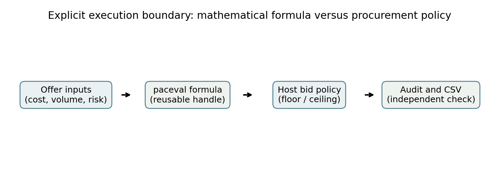
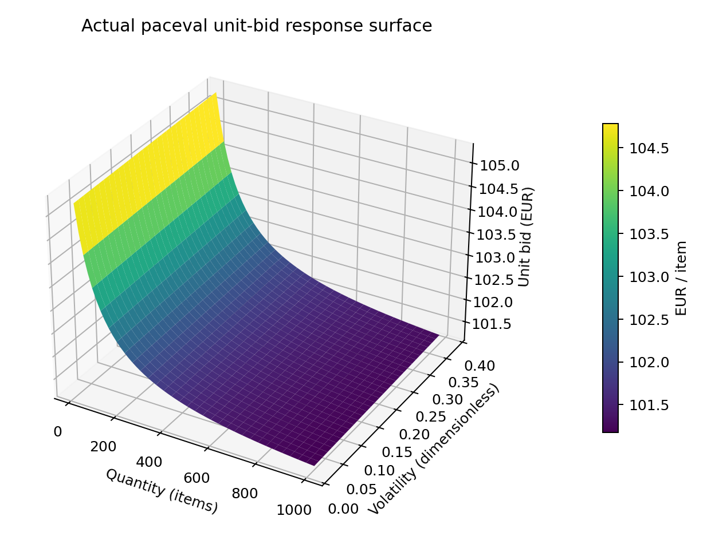
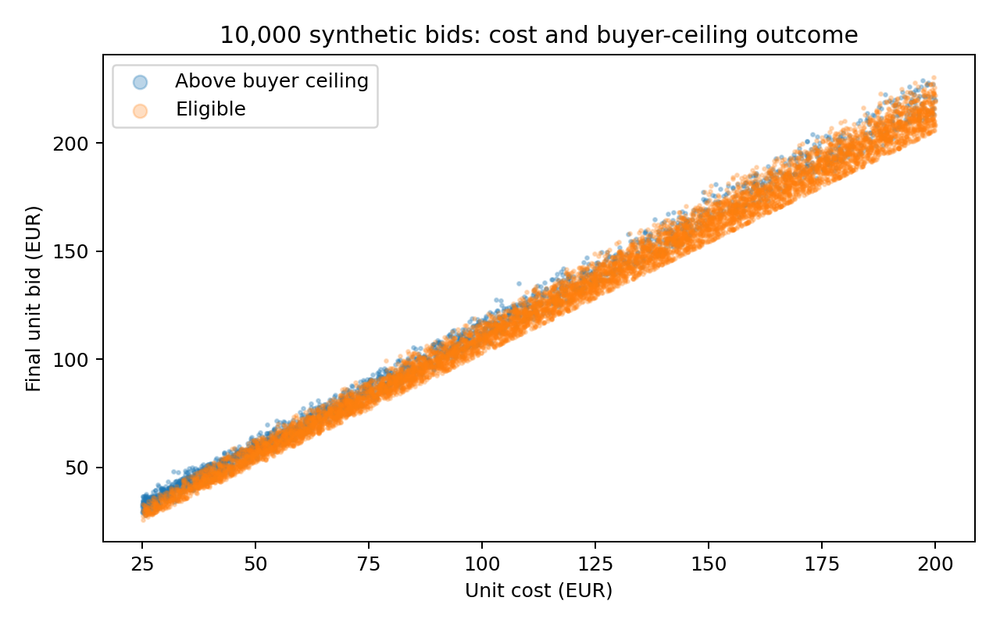

# paceval. | Programmable Auction and Bid Formulas


**Reusable mathematical quotation policies for an illustrative industrial supplier-bidding workflow.** This C++ demonstrator builds 50 distinct, versioned bid-calculation expressions in the original paceval Mathematical Engine and evaluates them for 10,000 deterministic synthetic offers.

[English research whitepaper](paceval_Auction_Bid_Formulas_Whitepaper_EN.pdf) · [C++ demonstrator](src/auction_bids.cpp) · [CMake](src/CMakeLists.txt) · [SDK interface](src/paceval_main.h) · [SDK implementation](src/paceval_main.cpp) · [Data verification](src/verify_results.py)

## 1. Industrial use case and current state of the art

Industrial suppliers often prepare price quotations for reverse-auction purchasing, tendering and contract bids. The price depends on unit production cost, desired markup, delivery risk, requested quantity, discounts, lead time and uncertainty. Multiple quotation rules may coexist for different supply contracts, product categories or commercial policies. The buyer specifies eligibility and award criteria, while the supplier computes its offered price. A mathematically reproducible quotation is useful for comparing internal policy scenarios, but is **not** itself an estimate of auction win probability or a market-equilibrium optimal bid.

Recent published research investigates supplier selection and combinatorial procurement auctions involving order allocation, transport and other costs [Abbaas and Ventura (2024)](https://doi.org/10.3390/math12142228); a 2024/2025 review highlights the gap between theoretical tender-pricing models and business use [Herrmann and Cobo Martín](https://doi.org/10.1007/s11301-024-00424-1). A 2025 procurement-auction study addresses how a fixed buyer budget changes bidding incentives [Rottner](https://doi.org/10.1111/1756-2171.70028). These studies inform the industrial context, but this demonstrator deliberately isolates **quotation formula execution**, not market mechanism design, auction allocation or bidder strategic behavior.

A hypothetical supplier receives an offer request with cost in EUR/item, quantity in items, a risk surcharge in EUR/item, lead time in days, dimensionless volatility and discount fraction, and a **synthetic** buyer ceiling in EUR/item. paceval computes the mathematical bid. The C++ host enforces an illustrative 3% markup floor, checks whether the quoted price is below the synthetic ceiling, and exports a traceable record. Real tenders require additional award rules, procurement law and validation against real bids.

## 2. Mathematical pricing policies and paceval execution

The shared six-variable input is $C$ (EUR/item), $q$ (item count), $R$ (EUR/item), $d$ (discount fraction), $L$ (days), and $v$ (dimensionless volatility). The coefficient triple $(a,b,k)$ is frozen for each versioned rule.

Each policy calculates a **proposed unit bid** $B_j$ using one of five nonlinear formula families. The following definitions reproduce the implemented calculation before the host floor:

```math
B_1=C(1+a)+R(1+bv)-Cdk\frac{q}{q+100}
```

```math
B_2=C(1+a)+R\left(1+b\frac{L^2}{900}\right)-Cdk\frac{q}{q+100}
```

```math
B_3=C(1+a)+R\left(1+b\sqrt{1+v^2}\right)-Cdk\frac{q}{q+100}
```

```math
B_4=C(1+a)+R(1+bv)-Cdk\frac{\ln(1+q)}{\ln(1001)}
```

```math
B_5=C(1+a)+R(1+b e^{-L/30})-Cdk\frac{q}{q+100}
```

In the formula registry, each family has ten coefficient configurations. Units remain EUR/item: all multipliers of unit cost and risk are dimensionless. The host computes the final bid, indicative gross margin and total quotation:

```math
B_{\mathrm{final}}=\max\{B_j,1.03C\},\qquad
M=\frac{B_{\mathrm{final}}-C}{B_{\mathrm{final}}},\qquad
Q=qB_{\mathrm{final}}.
```

A separate binary flag records whether the final unit bid is below the **synthetic buyer ceiling**. This flag is only an *eligibility proxy*, not auction success or an inferred economic win probability. The example 3% floor is an illustrative markup above cost, not a 3% net margin or contractual rule.

The engine creates each policy once using `paceval_CreateComputation`, reuses its handle with `paceval_dGetComputationResult`, and performs separate small packed tests through `paceval_dGetComputationResultExt`. A sixth set of variables is passed to every graph, while unused inputs are permitted for individual families. One changed policy is registered as **version 2** without deleting version 1. The C++ host owns synthetic offer generation, validation, business rules and CSV output.



## 3. Executed synthetic application results

| Recorded item | Result |
|---|---:|
| Mathematical bid policies | 50 in five families |
| Reusable paceval handles | 51 including version 2 |
| Deterministic supplier offer requests | 10,000 |
| Scalar paceval checks including scenario surface | 13,821 |
| Independent packed batch checks | 1,600 |
| 3D response-surface points | 3,721 |
| Separate 80-digit decimal-reference checks | 500, passed |
| CMake/CTest integration | 1/1 passed |
| Offers below synthetic buyer ceiling | 7757 / 10,000 |
| Mean final bid across synthetic requests | 123.21 EUR/item |
| Mean indicative gross margin fraction | 0.1003 |

The independent numerical checks have passed and technical diagnostics are retained in [audit records](results/high_precision_audit.json). The figures and market numbers concern the declared synthetic inputs only. No speedup, real auction win probability or revenue benefit is claimed.

## 4. Scientific and industrial graphics

All result graphics (Figures 2–8) are rendered from actual paceval-exported CSV records; Figure 1 is a schematic and the cover is a **conceptual illustration**, not observed auction activity.

| Figure | Meaning | Files |
|---|---|---|
| 1 | Bid execution and host policy architecture | [PNG](figures/01_architecture.png) · [PDF](figures/01_architecture.pdf) |
| 2 | Mean proposed unit quotation by policy | [PNG](figures/02_unit_bid_policies.png) · [PDF](figures/02_unit_bid_policies.pdf) |
| 3 | Price eligibility under the synthetic ceiling | [PNG](figures/03_buyer_ceiling_eligibility.png) · [PDF](figures/03_buyer_ceiling_eligibility.pdf) |
| 4 | Indicative realized gross margin of synthetic offers | [PNG](figures/04_gross_margin.png) · [PDF](figures/04_gross_margin.pdf) |
| 5 | 3D unit-bid surface for quantity and volatility | [PNG](figures/05_bid_response_surface.png) · [PDF](figures/05_bid_response_surface.pdf) |
| 6 | Contour map of the identical response surface | [PNG](figures/06_bid_contours.png) · [PDF](figures/06_bid_contours.pdf) |
| 7 | Concurrent versions of a changed quotation policy | [PNG](figures/07_versioned_rule.png) · [PDF](figures/07_versioned_rule.pdf) |
| 8 | Cost versus quoted unit bids and buyer ceiling eligibility | [PNG](figures/08_cost_bid_scatter.png) · [PDF](figures/08_cost_bid_scatter.pdf) |





Released inputs and results: [policy registry](examples/policy_registry.csv), [offers](examples/offers.csv), [policy summary](examples/policy_summary.csv), [3D sweep](examples/bid_surface.csv), [formula version data](examples/formula_version.csv), [SDK execution log](results/sdk_execution.txt), [CTest](results/ctest_sdk.txt).

## 5. Build and reproduce

The repo includes the original `paceval_main.h` and `paceval_main.cpp` facade with the relative include path adjusted. A compatible Linux `.so` must be supplied separately and is not redistributed.

```bash
cmake -S src -B build -DCMAKE_BUILD_TYPE=Release \
  -DPACEVAL_RUNTIME=/absolute/path/to/libpaceval_linux_sharedLIB.so
cmake --build build -j
ctest --test-dir build --output-on-failure
./build/auction_bids --out reproduced
python3 src/verify_results.py
python3 src/high_precision_reference.py
python3 src/make_figures.py
python3 src/make_whitepaper.py
python3 src/check_readme_math.py
```

The Python source scripts use the released `examples/` data by default; the demonstration executable can generate fresh CSV data to a separate folder. Python requirements for plots are `numpy` and `matplotlib`, high-precision verification uses standard-library `decimal`, and the PDF generator uses `reportlab` and `Pillow`.

## 6. Scientific boundaries

This is **an illustrative supplier quotation engine**, not a deployed auction, an allocation solver, a validated risk forecast, a mechanism-design simulator or a buyer's decision system. All synthetic ceilings are invented for the experimental contract. The cost-based floor does not account for taxes, transport, capacity constraints or complex contracts. Competitive bidding and contract award depend on legal and market factors beyond a mathematical bid expression.

The evidenced contribution of paceval is repeatable evaluation of 50 versioned, nonlinear mathematical quotation rules within a traceable C++ application. The original SDK is called directly. Numerical validation was performed independently; detailed verification output is in the audit files rather than the public application-focused report.

## References

- [Supplier selection through an iterative combinatorial procurement auction, Abbaas and Ventura, 2024](https://doi.org/10.3390/math12142228)
- [B2B and B2G tender pricing models in practice, Herrmann and Cobo Martín, 2024/2025](https://doi.org/10.1007/s11301-024-00424-1)
- [Auctioning Off Budgets in Procurement, Rottner, published November 2025](https://doi.org/10.1111/1756-2171.70028)
- [Official paceval C/C++ API](https://paceval.com/api/)
