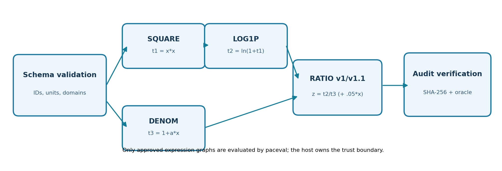
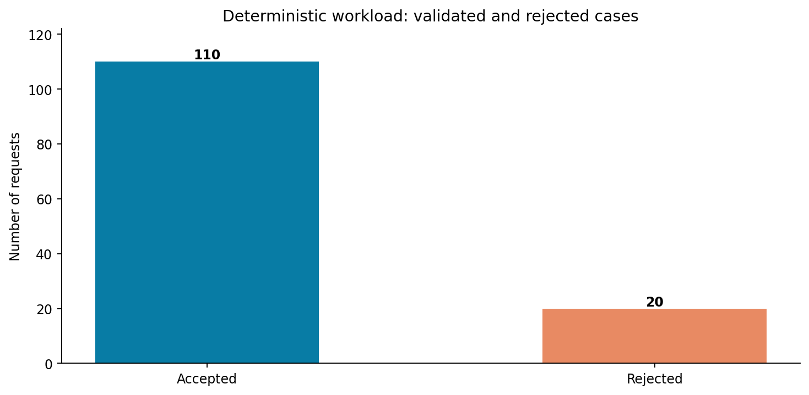
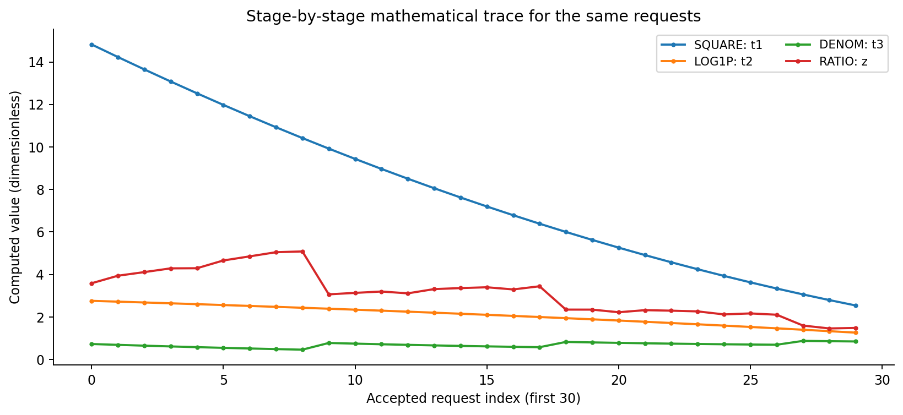
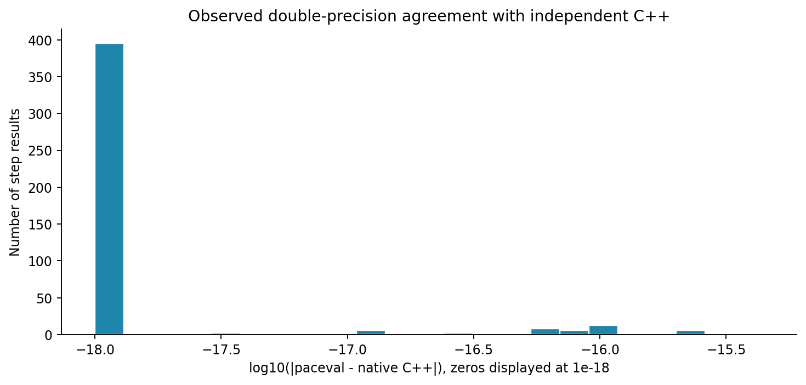
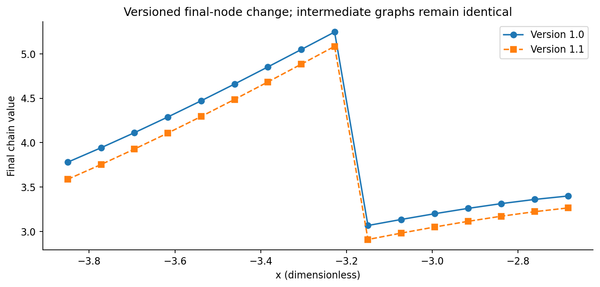
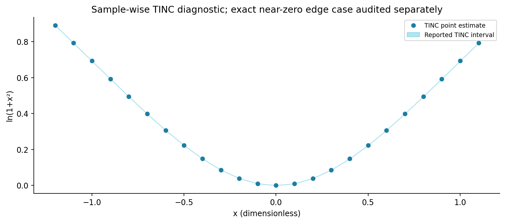
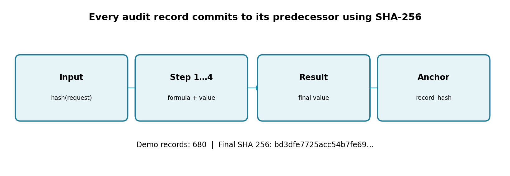
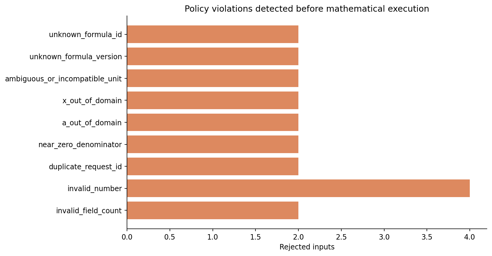

# paceval | Auditable Multi-Step AI Computation Chains


**Research status: implemented and independently numerically tested on Linux x86-64.** This repository demonstrates how a constrained, structured AI-tool request can be translated into a traceable, multi-stage mathematical workflow using the **real paceval mathematical engine**. It implements reusable expression graphs, versioned expression identities, deterministic dependency order, per-step verification, controlled rejection, and SHA-256-linked audit records. The headline illustration is conceptual; the diagrams below use published test results.

> The package is an offline C++ and JSONL proof of feasibility. It does **not** contain a connected LLM, an MCP server, a production audit database, or a certified numerical interval engine. No performance or energy advantages are claimed.

[English research whitepaper (PDF)](paceval_Auditable_AI_Chains_Whitepaper_EN.pdf) · [C++ source](src/auditable_chains.cpp) · [CMake build](src/CMakeLists.txt) · [Input examples](examples/requests.csv) · [Independent verifier](src/verify_audit.py)

## Why this research use case matters

An LLM can propose a multi-step computation, but the mathematical execution should not rely on the LLM's own arithmetic or its unverified interpretation of tool outputs. A host can validate a structured request, locate an immutable approved formula version, execute each mathematical step through paceval, and return a result with the trace needed for independent replay.

This is consistent with the distinction in the [MCP 2025-11-25 tools specification](https://modelcontextprotocol.io/specification/2025-11-25/server/tools) between a tool's input schema and its returned content. The local adapter deliberately supports only the computation-specific JSONL boundary, not the MCP transport or protocol. See also [OWASP MCP Security Cheat Sheet](https://cheatsheetseries.owasp.org/cheatsheets/MCP_Security_Cheat_Sheet.html) and [NIST AI RMF](https://www.nist.gov/itl/ai-risk-management-framework).

## Mathematical chain implemented with paceval

The original WP-012 model is `z = ln(1 + x*x) / (1 + a*x)`. This implementation decomposes it into the following **four independently reusable paceval execution graphs**:

| Step | Immutable node | Exact expression sent to paceval | Dependencies |
|---|---|---|---|
| 1 | `SQUARE@1.0` | `x*x` | `x` |
| 2 | `LOG1P@1.0` | `ln(1+t1)` | output `t1` |
| 3 | `DENOM@1.0` | `1+a*x` | `a`, `x` |
| 4 | `RATIO@1.0` | `t2/t3` | outputs `t2`, `t3` |

One additional graph, `RATIO@1.1`, implements `t2/t3+(0.05*x)` as an **explicitly modified model version**, not a mathematical rewriting of v1.0. Both model versions are retained; they reuse the same first three nodes. Each graph is created once through `paceval_CreateComputation()` and then evaluated using `paceval_dGetComputationResultExt()`; its lifetime is explicitly managed with `paceval_DeleteComputation()`. The application links the external paceval Linux runtime and compiles the official `paceval_main.cpp` directly with the C++ host.



**Input policy for this application**: only `CHAIN_LOGRATIO`, versions `1.0` or `1.1`, two finite dimensionless inputs, `|x| <= 4`, `|a| <= 2` and `|1+a*x| >= 0.05`. The input limits are deliberate **host validation policies**, not fixed limits of paceval. Failed checks produce typed rejection records without executing the corresponding request. All five expressions are registered before requests are processed.

## Verified results

The deterministic demonstration includes **100 initial valid tasks**, **10 repeated-mathematics tasks with new request IDs**, and **20 deliberately invalid tasks**. It produces 440 stage values (110 × 4) and 680 hash-linked audit entries (110 × 6 + 20). Original raw requests are linked to audit entries by SHA-256 digests; model expressions and variable signatures are bound to immutable SHA-256 formula digests.

| Test | Observed result |
|---|---|
| Accepted valid tasks | **110 / 110** |
| Rejected invalid tasks | **20 / 20** |
| Independently rechecked stage values (100-digit mpmath) | **440 / 440 within tolerance** |
| Maximum absolute stage error versus exact-input high precision | **8.793 × 10⁻¹⁶** |
| Version update comparison | **16 / 16 within tolerance** |
| Verified SHA-256 audit entries | **680 / 680** |
| Deliberate edit of a hash-linked entry | **Detected** |
| Local JSONL adapter | **12 accepted; 4 rejected** |
| TINC sample-wise raw interval inclusion | **23 / 24** |

The one TINC non-inclusion occurs at `x = 2.2204460492503131e-16` for `ln(1+x*x)`: finite-precision evaluation produces the point interval `[0,0]`, while the exact result for that binary64 input is positive (approximately `4.93e-32`). This **does not affect the normal chain values**, which are checked by independent high-precision calculations, and it is not recast as a passing interval test. The observed TINC intervals should not be treated as universally certified rigorous enclosures.









The exact underlying CSV results are preserved in [examples/results.csv](examples/results.csv), [examples/steps.csv](examples/steps.csv), [examples/audit_steps.csv](examples/audit_steps.csv), [examples/rejections.csv](examples/rejections.csv), [examples/version_comparison.csv](examples/version_comparison.csv) and [examples/tinc_samples.csv](examples/tinc_samples.csv). Formula identities are recorded in [examples/models.csv](examples/models.csv). The [independent audit report](examples/independent_audit.json) records the actual 100-digit numerical and hash-integrity verification results.

## Build and reproducibility (Linux x86-64)

Requirements: C++17 compiler, CMake >= 3.16, OpenSSL libcrypto **development headers** (for SHA-256), Python 3 with `mpmath`, and the **separately provided, compatible original paceval Linux shared library**. For diagram regeneration, install `matplotlib` and `numpy`; for whitepaper regeneration, install `reportlab` and `Pillow`.

The original paceval SDK API translation units [paceval_main.h](src/paceval_main.h) and [paceval_main.cpp](src/paceval_main.cpp) are included in `src/` with their existing copyright/license notices. The proprietary Linux runtime (`.so`) is **not distributed**.

```bash
cmake -S src -B build -DCMAKE_BUILD_TYPE=Release \
  -DPACEVAL_RUNTIME=/absolute/path/to/libpaceval_linux_sharedLIB.so
cmake --build build --parallel
ctest --test-dir build --output-on-failure
./build/auditable_chains --demo --batch 37 --out replay
python3 src/verify_audit.py replay
```

The same demo may be run with `--batch 1` or `--batch 128`. For the published workload these settings produced byte-identical output CSVs (aside from files created by verification utilities, which are not part of the C++ outputs). Reproduction instructions use the real shared library, never an invented stub.

Use `--input examples/requests.csv` to replay the exact test cases. By design the auditor is **read-only**, so running `verify_audit.py` does not modify its inputs.

### Structured agent adapter (offline JSONL)

The [JSON Schema example](examples/tool_schema.json) defines a six-field request. Its joint `abs(1+a*x)` condition is enforced in Python and C++, not by ordinary JSON Schema property bounds. The [Python adapter](src/agent_tool_adapter.py) keeps one C++ worker open and maps structured JSONL requests into a strictly delimited internal protocol:

```bash
python3 src/agent_tool_adapter.py --binary ./build/auditable_chains \
  --write-examples generated_agent_examples
```

The published [request examples](examples/agent_calls.jsonl) and [response examples](examples/agent_responses.jsonl) show successful reuse and deliberate errors. These messages **are not MCP messages**, and no real LLM calls are included. A future MCP wrapper would need actual `tools/list` and `tools/call` support, the correct transport and security controls, output-schema validation and trustworthy authorization.

## Audit integrity: exactly what is demonstrated

Each successful request produces an **INPUT** digest, four **STEP** records, and a **RESULT** record. Each rejected request produces one **REJECT** record. A record commits to its predecessor using `SHA256(previous_hash + "|" + canonical_fields)`. The terminal value and record count are saved in [examples/audit_head.txt](examples/audit_head.txt); this file is intended to be **independently anchored** outside the mutable working directory in a real deployment. [verify_audit.py](src/verify_audit.py) independently checks all 680 records, the model digests, numeric stages, and a deliberately corrupted-record negative test.

A hash chain by itself does not prove who created a record, prevent someone with full filesystem access from rewriting the entire chain and head, or certify that a model request is appropriate. This is **auditable computation**, not a cryptographic authenticity service, a safety assessment, or a test of LLM reasoning quality. Do not use the untrusted payloads as executable formulas.

## Source files and test assets

- [Core C++](src/auditable_chains.cpp) · [CMake](src/CMakeLists.txt) · [Independent Python numerical and hash audit](src/verify_audit.py) · [JSONL adapter](src/agent_tool_adapter.py) · [Diagram reproduction](src/make_figures.py) · [Whitepaper generator](src/make_whitepaper.py)
- [Original structured requests](examples/requests.csv) · [Validations and rejections](examples/rejections.csv) · [SHA-256 terminal digest](examples/audit_head.txt) · [Model version comparisons](examples/version_comparison.csv)

Full expressions, test boundaries and the source-to-result traceability design are documented in the [English research whitepaper](paceval_Auditable_AI_Chains_Whitepaper_EN.pdf). Figure sources are supplied as PNG and editable SVG in `figures/`.

## Scientific references

1. [paceval C/C++ API](https://paceval.com/api/) — computation creation, reusable handles, batch API.
2. [Model Context Protocol specification 2025-11-25, server tools](https://modelcontextprotocol.io/specification/2025-11-25/server/tools) — tool input/output schemas and tool invocation boundary.
3. [OWASP MCP Security Cheat Sheet](https://cheatsheetseries.owasp.org/cheatsheets/MCP_Security_Cheat_Sheet.html) — validation and auditing of tool boundaries.
4. [NIST AI Risk Management Framework](https://www.nist.gov/itl/ai-risk-management-framework) — valid, accountable and transparent AI-system practices.

**Scope of the result:** successful, independently audited mathematical execution of the selected synthetic, dimensionless chain. No live AI provider, real external dataset, cryptographic signature service, or production MCP deployment is claimed.
