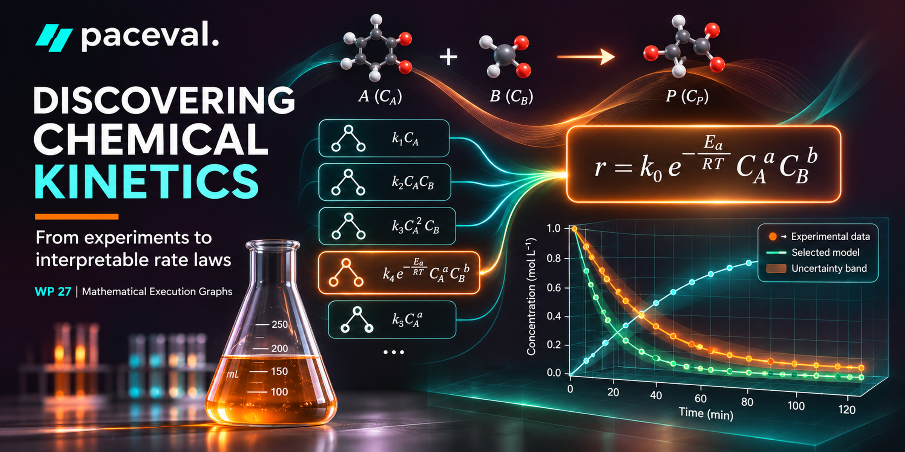
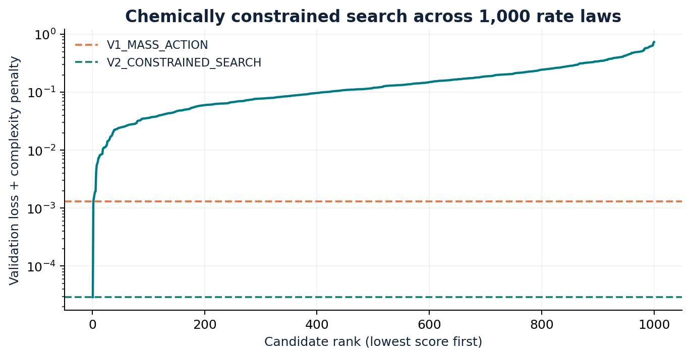
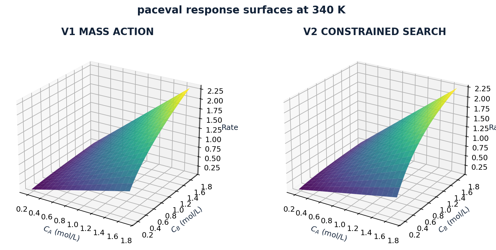
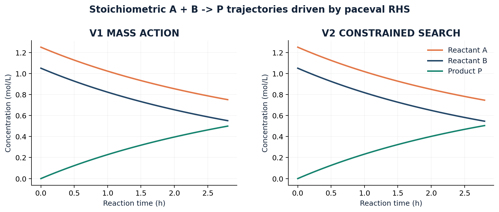

# paceval. | Automatic Discovery of Chemical Kinetic Rate Equations



**WP 27.** Functional research on original paceval Mathematical Engine 4.25, performed in C++ on Linux. Complete source, generated inputs, 1,000 kinetic candidate models, independent verification and an illustrated English scientific paper are included.

## 1. Industrial use case and current state of the art

Chemists and process engineers need explicit reaction-rate equations to explain concentration time histories, predict temperature sensitivity, and construct reactor models. A fixed hand-chosen power law may fit a narrow experiment but fail when reactant concentration or temperature changes. Data-driven symbolic regression can search interpretable mathematical structures while retaining stoichiometry and other chemical restrictions. Recent research includes stoichiometrically informed symbolic regression (Palma Banos et al., 2026), physics-informed automated kinetics discovery (de Carvalho Servia et al., 2026) and established sparse dynamical identification methods such as SINDy. Their methods should not be confused with the narrower finite-library selection implemented here.

This project tests a clear and reproducible question: **can paceval register, repeatedly evaluate and independently verify a fixed library of 1,000 chemically constrained kinetic equations, selecting a structure that extrapolates to a held-out synthetic temperature range?** The C++ host enumerates the fixed search space and accumulates fitted statistics. paceval evaluates the candidates, per-sample moments, fitted parameter formula, loss kernels and downstream chemical balances. The host makes the discrete final model selection and orchestrates numerical integration.

## 2. Research model and true scope

The **entire dataset is synthetic**. A deliberately hidden, planted kinetic rate law generates noisy concentration-temperature observations for a conceptual isothermal batch reaction $A+B \rightarrow P$. The true law, exposed for reproducibility in the original C++ source, is:

$$
r = 0.65 \exp\left[-\frac{36000}{R_g}\left(\frac{1}{T}-\frac{1}{310}\right)\right] \frac{C_A C_B}{1+1.1 C_B}.
$$

Concentrations are in mol/L, temperature in kelvin, the rate is mol L$^{-1}$ h$^{-1}$, $R_g$ is 8.31446261815324 J mol$^{-1}$ K$^{-1}$, and the dimensional units of the fitted prefactor depend on candidate reaction orders. The denominator creates an apparent saturating response in reactant B; it is **not** proof of a specific molecular mechanism. The candidate pool contains this true expression by construction, so recovering it is a controlled recovery test, not evidence of discovering a previously unknown rate equation.

Five reaction families are examined: mass-action/thermal correction, B saturation, A saturation, B-squared saturation and A-B cross saturation. Five A orders, five B orders, four activation energies and two family-specific correction choices give exactly **1,000 unique candidate expressions**. The host fits one nonnegative prefactor from training moments, using paceval for the numerator/denominator kernels and the final quotient. Candidate ranking is determined from validation loss plus an explicit complexity penalty, also evaluated by paceval.

The observations are intentionally divided into distinct conditions: 512 training cases at 287-324 K, 256 validation cases at 317-342 K and 256 locked holdout cases at 341-360 K. Variation within each group and deterministic noise follow explicitly documented seeds/formulas. The holdout outcomes are not used to select the winning model.

## 3. Two persistent kinetic model versions

The restricted **V1_MASS_ACTION** version is selected from the mass-action family alone. The unrestricted **V2_CONSTRAINED_SEARCH** version is selected from all 1,000 candidates. Both versions remain instantiated as separate paceval graphs. The frozen holdout includes full predicted rates, residuals, squared loss, concentration and temperature sensitivities, stoichiometric source terms, numerical margin to a hypothetical 1.6 mol L$^{-1}$ h$^{-1}$ rate threshold and a Boolean guard.

For an explicitly chosen stoichiometry $A+B \rightarrow P$, the rate-driven balance is:

$$
\frac{dC_A}{dt}=-r, \qquad \frac{dC_B}{dt}=-r, \qquad \frac{dC_P}{dt}=r.
$$

The original paceval graph executes the candidate rate and species source terms. C++ orchestrates a four-stage Runge-Kutta time step. An independently coded native kinetics reference repeats all trajectories and verifies the invariants $C_A+C_P$ and $C_B+C_P$ for eight synthetic integration scenarios per version. This is a zero-dimensional constant-temperature reactor thought experiment and does not represent real plant control.

## 4. Actual execution ownership

| Mathematical function / Industrial purpose | Actual implementation | Graph/Version or rationale |
|---|---|---|
| 1,000 candidate rate bases | Original paceval | `C0` to `C999`, persistent independent graph handles |
| Observation cross-moment and squared basis moment | Original paceval | `GLOBAL_moment_xy`, `GLOBAL_moment_xx` |
| Rate prefactor as ratio of aggregated moments | Original paceval | `GLOBAL_fit_k` after host sums |
| Per-sample normalized squared loss and complexity-aware score | Original paceval | `GLOBAL_loss`, `GLOBAL_selection_score` and two versioned model outputs |
| Both selected reaction-rate equations | Original paceval | `V1_MASS_ACTION_rate`, `V2_CONSTRAINED_SEARCH_rate` |
| Stoichiometric source terms and full model residuals | Original paceval | Versioned `dca_dt`, `dcb_dt`, `dcp_dt`, `rate_residual` |
| Explicit concentration and temperature sensitivities | Original paceval | Versioned `sensitivity_ca`, `sensitivity_cb`, `sensitivity_temp` |
| Hypothetical rate bound and logical indicator | Original paceval | Versioned `rate_margin`, `candidate_compliance` |
| Candidate enumeration and aggregate sums | C++ host | Requires discrete search and accumulation |
| Validation ranking and identification of the minimum | C++ host | Discrete selection with no hidden optimizer claims |
| RK4 state updates and CSV data governance | C++ host | Stateful integration and I/O; rate/source values from paceval |
| Independent references | Separate C++ and Python | Not counted as paceval execution |

A complete formula-to-owner inventory is available in [the generated mathematical execution inventory](results/math_execution_inventory.csv). Real graph counts and API call counts are read from [execution evidence](results/execution_evidence.json). The SDK conversions `paceval_dConvertStringToFloat` and `paceval_dConvertFloatToString` process numeric input and output CSV fields after a strict numeric-literal schema check; expression strings disguised as numeric CSV fields are rejected.

## 5. Results and published figures

The successful main run generated 1,031 unique persistent and executed graph handles and 2,623,248 graph-point outputs. All 1,000 candidate rankings were independently reconstructed in Python. The unconstrained selection recovered the planted structure: candidate **301**, B saturation, unit reaction orders in A and B, activation energy 36,000 J/mol, saturation coefficient 1.1 and recovered prefactor approximately 0.650145. The restricted model selected candidate **92**, which does not capture the same concentration dependence.

The selected synthetic holdout normalized losses are approximately 0.00146005 for V1 and 0.00000684708 for V2. These are model-fit quantities for a synthetic dataset, not comparisons of paceval runtime/efficiency against another numerical engine. The comparisons establish no general chemical discoverability or improvement in experimental kinetics.







The English [scientific whitepaper](paceval_Automatic_Discovery_Chemical_Kinetics_Whitepaper_EN.pdf) contains a methodological discussion, search and reaction charts, validation evidence and the scientific limitations. All numerical figures are generated by `src/make_figures.py` from archived actual paceval output tables. Figure 01 is explicitly a conceptual architecture diagram.

## 6. Build and reproduce

The project contains the **original `paceval_main.h` and `paceval_main.cpp`** interface files under `src/`. You must provide a separately licensed/runtime-compatible original Linux paceval shared library. The shared library is **not** distributed in the GitHub ZIP.

```bash
cmake -S src -B build -DCMAKE_BUILD_TYPE=Release \
  -DPACEVAL_RUNTIME=/absolute/path/to/libpaceval_linux_sharedLIB.so
cmake --build build -j
./build/kinetic_discovery --selftest
./build/kinetic_discovery --run 512 256 256 results
python3 validation/check_high_precision.py results
ctest --test-dir build --output-on-failure
```

The main experimental command overwrites deterministic output files. `results/independent_validation.json` is generated by the Python reference, and `src/make_figures.py` rebuilds the data figures. The build instructions and exact output contracts are expanded in [REPRODUCIBILITY.md](docs/REPRODUCIBILITY.md).

A GitHub-compatible Markdown math and link checker is included. It examines **all Markdown files recursively** through a real Mistune math parser and refuses raw math delimiters, banned macros, unpaired fences and bad links. Nine deliberately invalid examples are independently rejected.

## 7. Scientific boundaries and future extensions

This is constrained model selection from a fixed known candidate library using synthetic instantaneous rates, not unrestricted symbolic regression over unknown chemistry. Observed rates may require differentiation from measured time series; that inference can introduce bias and uncertainty. Order and activation energy can become nonidentifiable without sufficiently varied experiments. The single, deliberately chosen stoichiometric channel $A+B\rightarrow P$ does not recover a hidden intermediate or distinguish mechanisms that share the same macroscopic rate law. The fixed thermal response and saturation coefficients do not establish real material or reaction identities. Reagent safety, scale-up, heat effects and plant operation are entirely out of scope.

A meaningful next study would use legitimately licensed experimental rate measurements and time-course data, with multi-reaction stoichiometric constraints, competing kinetic forms, independent out-of-time validation and practical parameter uncertainty quantification. The finite candidate pool and integration interface demonstrated here can be reused for that work, but no industrial validation is asserted.

## 8. References

1. Palma Banos et al., **Stoichiometrically-informed symbolic regression for extracting chemical reaction mechanisms from data**, *Digital Discovery* (2026), [doi:10.1039/D5DD00470E](https://doi.org/10.1039/D5DD00470E).
2. de Carvalho Servia et al., **Physics-informed symbolic regression for data-efficient kinetic model discovery**, *Computers & Chemical Engineering* (17 October 2026), [doi:10.1016/j.compchemeng.2026.109918](https://doi.org/10.1016/j.compchemeng.2026.109918).
3. Cohen, Beykal and Bollas, **Data-driven Discovery of Reaction Kinetic Models in Dynamic Plug Flow Reactors using Symbolic Regression**, *Computer Aided Chemical Engineering* 53 (2024), [doi:10.1016/B978-0-443-28824-1.50492-0](https://doi.org/10.1016/B978-0-443-28824-1.50492-0).
4. PySINDy, [official algorithm documentation](https://pysindy.readthedocs.io/en/stable/).
5. NIST, [Chemical Kinetics Database](https://kinetics.nist.gov/kinetics/), gas-phase kinetics reference (not a source of this synthetic dataset).
6. paceval, [official Mathematical Engine API](https://paceval.com/api/).

**Distribution:** Original public interface files are included with their source notices, but the external shared runtime is excluded. This repository does not provide a chemical safety qualification, scientific discovery claim outside the fixed library, or performance comparison.
