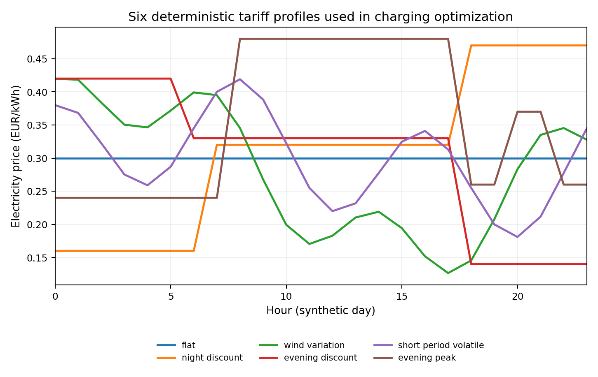
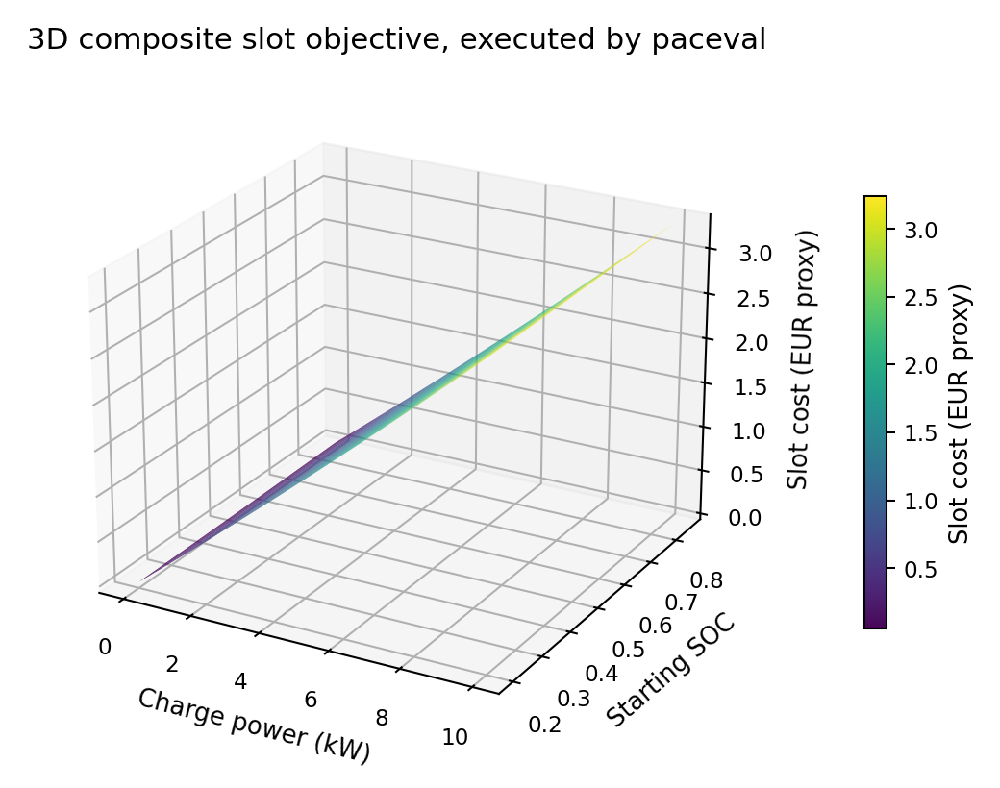
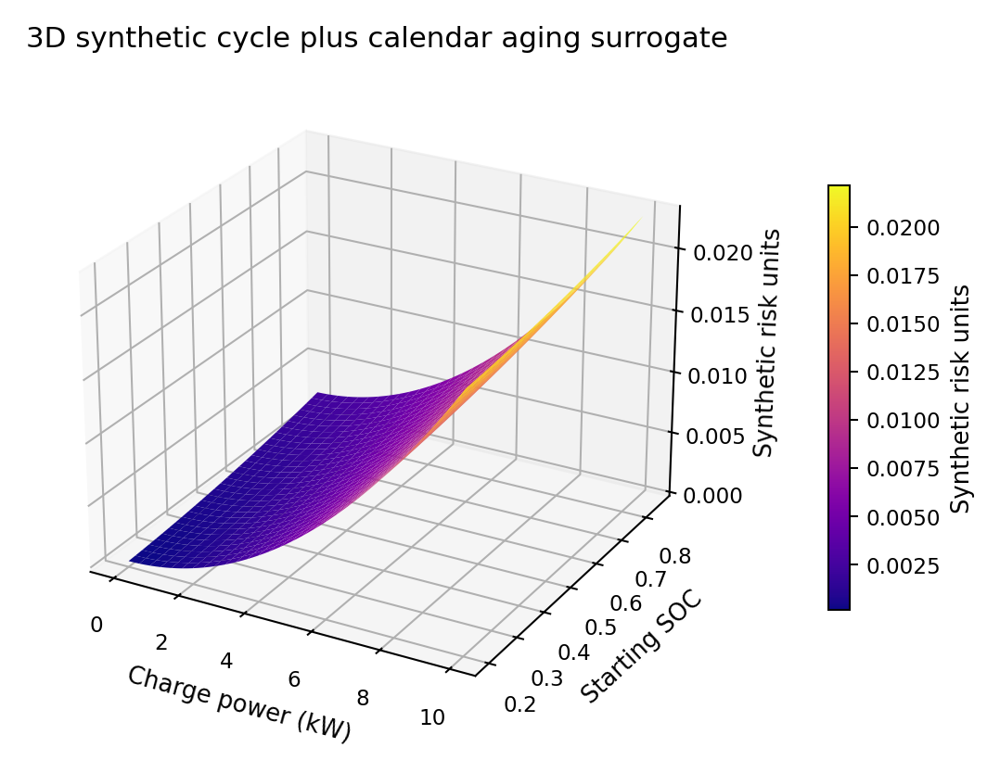
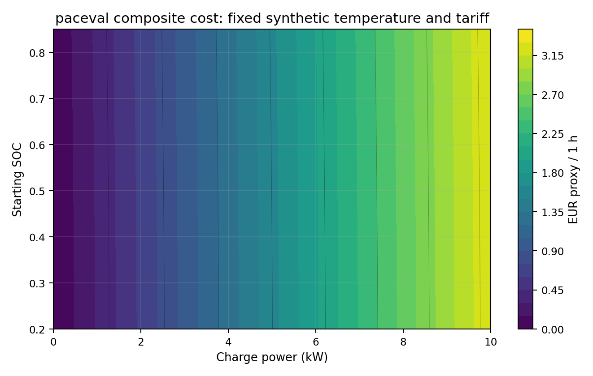
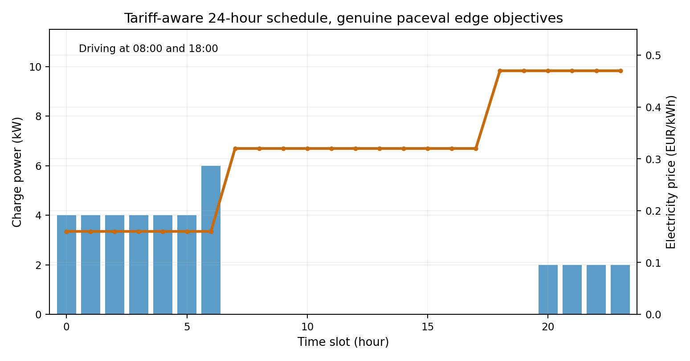
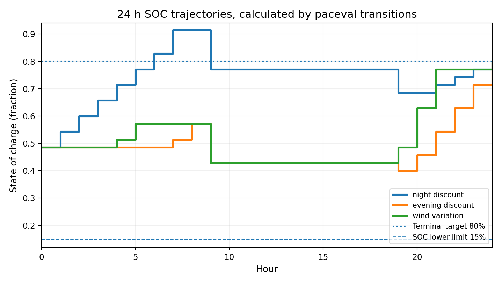
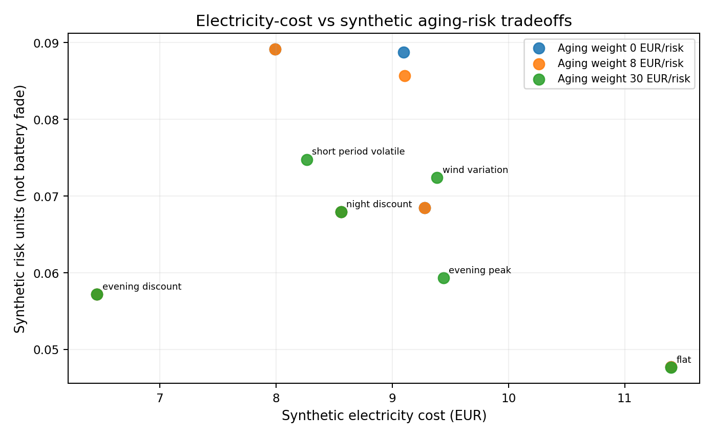
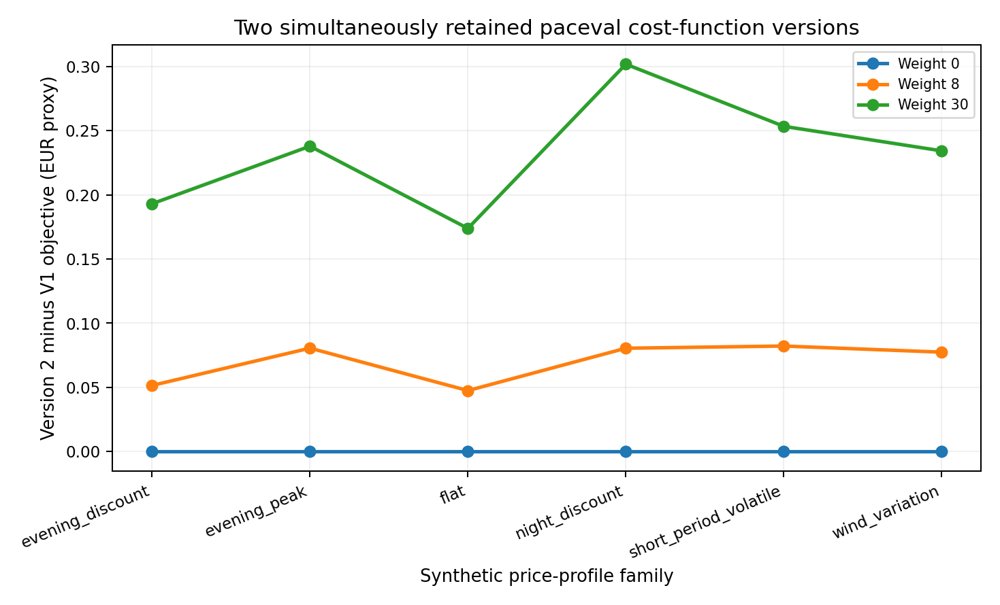
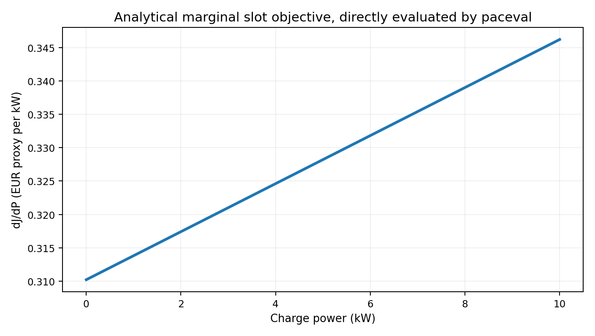
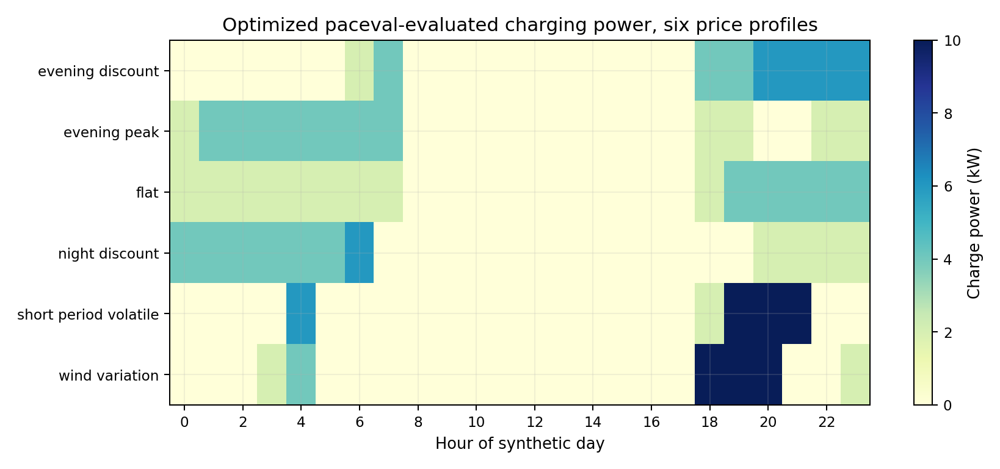

# WP_039 — Battery Charging Cost and Aging Terms with paceval


*Title illustration (2400 × 1200 pixels) is conceptual artwork, **not** a computed battery or measured charging experiment. The numbered figures use files exported by the actual C++/paceval run: input traces are labeled synthetic, while computed surfaces and schedules use executed mathematical outputs.*

**A verified C++/paceval research demonstrator for battery-electric-vehicle charging, tariff-aware scheduling, constrained state-of-charge transitions and explicitly uncalibrated aging surrogates.** The complete mathematical cost expressions, both formula versions and their sensitivities are evaluated with the **original paceval Mathematical Engine** in persistent, reusable Multi-Graph batches. The host implements only the discrete scheduling policy, validated inputs and file I/O.

[**English scientific whitepaper (PDF)**](paceval_Battery_Charging_Aging_Whitepaper_EN.pdf) · [Original WP_039 proposal](data/WP_039_original_research_proposal.pdf) · [C++ source](src/battery_charging_aging.cpp) · [CMake](src/CMakeLists.txt) · [Actual paceval results](examples/) · [Execution inventory](results/math_execution_inventory.csv) · [Independent checks](results/high_precision_audit.json)

## 1. Industrial use case and research context

An industrial charging planner must reconcile arrival and departure, driving energy, charger availability, battery state of charge (SOC), energy tariffs and potentially longer-term battery-health policies. A fixed charging schedule can meet its energy requirement while missing cheaper intervals or incurring greater modeled charging stress. This example represents a **reusable mathematical callback inside a real scheduling algorithm**, rather than a claim about battery chemistry.

Modern studies explicitly combine energy-price scheduling and battery aging, including Nnorom et al. (2026), *Aging-Aware Battery Control via Convex Optimization*. Battery-aging tools such as the [NREL BLAST suite](https://www.nlr.gov/transportation/battery-lifespan) model cycling and calendar degradation based on experimentally informed temperature, current and SOC histories. The [NREL EVI-Pro](https://nrel.sitefinity.cloud/transportation/evi-pro) framework models real travel demand for EV charging. **This WP_039 reproducible pilot does not claim to implement BLAST, EVI-Pro, an electrochemical cell model or real measured cost curves.** It supplies a narrowly specified, transparent mathematical execution experiment.

The source proposal uses the illustrative expression `J = sum_t(price_t * P_t * dt + lambda * P_t^2)`. That form is a regularized charging-cost surrogate; **quadratic power by itself does not predict capacity fade**. The present project retains this term and adds separate SOC/temperature-dependent, deliberately synthetic calendar and cycle penalties. Each formula is explicitly tracked, versioned and independently audited.

## 2. Verified paceval run

| Item | Verified result |
|---|---:|
| Persistent real paceval mathematical graphs | **23** |
| Actual `paceval_dGetMultipleComputationsResultsExt` calls | **506** |
| Actual Multi-Graph-Batch results | **2,231,759** |
| Individually tested scalar handles | **23** |
| Independently verified C++ reference values | **116,380** |
| Independent `mpmath` checks at 80 decimal digits | **2,760** |
| Distinct deterministic synthetic tariffs | **6** |
| Synthetic aging valuations / independently held formula versions | **3 / 2** |
| DP-optimized feasible charge schedules | **36 of 36** |
| Calculated 2D response-surface points | **3,721 (61 × 61)** |
| CMake / original-SDK CTest integration test | **1 of 1 passed** |

Original log: [results/execution_summary.txt](results/execution_summary.txt). The total of 2,231,759 is the actual number of values returned by paceval's Multi-Graph-Batch API, **not** the number of different input vectors or schedules. The 36 discrete charging solutions are selected by C++ using paceval-produced edge costs and SOC transitions.

## 3. Mathematical definitions and units

The synthetic study uses a 64.4 kWh battery, constant grid-to-battery efficiency 0.92, one-hour slots, charging actions `P` of 0, 2, 4, 6, 8 or 10 kW, SOC lower bound 0.15 and upper bound 0.92. A fixed 24-hour journey plan consumes 9.20 kWh at hour 8 and 5.52 kWh at hour 18. The starting SOC is 17/35 and the required terminal SOC is 28/35 = **0.80**. The driving-departure policy additionally requires at least 20/35 SOC immediately before the first journey.

The exact charge and travel SOC transition evaluated by paceval is:

```math
s_{t+1}=s_t-\frac{D_t}{C}+\frac{\eta P_t\Delta t}{C},\qquad C=64.4\ {\rm kWh},\quad \eta=0.92.
```

The grid-energy charge and electricity cost are independently defined as:

```math
E_{{\rm grid},t}=P_t\Delta t,\qquad C_{{\rm electricity},t}=c_tP_t\Delta t.
```

The capacity-proxy model separates two types of **unitless, uncalibrated mathematical risk**:

```math
R_{{\rm cycle},t}=k_{\rm cy}\left(\frac{P_t}{10\ {\rm kW}}\right)^2\Delta t,
```

```math
R_{{\rm calendar},t}=k_{\rm cal}\,s_{{\rm mid},t}^2\exp[\alpha(T_t-25)]\Delta t,\quad
s_{{\rm mid},t}=s_t-\frac{D_t}{C}+\frac{\eta P_t\Delta t}{2C}.
```

Time is numerically expressed in hours; coefficients are **synthetic per-hour parameters** (`k_cy = 0.020`, `k_cal = 0.003`, `alpha = 0.040 / °C`). These risk units are *not* capacity-fade percentage, lost years, battery replacement cost, or calibrated degradation rates.

The two complete and simultaneously retained paceval objectives are:

```math
J_t^{(1)}=c_tP_t\Delta t+w_{\rm age}(R_{{\rm cycle},t}+R_{{\rm calendar},t})+w_{\rm smooth}\left(\frac{P_t}{10\ {\rm kW}}\right)^2\Delta t,
```

```math
J_t^{(2)}=c_tP_t\Delta t+w_{\rm age}(R_{{\rm cycle},t}+R_{{\rm calendar},t})(1+0.2s_{{\rm mid},t})+w_{\rm smooth}\left(\frac{P_t}{10\ {\rm kW}}\right)^2\Delta t.
```

The program also registers an **analytic derivative** of version 1 with respect to charging power. SOC margins, charger power margin, charging/stored energy, actual tariff cost, and a synthetic grid-carbon proxy are all real paceval graphs. Host reductions across time slots and the DP state search are deliberately **not** described as paceval operations.

## 4. Reproducible industrial screening experiment

Every experiment uses the same synthetic 24-hour drive and availability trace, six deterministic synthetic price profiles, three assumed risk-value coefficients (0, 8, 30 EUR/risk unit), and two fixed formula versions. Grid power is limited to 10 kW, unavailable hours reject nonzero charge, and the battery must satisfy each state bound and the prescribed final SOC. The C++ host implements a standard dynamic programming lattice with 36 SOC states; it calls paceval for **all** proposed mathematical edge transitions before it selects the cost-minimizing valid path.

For every feasible schedule the program exports the complete hourly SOC and power trajectory; the state-transition and energy-conservation checks are run on the actual chosen paceval values. Every scenario purchases exactly **38.00 kWh** of grid energy and stores **34.96 kWh**, with **14.72 kWh** synthetic driving consumption. This is an internal invariant of this deterministic mathematical case, not a claim about actual charging sessions.

### Illustrative results (synthetic tariff, aging weight 8, objective V1)

| Price family | Electricity (EUR) | Modeled aging penalty (EUR proxy) | Objective (EUR proxy) |
|---|---:|---:|---:|
| Flat | 11.40 | 0.382 | 11.805 |
| Discounted night | 8.56 | 0.543 | 9.133 |
| Synthetic wind variation | 9.11 | 0.685 | 9.858 |
| Discounted evening | 6.46 | 0.458 | 6.957 |
| Short-period volatile | 7.99 | 0.713 | 8.771 |
| Evening peak | 9.28 | 0.547 | 9.854 |

The objective also includes a small nonnegative power-regularization term. The rows have different **assumed tariffs** and therefore cannot be read as measured percentage gains or general recommendations. The aging penalty is only an explicit valuation of a non-calibrated risk proxy.

## 5. Scientific figures from actual paceval data

| Measured mathematical output | Graphic |
|---|---|
| Six synthetic price input profiles |  |
| Composite cost response, 3D |  |
| Synthetic cycle/calendar risk response, 3D |  |
| Cost contours |  |
| Optimized charging versus price |  |
| SOC evolution and terminal constraint |  |
| Electricity cost vs synthetic aging-risk tradeoff |  |
| Version 1 vs version 2 |  |
| Analytical marginal slot objective |  |
| Optimized charging across price profiles |  |

All **10 scientific graphics** are provided as PNG and PDF in [figures/](figures/). The original tariff inputs are explicitly synthetic; modeled quantities are based on actual SDK-produced mathematical values and C++ state selection, without invented observational measurements.

## 6. Exact execution responsibility

| Component | Executed by |
|---|---|
| 23 declared formula families, versioned slot objective, energy and SOC transitions | **Original paceval runtime** |
| SOC/charger constraint margins and analytic sensitivity functions | **Original paceval runtime** |
| Thousands of transition combinations and 61 × 61 surface | **Original paceval Multi-Graph Batch** |
| Tariff and driving traces, candidate generation, grid availability | C++ deterministic host |
| 24-hour discrete dynamic programming and terminal-state selection | C++ host |
| Independent oracle and high-precision checks | C++ and Python mpmath |
| Scientific charts and whitepaper typesetting | Python (visualization and reporting only) |

The exact [math_execution_inventory.csv](results/math_execution_inventory.csv) maps each real graph to its API and its responsible runtime. This experiment demonstrates formula execution and maintainability, not a demonstrated speed advantage, full electrochemical simulation or a measured health benefit.

## 7. Build and reproduce (Linux)

**Prerequisites:** CMake ≥3.16, Linux with a C++17 compiler, and a compatible **separately provided** paceval Linux runtime. `src/paceval_main.h` and `src/paceval_main.cpp` are the unmodified original SDK interfaces with their original copyright notices. The proprietary or separately licensed runtime binary is **not** redistributed in this repository.

```bash
cmake -S src -B build -DCMAKE_BUILD_TYPE=Release \
  -DPACEVAL_RUNTIME=/absolute/path/to/libpaceval_linux_sharedLIB.so
cmake --build build -j
ctest --test-dir build --output-on-failure
./build/battery_charging_aging --out . --profiles 6 --weights 3 --surface 61
python3 -m pip install -r src/requirements.txt
python3 src/high_precision_reference.py
python3 src/verify_results.py
python3 src/make_figures.py
python3 src/make_whitepaper.py
python3 src/check_readme_math.py
```

`results/execution_summary.txt` contains the actual counts from the executed program; `examples/paceval_transition_audit.csv` stores each selected input vector and the corresponding 23 SDK outputs. The 80-digit reference script independently evaluates the literal expressions in the saved [formula registry](examples/formula_registry.csv). `src/verify_results.py` checks all scenarios for power availability, SOC terminal state, energy balance and model version changes. The README checker includes positive/negative regression tests for fenced GitHub math and local document references; it is **not** a substitute for a browser-based GitHub rendering test.

## 8. Scientific limitations and useful next steps

The tariff, driving and temperature traces are fixed **synthetic inputs**, not live energy-pricing data or actual EV telemetry. The choice of 64.4 kWh, 92% charging efficiency, discrete 2 kW actions and risk coefficients is a declared demonstration contract. No temperature-dependent charging efficiency, electrochemical degradation, CC/CV charging taper, cell heterogeneity, battery warranty or fleet calibration is implemented. The modeled carbon intensity is also hypothetical. The illustrated optimizer guarantees an optimum only over its stated discrete action/state lattice, not a continuous globally optimal EV charging policy.

**The appropriate next step** is to replace the synthetic risk terms by a chemistry-specific, experimentally calibrated degradation model (e.g. BLAST-Lite), introduce actual timestamped tariffs and OEM-compliant charger/BMS limits, and compare verified SOC and energy trajectories over independent real trip histories. These data and any applicable licenses must be documented before industrial validation.

## 9. Sources

1. [Nnorom et al., *Aging-Aware Battery Control via Convex Optimization*, Optimization and Engineering (2026)](https://web.stanford.edu/~boyd/papers/aging_aware_battery_control.html).
2. [National Laboratory of the Rockies / NREL, Battery Lifespan and BLAST](https://www.nlr.gov/transportation/battery-lifespan).
3. [BLAST: Battery Lifetime Analysis and Simulation Tool Suite](https://nrel.sitefinity.cloud/transportation/blast).
4. [Appleton & Fotouhi, *A Model-Based Battery Charging Optimization Framework*, Automotive Innovation (2023)](https://doi.org/10.1007/s42154-023-00221-8).
5. [NREL EVI-Pro charging/travel demand modeling](https://nrel.sitefinity.cloud/transportation/evi-pro).
6. [2026 battery-lifetime research in Nature Climate Change](https://doi.org/10.1038/S41558-026-02579-Z).
7. [paceval Mathematical Engine public repository](https://github.com/paceval/paceval).

**Publication type:** reproducible analytical research demonstrator. **No claims of measured economic savings, calibrated physical battery aging, or paceval performance speedups.**
