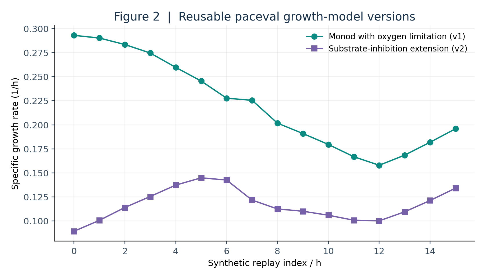
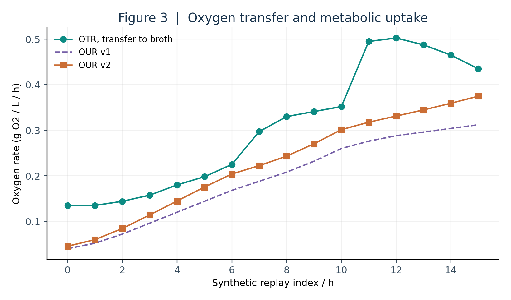
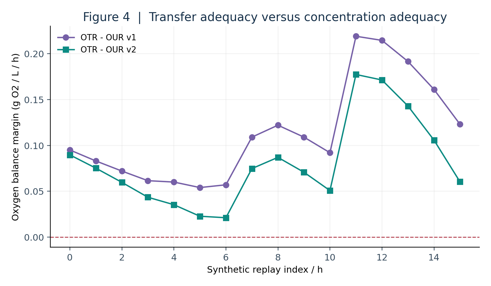
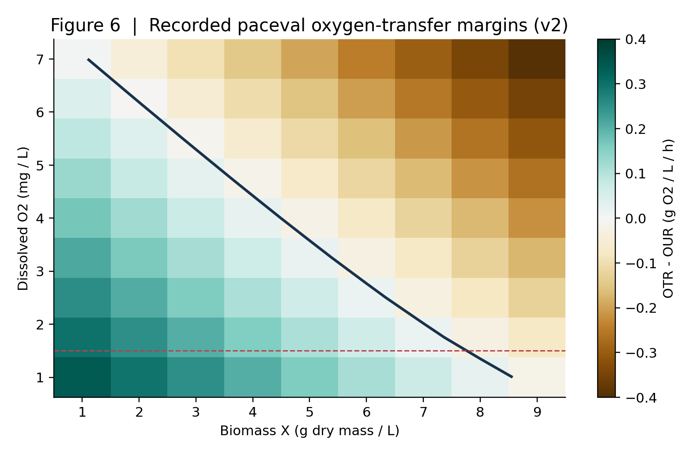
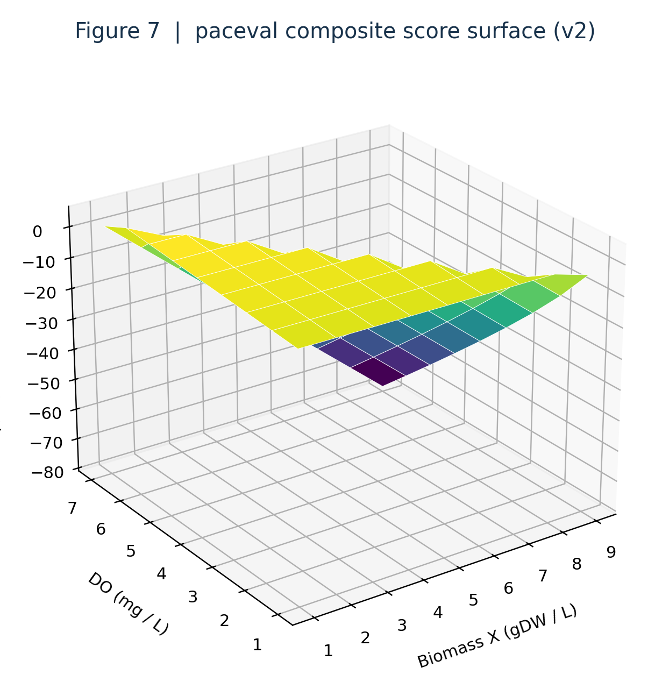
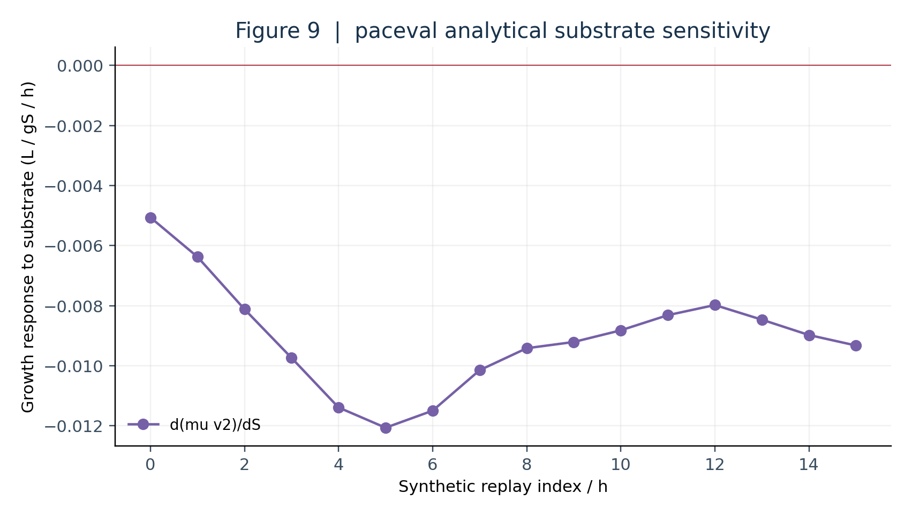

# Biomanufacturing Process Analytical Technology with paceval


*Concept illustration; not a computed research result.*

**Functional scientific research | Original paceval MCP v4.26 results | 14 November 2026**

This repository implements a reproducible mathematical demonstrator for monitoring a hypothetical fed-batch bioreactor. The biological questions are specific: How does substrate and dissolved oxygen affect modeled growth? How does oxygen uptake compare with transfer capacity? Can two controlled kinetic versions and their warning conditions be executed as persistent mathematical graphs in the original paceval Mathematical Engine? The answer here is a **functional mathematical demonstration**, not a validated bioprocess controller, experimental cell-culture study, GMP qualification or quality-release procedure.

[Read the English scientific whitepaper](paceval_Biomanufacturing_PAT_Whitepaper_EN.pdf) · [C++ execution path](src/biomanufacturing_pat.cpp) · [Formula inventory](results/math_execution_inventory.csv) · [Remote evidence](results/execution_evidence.json) · [Independent verification](results/independent_validation_summary.json)

## 1. Industrial use case and current state of the art

Biomanufacturing relies on controlled bioreactors containing living cells and nutrients. In a fed-batch reactor, a substrate-containing feed supports continued growth while aeration and agitation facilitate oxygen transfer. Operators observe dissolved oxygen (DO), substrate, biomass, off-gas composition, feeding rates, temperature and other process signals. A process analytical technology (PAT) layer combines these observations with quantitative models to interpret process state and generate investigation signals.

Industrial approaches range from conventional dissolved-oxygen probes and off-gas measurements to spectroscopy, chemometric soft sensors, mechanistic rate equations and hybrid process models. The US FDA's [PAT framework (2004)](https://www.fda.gov/regulatory-information/search-fda-guidance-documents/pat-framework-innovative-pharmaceutical-development-manufacturing-and-quality-assurance) and [ICH Q13 guidance (2023 FDA publication)](https://www.fda.gov/regulatory-information/search-fda-guidance-documents/q13-continuous-manufacturing-drug-substances-and-drug-products) provide regulatory context, not certification of this project. Research on [inline oxygen-uptake monitoring for CHO antibody production (2024)](https://www.sciencedirect.com/science/article/pii/S1369703X2400250X), [bioreactor sensor benchmarking (2025)](https://doi.org/10.3303/CET25117018) and [optical oxygen sensors (2025/2026)](https://doi.org/10.3390/s26010010) illustrates the current industrial interest in integrated sensors, oxygen balances and online mathematical interpretation.

The relevant paceval contribution is a reusable and versioned **mathematical evaluation layer**. An instrumentation system supplies verified measurements and parameters. paceval evaluates explicit growth, substrate, oxygen, sensitivity and decision-margin expressions for those inputs. A host application validates physical domains, manages the source data and formula versions, interprets the results, and retains audit records. paceval does not itself measure the reactor, identify model coefficients, solve arbitrary differential equations, or confer regulatory approval.

## 2. Mathematical model and scope

The source proposal, *WP 05. Biomanufacturing Process Analytical Technology*, defines a Monod-style growth rate with oxygen limitation, substrate use, oxygen consumption and oxygen-transfer slope. This extension evaluates two genuinely different model versions:

- **v1:** `mu = umax*S/(Ks+S)*DO/(Ko+DO)`, `OUR = qO2*X`.
- **v2:** `mu = umax*S/(Ks+S+S*S/Ki)*DO/(Ko+DO)`, `OUR = (qO2+qG*mu)*X`. The v2 substrate-inhibition and growth-coupled respiration assumptions are explicit hypotheses, not fitted mammalian-cell kinetics.

Both versions use `OTR = kLa*(DOstar-DO)`, `rS = mu*X/Yxs`, `dX/dt = (mu-F/V)*X`, `dS/dt = (F/V)*(Sfeed-S)-rS`, and `dDO/dt = OTR-OUR-(F/V)*DO`. They are instantaneous rate expressions. The replay is not an integrated dynamic simulation and its supplied volume is not advanced with time.

The mathematical monitoring rules are `Moxygen = OTR - OUR`, `MDO = DO - DOmin`, and `score = MDO min (tau*Moxygen)`, where `min` is the actual infix paceval operator and `tau` converts an oxygen-rate margin to a concentration scale. The composite logical graph is `(DO>=DOmin) AND (Moxygen>=0) AND (S>=0)` with explicit parentheses. A nonnegative score represents the selected mathematical conditions only. It does not make an industrial acceptance decision.

Concentrations are g/L, biomass is g dry mass/L, the feed is L/h, the volume is L, growth and kLa are 1/h, and oxygen flux is g oxygen/L/h. Valid input domains require positive kinetic denominators, finite values, positive volume and `DOstar > DO`; the latter is necessary for the required-kLa graph. A strict numeric CSV grammar rejects arbitrary mathematical expressions before the paceval string converter is invoked.

## 3. Actually executed mathematical functions

Twenty-four reusable domain-specific graphs were created and executed in the original paceval MCP service, which reported version 4.26. The 81-point state grid and 16-snapshot replay were each evaluated with a real multi-graph batch call. Six existing graph handles were evaluated again for the replay. Three additional TINC-enabled graphs were executed at six cases each, separately from the main 24-graph count.

| Mathematical function / industrial purpose | Actual implementation | Graph/version or rationale |
|---|---|---|
| Growth with substrate and oxygen limitation | paceval | `mu_v1`, `mu_v2` |
| Biomass and substrate instantaneous balances | paceval | `dX_v1`, `dX_v2`, `dS_v1`, `dS_v2`, consumption graphs |
| OUR, OTR and DO slope | paceval | `oxygen_uptake_v1/v2`, `oxygen_transfer`, `dDO_v1/v2` |
| Oxygen-capacity margins and concentration-scaled scores | paceval | `oxygen_margin_v1/v2`, `score_v1/v2` |
| Logical 0/1 process guards | paceval | `guard_v1/v2` |
| Analytical sensitivity and required kLa | paceval | `sensitivity_mu_S_v2`, `sensitivity_dDO_kLa`, `minimum_required_kLa_v2` |
| Alternative-model comparison and capacity ratio | paceval | `version_growth_delta`, `oxygen_capacity_ratio_v2` |
| Input grammar, units, finite/domain checks, scenario ordering | C++ host | Cannot be delegated safely to a mathematical expression |
| Model interpretation and hypothetical alert label | C++ host | Human-defined monitoring policy, never a GMP decision |
| Validation against native and high-precision references | Independent C++ / Python | Reference only, not paceval production results |

See [all registered original formula expressions](src/formula_manifest.json) and the [execution inventory](results/math_execution_inventory.csv). Remote opaque handles are kept for provenance; **the local SDK recreates its own handles** and does not copy remote handle numbers.

## 4. Research outcomes and independent verification

The 81-point grid contains 1,944 domain-graph/point evaluations; the 16-snapshot replay contains 384 more. A separate call re-evaluated six existing graphs for 16 snapshots. These counts refer to **different graph-point combinations**, not independent experimental measurements or unique physical sensor observations. Every main graph-point evaluation returned an error code of zero.

The archived paceval result CSVs retain selected output fields at the service's reported decimal precision. In an independent 90-decimal-digit mpmath audit, **515 ordinary retained values passed** the documented consistency criterion. Eighteen additional TINC output intervals were examined; 15 reported decimal intervals directly enclosed the reference value. In three score cases, both returned endpoints were the same displayed decimal and the exact binary-input reference lay outside those literal printed endpoints. Those cases are **not claimed to pass TINC inclusion**. They need inspection of typed binary bounds from a compatible local SDK to determine whether the issue lies in interval calculation or text serialization.

In the hypothetical replay, the model-computed oxygen transfer margin is positive at indices 11 and 12 although the supplied DO concentration is below the illustrative minimum. The compound guard correctly evaluates to false. At index 13 the synthetic DO is exactly at the threshold, the composite score is zero, and the non-strict guard is true. This illustrates why an oxygen-transfer reserve alone is not an adequate PAT rule.

[Open execution evidence](results/execution_evidence.json) · [High-precision audit summary](results/independent_validation_summary.json) · [Raw calculation audit CSV](results/independent_numerical_audit.csv) · [TINC investigation](RESEARCH_VALIDATION.md)

## 5. Scientific diagrams

The figure scripts use recorded outputs of real paceval MCP calls. The architecture diagram and the hero are explicitly conceptual.



*Figure 2. Two versioned paceval-specific growth-rate evaluations across synthetic inputs.*



*Figure 3. Original paceval OTR and OUR outputs, rather than an independently simulated signal.*



*Figure 4. Oxygen capacity and demand, with separate concentration-limit reasoning.*



*Figure 6. Process-state plane constructed from 81 actual paceval oxygen-margin results.*



*Figure 7. The 81-point paceval composite-score grid. The smooth surface between points is illustrative interpolation.*



*Figure 9. paceval's independently derived explicit sensitivity function.*

The remaining figures (architecture, DO guard, kLa requirement and TINC observations) are linked in the [figures folder](figures/01_PAT_architecture_schematic.png), [DO guard](figures/05_DO_limit_guard.png), [kLa](figures/08_required_kla.png), and [TINC output](figures/10_tinc_margin_width.png). Each generated scientific figure also has a vector PDF variant.

## 6. Reproducible CSV input and local C++ build

The two deterministic input files are [synthetic_sensor_snapshots.csv](data/synthetic_sensor_snapshots.csv) and [synthetic_state_grid.csv](data/synthetic_state_grid.csv). They have exactly 19 numeric columns: `time_h` followed by the 18 variables listed in the [formula manifest](src/formula_manifest.json). The separator is a comma and the decimal mark is a dot; no quoted free-text fields are used. The host rejects empty or nonfinite values, unexpected field counts and expression-like strings (`1+2`, `NaN`, locale commas, etc.) **before** it calls `paceval_dConvertStringToFloat`.

The C++ program uses the original SDK header and bridge, scalar and multi-graph batch calls, checked per-point errors, and `paceval_dConvertFloatToString` for its actual numerical CSV output. It separately archives original numeric input literals and documents that SDK conversion to text is not presumed to be IEEE-754 bitwise reversible. Numerical regression files can be saved in binary form in a future local execution phase.

```bash
cmake -S src -B build -DCMAKE_BUILD_TYPE=Release \
  -DPACEVAL_RUNTIME=/absolute/path/to/libpaceval_linux_sharedLIB.so
cmake --build build -j
ctest --test-dir build --output-on-failure
```

The runtime library must be the **genuine ABI-compatible original** paceval Linux shared object supplied separately by an authorized source. **It is intentionally not included in this repository.** In the supplied environment, C++17 source syntax was checked but there was no compatible shared object, so a successful link, CTest and local SDK execution are **not** claimed. The remote MCP results do not substitute for those unexecuted local checks.

Recreate the independent audit and graphics without the runtime:

```bash
python validation/high_precision_reference.py
python scripts/make_figures.py
python validation/check_project.py
```

## 7. Scientific interpretation and limitations

All numerical inputs are synthetic. Cell-specific growth parameters, oxygen uptake, effective kLa and DO thresholds are illustrative. This reduced-order model excludes cell physiology, pH, by-products, off-gas dynamics, oxygen probe response, gas-liquid interfacial changes, product quality attributes, uncertainty from measurement, reactor-volume integration and formal parameter fitting. A positive mathematical guard means that the chosen explicitly defined conditions passed, **not** that the process is suitable for a GMP batch or medicinal-product release.

The v2 inhibition coefficient and growth-dependent oxygen demand are research extensions, not a claimed state-of-the-art validated CHO kinetic model. A defensible industrial pilot would use permission-cleared real sensor data, assess model identifiability and holdouts, propagate instrument uncertainty separately from floating-point/TINC effects, test dynamic mass balances and validate decisions under an appropriate quality system.

## 8. External references

The publication includes linked references to the [FDA PAT framework](https://www.fda.gov/regulatory-information/search-fda-guidance-documents/pat-framework-innovative-pharmaceutical-development-manufacturing-and-quality-assurance), [FDA ICH Q13](https://www.fda.gov/regulatory-information/search-fda-guidance-documents/q13-continuous-manufacturing-drug-substances-and-drug-products), [2024 OUR monitoring research](https://www.sciencedirect.com/science/article/pii/S1369703X2400250X), [2025 bioreactor instrumentation survey](https://doi.org/10.3303/CET25117018), [oxygen sensing review](https://doi.org/10.3390/s26010010), [Raman soft-sensor model review](https://pubmed.ncbi.nlm.nih.gov/41420293/), the [paceval API](https://paceval.com/api/), and the [ICH Q5E comparability guideline](https://www.ema.europa.eu/de/node/69582). The detailed reference manifest is [docs/web_references.json](docs/web_references.json).

*No hardware-performance, energy, cost-savings or runtime-advantage claims are made.*
