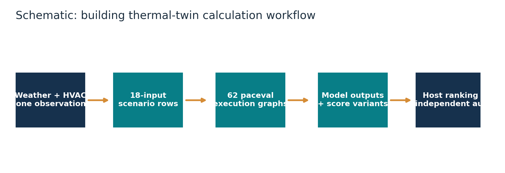
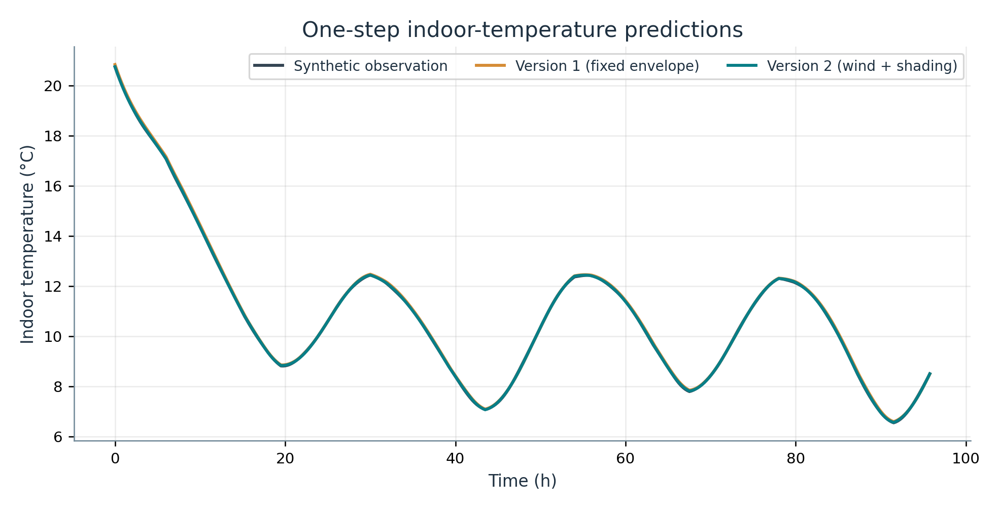
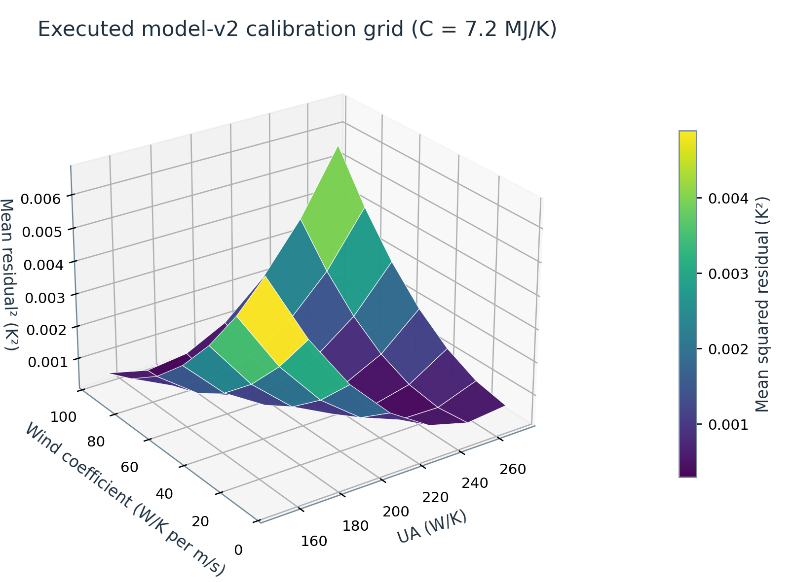
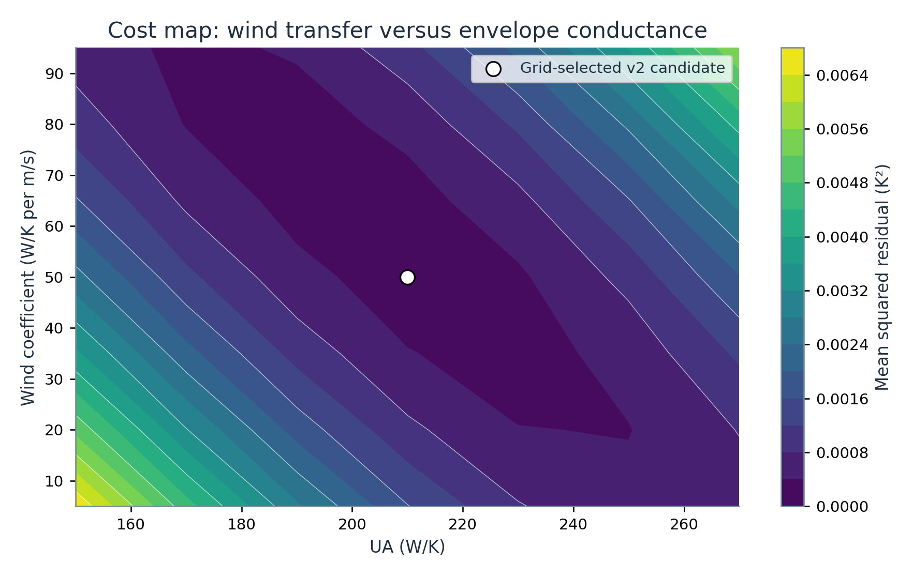
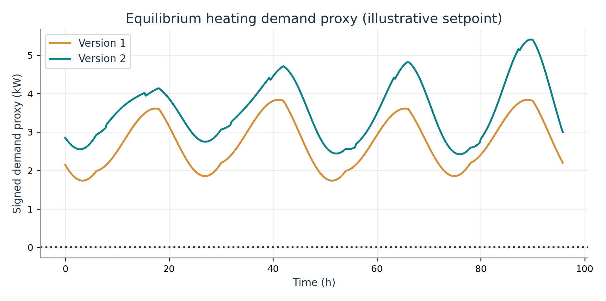
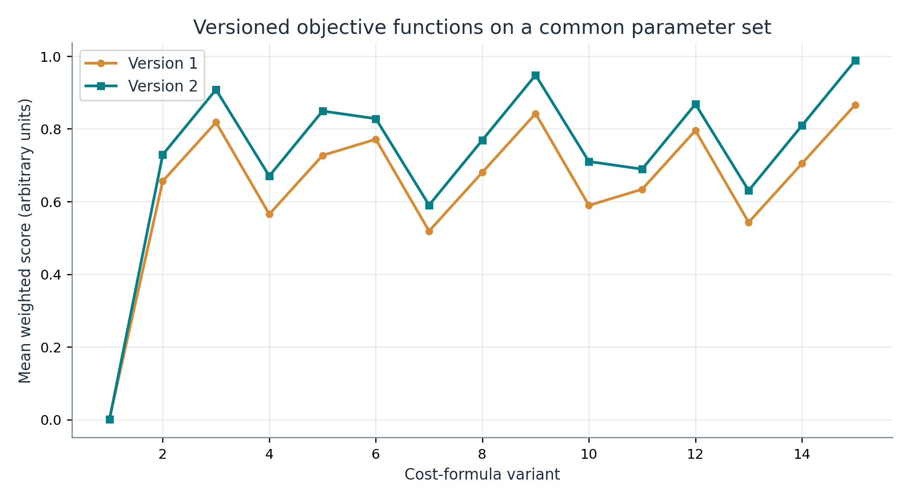

# paceval | Building Thermal Twin Cost Functions Research


*Concept illustration; not a computed research result.*

**A reproducible, original-SDK C++ demonstrator of parameterized building thermal balances, single-step forecasts, versioned calibration losses, composed cost functions, physical margins and analytical sensitivities executed with reusable paceval expression graphs.** This is a research-grade mathematical *kernel*, not a validated building-management product.

[Read the English scientific whitepaper](paceval_Building_Thermal_Twin_Whitepaper_EN.pdf) · [C++ application](src/thermal_twin.cpp) · [Executed mathematical inventory](results/math_execution_inventory.csv) · [Verified output manifest](results/verification_summary.json)

## 1. Industrial use case and current state of the art

Building owners and energy-management teams need to estimate how indoor temperatures respond to exterior weather, solar exposure, internal gains and heating or cooling power. A *building thermal twin* is a mathematical representation of part of that process. It can be used to explore parameter assumptions, compare forecasts to observations or supply model quantities to an upstream controller. As an illustrative industrial workflow, a facilities engineer could take measured indoor and outdoor temperatures, HVAC power and weather measurements, fit a lower-order thermal model and assess hypothetical operating conditions. This project uses **synthetic data only** and does not assert any real building deployment.

Detailed engineering tools such as [EnergyPlus](https://energyplus.net/), the [Modelica Buildings library](https://simulationresearch.lbl.gov/modelica/) and the [BOPTEST framework](https://ibpsa.github.io/project1-boptest/) provide much richer physical modeling, system simulation or controls benchmarking. Reduced-order resistor–capacitor (RC), or *grey-box*, models remain useful for explainable parameter estimation and model-predictive-control research. Recent literature has examined systematic parameter identification (Serasinghe et al., 2024), identification despite unmeasured internal loads (Lin et al., 2024), physically coherent model variation (Mont Lecocq et al., 2025), and thermal RC models in digital-twin workflows (Bisogno Bernardini et al., 2026). The Modelica Buildings library released v14.0.0 on 5 October 2026.

The industrial mathematical task demonstrated here is much narrower than complete building simulation: **evaluate the same transparent mathematical expressions repeatedly for many measurement rows and model parameters, retain multiple formula versions and audit all important derived quantities**. paceval creates original, reusable expression graphs and evaluates them with scalar and true multi-graph batch API calls. The C++ host performs time-indexed data assembly, validation, parameter-grid selection, file output and independent verification. No claim is made that paceval replaces EnergyPlus or a calibrated HVAC controller.

## 2. Research question and experimental scope

Can the mathematically meaningful calculation chain of a simplified one-zone thermal twin, including its outputs, guards and cost functions, execute through original paceval computation graphs rather than only through native C++ arithmetic? A deterministic **96-hour / 384-row** experiment tests two simultaneously retained model versions, **62 registered and executed mathematical graphs**, **30 objective variants** (two baseline squared-residual scores and 28 composite alternatives), and a fixed grid of **49 version-1 plus 343 version-2** parameter candidates. **1,575 multi-graph batch calls** produced **324,868 graph outputs** in the primary execution, alongside 388 scalar evaluations. These are execution counts, not throughput or performance claims.

All 62 graph expressions have the same declared 18-variable interface. Handles are created once; subsequent work reuses them. The actual `paceval_dGetMultipleComputationsResultsExt` buffer layout is checked against scalar paceval evaluations. **18,834 native C++ comparisons** and **1,438 independent 80-digit mpmath comparisons** passed the documented numerical criteria. Exact audit details reside in [technical verification files](results/high_precision_audit.json), not in the scientific presentation.

## 3. Defined mathematical model

A deliberately reduced one-zone, one-capacitance, one-resistance (1R1C) building model is integrated by explicit Euler with an illustrative fixed time step of 900 s. The two model revisions differ in their solar and wind terms:

```math
C\frac{dT}{dt}=Q_{\mathrm{HVAC}}+Q_{\mathrm{int}}+Q_{\mathrm{solar}}-Q_{\mathrm{loss}}.
```

```math
\begin{aligned}
Q_{\mathrm{solar},1}&=\alpha G, & Q_{\mathrm{loss},1}&=UA(T-T_o),\\
Q_{\mathrm{solar},2}&=\alpha G(1-s), & Q_{\mathrm{loss},2}&=(UA+k_w w)(T-T_o).
\end{aligned}
```

```math
T_{k+1}^{(v)}=T_k+\frac{\Delta t}{C}\left(Q_{\mathrm{HVAC},k}+Q_{\mathrm{int},k}+Q_{\mathrm{solar},v,k}-Q_{\mathrm{loss},v,k}\right).
```

Here $T$ and $T_o$ are indoor/outdoor temperature (°C); $C$ is effective thermal capacitance (J/K); $UA$ is envelope conductance (W/K); $G$ is incident solar thermal-power proxy (W); $\alpha$ is dimensionless gain efficiency; $s$ is shade fraction; $w$ is wind speed (m/s); $k_w$ is an empirical wind-dependent conductance coefficient (W/K per m/s); all $Q$ terms are thermal powers (W). These are *model-defined* effective quantities, not independently identified building material properties.

For a desired indoor setpoint $T_{\mathrm{set}}$, the project also calculates an instantaneous **steady-state signed heating-demand proxy** (which intentionally excludes transient stored energy):

```math
Q_{\mathrm{req},v}=U_v(T_{\mathrm{set}}-T_o)-Q_{\mathrm{solar},v}-Q_{\mathrm{int}},\qquad
U_1=UA,\quad U_2=UA+k_w w.
```

The baseline calibration objective uses the squared one-step residual $r_k^{(v)}=T_{k+1}^{(v)}-T_{k+1,k}^{\mathrm{obs}}$. Each model also retains fourteen alternative **fully composed** weighted objectives, evaluated by paceval:

```math
J_i^{(v)}=w_{r,i}r_k^2+w_{e,i}\left(\frac{Q_{\mathrm{req},v}}{1000\,\mathrm{W}}\right)^2
+w_{c,i}\left(\frac{T_{k+1}^{(v)}-T_{\mathrm{set}}}{2\,\mathrm{K}}\right)^2
+w_{p,i}\left(\frac{UA-UA_{\mathrm{prior}}}{100\,\mathrm{W/K}}\right)^2.
```

The weights encode *illustrative* priorities, not engineering-calibrated utility or currency. Internally, formula `score_v*_01` is only $r_k^2$ and `score_v*_02` through `score_v*_15` are the weighted alternatives. Graphs compute the lower and upper temperature guard margins, version differences and derivatives, including the exact analytical derivative of the full `score_v2_02` formula with respect to $UA$. Invalid and nonfinite input handling remains the host's responsibility.

## 4. What is actually executed with paceval?

| Mathematical function / industrial purpose | Actual implementation | Graph / version or rationale |
|---|---|---|
| Solar gain and wind-dependent heat transfer | **paceval** | `solar_gain_v1/v2`, `envelope_loss_v1/v2` |
| Net thermal balance and next-zone temperature | **paceval** | `net_heat_v1/v2`, `temperature_next_v1/v2` |
| Residual and baseline squared calibration objective | **paceval** | `temperature_residual_v1/v2`, `score_v1_01/v2_01` |
| Signed setpoint thermal demand | **paceval** | `required_heat_v1/v2` |
| Lower/upper temperature margins | **paceval** | `lower_margin_v1/v2`, `upper_margin_v1/v2` |
| Fourteen composite cost variants per version | **paceval** | `score_v1_02`–`15`, `score_v2_02`–`15` |
| Temperature and score sensitivities | **paceval** | `temperature_dUA_v*`, `temperature_dC_v*`, `score02_dUA_v*`, etc. |
| Controlled formula-version difference | **paceval** | `formula_temperature_delta_v2_minus_v1` |
| Recursive state, deterministic inputs and finite-grid ranking | **C++ host** | Stateful iteration and selection, not scalar expression evaluation |
| Independent reference calculations | **C++ / Python audit only** | Not claimed as paceval application output |

The complete machine-readable [function execution inventory](results/math_execution_inventory.csv) maps every graph to the actual API call and verification status; the exact executable expressions are recorded in [formula_registry.csv](results/formula_registry.csv).

**End-to-end example:** a synthetic quarter-hour record contains $T_k$, $T_o$, solar, HVAC and internal power, wind and shade. Persistent paceval graphs calculate heat terms, a next-temperature forecast, signed setpoint demand and a score and guard margins. C++ accumulates the paceval output over measurement rows, selects the lowest squared-residual candidate in a finite parameter grid and exports all outcomes. This is actual execution with the supplied original SDK, not a host-side formula imitation.

## 5. Reproducible research outputs

The synthetic generator uses a fixed weather/HVAC waveform, a 15-minute step, known reference parameters $UA=210\,\mathrm{W/K}$, $C=7.2\,\mathrm{MJ/K}$, $k_w=55\,\mathrm{W/K/(m/s)}$ and $\alpha=0.65$, with small deterministic sensor perturbations. Synthetic truth is *generated by revision v2*, so this experiment is **not an independent field test demonstrating v2's superiority**. The v2 grid is discretized (the true $k_w=55$ is between candidate grid values), and correlations/identifiability deserve separate study.

The actual executed minimum mean squared one-step residuals on this finite grid were **0.000418430 K² for v1** at $UA=270\,\mathrm{W/K}$, $C=7.2\,\mathrm{MJ/K}$, and **0.000196607 K² for v2** at $UA=210\,\mathrm{W/K}$, $C=7.2\,\mathrm{MJ/K}$, $k_w=50\,\mathrm{W/K/(m/s)}$. These are constrained synthetic grid outcomes, not validated building forecast accuracy.

The principal reproducible files are [synthetic input records](examples/observations.csv), [full paceval parameter grid](results/model_sweep.csv), [computed time series](results/time_series.csv), [score variations](results/score_variants.csv), and [SDK execution log](results/sdk_execution.txt). The two model versions and all 30 objectives remain simultaneously callable.

## 6. Scientific diagrams

All result diagrams below are regenerated from the **executed paceval CSVs**, and are supplied as high-resolution PNG and vector PDF. The introductory workflow figure is a schematic, not an executed result. See [figure provenance](results/figure_manifest.csv).













Additional: [Residual behavior](figures/03_residual_by_model.png), [Guard margins](figures/07_temperature_guard_margins.png), [Score sensitivity](figures/09_calibration_sensitivity.png), [Thermal-capacitance study](figures/10_selected_cost_by_heat_capacity.png).

## 7. Build and rerun with the original SDK

The actual unmodified SDK header `src/paceval_main.h` and original adapter source `src/paceval_main.cpp` are included with original copyright and AGPL notices. In the adapter, **only the relative header include was changed** for this standalone directory structure. Provide your own compatible Linux x86-64 runtime, such as `libpaceval_linux_sharedLIB.so`; the shared library is **not redistributed** in this ZIP.

```bash
cmake -S src -B build -DCMAKE_BUILD_TYPE=Release \
  -DPACEVAL_RUNTIME=/absolute/path/to/libpaceval_linux_sharedLIB.so
cmake --build build -j
ctest --test-dir build --output-on-failure
./build/building_thermal_twin --out . --steps 384 --grid 7
python3 src/verify_results.py --root .
python3 src/make_figures.py --root . --figures figures
python3 src/check_readme_math.py
python3 src/make_whitepaper.py --root .
```

Python publishing tools use `numpy`, `matplotlib`, `Pillow`, `reportlab`, and the independent numerical audit uses `mpmath`. The C++ executable requires only the supplied original paceval API adapter and the compatible external Linux `.so`; it does not use a surrogate calculation engine. `src/CMakeLists.txt` is the CMake entry point. CTest includes a real original-SDK execution and the dependent high-precision validation. The command shown is for a user-supplied runtime path; the runtime is intentionally excluded from the archive.

## 8. Scientific boundaries and verification

The data are deterministic, synthetic and model-consistent by construction. The explicit Euler implementation is not a high-fidelity multi-zone simulation; one-step predictions consume observed prior states and should not be called validated long-horizon autonomous forecasts. Solar forcing, internal gains, shade, wind effects and heating decisions are deliberately simplified. The cost function combines illustrative preferences; setpoint thermal-demand proxies are not measured or dispatched HVAC energy. The demonstration does not certify controller safety, policy compliance, physical identification uniqueness, performance advantages or deployment suitability.

TINC was not used for the production results; this project makes no interval-enclosure claim. The original scalar and multi-graph batch APIs were checked with the actual shared library. Independent native C++ calculations and the 80-digit high-precision reference were verified for the main end-to-end model output and weighted objectives. Numeric audit files are retained in [results](results/verification_summary.json); public presentation intentionally omits native-versus-paceval error comparisons and benchmark timing claims.

## 9. Selected external references

1. U.S. Department of Energy, **EnergyPlus Engineering Reference**, zone-air heat balance: [Documentation](https://energyplus.readthedocs.io/en/stable/guides/engineering-reference/2.1-basis-for-the-zone-and-air-system-integration.html).
2. Lawrence Berkeley National Laboratory, **Modelica Buildings Library**, [official project](https://simulationresearch.lbl.gov/modelica/), updated October 2026.
3. International Building Performance Simulation Association, **BOPTEST**, [official project](https://ibpsa.github.io/project1-boptest/).
4. Serasinghe, Long and Clark, *Parameter identification methods for low-order gray box building energy models: A critical review*, Energy and Buildings (2024), [DOI: 10.1016/j.enbuild.2024.114123](https://doi.org/10.1016/j.enbuild.2024.114123).
5. Lin et al., *Grey-box modeling for thermal dynamics of buildings under the presence of unmeasured internal heat gains*, Energy and Buildings (2024), [DOI: 10.1016/j.enbuild.2024.114229](https://doi.org/10.1016/j.enbuild.2024.114229).
6. Mont Lecocq, Pascual and Salom, *Development of physically coherent grey-box models for residential buildings using a simplified adjustment method*, Energy and Buildings (2025), [DOI: 10.1016/j.enbuild.2024.115215](https://doi.org/10.1016/j.enbuild.2024.115215).
7. Bisogno Bernardini et al., *Grey-Box RC Building Models for Intelligent Management of Large-Scale Energy Flexibility: From Mass Modeling to Decentralized Digital Twins*, Energies (2026), [DOI: 10.3390/en19010077](https://doi.org/10.3390/en19010077).

**Research release, 13 November 2026.** The supplied WP_045 proposal is preserved in [reference](reference/WP_045_Building_Thermal_Twin_Cost_Functions.pdf). The case-study result is confined to the mathematical execution and controlled synthetic experimental conditions stated above.
