# Parameterized Bulk-Wave Evaluation Kernels with paceval


*Original conceptual cover artwork, 2400 × 1200 px; not a measured fifth-dimensional geometry or an observed gravitational wave. Every numbered figure below is generated from actual executable output.*

**WP_044 | Original paceval SDK execution | C++ | 13 November 2026**

This research demonstrator applies the **actual paceval Mathematical Engine** to a parameterized, linear, one-dimensional bulk-coordinate wave problem inspired by the AdS₅ conformal-coordinate operator. It preserves explicit formula versions and executes reusable finite-difference operators, right-hand sides, manufactured forcing, energy diagnostics, mathematical sensitivities and error expressions through **28 persistent paceval graphs** and the real `paceval_dGetMultipleComputationsResultsExt` API. The separate 7,623-point parameter survey deliberately evaluates a fixed analytical test field with the manufactured source **disabled** to isolate k and q dependence. An otherwise ordinary C++ method-of-lines / fourth-order Runge–Kutta driver handles the stateful integration and file output.

**[English research whitepaper (PDF)](paceval_Bulk_Wave_Kernels_Whitepaper_EN.pdf)** · [C++ executable source](src/bulk_wave_kernels.cpp) · [CMake project](src/CMakeLists.txt) · [Exact graph registry](examples/formula_registry.csv) · [Execution inventory](results/math_execution_inventory.csv) · [Scientific figures](figures/)

## 1. Industrial and scientific use case

High-dimensional PDE applications (extra-dimensional wave models, lattice wave propagation, inverse problems, reduced-order simulation and parameter sweeps) repeatedly evaluate the same nonlinear or parameterized mathematical expressions on thousands of spatial points and time steps. The mathematical kernels must remain auditable when potential terms, forcing profiles and boundary conditions change.

The input proposal targeted a single illustrative term `hTT=-k*k*h+d2hdz2-3*dh_dz/z`. This executable study makes the kernel precise and adds 12 spatial/temporal convergence experiments, real graph versioning, an explicitly forced manufactured solution, an analytical Bessel-function mode and independent verification. The models are not claims about physical gravitational shortcuts, gravitational-wave detection or a nonlinear five-dimensional Einstein solution.

In conventional AdS₅ Poincaré coordinates, the metric is conformal to flat spacetime, and separation of four-dimensional Fourier modes yields a weighted radial wave operator. The particular linear equation studied here is a **dimensionless benchmark** based on that operator, with an additional tunable *numerical* potential `q`:

```math
\frac{\partial^2 h}{\partial t^2}=\frac{\partial^2 h}{\partial z^2}-\frac{3}{z}\frac{\partial h}{\partial z}-(k^2+q+\delta)h+S(t,z),\quad z\in[1,2].
```

The term `δ` is zero in the original formula and positive only in the explicitly versioned mathematical revision. It is a controlled change to the numerical model, **not** an independently derived graviton mass. The external Dirichlet boundaries follow the specified exact test mode and generally inject or remove energy.

## 2. The four rigorous test modes

| Test | Exact/controlled analytical reference | PDE forcing | Purpose |
|---|---|---|---|
| `zero_radial` | `0.38 (1 + 0.08 z⁴) cos(1.4 t)` | 0 | Exact homogeneous polynomial radial mode; spatial truncation order |
| `bessel_J2` | `0.80 z² J₂(2z) cos(ωt)`, ω² = k² + q + 2² | 0 | Exact genuine oscillatory radial mode using Bessel order two |
| `manufactured_forced` | `0.25 z² sin(1.8z) cos(2.05t)` | Analytically specified below | Manufactured-source verification |
| `zero_radial_revision` | As zero mode with ω² = k² + δ, δ = 0.55 | 0 | Simultaneously preserved versioned RHS |

The manufactured source is evaluated **by paceval**, not replaced with an approximate Python-generated source:

```math
S(t,z)=a\cos(\omega t)\left[\left(k^2+q-\omega^2+m^2\right)z^2\sin(mz)+4\sin(mz)-mz\cos(mz)\right].
```

Here `a` is the scenario amplitude, `m` the radial frequency and `ω` the explicit temporal frequency. These are dimensionless controlled test inputs. The Bessel `J₂` special function is used only in the **host-side exact initial/boundary reference and independent high-precision oracle**: the interior wave operator, state acceleration and related formulas are always evaluated through actual paceval graphs.

## 3. Mathematical functions and independent graph versioning

Central differences and the warped radial differential operator are registered as reusable mathematical expressions:

```math
D_z h_i=\frac{h_{i+1}-h_{i-1}}{2\Delta z},\qquad D_{zz}h_i=\frac{h_{i+1}-2h_i+h_{i-1}}{(\Delta z)^2},\qquad L_z h_i=D_{zz}h_i-\frac{3}{z_i}D_z h_i.
```

Both the full acceleration and an independently registered revision are evaluated by paceval:

```math
a_i=L_z h_i-(k^2+q)h_i+S_i,\qquad a_i^{(2)}=a_i-\delta h_i.
```

The numerical method uses ordinary RK4 in C++, because ordered state transitions, boundary assignment and reductions are stateful operations rather than scalar mathematical expressions. The weighted energy and outward-flux proxies are evaluated by the same engine:

```math
\mathcal{E}(t)=\frac12\int_1^2\frac{h_t^2+h_z^2+(k^2+q)h^2}{z^3}\,dz,\qquad \mathcal{F}=-z^{-3}h_t h_z.
```

This energy **need not be constant**: prescribed time-dependent Dirichlet boundaries exchange energy with the finite interval, and the forced mode has a nonzero source. The actual calculation logs the boundary flux and the forcing power. Mathematical sensitivities, residuals, Euler update diagnostics, exact trial expressions and formula-version differences are also evaluated in paceval and listed in [the registry](examples/formula_registry.csv).

## 4. Actually executed results

| Property | Verified numerical execution |
|---|---:|
| Real original-SDK paceval computation graphs | **28** |
| Real multi-graph batch calls | **5,623** |
| Successful batch graph results | **663,784** |
| Dynamical test modes | **4** |
| Spatial grids for each mode | **25, 49 and 97 points** |
| Time interval | **0.6** (dimensionless) |
| Independently checked C++ operator values | **1,260** |
| Source, continuum and discrete sampled operator entries | **663** |
| 80-decimal-digit independent reference values | **2,779 passed** |
| Additional parameter sweep | **7,623 points** |
| Spatial convergence | **Approximately second order in all modes** |
| CMake, integration CTest | **1/1 passed** |

The complete original-SDK results are in [execution_summary.json](results/execution_summary.json), [grid_convergence.csv](examples/grid_convergence.csv), [field_time_series.csv](examples/field_time_series.csv), [energy_and_error_diagnostics.csv](examples/energy_and_error_diagnostics.csv), [spatial_operator_residuals.csv](examples/spatial_operator_residuals.csv), and [parameterized_kernel_surface.csv](examples/parameterized_kernel_surface.csv). These are outputs of an actual linked paceval C++ program, not calculated in a Python substitute. All counts refer to the described machine execution, not to performance claims on other computers.

## 5. Scientific figures derived from the actual output

| Figure | Result |
|---|---|
| 1 | 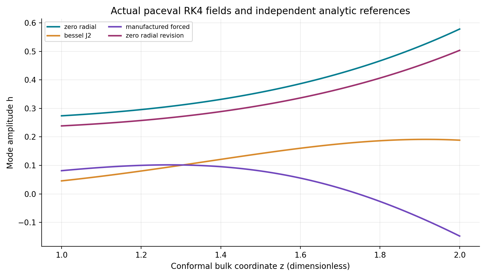 |
| 2 | 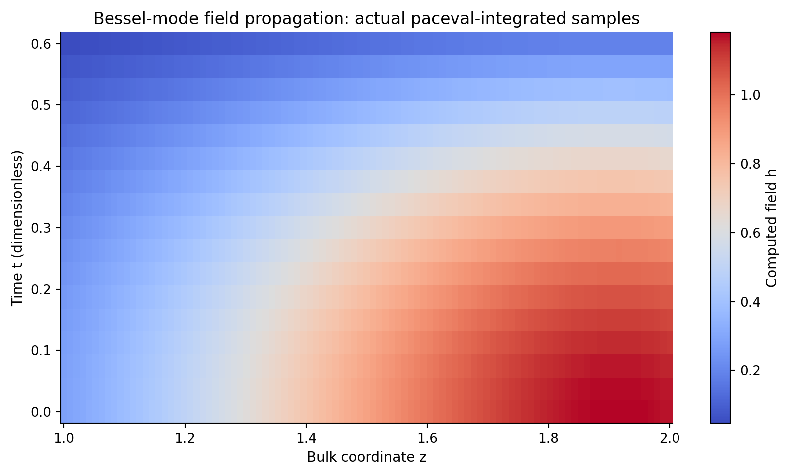 |
| 3 | 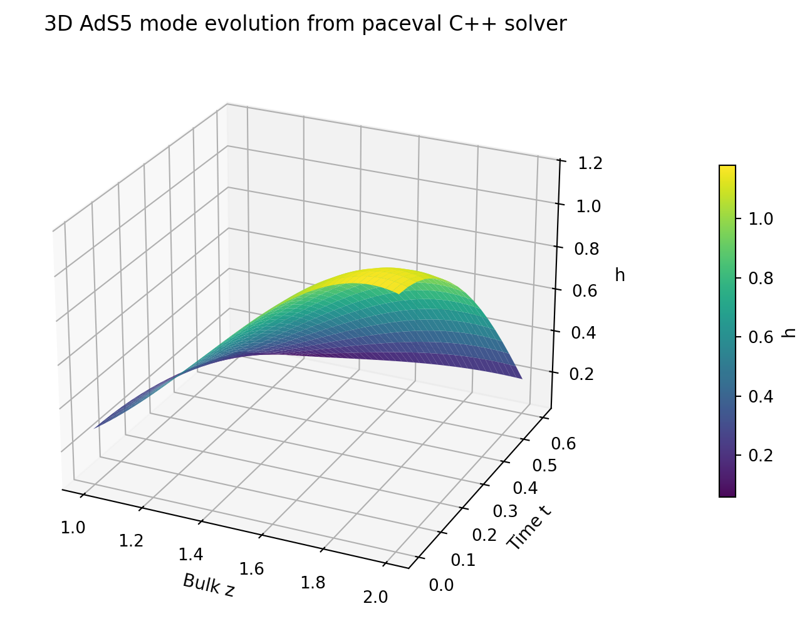 |
| 4 | 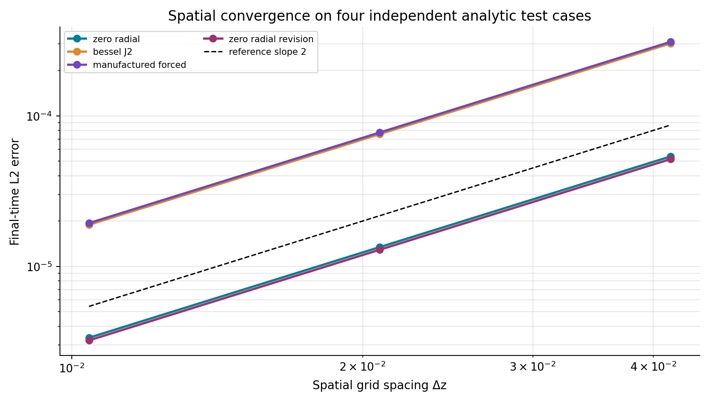 |
| 5 | 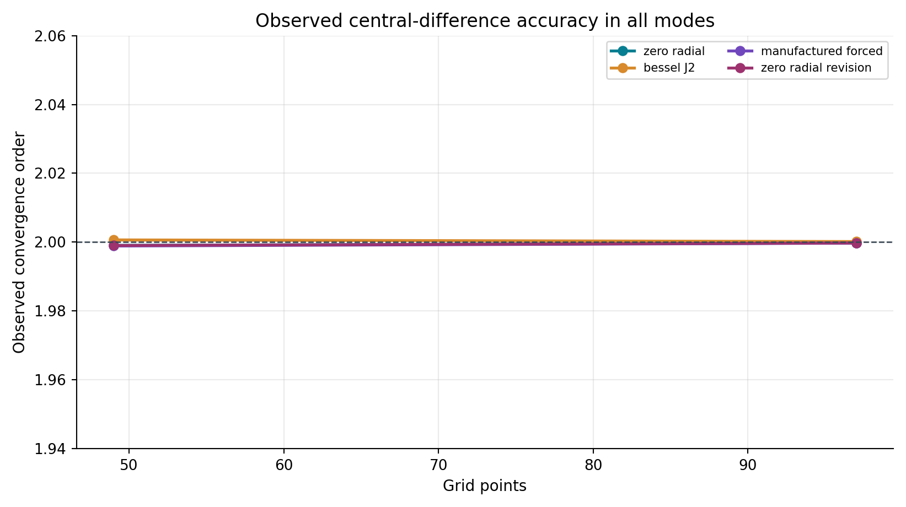 |
| 6 | 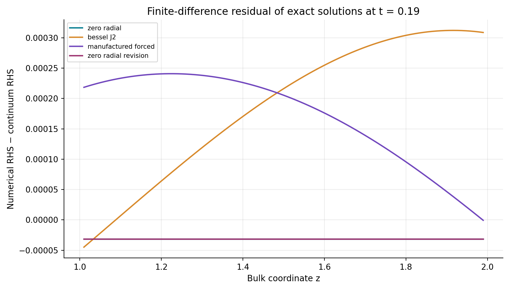 |
| 7 | 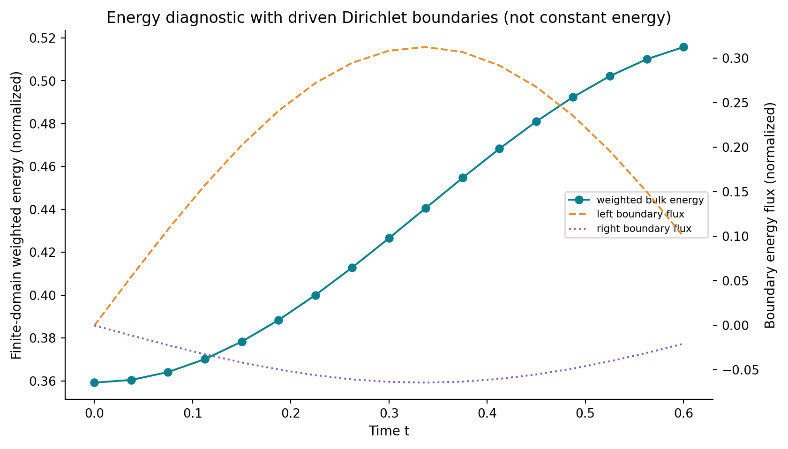 |
| 8 | 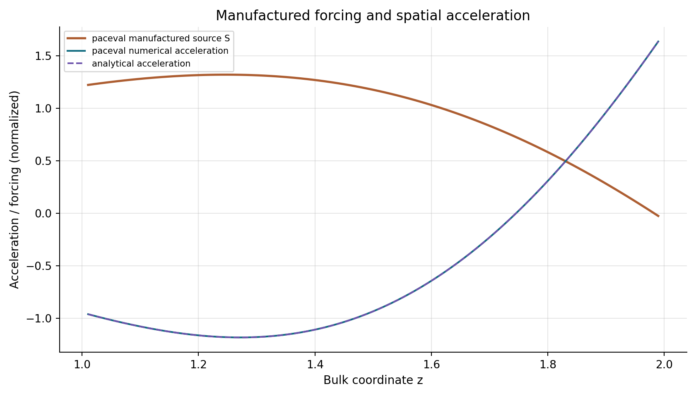 |
| 9 | 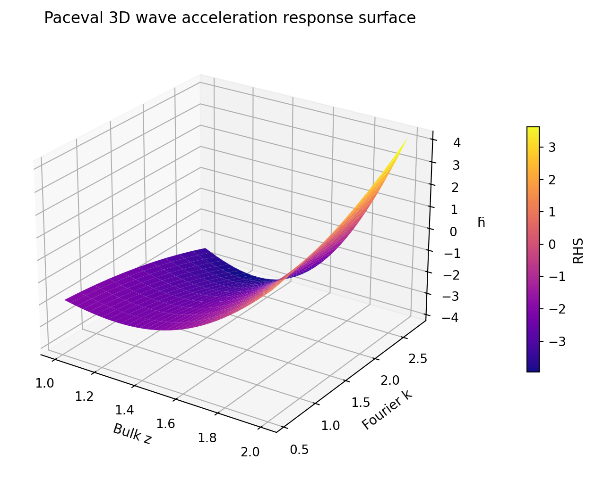 |
| 10 | 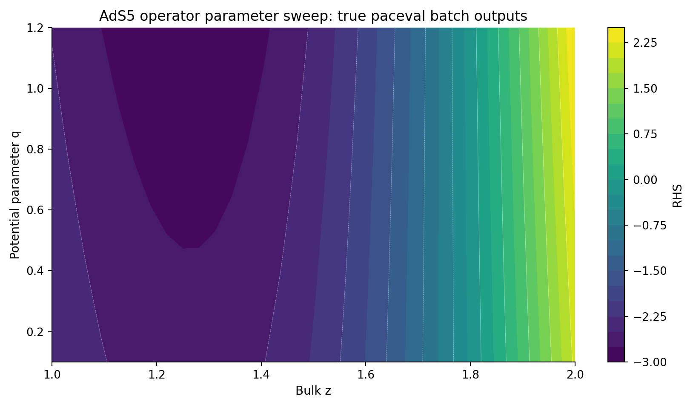 |
| 11 | 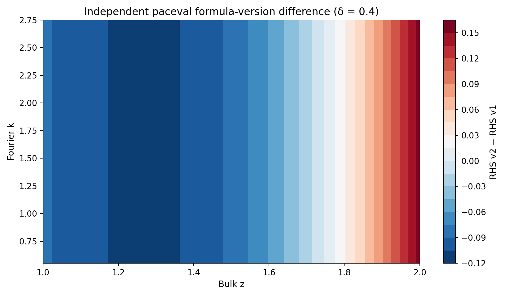 |
| 12 | 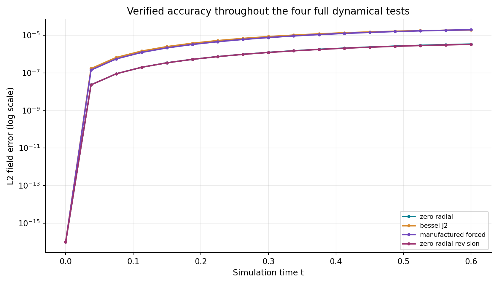 |

All twelve original research figures are supplied in both high-resolution PNG and vector PDF formats. Only the separate hero image is concept art.

## 6. Build and execute with the original paceval SDK

Requirements: Linux x86-64, C++17 compiler, CMake ≥ 3.16, compatible externally acquired original paceval shared runtime; Python 3 with `numpy`, `matplotlib`, `mpmath`, `Pillow`, `reportlab`, `PyMuPDF` for reproducibility tools. The repository includes the original `paceval_main.cpp` and `paceval_main.h`, while the runtime `.so` is intentionally excluded.

```bash
cmake -S src -B build -DCMAKE_BUILD_TYPE=Release \
  -DPACEVAL_RUNTIME=/absolute/path/to/libpaceval_linux_sharedLIB.so
cmake --build build -j
ctest --test-dir build --output-on-failure
./build/bulk_wave_kernels --out . --n0 25 --time 0.6 --courant 0.30
python3 src/high_precision_reference.py
python3 src/verify_results.py
python3 src/make_figures.py
python3 src/make_whitepaper.py
python3 src/check_readme_math.py
python3 src/check_release.py
```

The program creates four modes on grids `n0`, `2*n0-1`, `4*n0-3`. CTest runs a smaller **real-library** integration case. The command-line study uses centered finite differences and a fixed-step RK4 driver, with exact Dirichlet data. The provided reference is deterministic and needs no external astrophysical data. Math formulas inside this README use GitHub-supported fenced `math` blocks to avoid `\operatorname` parsing issues.

## 7. Scope, scientific limitations and next steps

The bulk wave operator is linear and one-dimensional after Fourier separation. It **does not** include nonlinear backreaction, a physical brane junction-condition analysis, a physically measured extra dimension, a matched gravity-wave signal, or propagation of information faster than light. The scalar parameter `q` and revision `δ` are controlled numerical potentials. These numerical results may be used to verify mathematical expression evaluation and help develop reliable PDE software, not to claim a new astrophysical discovery.

Scientific next steps include physical boundary/junction conditions, self-adjoint spectral analysis, independent energy-flux balance convergence, benchmarks against higher-order or spectral schemes, full uncertainty budgets, and separate application-level validation with a five-dimensional gravity model. The method-of-manufactured-solutions tests and observed convergence orders are **code verification**, not validation of the physical model.

## 8. Selected sources

1. [The Randall–Sundrum Model: graviton wave modes and conformal coordinates](https://ncatlab.org/nlab/files/Gabella-RandallSundrumModel.pdf).
2. [Study of massive graviton modes in conformal bulk coordinates and Bessel order-two equation (Durham thesis)](https://etheses.durham.ac.uk/id/eprint/2242/1/2242_252.pdf).
3. [AdS₅ and Randall–Sundrum modal equations (OSTI research article)](https://www.osti.gov/pages/servlets/purl/2579340).
4. [NIST: Verification and Validation procedures for computational mechanics](https://nvlpubs.nist.gov/nistpubs/ir/2020/NIST.IR.8298.pdf).
5. [Roache, Fundamentals of Verification and Validation, manufactured solution method](https://www.marin.nl/api/marin/downloads/get-download/6045/0/2704/block_files_hlee9l0uubi5p/8n76MTt2KkFhEwJLXf6U64eXsrI%3D/2009-FVVBook-Roache.pdf).
6. [paceval Mathematical Engine original public SDK](https://github.com/paceval/paceval).
7. [Original WP_044 proposal supplied by the user](reference/WP_044_Parameterized_Bulk_Wave_Evaluation_Kernels.pdf).

**Publication scope:** verified reproducible mathematical feasibility demonstrator, 13 November 2026. Independent physics validation remains an open research task.
