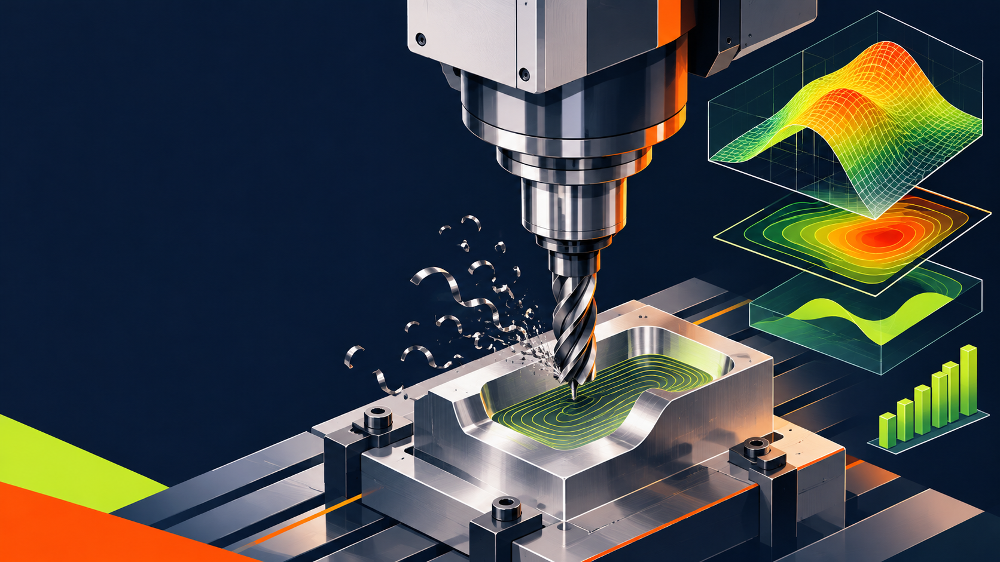
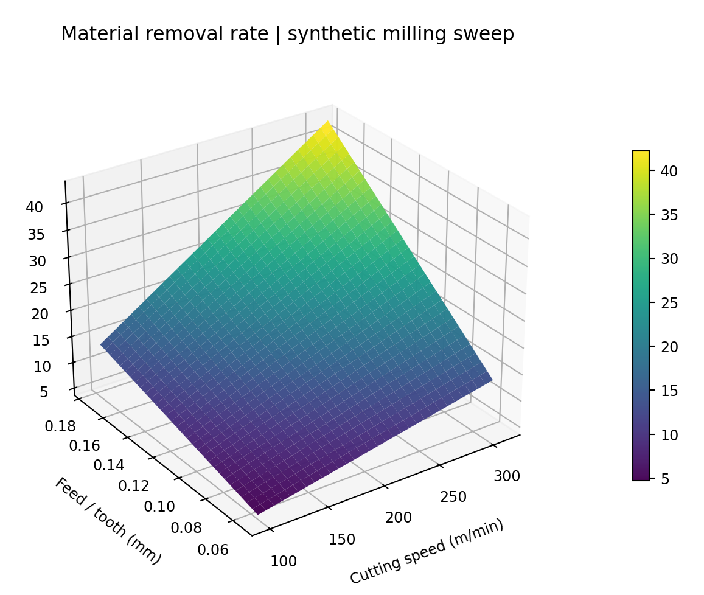
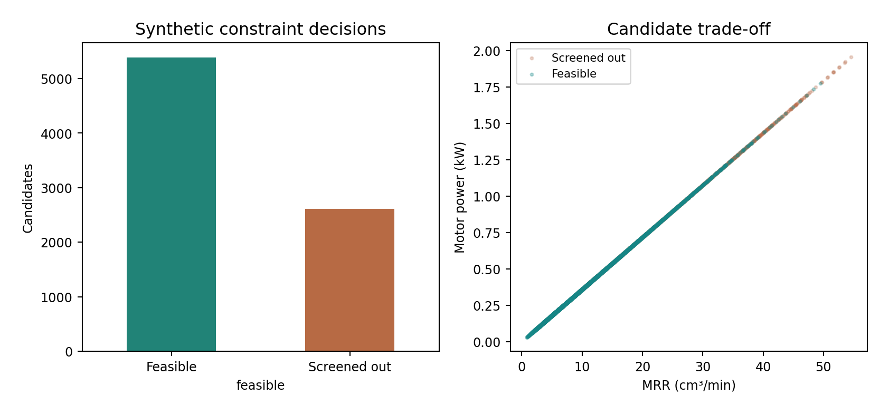

# WP_034 | Formula-Based CNC Parameter Screening with paceval



*Cover: independently created conceptual illustration, not a photograph of a performed machining trial. All numbered research figures use saved results from actual paceval computations.*

A **reproducible, research-only C++ demonstration** of mathematical machining parameter screening using the original paceval Mathematical Engine. The project creates **58 persistent computation graphs** for seven milling-related equations, 50 interchangeable scoring expressions and one controlled new formula version. It executes actual SDK scalar and batch API calls, checks numerical arithmetic independently, and records the decisions of a separate application-level feasibility filter.

**[Read the English research whitepaper](paceval_CNC_Parameter_Screening_Whitepaper_EN.pdf)** · [C++ implementation](src/cnc_screening.cpp) · [Build configuration](src/CMakeLists.txt) · [Audit results](results/data_audit.json)

## 1. Industrial use case and current state of the art

A manufacturing process engineer must choose spindle speed, cutting speed, feed per tooth, axial engagement and radial engagement before machining a component. These parameters affect material removal, spindle power, wear and surface finish. Candidate settings may be checked against the limitations of a selected tool, machine and workpiece. Tooling companies provide process equations and application guidance, and experimental machining data are necessary to qualify a real cutting process. The formulas from [Sandvik Coromant](https://www.sandvik.coromant.com/en-gb/knowledge/machining-formulas-definitions/milling-formulas-definitions) describe standard feed conversion, removal rate and cutting power. [ISO 8688-1:1989](https://www.iso.org/standard/16091.html), confirmed in 2022, concerns standardized tool-life testing in face milling.

This research isolates the **repeated mathematical calculation** within an offline screening workflow. A deterministic C++ host generates candidate conditions, invokes persistent paceval graphs for feature equations, invokes a selected reusable score graph, and applies transparent feasibility limits. No actual machine controller is connected. Such a screening kernel could eventually become part of process-planning, CNC digital-twin prototypes or tooling engineering applications after a separate experimental validation program.

The illustrative tool uses 12 mm diameter, four teeth, declared cutting-force coefficient 1,850 N/mm², motor efficiency 0.86 and a toy geometric nose-radius value of 0.8 mm. The specific material, chip formation, wear law, machine capacity and cutter dynamics have **not** been experimentally measured.

## 2. Mathematical functions actually evaluated by paceval

For cutting speed $v_c$ (m/min), diameter $D$ (mm), number of cutting teeth $z$ and feed per tooth $f_z$ (mm/tooth), the milling equations used in the source are:

```math
n=\frac{1000v_c}{\pi D},\qquad v_f=nzf_z
```

With axial engagement $a_p$ (mm), radial engagement $a_e$ (mm), specific cutting force $k_c$ (N/mm²) and assumed spindle efficiency $\eta$:

```math
Q=\frac{a_pa_ev_f}{1000},\qquad P_{\mathrm{motor}}=\frac{Qk_c}{60000\eta}
```

Here $Q$ is material removal rate in cm³/min and $P_{\mathrm{motor}}$ is motor power in kW. The work also evaluates an apparent tangential-force proxy $F=60000P_{\mathrm{cut}}/v_c$.

Two *explicitly uncalibrated* research-only proxies illustrate more complex nonlinear expressions:

```math
T_{\mathrm{proxy}}=40\left(\frac{180}{v_c}\right)^4\left(\frac{0.12}{f_z}\right)^{0.25}
```

```math
R_{\mathrm{proxy}}=\frac{f_z^2}{32(0.8)}
```

$T_{\mathrm{proxy}}$ is a synthetic tool-life response in minutes, **not a verified Taylor calibration**. $R_{\mathrm{proxy}}$ is a stylized geometric feed-mark measure in millimeters, **not a measured or certified roughness Ra in milling**. The machining literature requires material-specific tool-life and surface-finish tests for application to real equipment.

The 50 mathematical cost models comprise five nonlinear families and ten different coefficient choices per family. The variables are normalized before scoring; one family is:

```math
J=a\left(\frac{P_{\mathrm{motor}}}{5}\right)^2+b\left(\frac{R_{\mathrm{proxy}}}{0.001}\right)^2-c\left(\frac{Q}{20}\right)
```

The other families involve logarithmic, radical, squared-force, life and trade-off terms. The scores are *dimensionless mathematical preferences*, not calibrated machining economics. Absolute scores between different families are not meaningfully comparable. Version 2 adds an explicit force term to an independently stored score graph while version 1 remains callable.

## 3. Scope of the actual original paceval SDK integration

The source includes the original [paceval adapter header](src/paceval_main.h) and compiles the original [SDK adapter implementation](src/paceval_main.cpp) in a separate translation unit. The program uses `paceval_InitializeLibrary`, `paceval_CreateComputation`, `paceval_dGetComputationResult`, `paceval_dGetComputationResultExt`, `paceval_DeleteComputation` and `paceval_FreeLibrary`.

The seven metric graphs, 50 cost-expression graphs and a controlled formula revision are created once and reused across changes in numerical input. The separate C++ host generates candidates, checks finite input domains, derives rule selection, performs threshold decisions, writes files and provides independent reference formulas. **Neither an optimizer, a CNC machine, tool-wear predictor nor material simulator is implemented by the paceval engine.**

## 4. Reproducible synthetic numerical result

| Experiment | Verified result |
|:--|--:|
| Reusable paceval execution graphs | **58** |
| Different mathematical cost expressions | **50** |
| Immutable controlled graph revision | **1** |
| Candidate machining parameter rows | **8,000** |
| Candidate rows passing the declared synthetic limits | **5,388** |
| Direct scalar paceval results | **64,707** |
| Actual SDK batch outputs | **12,955** |
| Surface grid points | **3,721** |
| Independent internal C++ numerical checks | **77,157** |
| Independently validated 80-digit arithmetic results | **3,384** |
| CMake / CTest original-Linux-SDK integration | **1 / 1 passed** |

Five illustrative constraints are checked by the C++ host: $n\leq 9000$ rev/min, $P_{\mathrm{motor}}\leq 7.5$ kW, $T_{\mathrm{proxy}}\geq18$ minutes, $R_{\mathrm{proxy}}\leq0.0012$ mm, and $F\leq1800$ N. **These are scenario parameters, not validated or recommended safe manufacturing limits.** See [original candidate output](examples/screening_candidates.csv), [all graph formulas](examples/formula_registry.csv), [SDK log](examples/sdk_audit.txt), [independent arithmetic audit](results/high_precision_audit.json) and [dataset checks](results/data_audit.json).

## 5. Scientific figures from executed paceval outputs

The figures below are reproducible by executing [make_figures.py](src/make_figures.py) on the original saved [response-surface CSV](examples/cnc_response_surface.csv), [screening CSV](examples/screening_candidates.csv) and [formula-version CSV](examples/formula_revision.csv). Each PNG also has a corresponding editable/vector PDF in `figures/`.

| Computed figure | PNG | PDF |
|:--|:--|:--|
| 3D material removal | [Figure 1](figures/01_mrr_surface.png) | [PDF](figures/01_mrr_surface.pdf) |
| 3D motor power | [Figure 2](figures/02_power_surface.png) | [PDF](figures/02_power_surface.pdf) |
| 3D synthetic tool life | [Figure 3](figures/03_tool_life_surface.png) | [PDF](figures/03_tool_life_surface.pdf) |
| Power contour map | [Figure 4](figures/04_power_contours.png) | [PDF](figures/04_power_contours.pdf) |
| Feasibility decisions | [Figure 5](figures/05_screening_decisions.png) | [PDF](figures/05_screening_decisions.pdf) |
| Throughput–life trade-off | [Figure 6](figures/06_life_tradeoff.png) | [PDF](figures/06_life_tradeoff.pdf) |
| Formula version retention | [Figure 7](figures/07_formula_revision.png) | [PDF](figures/07_formula_revision.pdf) |
| Cost-family distribution | [Figure 8](figures/08_cost_family_distribution.png) | [PDF](figures/08_cost_family_distribution.pdf) |
| Tool-life boundary contours | [Figure 9](figures/09_tool_life_boundary.png) | [PDF](figures/09_tool_life_boundary.pdf) |





## 6. Build and reproduce with the original paceval Linux shared library

The external original compatible library `libpaceval_linux_sharedLIB.so` is deliberately **not included** in this repository. Supply the absolute path to your own compatible original vendor runtime. GCC or Clang with C++17, CMake 3.16+, Python 3, NumPy, Pandas, Matplotlib and mpmath are required to regenerate all audits and figures.

```bash
cmake -S src -B build -DCMAKE_BUILD_TYPE=Release \
  -DPACEVAL_RUNTIME=/absolute/path/to/libpaceval_linux_sharedLIB.so
cmake --build build -j
ctest --test-dir build --output-on-failure
./build/cnc_screening --out examples
python3 src/verify_results.py
python3 src/high_precision_reference.py
python3 src/make_figures.py
python3 src/check_readme_math.py
python3 src/make_whitepaper.py
```

Refer to the saved [CTest output](results/ctest_sdk.txt). The independent checks are intentionally technical: README and Whitepaper concentrate on the demonstrated industrial-screening use case rather than advertising numeric differences with C++ or processor-speed advantages.

## 7. Scientific interpretation and restrictions

The study demonstrates that actual paceval reusable mathematical graphs can execute a reproducible CNC screening function registry, control mathematical revisions, evaluate multidimensional parameter surfaces and support separately audited decisions. It does **not** demonstrate calibrated wear, a physical surface-roughness predictor, chatter stability, cutting-force measurements, controller safety, cutting-condition qualification, manufacturing cost savings or production optimization. In particular, a selected candidate may still be unsafe or unsuitable for an actual manufacturing setup. Independent machining trials and machine-specific limits must precede real deployment.

## 8. External technical sources

- [Sandvik Coromant: Milling formulas and definitions](https://www.sandvik.coromant.com/en-gb/knowledge/machining-formulas-definitions/milling-formulas-definitions)
- [ISO 8688-1:1989: Tool life testing in milling — Part 1](https://www.iso.org/standard/16091.html), confirmed in 2022
- [Kennametal: Milling technical information, force and power](https://www1.mscdirect.com/images/solutions/kennametal/millingTechInfoFormulas.pdf)
- [paceval Mathematical Engine C/C++ source](https://github.com/paceval/paceval)

The original notices in the supplied paceval adapter files are retained. Distribution of these SDK files requires compliance with the applicable original rights and licensing terms. This research project does not contain the external compiled runtime or a separate `LICENSE_NOTICE.md`.
