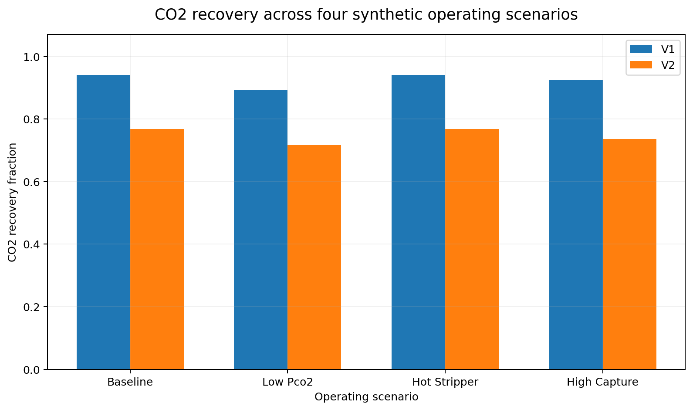
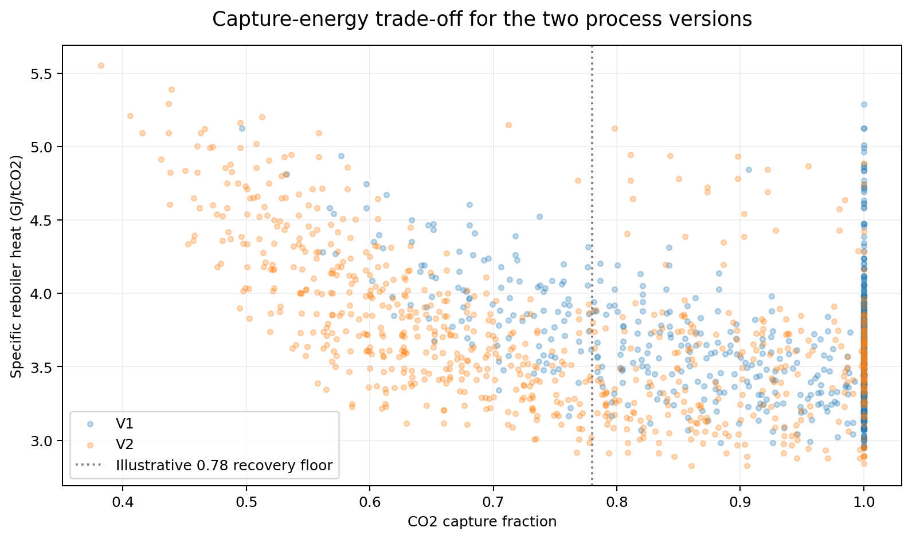
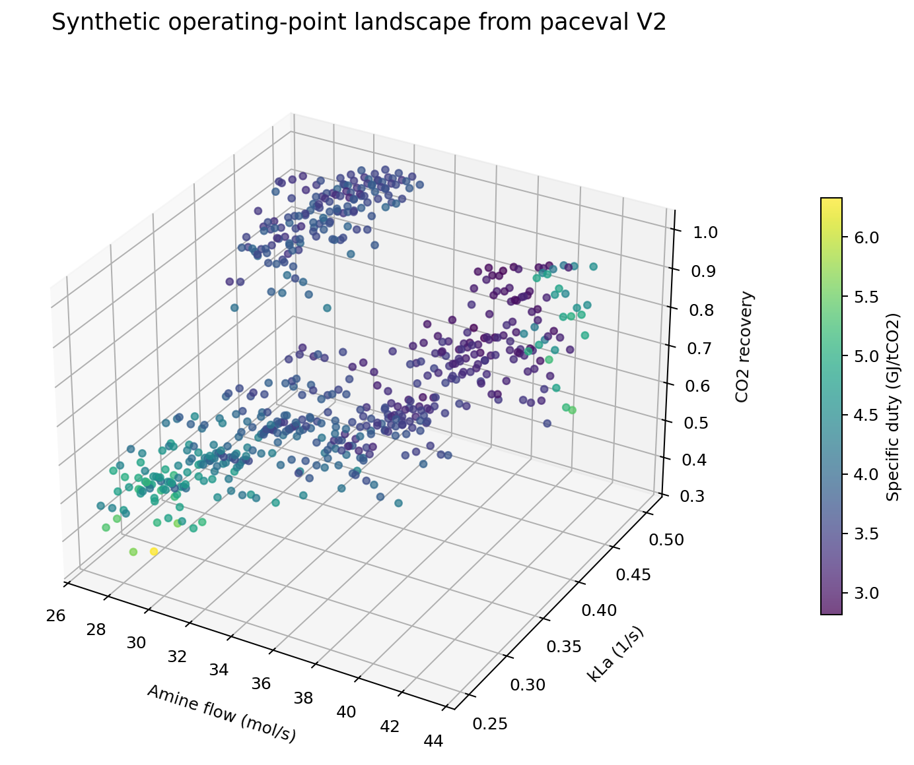

# Carbon Capture Absorber-Regenerator Process Windows with paceval


**Independent mathematical function demonstrator | C++17 and the original paceval 4.25 SDK | 14 November 2026**

This research project demonstrates how a reusable mathematical execution engine can screen related operating conditions of a simplified post-combustion CO2 capture process. The actual numerical research results were produced by executing original paceval computation graphs through the provided Linux SDK runtime. A native C++ model and a 90-digit Python reference independently check the physical balances and the resulting calculations. The experiment deliberately uses synthetic inputs, not measurements from a commercial plant.

## 1. Industrial use case and current state of the art

In a conventional amine-based carbon capture facility, CO2-rich flue gas enters an **absorber** where circulating lean solvent takes up CO2. The resulting rich solvent is heated by a lean/rich heat exchanger, then sent to a **stripper** and its reboiler. Heating regenerates the solvent and produces a concentrated CO2 overhead stream. The regenerated lean solvent returns to the absorber. Industrial engineering must reconcile the CO2 removal target with solvent circulation, available cyclic loading capacity, regeneration duty, temperature limits and the gas composition.

Commercial process design commonly uses rate-based packed-column models, thermodynamic electrolyte property packages and pilot-plant data in systems such as Aspen Plus. In 2025, an AMP/PZ rate-based and e-NRTL study was checked against pilot campaigns, while the 2026 CESAR1 study presented a validated rate-based process model. Current research also explores advanced blends, integrated heat recovery, regeneration design and constrained operating envelopes [1-6]. These methods provide much more physical detail than the compact expressions used here.

**The specific role for paceval:** supply a reusable, versioned, transparent mathematical computation layer for screening many candidate input vectors. The surrounding application still decides which operating points to investigate and whether a result warrants detailed process simulation.

A hypothetical engineer may specify an inlet CO2 molar flow, gas flow, absorber transfer parameter, contact volume, solvent circulation, loading and regeneration temperature. paceval evaluates CO2 transfer and capacity, material balances, energy terms, capture fraction, constraint margins, sensitivities and a composite screening score. The host groups those mathematical results and writes an audit trail. This is a **mathematical process-window example**, not an operational control command.

## 2. Research question and actual execution

**Question:** Can the original paceval engine execute complete, reusable absorber-regenerator screening calculations across multiple physical model variants with independently verified outputs and traceable acceptance conditions?

The verified main run contains **3,072 distinct deterministic synthetic operating inputs**. Both model versions are evaluated for each input, producing **6,144 model-case rows**. The original SDK successfully created and exercised **56 of 56 research graphs**. There are **5,332 independent native C++ end-value assertions** and **8,672 90-decimal-digit Python high-precision checks**. Their details are preserved in [execution evidence](results/execution_evidence.json), [native audit](results/native_audit.csv) and [high-precision audit](results/high_precision_audit.json).

For the illustrative capture, thermal-duty, loading and temperature constraints, 2,478 V1 candidates and 1,228 V2 candidates pass. The versions are deliberately different screening hypotheses rather than two competing claims about a real solvent. Lower or higher pass counts do not constitute process-model accuracy evidence or industrial superiority.

## 3. Mathematical and physical model

The model is a steady-state, reduced-order absorber plus reboiler calculation. The inputs use canonical SI-related units documented in [input schema](input/SCHEMA.md). `Fin` and `Fgas` are mol/s, `Kla` is 1/s, `Vol` is cubic metres and `Cstar`, `Cbulk` are mol/m3. `S` is mol amine/s and `lean`, `maxload` are mol CO2 per mol amine. The configured molar masses are 0.06108 kg/mol amine and 0.04401 kg/mol CO2. `wt` is an aqueous amine mass fraction, `cp` is kJ/(kg K), and `dh`, `hvap` are kJ/mol CO2. Thermal powers are kJ/s (kW).

The first main computation is the absorption driving-force proxy:

```math
N_{transfer}=k_La\,V\,(C^*-C_b), \qquad N_{cap}=S(\alpha_{max}-\alpha_{lean}).
```

For V1 the bounded capture rate is defined by

```math
N_{capt,V1}=\min(F_{in},N_{cap},N_{transfer}).
```

V2 uses a smooth saturation law before applying the physical feed bound:

```math
N_{capt,V2}=\min\left(F_{in},N_{cap}\left[1-\exp\left(-N_{transfer}/N_{cap}\right)\right]\right).
```

The resulting recovery is $\eta=N_{capt}/F_{in}$ and rich-solvent loading is $\alpha_{rich}=\alpha_{lean}+N_{capt}/S$. The formula accounts for CO2 material balance and capacity, but deliberately does not solve chemical equilibrium, column heights or reaction kinetics. The treated-gas CO2 mole fraction assumes a binary gas mixture and no solvent entrainment; this is **not a CO2 product-purity estimate**.

In both variants the reboiler heat proxy consists of solvent sensible heat after lean/rich exchange, CO2 desorption enthalpy and a simplified overhead vapor heat term:

```math
Q_{reb}=\frac{S M_{amine}}{w_{amine}}c_p(T_{strip}-T_{feed})(1-\epsilon_{HX})+N_{capt}\Delta h_{des}+Q_{vapor}.
```

V2 uses a 0.04 higher, bounded heat-exchanger effectiveness and an explicitly temperature-dependent vapor duty proxy. Specific thermal duty is $q_{spec}=Q_{reb}/(1000\,N_{capt}\,M_{CO2})$ in GJ/tCO2. The scenario generator specifies the illustrative coefficients, not plant-fitted thermodynamic data.

Four signed mathematical margins test capture fraction, specific thermal duty, rich solvent loading and stripper temperature. A 0/1 graph combines the margins. The engine also evaluates analytical local derivatives with respect to transfer coefficient and temperature wherever the version-specific expression is differentiable. Boundary equality is included in the guard. Differentiability at `min` switches is not asserted.

## 4. Actual paceval execution ownership

| Mathematical function / industrial purpose | Actual implementation | Verified graph/version or rationale |
|---|---|---|
| Mass-transfer driving force and solvent capacity | paceval | `V1_TRANSFER_POTENTIAL`, `V2_CYCLIC_CAPACITY` |
| Versioned captured-CO2 flow and recovery | paceval | `V1_CAPTURE`, `V2_CAPTURE_FRACTION` |
| Rich loading, off-gas CO2 and solvent capacity | paceval | `V1_RICH_LOADING`, `V2_OFFGAS_YCO2` |
| Sensible, desorption and vapor duties | paceval | `V1_REBOILER_SENSIBLE`, `V2_REBOILER_VAPOR` |
| Combined reboiler heat and specific energy | paceval | `V1_REBOILER_TOTAL`, `V2_SPECIFIC_DUTY` |
| Signed capture, energy, loading, temperature margins | paceval | `V1_MARGIN_CAPTURE`, `V2_MARGIN_DUTY`, related graphs |
| Composite feasibility gate and multi-term score | paceval | `V1_COMPOSITE_GUARD`, `V2_PROCESS_SCORE` |
| Local analytical sensitivities | paceval | `V1_D_ETA_D_KLA`, `V2_D_QSPEC_D_TSTRIP` |
| Differences between model versions | paceval | `DELTA_CAPTURE`, `DELTA_SPECIFIC_DUTY`, `COMBINED_GUARD` |
| Case construction, validation and selection | C++ and Python host | State/I-O/condition orchestration, not claimed as engine math |
| Independent numerical references | C++ and Python mpmath | Separate reference code, not the published paceval path |

The original SDK functions used include `paceval_InitializeLibrary`, `paceval_CreateComputation`, `paceval_dGetComputationResult`, `paceval_dGetMultipleComputationsResultsExt`, `paceval_dConvertStringToFloat`, `paceval_dConvertFloatToString` and `paceval_DeleteComputation`. Graph handles are retained across production batches. A dedicated layout probe determines the exact output order of the installed multi-graph SDK, and individual error codes are checked.

The [graph manifest](results/formula_manifest.csv), [execution inventory](results/math_execution_inventory.csv) and [execution evidence](results/execution_evidence.json) distinguish registrations, real graph executions, scenarios, batch calls, scalar calls and graph-point evaluations.

## 5. Application results and visualization



*Figure 1. Scenario-specific mean recovery produced by actual paceval model evaluations.*



*Figure 2. Capture-reboiler trade-off. A lower specific duty alone is not an adequate feasibility criterion when CO2 capture falls short.*



*Figure 3. Three-dimensional view of the sampled V2 process window. Color denotes specific reboiler duty, not measured industrial operation.*

Further published plots include [heat-duty components](figures/fig03_reboiler_components.png), [rich loading](figures/fig04_rich_loading_recovery.png), [feasibility](figures/fig05_feasible_by_scenario.png), [model duty comparison](figures/fig06_versioned_specific_duty.png), [transfer sensitivity](figures/fig07_transfer_sensitivity.png), [treated-gas CO2](figures/fig08_offgas_co2.png), and [constraint contributors](figures/fig10_constraint_limit_contributors.png). Every figure also exists as a vector PDF in `figures/`.

The output files [screening.csv](results/screening.csv) and [model_comparison.csv](results/model_comparison.csv) are derived from real paceval graph evaluations, rather than independent reference predictions. No performance, throughput, energy-saving or equipment cost advantage has been inferred from the execution.

## 6. Build and reproduce on Linux x86-64

The two original AGPL SDK interface files are in `src/` with their copyright headers retained. A one-line adjustment in `paceval_main.cpp` makes its header include relative to `src/`. The compatible **external** Linux shared library is not distributed in this repository.

```bash
python3 -m pip install mpmath pandas matplotlib markdown-it-py pillow reportlab pymupdf
python3 scripts/generate_input.py
cmake -S src -B build -DCMAKE_BUILD_TYPE=Release \
  -DPACEVAL_RUNTIME=/absolute/path/to/libpaceval_linux_sharedLIB.so
cmake --build build -j
ctest --test-dir build --output-on-failure
./build/carbon_capture --run input/operating_points.csv results
python3 scripts/verify_high_precision.py results input/operating_points.csv
python3 scripts/make_figures.py
python3 scripts/check_markdown.py .
```

`input/operating_points.csv` is versioned and reproducibly generated. The exact input grammar is validated before the paceval conversion API; expression strings in numeric CSV fields are rejected. The engine's numeric formatting is used for exported scientific values, but decimal CSV text is not claimed to be bit-for-bit reversible to every binary64 input. Binary64 input semantics for reference checks are described in [validation documentation](RESEARCH_VALIDATION.md).

See [research replication instructions](docs/REPRODUCE.md), [SDK compatibility](docs/SDK_COMPATIBILITY.md) and [output audit schema](results/README.md). Markdown math follows GitHub-compatible `$...$` or fenced `math` syntax and is checked recursively by the release preflight.

## 7. Scientific interpretation and limitations

The reduced-order transfer relation and energy decomposition are **study models**. V1 and V2 do not implement solvent vapor-liquid equilibria, kinetic column integration, packing hydrodynamics, liquid holdup, heat-transfer profiles, water balance, corrosion, solvent degradation, emissions, contaminant removal, CO2 product purity or compressor duty. Those tasks require validated chemical-engineering models and often facility data. No claimed capture-plant feasibility, regulatory compliance or safety approval follows from a positive graph margin.

Thermodynamic model, solvent identity, property ranges and energy coefficients would require rigorous calibration before plant engineering. Typical literature values for conventional 30 wt% MEA regeneration duty near 3.6 GJ/tCO2 provide context only, **not an experimental validation** of our synthetic thermal model [1].

## 8. External references

1. Royal Society of Chemistry (2018), *Carbon capture and storage: the way forward*, Energy & Environmental Science, https://pubs.rsc.org/en/content/articlehtml/2018/ee/c7ee02342a
2. NETL (2024), *Carbon Capture Program R&D Compendium*, https://netl.doe.gov/sites/default/files/2025-01/Carbon-Capture-Compendium-2024.pdf
3. *Development of a Validated Rate-Based Model for CO2 Absorption in Aqueous AMP/PZ Blends* (2025), ACS, https://pmc.ncbi.nlm.nih.gov/articles/PMC12519493/
4. *CESAR1 Unlocked: A validated rate-based model enabling next-generation carbon capture design* (2026), Separation and Purification Technology, https://doi.org/10.1016/j.seppur.2026.137422
5. *Process integration and energy optimization of an MDEA/PZ-based CO2 capture system* (2026), Chemical Engineering Research and Design, https://doi.org/10.1016/j.cherd.2026.02.062
6. *Process simulation and optimization for post-combustion CO2 capture pilot plant* (2024), Separation and Purification Technology, https://doi.org/10.1016/j.seppur.2024.127873
7. Original paceval API: https://paceval.com/api/ and https://paceval.com/product-brief/

The [English scientific whitepaper](paceval_Carbon_Capture_Process_Windows_Whitepaper_EN.pdf) provides the full independent scientific report. The original [proposed research brief](docs/original_WP16_proposal.pdf) is retained for traceability.
