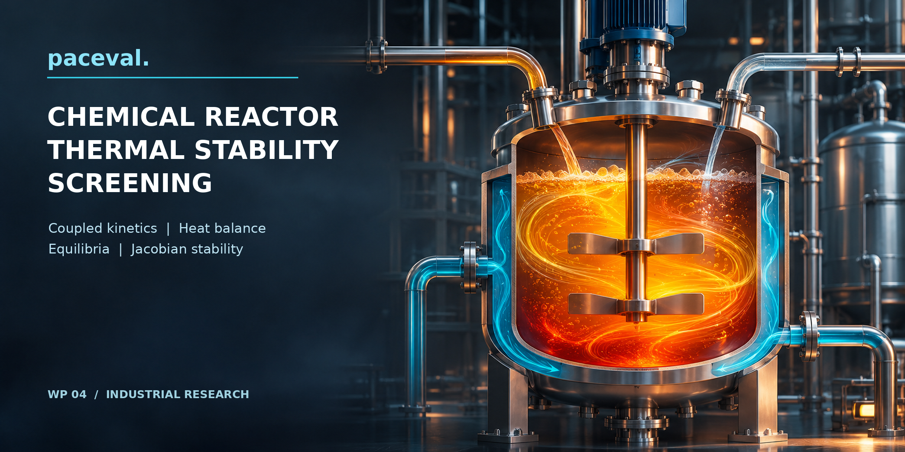

# Chemical Reactor Thermal Stability Screening with paceval



*Concept illustration; not a computed research result.*

A reproducible **C++ and paceval Mathematical Engine** research demonstrator for non-isothermal continuous stirred-tank reactor (CSTR) screening. It assesses heat generation, coolant heat removal, coupled species and temperature dynamics, multiple steady states, and the local two-state Jacobian stability criterion. The use case, models and numerical observations are presented independently in the [English research whitepaper](paceval_Chemical_Reactor_Thermal_Stability_Whitepaper_EN.pdf). The complete [C++ application](src/reactor_main.cpp), [input data](input/scenarios.csv), and [recorded execution evidence](results/execution_evidence.json) are included.

**Evidence status (14 November 2026).** The demonstrator was built against the original paceval C/C++ interface v4.25 and executed with the user-supplied Linux x86-64 runtime. The source scenario data are **fully synthetic**, not reactor or laboratory measurements. This is mathematical screening research, not a prediction of safe industrial operation or equipment certification.

## 1. Industrial use case and current state of the art

A chemical plant operating an exothermic liquid-phase process must understand how reaction kinetics and a cooling jacket interact. An increase in temperature may accelerate reaction rates and heat production. Coolant temperature, residence time, feed concentration and effective heat-exchanger duty together determine which stationary operating states are mathematically possible. In a sufficiently nonlinear system, the balances can admit multiple steady states, and some of them are unstable. A steady thermal residual equal to zero does not itself prove local stability or process safety.

Industrial engineering already uses validated process modeling and dynamic simulation tools. [Aspen Plus Dynamics](https://www.aspentech.com/en/products/engineering/aspen-plus-dynamics), [Siemens gPROMS Process](https://www.siemens.com/de-de/products/gproms/process/), [Cantera](https://cantera.org/stable/reference/reactors/index.html) and [DWSIM](https://dwsim.org/help/api/reactors/cstr.html) serve related but broader needs. Cantera describes CSTR mass residence and numerical approach to steady state. A classical [university CSTR derivation](https://pages.mtu.edu/~tbco/cm416/lecture_22_2017.pdf) explicitly discusses the possibility of multiple equilibria and local Jacobian analysis. Recent work addresses calorimetric validation and runaway assessment [2024 review](https://doi.org/10.1002/cjce.25422), experimental/model-based research [2026 investigation](https://pubs.acs.org/iecred/article/65/4/2057/5072740/Thermal-Runaway-of-Chemical-Reactors-An), and a distinct **tubular** reactor criterion [2026 study](https://doi.org/10.3303/CET26126040). The latter is context, not evidence that a tubular-reactor criterion applies to a CSTR.

Here the research question is narrower: **Can a substantial, interdependent screening kernel be represented and actually executed as reusable mathematical paceval graphs while the host handles equilibrium search, time stepping, data management and independent validation?** The answer is demonstrated for the specified synthetic first-order CSTR, not generalized to every chemical reactor.

In a hypothetical engineering workflow, an engineer supplies a validated recipe model and candidate feed/coolant settings. The system computes energy and material derivatives, brackets stationary temperatures, evaluates the full coupled Jacobian, and ranks mathematical margins. Those results may help select cases for detailed design studies, calorimetry and formal hazard analysis. They do not establish allowable plant limits.

## 2. Verified research scope

The actual executed research data are in the `results/` directory. All reported counts are reproducible using the included input CSV and original compatible external runtime.

| Actual main-run evidence | Count |
|:---|---:|
| Distinct domain-formula graphs created and executed | 35 |
| Distinct synthetic parameter scenarios | 81 |
| Scenario-model combinations (two cooling versions) | 162 |
| Candidate stationary states located | 418 |
| Locally asymptotically stable equilibria (V1 / V2) | 145 / 145 |
| Stable equilibria below the **illustrative** 345 K limit (V1 / V2) | 91 / 92 |
| Independent native C++ function checks | 168 |
| Additional independently audited high-precision root records and profile rows | 418 / 542 |

The multi-graph API was used for model kernels, Jacobian diagnostics, temperature profiles and phase-plane fields. Scalar paceval evaluation was also exercised for root refinement and the integration right-hand sides. Repeated graph calls are **not** distinct graphs. Detailed API invocation counts are maintained in [execution_evidence.json](results/execution_evidence.json). There are two additional one-time SDK layout-calibration handles outside the 35 domain graphs.

## 3. Mathematical model and paceval execution

An ideal, constant-density, constant-volume, single-phase, well-mixed reactor contains one first-order exothermic reaction, with reactant concentration $C$ in mol/m³ and temperature $T$ in kelvin. Residence time is $\tau=V/F$ in seconds, with $F$ the volume flow. Reaction enthalpy release $H=-\Delta H$ is positive in J/mol. The liquid volumetric heat capacity is $\rho c_p$ in J/(m³ K).

```math
k(T)=k_{\mathrm{ref}}\exp\left[-\frac{E_a}{R_g}\left(\frac{1}{T}-\frac{1}{T_{\mathrm{ref}}}\right)\right], \qquad r=k(T)C.
```

```math
\begin{aligned}
\frac{dC}{dt}&=\frac{C_{\mathrm{in}}-C}{\tau}-k(T)C,\\
\frac{dT}{dt}&=\frac{T_{\mathrm{in}}-T}{\tau}+
\frac{H}{\rho c_p}k(T)C-
\frac{UA_{\mathrm{eff}}(T)}{\rho c_pV}(T-T_c).
\end{aligned}
```

**Two concurrently available mathematical model versions:** V1 uses constant $UA_{\mathrm{eff}}(T)=UA$; V2 uses the hypothetical, temperature-dependent effective cooling coefficient $UA_{\mathrm{eff}}(T)=UA[1+\alpha(T-T_{\mathrm{ref}})]$. This is a *scenario assumption*, not a measured heat-transfer correlation. Domain validation ensures its positivity over the scan. At equilibrium, paceval evaluates $C_*(T)=C_{\mathrm{in}}/[1+\tau k(T)]$ and the resulting reduced energy residual. A host bisection solver brackets candidate steady temperatures. Full stability is assessed from both states, via Jacobian $J$:

```math
\mathrm{trace}(J)<0,\quad \det(J)>0,
```

which is the necessary and sufficient criterion for local asymptotic stability of this continuous-time 2×2 linearization when inequalities are strict. The program evaluates trace, determinant, the largest eigenvalue real part and a composed screening margin with paceval. It also computes derivatives with respect to effective cooling and coolant temperature as explicit mathematical graphs. `SCREEN_GUARD` is a composed paceval logical/relational graph; its 0/1 value is not regulatory authorization.

| Mathematical function / industrial purpose | Actual execution | Graph / rationale |
|:---|:---|:---|
| Arrhenius kinetics, reaction rate and heat generation | **paceval** | `K_RATE`, `REACTION_RATE`, `Q_GEN` |
| Enthalpy feed term, conversion, Damköhler group | **paceval** | `Q_FLOW`, `CONVERSION`, `DAMKOHLER` |
| Species balance, steady concentration, analytic kinetic derivative | **paceval** | `F_C`, `C_EQ`, `DK_DT` |
| Cooling, coupled energy balance and reduced residual | **paceval** | `V1_Q_REM/F_T/F_RED`, `V2_Q_REM/F_T/F_RED` |
| Full analytic Jacobian, trace, determinant and eigenvalue criterion | **paceval** | `J11`, `J12`, `J21`, `V1_J22`, `V2_J22`, `J_TRACE`, `J_DET`, `EIG_MAX_RE` |
| Cooling derivatives, version differences and constraint margins | **paceval** | `V1_D_T_D_UA/TC`, `V2_D_T_D_UA/TC`, `DELTA_REM`, `DELTA_FRED`, `MARG_*`, `SCREEN_SCORE`, `SCREEN_GUARD` |
| Root bracketing and bisection, scenario search, data I/O | **C++ host** | Stateful algorithms and schema enforcement |
| Runge-Kutta integration, time progression | **C++ host** | Each differential-equation RHS comes from a paceval graph |
| Independent reference evaluations | **native C++ / mpmath Python** | Audit only, not published paceval model results |

This exact responsibility allocation, formula strings and actual executed status can be checked in [math_execution_inventory.csv](results/math_execution_inventory.csv), [formula_manifest.csv](results/formula_manifest.csv), the [C++ source](src/reactor_main.cpp), and the independent [scientific audit](results/scientific_audit.json). In the `SCENARIO_*` output, **the word “stable” means only local linearized stability under this specified model**.

## 4. Reproducible numerical results

For the baseline synthetic condition `S04_04` with $T_c=295$ K, $UA=16{,}000$ W/K and a constant-cooling coefficient, three distinct stationary temperatures were computed: about **304.713 K**, **325.963 K**, and **347.979 K**. The middle branch is locally unstable; the first and third are locally stable. Under the *illustrative* 345 K screening threshold only the first satisfies the complete combined mathematical screening guard. The model-V2 branch temperatures also change, although both formulations retain three equilibria for this scenario.

Across all 81 predefined parameter combinations, each model found 64 scenarios with three equilibria and 17 scenarios with one equilibrium in the bounded temperature scan. These counts are conditional on the scanned 276–410 K interval and on the particular parameter grid; they are not a global bifurcation theorem. Every computed equilibrium record includes the species concentration, energy balance residual, trace, determinant, leading eigenvalue real part, score and guard in [equilibria.csv](results/equilibria.csv).

The transient illustration integrates the coupled equations in the host with a fixed-step RK4 scheme and evaluates both right-hand sides through reusable paceval handles. It shows mathematical trajectories for three synthetic initial states. Without reaction-specific parameters, calorimetry, physical heat-transfer characterization, emergency-system design and independent hazard analysis, **none of these numbers should be used to operate a plant**.

## 5. Scientific figures

All ten scientific plots below are generated exclusively from `results/` CSV files computed by the actual paceval application. Each exists as high-resolution PNG and vector PDF. Run `python3 scripts/make_figures.py` to rebuild them.

| Figure | Industrial / scientific interpretation |
|:---|:---|
| [01. Stationary thermal residual](figures/fig01_thermal_residual.png) | Three heat-balance roots in both cooling formulations |
| [02. Energy contributions](figures/fig02_energy_components.png) | Reaction heat, jacket heat and sensible enthalpy flow |
| [03. Equilibrium branches](figures/fig03_equilibrium_branches.png) | Stable and unstable states as coolant temperature changes |
| [04. Multiplicity maps](figures/fig04_multiplicity_maps.png) | One-versus-three-root operating regions in two mathematical models |
| [05. Phase plane](figures/fig05_phase_plane.png) | Coupled concentration/temperature vector field |
| [06. Transients](figures/fig06_transients.png) | Three initial states under two cooling assumptions |
| [07. Sensitivity functions](figures/fig07_sensitivity.png) | Cooling-coefficient and coolant-temperature sensitivity |
| [08. Stable equilibrium surface](figures/fig08_stable_equilibrium_surface.png) | Lowest stable equilibrium within each scenario; visible branch switching is possible |
| [09. Screening scores](figures/fig09_screening_score.png) | Relative model margin, not a safety certification |
| [10. Jacobian diagnostic](figures/fig10_jacobian_stability.png) | Two-state stability criteria of found stationary solutions |

## 6. Build and reproduce on Linux x86-64

The original **paceval 4.25** `paceval_main.h` and `paceval_main.cpp` are in `src/`. The source adapter's sole required integration change is the relative include path to the header. The user-supplied compatible **shared library is not distributed**, so users must provide their own appropriately licensed runtime. The original copyright and AGPL notices remain in the SDK source files; review the applicable license before redistribution.

```bash
cmake -S src -B build -DCMAKE_BUILD_TYPE=Release \
  -DPACEVAL_RUNTIME=/absolute/path/to/libpaceval_linux_sharedLIB.so
cmake --build build -j
ctest --test-dir build --output-on-failure
./build/reactor_screening --run input/scenarios.csv results
python3 scripts/verify_high_precision.py
python3 scripts/make_figures.py
python3 scripts/make_whitepaper.py
python3 src/check_readme_math.py
python3 src/check_readme_math.py --selftest
```

The input CSV schema is fixed and ASCII numeric literals use a period as decimal separator. Numeric values are **first validated as strict decimal literals** and then parsed with the actual SDK `paceval_dConvertStringToFloat` routine. SDK `paceval_dConvertFloatToString` produces numerical CSV fields; this presentational output is not claimed to be byte-identical to all original IEEE-754 doubles. The self-test rejects CSV arithmetic expressions, `NaN`, infinities, thousands separators and locale-mismatched fields. Every output CSV is synthesized from the executing application, not from Python reference calculations.

## 7. Independent verification and limitations

The actual C++ self-test checks syntax, operator semantics (including `%` versus `mod`), numeric conversion, multi-graph output order, scalar versus batch evaluation, analytic two-state Jacobians and the known three-root regression. The separate [Python high-precision validator](scripts/verify_high_precision.py) uses independently coded physics at 85 decimal-digit precision, including stationary balances, equilibrium concentrations, local eigenvalue criteria and cooling sensitivities. Detailed technical audit differences are recorded in [scientific_audit.json](results/scientific_audit.json), not in this publication narrative. See [research validation notes](RESEARCH_VALIDATION.md) and [test log](results/ctest_report.txt).

Physical limits matter: the model omits vapor-liquid transitions, side reactions, mixing nonidealities, actuator dynamics, jacket thermal inertia, decomposition, pressure/relief design and spatial gradients. Local stability does not imply global stability, dynamic safety, or hazard-free startup/shutdown. No TINC-based global certification, industrial measurement validation, control-system qualification, real-time or hardware advantage has been claimed.

Process safety work must remain aligned with suitable laboratory data and expert-led process hazard analysis. For context see [OSHA Chemical Reactivity Hazards](https://www.osha.gov/chemical-reactivity) and the [US Process Safety Management regulation 29 CFR 1910.119](https://www.osha.gov/laws-regs/regulations/standardnumber/1910/1910.119) where applicable; local jurisdictional requirements may differ.

## 8. References and provenance

The external scientific and industrial sources are listed with direct URLs in the PDF. The initial two-page proposal is retained under [docs/source_WP04_proposal.pdf](docs/source_WP04_proposal.pdf). This study intentionally uses the latest supplied Master Prompt's **functionality-first** publication scope and does **not** report performance or energy benchmarking. The input is deterministic and synthetic; results can be audited independently and are not presented as measured plant behavior. No GitHub-hosted visual rendering test has been asserted without an actual preview.
