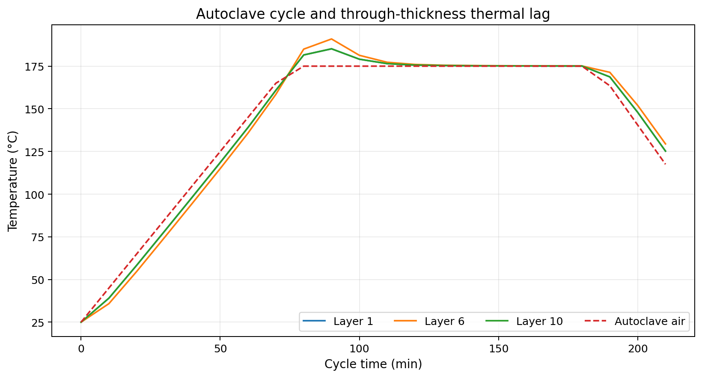
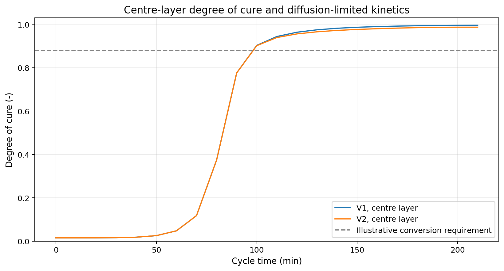
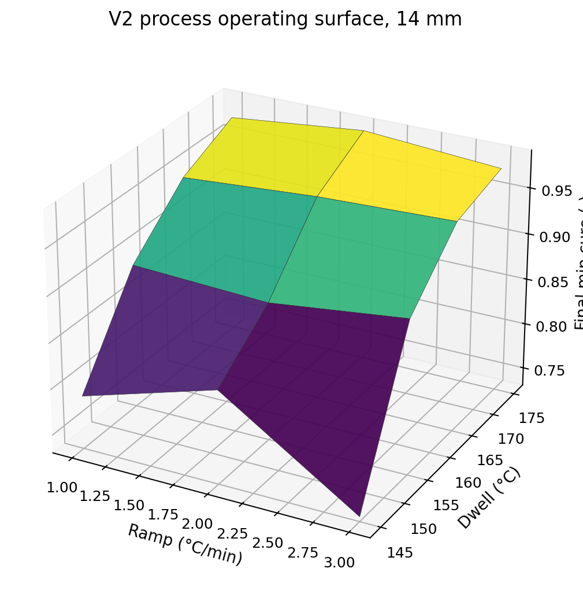

# Composite Cure Kinetics and Autoclave Process Constraints


**WP 21 | paceval Mathematical Engine | Independently checked numerical research demonstrator | 14 November 2026**

This open research package demonstrates a connected cure-chemistry and through-thickness thermal process-window calculation. It uses original paceval 4.25 to evaluate the mathematical expressions, while C++ carries out the time-dependent state propagation and the implicit finite-volume heat equation solve. Input recipes and material parameters are synthetic research assumptions, not certified manufacturer conditions. The [English whitepaper](paceval_Composite_Cure_Autoclave_Whitepaper_EN.pdf) explains the full application and research boundaries.

## 1. Industrial use case and current state of the art

Aerospace prepreg laminates are commonly processed in autoclaves using controlled temperature ramps, intermediate and final dwells, applied pressure, vacuum and cooling. During a heat cycle, the part may lag behind the programmed air temperature. Thermoset resin cure generates internal heat and changes the resin's properties. In a thick part, the outer and central layers need not reach the same temperature or degree of cure at the same time. Engineers therefore screen candidate recipes for insufficient conversion, local temperature overshoot and through-thickness thermal nonuniformity before they undertake detailed calibrated simulation and qualification.

The classical Kamal-Sourour cure kinetics and Arrhenius reaction terms are well established for thermosets. State-of-the-art commercial and academic simulations additionally include thermal conduction, anisotropy, resin-specific cure chemistry, chemical shrinkage, tool-part interactions, heat-transfer boundary conditions and viscoelastic behavior. Ansys Composite Cure Simulation and research from 2025–2026 demonstrate these richer approaches. Industrial prepreg suppliers specify processing windows for their actual products. Such supplier specifications must **never** be replaced with the illustrative limits of this demonstrator.

Here, paceval supplies versioned, reusable mathematical graphs for cure kinetics, exothermic heat, glass-transition correlation, thermal transport coefficients, constraints and sensitivities. C++ owns safe numerical data input, the implicit one-dimensional heat-equation solve, time integration, state boundaries, spatial selection, final decision handling and CSV output. This is a **research screening kernel, not a certified autoclave controller or a full multiphysics finite-element solver**.

## 2. Research questions and representative scenario

Can persistent mathematical graphs evaluate the local cure chemistry and thermally coupled constraints of many candidate autoclave recipes, while a separate C++ host advances the changing physical state? Can both a baseline Kamal-Sourour model (**V1**) and a diffusion-limited model (**V2**) be retained as distinct, executable formula versions? Can the key end values and invariants be checked independently?

The deterministic experiment evaluates 36 synthetic recipes, each with 10 through-thickness layers and two mathematical model versions, over a 210-minute cycle at 15-second integration intervals. Recipes vary thickness (10, 14 and 18 mm), heating rate (1, 2 and 3 °C/min) and dwell temperatures (145, 155, 165 and 175 °C). The cases additionally vary dwell duration, convection coefficient and illustrative autoclave pressure. The initial conversion is 0.015. These are controlled synthetic input values, not actual DSC-fit material parameters.

## 3. Defined mathematical equations

All temperatures in equations are **kelvin**; rate constants and derivatives are in **seconds**. The resin conversion `a` ranges from 0 to 1.

```math
k_i(T)=A_i\exp\left(-\frac{E_i}{RT}\right), \qquad i=1,2
```

```math
\frac{da}{dt} = \left(k_1+k_2a^m\right)(1-a)^n\,f_{\mathrm{diff}}
```

Version V1 uses $f_{\mathrm{diff}}=1$. Version V2 uses a deliberately simplified vitrification correction and DiBenedetto-type glass-transition correlation:

```math
T_g(a)=T_{g,0}+(T_{g,\infty}-T_{g,0})\frac{\lambda a}{1-(1-\lambda)a}
```

```math
f_{\mathrm{diff}}=\frac{1}{1+\exp((T_g-T)/\Delta T_g)}
```

The finite-volume heat balance for each layer includes through-thickness conduction, a convective surface contribution and resin reaction exotherm:

```math
\rho c_p\frac{dT}{dt}=\frac{k(T_L-2T+T_R)}{\Delta z^2}+\frac{b h(T_{\mathrm{air}}-T)}{\Delta z}+\rho_{\mathrm{resin}}H_c\frac{da}{dt}
```

Here $b=1$ for exposed outside layers and $b=0$ for interior layers. At a surface, the absent outer neighbor equals the boundary-layer temperature for the discrete conductive term. The C++ Thomas algorithm solves the resulting implicit thermal step. The degree of cure advances by a bounded explicit state update. The temporal and spatial discretizations are **approximations**; no time-step convergence proof or industrial heat-transfer calibration is claimed. The full mathematical inventory and numerical assumptions are in [MODEL_SPECIFICATION.md](docs/MODEL_SPECIFICATION.md).

## 4. Actual paceval versus host implementation

| Industrial mathematical function | Actual execution | Graph / reason |
|---|---|---|
| Two Arrhenius coefficients and Kamal-Sourour kinetics | paceval | `V1_K1`, `V1_K2`, `V1_BASE_RATE`; corresponding V2 graphs |
| Cure-dependent glass transition and diffusion factor | paceval | `V1_TG`, `V2_TG`, `V1_DIFF_FACTOR`, `V2_DIFF_FACTOR` |
| Cure rate and exothermic heat | paceval | `V1_CURE_RATE`, `V2_CURE_RATE`, `V1_HEAT_SOURCE`, `V2_HEAT_SOURCE` |
| Thermal conduction, convection and heating coefficients | paceval | `*_THERMAL_COEFFICIENT`, `*_SURFACE_COEFFICIENT`, `*_HEAT_TEMPERATURE_RATE` |
| Local heat-equation right-hand side | paceval | `*_CONDUCTION_SOURCE`, `*_BOUNDARY_SOURCE`, `*_TEMPERATURE_RATE` |
| Cumulative conversion enthalpy, signed margins and logic guards | paceval | `*_INTEGRATED_HEAT`, `*_MARGIN_*`, `*_LOCAL_GUARD` |
| Cure-rate sensitivities to temperature and the A1 coefficient | paceval | `*_SENS_T`, `*_SENS_A1` |
| End-of-cycle margins, total window score and Boolean acceptance | paceval | `G1_*`, `G2_*` |
| Explicit model comparison including end-value differences | paceval | `CMP_*` |
| Finite-volume state propagation and implicit tridiagonal solve | C++ host | Stateful numerical algorithm, not a stand-alone algebraic graph |
| Candidate enumeration, extrema selection, decisions and file output | C++ host | Control flow and I/O |
| C++ and 90-digit mpmath equations | independent verification only | Technical audit; not the published calculation path |

In particular, the complete path from **validated CSV recipe to original paceval local source terms, paceval thermal coefficients, host state integrator, paceval end-of-recipe margins, final disposition and numerical CSV output** is actually exercised. There are no mock paceval evaluators. All 60 domain and comparison graphs were both created and evaluated through the actual SDK.

## 5. Executed result and interpretation

The executed study produced the following machine-recorded counts (see [execution_evidence.json](results/execution_evidence.json) and [high_precision_audit.json](results/high_precision_audit.json)).

| Result | Recorded value |
|---|---:|
| Distinct evaluated paceval graphs | 60 |
| Independent synthetic recipes | 36 |
| Model-recipe cases | 72 |
| Thermal nodes per recipe | 10 |
| Model-node-time combinations in main sequence | 605,520 |
| Independent native C++ assertions | 4,000 |
| Independent 90-digit reference / final-value checks | 2,942 |
| Independently checked monotonic state transitions | 15,120 |
| Recipes satisfying illustrative screening limits in V1 | 26 of 36 |
| Recipes satisfying illustrative screening limits in V2 | 25 of 36 |

The illustrative acceptance criteria are minimum final degree of cure at least 0.88, maximum part temperature at most 196 °C, maximum layer temperature spread at most 32 K and autoclave pressure at least 3.5 bar. This screen is not a substitute for resin-specific kinetic calibration, materials quality, actual pressure/vacuum controls or engineering release. The V2 conversion is often slightly lower than V1 because the diffusion term slows chemistry near the modeled glass transition. These differences arise from different **physical model assumptions**, not comparisons of software numerical accuracy.

## 6. Scientific figures

The following figures are generated entirely from the original paceval-produced CSV dataset. The title image alone is a separately labeled conceptual illustration. All ten data figures are in [figures/](figures/fig01_temperature_cycle.png) and individually linked in the [whitepaper](paceval_Composite_Cure_Autoclave_Whitepaper_EN.pdf).







## 7. Build and reproducibility

**Prerequisites:** Linux x86-64, CMake 3.16+, C++17 compiler, Python 3 and the separately supplied matching original paceval runtime. The SDK header and interface source are included; the proprietary/external shared object is **not** redistributed. `paceval_main.cpp` has only the required local relative include adaptation.

```bash
python3 scripts/generate_input.py
cmake -S src -B build -DCMAKE_BUILD_TYPE=Release \
  -DPACEVAL_RUNTIME=/absolute/path/to/libpaceval_linux_sharedLIB.so
cmake --build build -j
ctest --test-dir build --output-on-failure
./build/composite_cure --run input/recipes.csv results
python3 scripts/verify_high_precision.py results
python3 scripts/verify_trajectory.py results
python3 scripts/make_figures.py
python3 scripts/check_markdown.py .
python3 scripts/check_markdown.py --selftest
python3 src/check_readme_math.py
```

The high-precision validator requires `mpmath`; figure generation requires `numpy`, `pandas` and `matplotlib`; the archive-wide Markdown checker requires `markdown-it-py`. None of these are dependencies of the compiled C++ mathematics. The CTest environment must have `mpmath` and `markdown-it-py` to run the corresponding tests. For a publication with every plot and PDF reproducible, additionally install `reportlab` and `Pillow`.

Detailed CSV schemas, input limitations, and numerical format concerns are in [CSV_SCHEMA.md](docs/CSV_SCHEMA.md). The source references, assumptions and provenance are in [RESEARCH_SOURCES.md](docs/RESEARCH_SOURCES.md). Review the [research validation](RESEARCH_VALIDATION.md) and [license notices](LICENSE_NOTICES.md) before reusing the project.

## 8. Limitations and prospective research

The example is a one-dimensional effective laminate model with ten equally spaced thermal cells, a single set of uncalibrated material constants, no resin-flow/void prediction, no anisotropic conduction, no tooling contact mechanics, no pressure-dependent porosity or viscoelastic residual stress, no cure shrinkage, and no actual laminate sensors. Pressure is presently a schedule input and mathematical acceptance condition; it does not enter the heat equation or chemical kinetics. Vitrification is a smooth illustrative correction, not a demonstrated constitutive law for a commercial epoxy.

The 15-second update with explicit conversion and implicit thermal conduction is numerical evidence for the chosen discrete model, **not a mesh/time-step convergence or global stability guarantee**. End-value high-precision tests verify formula values and selected invariants, not a full 90-digit integration of every trajectory. There was no external commercial FEA, resin DSC or autoclave experiment in this study. Future research should calibrate kinetics from measured DSC, characterize glass transition and diffusion limits, measure thermal boundary conditions, include tooling and anisotropy, and perform full discretization convergence and independent thermomechanical validation.

## 9. External technical references

- [Kamal-Sourour kinetics and resin cure formulations (2019)](https://pmc.ncbi.nlm.nih.gov/articles/PMC6401829/)
- [DiBenedetto conversion/glass-transition relationship (2019)](https://www.mdpi.com/2073-4360/11/11/1804)
- [Full thermal-fluid-solid coupled autoclave curing (2025)](https://www.mdpi.com/1996-1944/18/7/1471)
- [Variable thermal boundary conditions and composite curing (2026)](https://www.sciencedirect.com/science/article/pii/S1359835X26002496)
- [Real-time autoclave control with tool-part interaction (2026)](https://www.sciencedirect.com/science/article/pii/S1000936125005540)
- [Hexcel prepreg technology and cure cycle guidance (2026)](https://www.hexcel.com/wp-content/uploads/2026/01/Prepreg_Technology.pdf)
- [Ansys Composite Cure Simulation documentation](https://storage.ansys.com/mbu-assets/accs/v221/ug/Best_Practices.html)
- [paceval original C++ API documentation](https://paceval.com/api/)

All results are a **mathematical functional demonstration**. They are not performance comparisons, product qualification statements, or verified deployment results.
