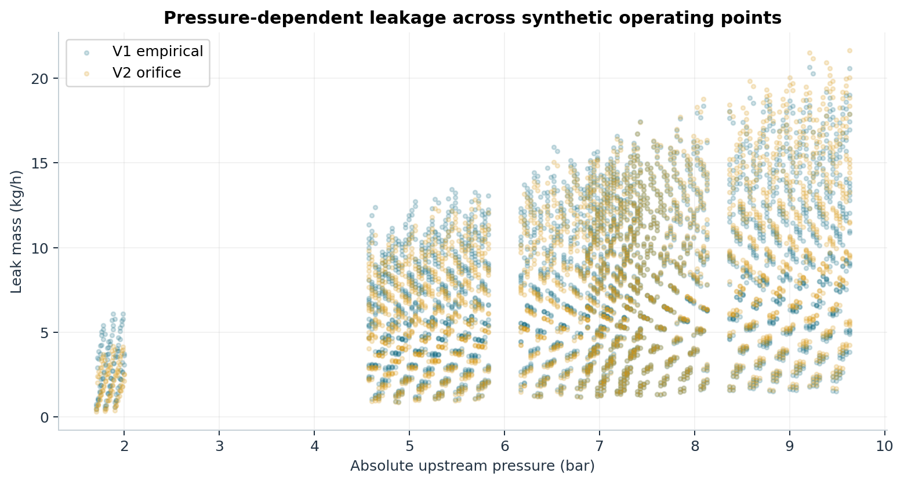
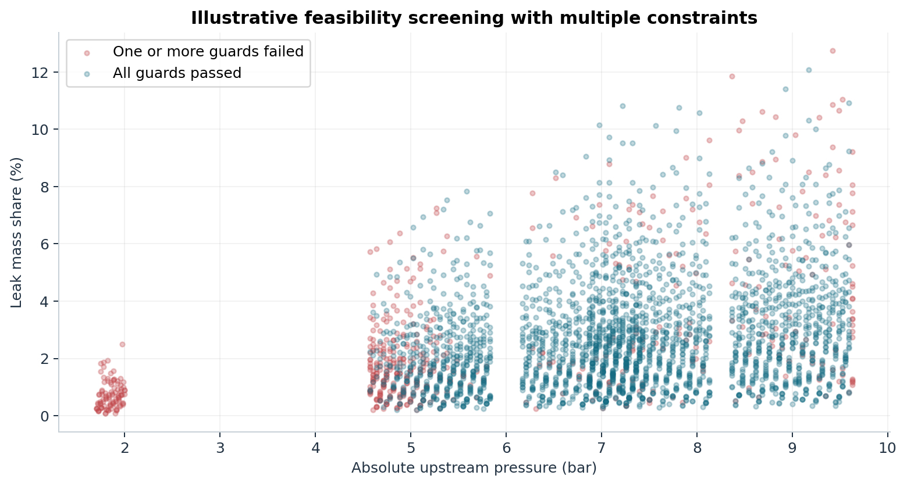
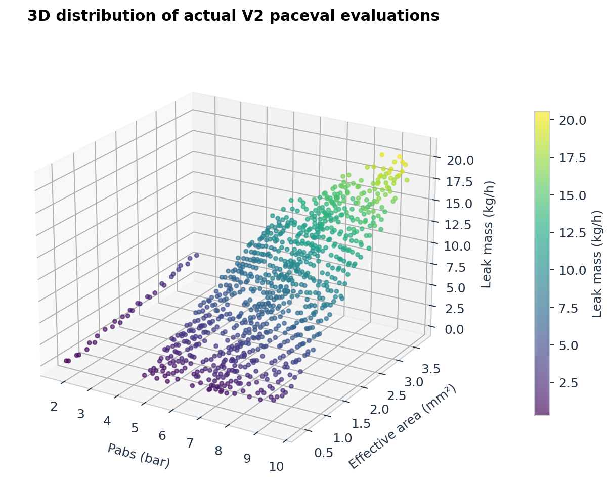

# Industrial Compressed Air Leak and Energy Optimization with paceval


This repository contains a **reproducible mathematical research demonstrator** for pressure-dependent compressed-air leakage, compressor energy accounting and operational feasibility screening. Its mathematical calculations are executed through the original **paceval Mathematical Engine 4.25** using persistent C++ computation graph handles and real multi-graph batches. The operating data are **synthetic**, not plant measurements.

## 1. Industrial use case and current state of the art

Industrial compressed air is a utility for machine tools, packaging lines, pneumatic actuators, cleaning systems and process equipment. A plant operator needs enough pressure and air mass flow to maintain production, while undesired leakage adds compressor demand. Plant-level evaluation considers air generation, distribution, end-use and wasted air together. A pressure setpoint affects leakage, the compression requirement and the pressure available to downstream consumers. A mass-flow balance alone cannot demonstrate that a leak has been detected or located.

ISO 11011:2013, confirmed in 2020 and subject to a future revision, defines a system-wide compressed-air assessment framework. The US Department of Energy and Oak Ridge National Laboratory offer **MEASUR** with compressed-air system assessments, calculators and compressor models. These tools address substantially broader engineering assessment workflows than this research example. Ultrasonic and acoustic leak detection form a complementary observational discipline. Recent academic work in 2024 and 2026 investigated spatial ultrasonic mapping and compared localization/quantification approaches. See [sources and technical positioning](docs/RESEARCH_SOURCES.md).

A hypothetical factory analyst takes the measured upstream pressure, compressor inlet conditions, a calibrated leak equivalent, demand, and a distribution loss model; constructs candidate operating cases; and evaluates mass-flow, downstream pressure, energy-related indicators and constraint margins. This demonstration examines the **mathematical kernel** of that process. It does not measure a factory or infer the position of a leak.

## 2. Research questions and mathematical models

The source WP 19 specified an empirical leak-flow power law, a polytropic-work proxy, compressor-energy accounting and indicative cost. The research extension adds a physically distinct compressible-orifice model, both choked and subcritical regimes, full flow and pressure-margin accounting, operating guard expressions, sensitivities, and a graph-native comparison of concurrently available model versions.

**V1: empirical calibrated leak.** For an assumed leak mass flow at reference pressure, the local effective flow model is

```math
\dot m_{\mathrm{leak},1}=\dot m_{\mathrm{ref}}\left(\frac{P_u-P_a}{P_{\mathrm{ref}}-P_a}\right)^n.
```

**V2: ideal-gas orifice approximation.** The pressure ratio $r=P_a/P_u$ and critical ratio $r_c=(2/(\gamma+1))^{\gamma/(\gamma-1)}$ select a choked or a subcritical orifice equation. The coefficient $C_d$ and effective orifice area are **synthetic assumed inputs**, not independently identified parameters. For choked flow,

```math
\dot m_{\mathrm{leak},2}=C_d A\frac{P_u}{\sqrt{R T_u}}\sqrt{\gamma}\left(\frac{2}{\gamma+1}\right)^{\frac{\gamma+1}{2(\gamma-1)}}.
```

For $r>r_c$, the subcritical equation uses a square-root factor depending on $r^{2/\gamma}-r^{(\gamma+1)/\gamma}$. Its complete expression is registered and executed by paceval in `src/compressed_air_main.cpp`. Both branches have host-validated domains; a graph mask is not treated as a guarantee against evaluation of invalid terms. This model is **not** an ISO 6358 component characterization or a calibrated leak metrology standard.

Common composite results include compressor mass flow, modeled specific isentropic compression work, electric input, leak-associated energy indicator, a simplified quadratic distribution pressure loss, a signed margin for each operating limit and a logical combined guard. This is a fixed-efficiency, steady-state approximation; no part-load compressor control map, receiver dynamics, thermal transient or actual acoustic detector is included. The apparent leak expenditure is illustrative operating accounting, **not a measured saving**.

| Mathematical function / industrial purpose | Actual implementation | Graph / rationale |
|---|---|---|
| Empirical and compressible leak mass flow | paceval | V1/V2 `LEAK_MASS_FLOW` |
| Isentropic work, total flow, compressor input | paceval | `SPECIFIC_WORK`, `REQUIRED_MASS_FLOW`, `COMPRESSOR_POWER` |
| Leak mass/energy/cost allocation | paceval | `LEAK_FRACTION`, `LEAK_ENERGY`, `ANNUAL_LEAK_COST` |
| Quadratic network-pressure proxy and individual margins | paceval | `END_USE_PRESSURE`, four `MARGIN_*` graphs |
| Conjunctive operating guard and composite score | paceval | `COMPOSITE_GUARD`, `PROCESS_SCORE` |
| Analytic sensitivities and orifice regimes | paceval | `D_LEAK_*`, `ORIFICE_FLOW_*` |
| Two-version differences and simultaneous guard | paceval | `DELTA_*`, `COMBINED_GUARD` |
| Case enumeration, data validation, selection and CSV I/O | C++ / Python host | State and input/output responsibilities |
| Independent numerical assessment | native C++ / Python mpmath | Research validation, not the result-producing engine |

See the [mathematical specification](docs/MODEL_SPECIFICATION.md) and [execution inventory](results/math_execution_inventory.csv) for the complete mapping.

## 3. Executed synthetic study

The input generator constructs **3,072 deterministic cases** covering ordinary pressure, high-pressure, reduced-pressure, peak demand and near-atmospheric *mathematical test* regimes. V1 receives an explicitly synthetic reference flow at a fixed reference pressure, calculated independently from the assumed V2 orifice parameters. This allows a controlled comparison of pressure dependence without implying an independently measured calibration.

All **53 functional model and comparison graphs** were created with the original SDK and exercised in the actual principal result path. Each of the 3,072 input cases was evaluated for two model versions. The principal run recorded **4,360 native C++ end-value assertions** and **73,728 independent 85-decimal-digit mpmath checks**. The low-pressure edge-case set also exercised the subcritical orifice formula. The original executable generated [screening results](results/screening.csv), [version comparison results](results/model_comparison.csv), [graph manifest](results/formula_manifest.csv), [execution evidence](results/execution_evidence.json) and [technical audits](results/high_precision_audit.json).

Under the **illustrative** four-constraint screening policy, **2,511** cases passed V1 and **2,505** passed V2. The difference is a consequence of the distinct assumed model equations, not engine numerical accuracy or measured engineering superiority. The scenario counts and inputs can be reproduced from the supplied code.







All nine scientific figures are provided in both PNG and vector PDF. Every figure is derived from the actual paceval results, not manually invented numeric plots.

## 4. Building and reproducing

Use Linux x86-64, C++17, CMake and the **original compatible external paceval shared library**. The copyrighted SDK interface files in `src/` retain their original license headers. The shared object is intentionally **not** shipped in the repository.

```bash
python3 scripts/generate_input.py
cmake -S src -B build -DCMAKE_BUILD_TYPE=Release \
  -DPACEVAL_RUNTIME=/absolute/path/to/libpaceval_linux_sharedLIB.so
cmake --build build -j
ctest --test-dir build --output-on-failure
./build/compressed_air --run input/cases.csv results
python3 scripts/verify_high_precision.py results input/cases.csv
python3 scripts/make_figures.py
python3 scripts/check_markdown.py .
python3 scripts/check_markdown.py --selftest
```

`mpmath`, `matplotlib` and `numpy` are only required for independent validation and figure generation, not the C++ executable. The CMake tests use Python and `mpmath` for the independent reference. Numeric CSV fields are checked as restricted decimal literals before they are passed to `paceval_dConvertStringToFloat`. Results are serialized with `paceval_dConvertFloatToString`. The technical audit retains the exact original input-file digest; visually similar decimal text is **not** claimed to be bitwise lossless. See the [CSV contract](docs/CSV_SCHEMA.md).

## 5. Scientific interpretation and limitations

The demonstrated success is the **actual reuse of paceval computation graphs** for several interconnected engineering expressions and their independent verification under synthetic, documented inputs. It does **not** establish the quality of leak estimates from acoustic measurements; actual leak position, orifice shape, discharge coefficient, equipment efficiency, part-load control, dynamic pressure response or even the existence of a physical leak. The 4-constraint guard is a research screening decision, not a standards-compliant equipment-safety clearance. Calibrated site measurement, equipment curves and validated fluid-network modeling are required for industrial use.

The [English research whitepaper](paceval_Compressed_Air_Leak_Energy_Whitepaper_EN.pdf) presents the background, equations, methods, verified experiments and figures. [Research validation](RESEARCH_VALIDATION.md) summarizes executed tests and the model's evidential limits. The original project brief is retained in [docs](docs/RESEARCH_SOURCES.md) as an attributed starting point, not as a source of experimentally established results.
