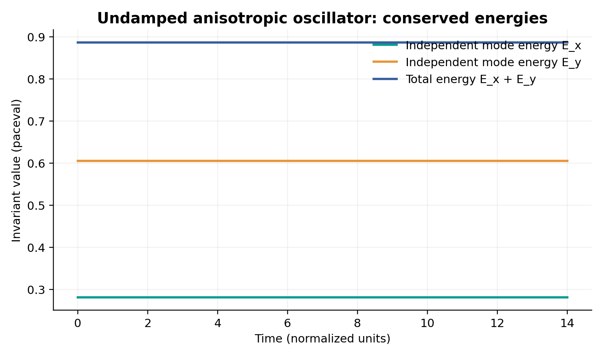
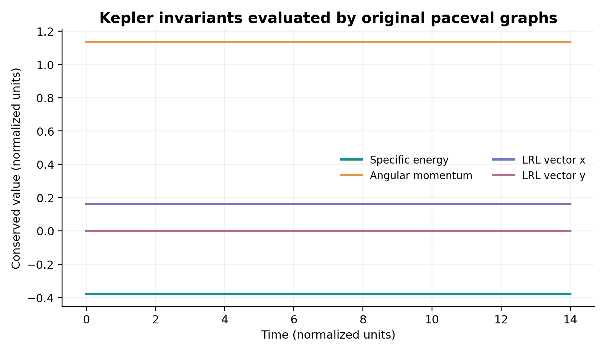
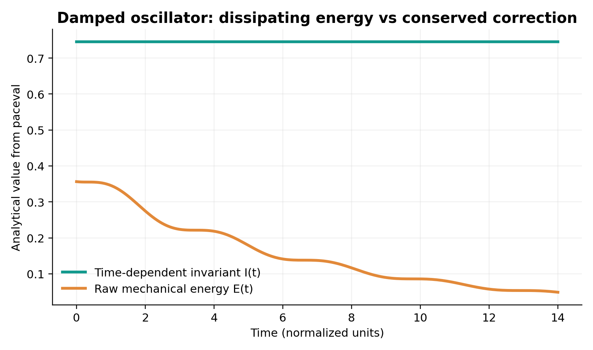
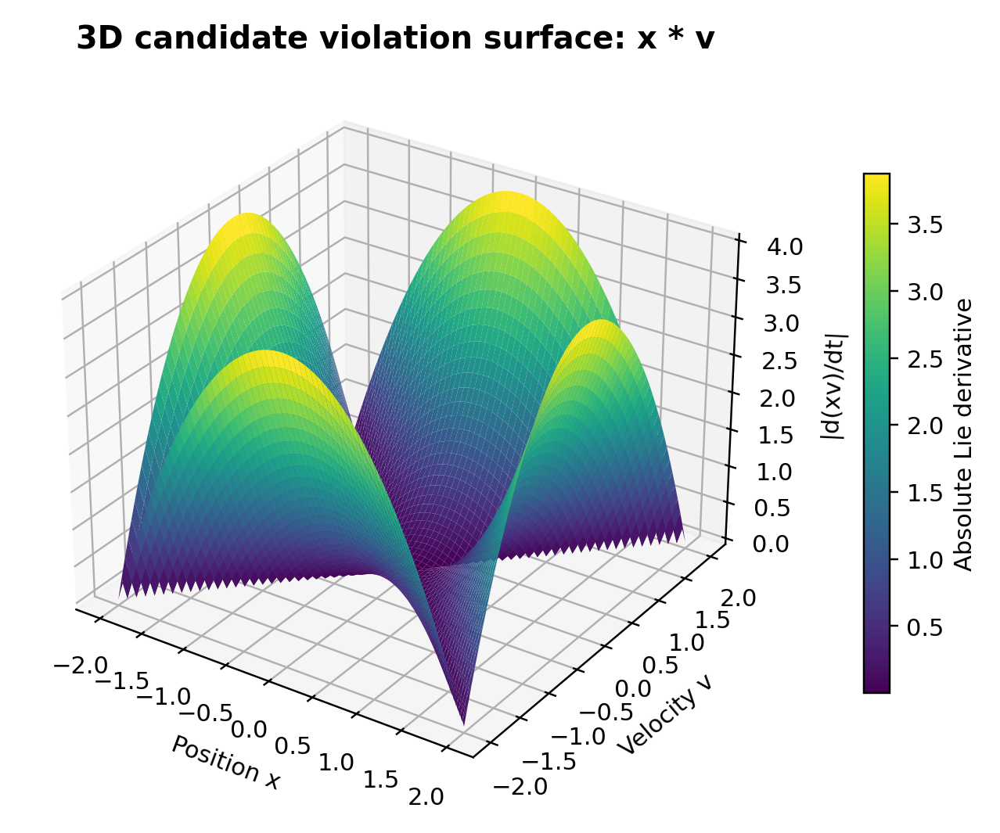
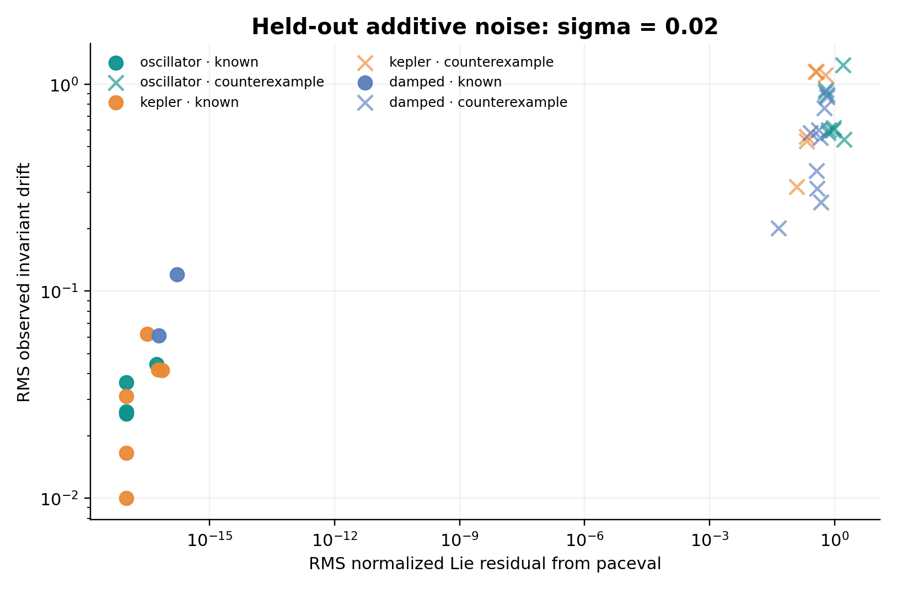

# WP_041 · Computational Testing of Conservation-Law Candidates with paceval


*Concept artwork, 2400 × 1200 px; not a representation of an experimental physical apparatus or measured trajectory. All numbered charts below are generated from the actual executed paceval output CSV files.*

**An independently checked C++/paceval research demonstrator that evaluates 36 candidate conservation laws using 144 persistent mathematical graphs, 645,168 original-library Multi-Graph-Batch results, noiseless and noisy dynamical trajectories, and independently checked held-out tests.**

[**English scientific whitepaper (PDF)**](paceval_Conservation_Law_Candidates_Whitepaper_EN.pdf) · [C++ source](src/conservation_law_candidates.cpp) · [CMake build](src/CMakeLists.txt) · [Candidate registry](results/formula_registry.csv) · [Graph execution inventory](results/math_execution_inventory.csv) · [Validation reports](results/high_precision_audit.json)

## 1. Scientific and industrial application

An engineer studying a robotic mechanism, vibration system, orbital motion, or the mathematical model of a digital twin may need to test whether a proposed quantity is conserved along the governing dynamics. A conservation law can improve modeling consistency and provide a regression test for numerical simulation, control, surrogate models or algorithmically generated physical hypotheses. **It is not sufficient for a candidate to vary little on one training trajectory**; the law must remain compatible with the dynamics and independent initial conditions, and noisy observations require a declared tolerance policy.

This project extends the original [WP_041 research proposal](references/WP_041_Computational_Testing_of_Conservation_Law_Candidates.pdf), whose minimal expression was `R = abs(dE_dt + div_flux - source)`. For an ODE model, we use the related *total derivative along a known vector field*, testing a state- and time-dependent candidate $I(\mathbf{x},t)$:

```math
\frac{dI}{dt}=\frac{\partial I}{\partial t}+\nabla_{\mathbf{x}}I\cdot\mathbf{f}(\mathbf{x},t).
```

A candidate conservation law satisfies $dI/dt=0$ for the defined dynamics. The project **evaluates the complete analytic chain-rule expression numerically using real paceval graph handles**, rather than replacing it by a constant zero. It also measures the drift of its *observed* value along trajectories.

The context is established research on [SINDy-based discovery of governing equations](https://doi.org/10.1073/pnas.1517384113) and [conservation-law discovery from trajectories by neural deflation](https://doi.org/10.1016/j.cnsns.2024.108563). These methods are broader than this controlled mathematical-verification pilot. The project does **not** claim to have autonomously discovered unknown laws, nor that it outperforms those methods.

## 2. Models and mathematical expressions

| Dynamical system | Governing law | Examples of intentionally included exact invariants |
|---|---|---|
| Anisotropic oscillator | $\dot x=v$, $\dot v=-x$, $\dot y=w$, $\dot w=-4y$ | $E_x=(x^2+v^2)/2$, $E_y=(4y^2+w^2)/2$, $E_x+E_y$ |
| Central Kepler problem | $\dot{\mathbf r}=\mathbf v$, $\dot{\mathbf v}=-\mu\mathbf r/\|\mathbf r\|^3$ | Specific energy, planar angular momentum, two Laplace-Runge-Lenz components |
| Damped oscillator | $\dot x=v$, $\dot v=-x-2\zeta v$ | Explicitly time-dependent invariant $I(t)$ (not raw mechanical energy) |

**Kepler invariants:**

```math
H=\frac{v^2+w^2}{2}-\frac{\mu}{\sqrt{x^2+y^2}},\qquad L=xw-yv.
```

The component invariants of the Laplace-Runge-Lenz vector are also tested. For damping $0<\zeta<1$, a time-dependent conserved expression is:

```math
I(t)=\exp(2\zeta t)\bigl(v^2+2\zeta xv+x^2\bigr).
```

The raw damped energy $E=(x^2+v^2)/2$ is deliberately a **negative control** because it decreases in this system. Other negative controls include position, velocity, and cross terms. Twelve of the 36 predeclared candidates are invariant functions, and 24 are non-invariants. **Some invariant candidates are algebraically dependent** (e.g. $H^2$); a label count of 12 is not a claim of 12 independent conservation laws.

All complete, literal expressions and chain-rule derivatives are recorded in [`results/formula_registry.csv`](results/formula_registry.csv). The generated C++ registry can be regenerated by [`src/generate_registry.py`](src/generate_registry.py). The program does not require SymPy at C++ runtime; the checked-in graph definitions are fixed and versionable.

## 3. Exact responsibilities of paceval and the host

For each of the **36 candidates**, the original paceval API creates **four** separate persistent mathematical graphs: (1) invariant value, (2) explicit analytic Lie derivative, (3) normalized absolute Lie derivative, and (4) square of the derivative. **All four are evaluated by `paceval_dGetMultipleComputationsResultsExt`.** Graph creation is done once per process, and all handles remain alive throughout the workload.

C++ handles fixed analytic benchmark trajectory generation, deterministic input perturbations, finite-array reductions such as RMS over many times, training/holdout partitioning, fixed classification thresholds, API/error control, and CSV output. It does **not** replace the production invariant, Lie or normalized-residual formulas with native calculations. Independent high-precision work is performed **only for auditing**. The exact ownership of each expression is in [`results/math_execution_inventory.csv`](results/math_execution_inventory.csv).

The assumed vector field is **known exactly**, including when state measurements are perturbed by synthetic noise. Consequently the Lie derivative remains a test of the declared ODE, not a derivative estimated from noisy sensor data. This choice demonstrates mathematical evaluation; it is **not a realistic field-identification accuracy result**.

## 4. Reproducible execution results

| Measured property | Result |
|---|---:|
| Candidate mathematical expressions | 36 |
| Persistent original paceval graphs | **144** |
| Actual Multi-Graph-Batch outputs | **645,168** |
| Original batch invocations | **161** |
| Original scalar SDK spot checks | **36** |
| Candidate × noise × data-split evaluations | **288** |
| Known-invariant Lie checks | **6,440** |
| Reference values independently checked at 80-digit precision | **2,304** |
| Independently sampled ODE trajectories | 4 per model |
| Observational noise standard deviations | 0, 0.005, 0.02, 0.05 |
| Grid points in the 3D derivative surface | 65 × 65 |

On this deliberately constructed closed library and the exact known vector fields, all 12 known invariant functions were selected and all 24 negative controls rejected at each predeclared noise level, for both training and held-out trajectories. **Precision/recall of 1.00 under these settings is a controlled benchmark outcome, not a claim about unknown physics, generalization to other candidate libraries, or robustness of derivatives estimated from real noisy measurements.** Even where $\nabla I\cdot f$ is analytically zero, the executed expressions retain the unsimplified chain rule to exercise numerical cancellation.

Results and machine-readable audits: [`execution_summary.csv`](results/execution_summary.csv), [`candidate_metrics.csv`](results/candidate_metrics.csv), [`precision_recall.csv`](results/precision_recall.csv), [`scientific_audit.json`](results/scientific_audit.json) and [`high_precision_audit.json`](results/high_precision_audit.json).

## 5. Real computed scientific figures

All eleven charts are calculated from actual program outputs. No chart contains an AI-generated experimental curve.

| Analytical system | Actual charts |
|---|---|
| Oscillator: mode energies |  |
| Kepler orbit and conserved quantities |  |
| Damped oscillator: corrected versus decaying energy |  |
| Non-conserved candidate surface |  |
| Known and false candidates under noise |  |

The other diagrams cover the [Kepler orbital trajectory](figures/02_kepler_orbit_trace.png), [Lie residual contours](figures/06_lie_violation_contours.png), [noisy drift](figures/08_noise_robustness_drift.png), [counterexample residuals](figures/09_counterexample_residuals.png), [held-out recall](figures/10_heldout_recall.png) and [registered graph counts](figures/11_registered_graph_families.png). Every scientific figure is available as a PNG and a vector PDF in [`figures/`](figures/).

## 6. Compile, run and independently reproduce

Requires CMake >= 3.16, a C++17 compiler, Linux x86-64 and a separately acquired compatible **original** paceval Linux runtime. The included [`src/paceval_main.cpp`](src/paceval_main.cpp) and [`src/paceval_main.h`](src/paceval_main.h) are original SDK interface sources; their notices remain intact. No proprietary runtime binary is redistributed.

```bash
cmake -S src -B build -DCMAKE_BUILD_TYPE=Release \
  -DPACEVAL_RUNTIME=/absolute/path/to/libpaceval_linux_sharedLIB.so
cmake --build build -j
ctest --test-dir build --output-on-failure
./build/conservation_law_candidates --out .
python3 src/high_precision_reference.py
python3 src/verify_results.py
python3 src/make_figures.py
python3 src/make_whitepaper.py
python3 src/check_readme_math.py
```

Use Python 3 with SymPy, mpmath, matplotlib, numpy, reportlab, Pillow and PyMuPDF to regenerate all artifacts. The original long-lived graph C++ runtime needs no Python dependency. `generated_registry.h` and the CSV formula registry are committed; do not rerun the symbolic generator while an executable using the old registry is running.

For the same input conditions, output CSV files are reproducible. Numerical tolerances and input domains are defined in the code; no interval certification has been claimed.

## 7. Scientific scope, limitations and further research

- **What works:** Original engine graph creation and reuse; real Multi-Graph-Batch evaluation of invariants, unsimplified Lie derivatives and mathematical scores; fixed, held-out, noise-perturbed trajectory tests; independent 80-digit numerical audit.
- **What remains open:** Discovery of nontrivial laws from unknown noisy vector fields; robust differentiation of observations; symmetry-class equivalence tests; conservation over long numerical integration under discretization error; physical sensor data and out-of-domain models; benchmark comparisons with SINDy and current neural law-discovery methods.
- **No misleading claim:** The experiment demonstrates mathematical candidate evaluation, **not new physical laws**, model truth, simulation speed advantage, industrial deployment, or guaranteed error bounds.

References: [Brunton, Proctor & Kutz, PNAS 2016](https://doi.org/10.1073/pnas.1517384113); [Data-driven discovery of conservation laws from trajectories via neural deflation, CNSNS 2025](https://doi.org/10.1016/j.cnsns.2024.108563); [paceval original API](https://paceval.com/api/); [Original study proposal](references/WP_041_Computational_Testing_of_Conservation_Law_Candidates.pdf).

*Reproducible research demonstrator, 13 November 2026. Scientific claims are limited to the declared synthetic systems and the exactly tested original paceval mathematical execution.*
