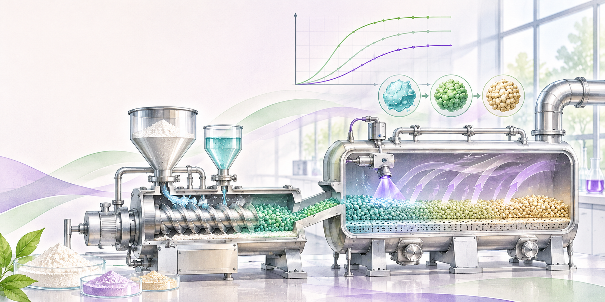
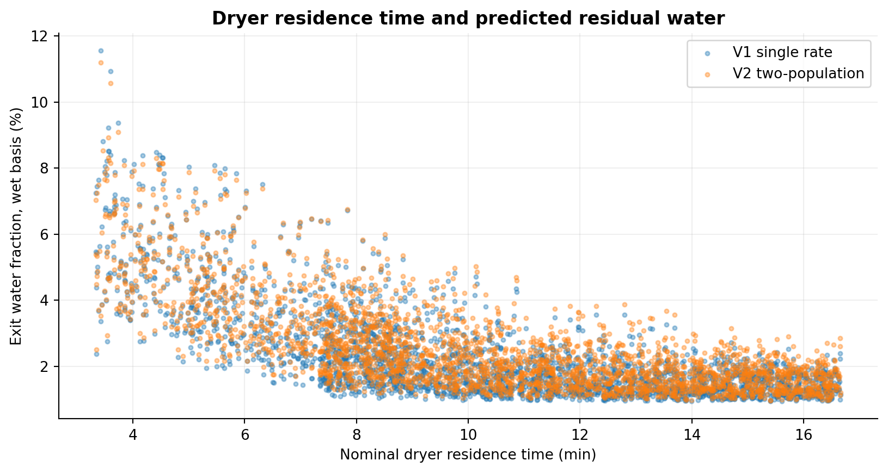
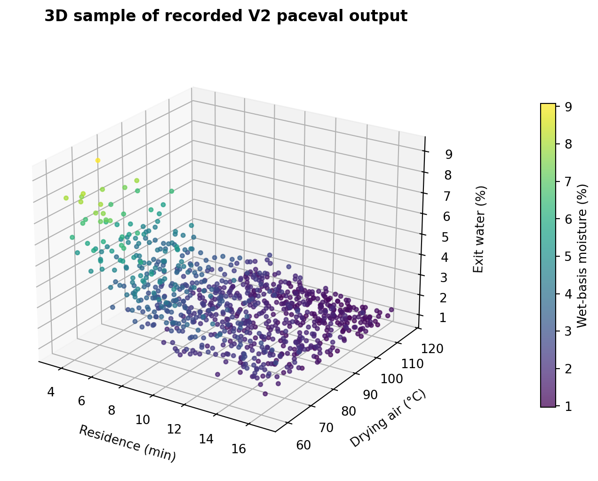

# Continuous Pharmaceutical Granulation and Drying Windows with paceval



**WP 23 | Industrial mathematics research | 15 November 2026**

This independent, reproducible mathematical demonstrator assesses a simplified continuous twin-screw wet granulation and fluidized-bed drying sequence. It uses the **original paceval Mathematical Engine 4.25**, not a surrogate implementation of the engine. The numerical source data are synthetic. The study is not GMP process validation, PAT method validation, product specification qualification or authorization to divert/release pharmaceutical material.

The [English research whitepaper](paceval_Continuous_Pharma_Granulation_Drying_Whitepaper_EN.pdf) provides the standalone scientific introduction and experimental interpretation. The [research validation record](RESEARCH_VALIDATION.md), [equation specification](docs/MODEL_SPECIFICATION.md) and [raw evidence](results/execution_evidence.json) make the numerical results auditable.

## 1. Industrial use case and current state of the art

A continuous solid-dose manufacturing line can meter powder and granulating liquid into a twin-screw granulator, feed wet granules into a continuous or segmented fluid-bed dryer, then condition, mill or blend the dried product before compression. An important requirement is to maintain the outlet water content inside a product-specific window despite changes in liquid feed, moisture of input material, drying-air conditions and residence time. In-line or at-line spectroscopy can add independent process observations, but a sensor signal is not automatically an approved quality attribute.

ICH Q13 (2022 final Step 4, FDA guidance issued March 2023) addresses control strategies, material traceability and diversion for integrated continuous manufacture. The FDA's Process Analytical Technology framework dates to 2004. Research published in 2023, 2024 and 2025 examined fluid-bed drying models, heterogeneity, and the joint use of moisture/temperature and PAT signals. In 2026, a new review summarized twin-screw wet granulation technologies. Equipment makers including GEA (ConsiGma) and L.B. Bohle (QbCon) implement connected granulation/drying systems. Their validated control and reporting features are **not** replicated by this study. Primary documentation and papers are linked in [research sources](docs/RESEARCH_SOURCES.md).

**Practical example.** A hypothetical engineer examines a continuous process with 20 kg/h dry solids, a controlled granulating-water feed, and uncertain residence time. The mathematical kernels receive validated flow rates, inlet moisture, air temperature and humidity, kinetic parameters, limits and a synthetic PAT observation. paceval evaluates predicted outlet moisture, product temperature, wettest/driest residence scenarios, mass conservation and quality margins. C++ labels each scenario as passing or failing the **illustrative** set of limits; a qualified pharmaceutical quality system would have separate responsibilities.

## 2. What the original paceval library actually computes

The study retains the source WP's Arrhenius-type rate and first-order moisture approach. It extends this to dry/wet basis conversion, granulation mass balance, residence-time sensitivity, temperature/moisture coupling and model-form uncertainty. Version **V1** uses one apparent drying rate. Version **V2** uses a fixed two-population mixture of faster and slower apparent rates; this is an illustrative heterogeneity model, not a measured particle-size or RTD distribution.

```math
M_0 = M_{\mathrm{feed}} + \frac{\dot m_{\mathrm{water}}}{\dot m_{\mathrm{dry}}},\qquad
M_{\mathrm{eq}} = M_b + a_{RH}RH\exp[-b_T(T_a-T_{\mathrm{ref}})]
```

```math
k(T_a)=k_{\mathrm{ref}}\exp\left[-\frac{E_a}{R}\left(\frac{1}{T_a}-\frac{1}{T_{\mathrm{ref}}}\right)\right]
```

```math
M_1(t)=M_{\mathrm{eq}}+(M_0-M_{\mathrm{eq}})e^{-kt}
```

```math
M_2(t)=M_{\mathrm{eq}}+(M_0-M_{\mathrm{eq}})
\left[f e^{-k(1+s)t}+(1-f)e^{-k(1-s)t}\right]
```

$M$ is kg water per kg dry solids, whereas the reported outlet **wet-basis** water fraction is $W=M/(1+M)$. By evaluating $t(1-r)$ and $t(1+r)$ independently, the model tests a deliberately simplified residence-time interval; it does not estimate a complete distribution. Moisture must remain monotone on the strictly positive drying domain.

### Mathematical function ownership

| Mathematical function / industrial purpose | Actual execution | Graph or technical responsibility |
|---|---|---|
| Granulation water-to-solid balance and size indicator | paceval | `V1_...`, `V2_...` input and granulation graphs |
| Equilibrium moisture, temperature-dependent rate | paceval | `EQUILIBRIUM_MOISTURE_DRY`, `RATE_CONSTANT` |
| Single-rate and two-population moisture predictions | paceval | `EXIT_MOISTURE_DRY`, `EXIT_MOISTURE_WET` V1/V2 |
| Residence robustness: wettest and driest endpoints | paceval | `SHORT_RESIDENCE_MOISTURE_WET`, `LONG_RESIDENCE_MOISTURE_WET` |
| Product temperature, evaporation, latent duty, mass balance | paceval | `GRANULE_TEMPERATURE`, `EVAPORATION_FLOW`, `LATENT_DUTY`, `WATER_BALANCE_RESIDUAL` |
| Residence-time and air-temperature analytical sensitivities | paceval | `SENSITIVITY_RESIDENCE`, `SENSITIVITY_AIR_TEMP` |
| Moisture/temperature/wetting/sensor margins, score and 0/1 guard | paceval | `MARGIN_*`, `PROCESS_SCORE`, `COMPOSITE_GUARD` |
| Differences and intersection between model versions | paceval | Six `COMPARE` graphs |
| Numerical-literal input parsing and result formatting | original paceval | `paceval_dConvertStringToFloat` / `paceval_dConvertFloatToString` |
| Dataset creation, validation, batch orchestration, status, output | C++ / Python host | No claim of in-engine state or regulatory decision making |
| Independent C++ and 85-digit mpmath checks | reference only | `src/granulation_drying_main.cpp`, `scripts/verify_high_precision.py` |

The SDK's scalar API and **real multi-graph batch API** have both been executed. The output buffer layout and error codes are checked with a small independent probe. Persistent graph handles remain available for repeated evaluation. The machine-readable [full function inventory](results/math_execution_inventory.csv) records each registered and actually executed function.

## 3. Reproducible scientific results

The executed experimental data consist of **2,880 unique synthetic scenarios** in four groups: normal, humid-air, hot-air and short-residence. Each is evaluated under both versions, yielding **5,760 model/scenario evaluations**. **60/60 domain-specific graphs** were executed and independently checked at selected end values. The original values, not regenerated reference-model calculations, feed the scientific diagrams.

| Result | V1 | V2 |
|---|---:|---:|
| Model/scenario results | 2,880 | 2,880 |
| Scenarios passing all illustrative conditions | **1,788** | **1,775** |
| Typical test-case `CASE00000` wet-basis water fraction | 1.4685% | 1.7112% |
| Typical test-case `CASE00000` product temperature | 350.850 K | 350.913 K |

The high-precision audit contains **138,240 checks at 85 decimal digits, all passing**, and the native C++ audit contains **3,985 end-value assertions**. The sensitivity and quality equations are mathematical kernels, not claims about actual drug-product quality. In particular, the synthetic PAT observation was generated from the V1 model with noise. It is **not** an experimentally independent spectroscopic measurement.





The remaining eight figures are available under [`figures/`](figures/fig02_moisture_distributions.png) as both PNG and vector PDF. All figures use actual paceval result CSVs; the cover image is explicitly conceptual.

## 4. Building and testing on Linux x86-64

The source directory includes the supplied original `paceval_main.h` and `paceval_main.cpp` with a minimal relative-header-include fix. It does **not** include or redistribute the external Linux `.so`. Supply the matching runtime separately.

```bash
python3 -m pip install -r requirements.txt
cmake -S src -B build -DCMAKE_BUILD_TYPE=Release \
  -DPACEVAL_RUNTIME=/absolute/path/to/libpaceval_linux_sharedLIB.so
cmake --build build -j
ctest --test-dir build --output-on-failure
./build/granulation_drying --run input/cases.csv results
python3 scripts/verify_high_precision.py results input/cases.csv
python3 scripts/check_markdown.py .
```

The generator is deterministic (`python3 scripts/generate_input.py` with seed `20261115`), but regenerating its input overwrites the saved source CSV. Validate the input checksum before replacing published data. The original test run uses the provided x86-64 Linux runtime. A new environment must rebuild and rerun its own tests.

## 5. Evidence, files and scientific limitations

The `results/` directory contains actual paceval CSVs, graph manifest, complete execution inventory, independent numerical audits, metadata and model comparisons. Its [execution evidence](results/execution_evidence.json) distinguishes created graphs, executed graphs, scalar calls, batch calls, graph-point evaluations and scenarios. The detailed numerical differences are retained in audit files and deliberately omitted from this public research summary.

All numeric inputs use UTF-8 CSV with comma-separated columns and a **dot decimal separator**. Text resembling mathematical code is rejected before use as a numeric field. The original paceval conversion API parses validated literals and produces numeric text, with no unsupported promise of bit-perfect IEEE-754 text roundtrips. The source input and SHA-256 checksum provide the immutable reference. See [CSV schema](docs/CSV_SCHEMA.md).

This model neglects full heat/mass-transfer coupling, spatial temperature gradients, particle-size distributions, drying-air energy balances, validated residence-time distributions, calibration-transfer of NIR, segregation and formulation-dependent kinetics. The linear granule-size proxy is **not** an experimentally supported PSD model. The temperature and heat-load indicators are deliberately simplified. No GMP validation, design-space qualification, product release, material diversion or regulatory approval can follow from these results alone.

## 6. References and project rights

The scientific and regulatory bibliography is collected in [research sources](docs/RESEARCH_SOURCES.md). See [license notices](LICENSE_NOTICES.md). Original paceval interface copyright and AGPL notices are retained; the provided external runtime library is not redistributed. The GitHub ZIP is a proposed publication bundle, not evidence of an online GitHub upload or visual inspection of GitHub's hosted renderer.
