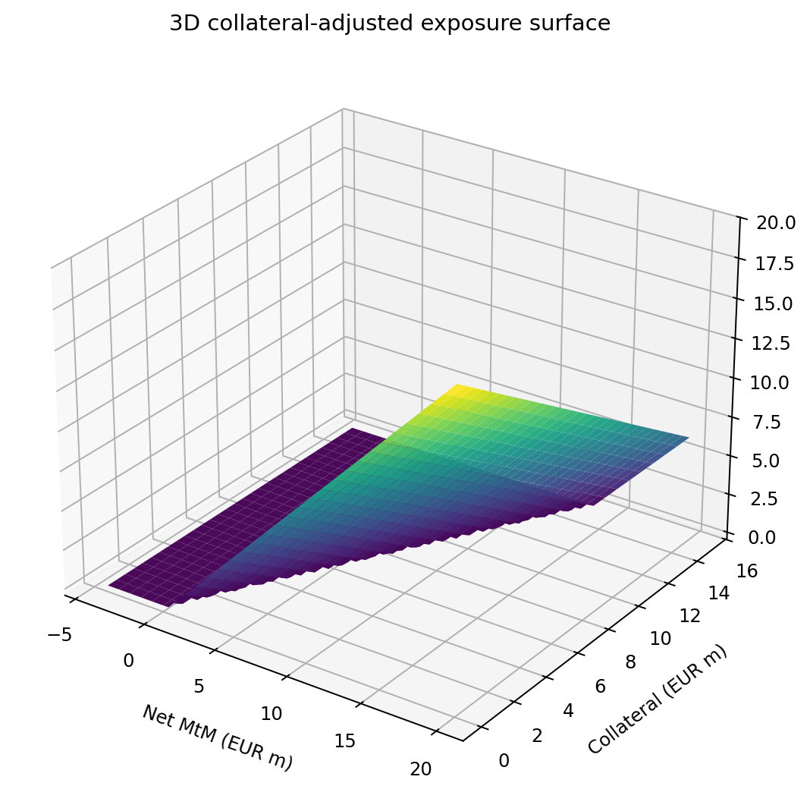
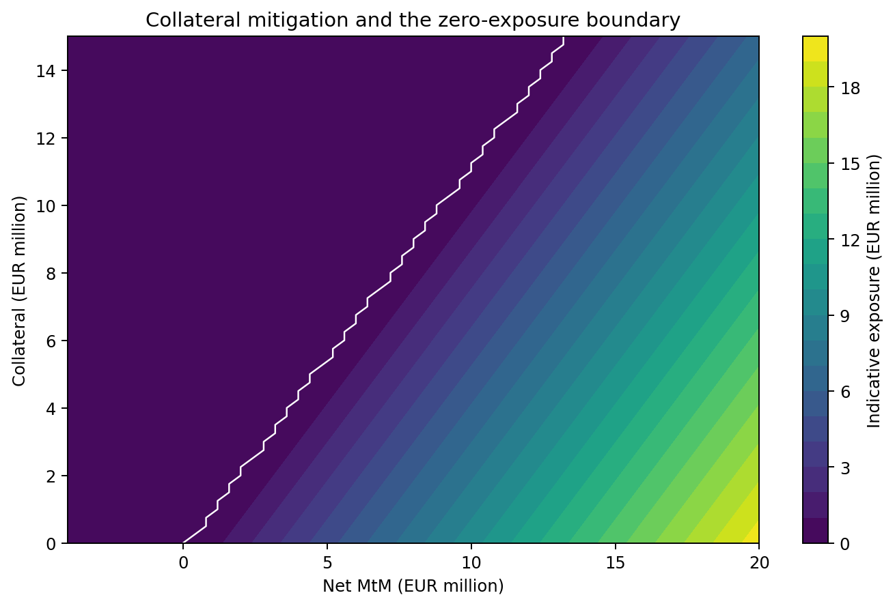

# paceval. | Real-Time Counterparty Exposure Functions


**A reproducible counterparty exposure *calculation-kernel* demonstrator using the original paceval C/C++ engine.** This research workflow executes 50 separately defined mathematical expressions, preserves an independent controlled formula revision and evaluates synthetic market updates. It does not implement regulatory SA-CCR, ISDA SIMM, trading decisions or a deployed risk service. The cover image is a conceptual illustration.

[English whitepaper](paceval_Counterparty_Exposure_Whitepaper_EN.pdf) · [C++ application](src/counterparty_exposure.cpp) · [CMake](src/CMakeLists.txt) · [SDK header](src/paceval_main.h) · [SDK source](src/paceval_main.cpp) · [Numerical audit](src/high_precision_reference.py)

## 1. Industrial use case and current state of the art

A derivatives risk desk monitors the current value of transactions with each counterparty. When the market moves, the mark-to-market of a legally defined netting set can change, and the amount of eligible collateral available to offset an exposure can also change. Risk engines and collateral management systems need reproducible, documented calculations to support exposure monitoring, escalation and downstream workflows.

The Basel Committee's SA-CCR framework distinguishes replacement cost from potential future exposure and uses a regulatory factor in the exposure-at-default calculation. **Neither the simple positive-exposure formula in the original research proposal nor the research extensions below are an implementation of SA-CCR.** Legal netting sets, collateral eligibility, enforceability, margin agreements, supervisory conditions and comprehensive pricing are separate activities. ISDA's 2026 collateral-process guidance similarly distinguishes variation margin, initial margin, collateral agreements and thresholds.

This project demonstrates one *pointwise mathematical subcomponent* within a larger bank or broker risk platform: a host application provides a synthetic, already aggregated netting-set value and permitted collateral parameters. paceval then evaluates a reusable, versioned analytic exposure formula. The host handles the update replay, domain checks, scenario definition and reporting. Results are **indicative exposure values in EUR millions**, not calibrated exposure-at-default or potential-future-exposure estimates.

## 2. Mathematical model and actual paceval boundary

Inputs: net mark-to-market `v` (EUR million); collateral `c` (EUR million); collateral haircut `h` (fraction); dimensionless market shock `s`; illustrative threshold `t` (EUR million); FX conversion `f` (dimensionless). All are bounded, finite contract inputs.

The central positive-part operator is evaluated as a mathematical expression graph:

```math
P(d)=\frac{d+\sqrt{d^2}}{2}.
```

The five research families (ten coefficient variants each) are:

```math
\begin{aligned}
E_1 &= P(v-c(1-h)-t+a s),\\
E_2 &= P(v(1+a s)-c(1-h)-t),\\
E_3 &= P(v+a s+b s^2-c(1-h)-t),\\
E_4 &= P(v-c(1-h)(f+a s)-t),\\
E_5 &= P(v-c(1-h)-t)+a\sqrt{1+s^2}P(v).
\end{aligned}
```

These are **illustrative study functions**, not prescribed ISDA haircut schedules, Basel replacement cost or margin formulae. In family 5 the second term is a model buffer, not an estimated PFE. All inputs have explicitly constrained domains. The scenario shock is a synthetic mathematical sensitivity, not a calibrated stress distribution. Netting-set aggregation and legal eligibility of collateral are *not* performed by paceval or the host; they are assumed inputs.

The original source proposed a simplified positive exposure `(MtM - collateral)` with a haircut multiplier. This study models the haircut instead as a reduction in recognized collateral, which is a clearer *illustrative* convention; it is not presented as regulatory compliance.

### paceval implementation

`paceval_CreateComputation` constructs each expression once. The C++ host reuses each handle with `paceval_dGetComputationResult`; `paceval_dGetComputationResultExt` performs independently checked packed-input evaluations. A controlled formula revision creates a **51st** handle instead of changing an existing expression. The original `paceval_main.cpp` and `paceval_main.h` are compiled with the application; the compatible runtime library is provided separately.

## 3. Executed numerical workload

| Verified research element | Actual result |
|---|---:|
| Distinct original formula variants | 50 |
| Persistent paceval graphs including one revision | 51 |
| Fully completed synthetic market update replay | 20,000 |
| Scalar paceval evaluations (all study outputs) | 24,167 |
| Packed batch checks | 1,600 |
| Mathematical response surface points | 3,721 |
| 80-digit independently verified exported sample values | 200 / 200 passed |
| Deliberately invalid input contracts rejected | 3 / 3 |
| Original SDK CMake/CTest integration | 1 / 1 passed |

The intended one-million-update workload from the original proposal was **not completed** in this environment. The C++ application retains a `--updates` option for larger replay experiments. The 20,000-update record, all published graphics and the declared audits are complete. No runtime or speed comparison is provided.

## 4. Scientific and industrial diagrams

All numbered result figures below are produced from exported original paceval calculations using `src/make_figures.py`. The cover image is conceptual rather than a computed plot.

| Figure | Use-case interpretation | Files |
|---|---|---|
| 1 | Exposure frequency distribution | [PNG](figures/01_sample_exposure_distribution.png) · [PDF](figures/01_sample_exposure_distribution.pdf) |
| 2 | Exposure profiles of five formula families | [PNG](figures/02_rule_family_exposure.png) · [PDF](figures/02_rule_family_exposure.pdf) |
| 3 | Scenario and stress exposure curves | [PNG](figures/03_market_stress_sensitivity.png) · [PDF](figures/03_market_stress_sensitivity.pdf) |
| 4 | 3D collateral-adjusted exposure function | [PNG](figures/04_exposure_surface_3d.png) · [PDF](figures/04_exposure_surface_3d.pdf) |
| 5 | Collateral/mark-to-market contour map | [PNG](figures/05_collateral_contour.png) · [PDF](figures/05_collateral_contour.pdf) |
| 6 | Controlled mathematical formula revision | [PNG](figures/06_immutable_formula_versioning.png) · [PDF](figures/06_immutable_formula_versioning.pdf) |
| 7 | Haircut and mark-to-market sampled responses | [PNG](figures/07_haircut_scatter.png) · [PDF](figures/07_haircut_scatter.pdf) |
| 8 | Collateral and shock sampled responses | [PNG](figures/08_collateral_vs_exposure.png) · [PDF](figures/08_collateral_vs_exposure.pdf) |





## 5. Build and reproduce

The shared library is intentionally **not** included in this GitHub package. Supply the ABI-compatible original paceval Linux runtime yourself:

```bash
cmake -S src -B build -DCMAKE_BUILD_TYPE=Release \
  -DPACEVAL_RUNTIME=/absolute/path/to/libpaceval_linux_sharedLIB.so
cmake --build build -j
ctest --test-dir build --output-on-failure
./build/counterparty_exposure --out reproduced --updates 20000
python3 src/verify_results.py
python3 src/high_precision_reference.py
python3 src/make_figures.py
python3 src/make_whitepaper.py
python3 src/check_readme_math.py
```

The verification scripts use the **shipped** `examples/` data, not the newly produced `reproduced/` output. To evaluate reproduced outputs, compare the CSV datasets explicitly. The native C++ executable requires C++17 and CMake; plotting requires NumPy and Matplotlib; the report requires ReportLab and Pillow. High precision uses Python's standard-library Decimal.

[Registered expressions](examples/rule_registry.csv) · [Sampled market records](examples/exposure_samples.csv) · [Rule aggregates](examples/rule_metrics.csv) · [Exposure surface](examples/exposure_surface.csv) · [Stress curves](examples/stress_scenarios.csv) · [Formula revision](examples/formula_revision.csv) · [SDK execution evidence](examples/sdk_execution.txt) · [High precision audit](results/high_precision_audit.json) · [Reproduction verifier](src/verify_results.py).

## 6. Limitations and research interpretation

This is a synthetic, deterministic pointwise exposure function executor. The experiment does not establish enforceable netting arrangements, collateral valuation or eligibility, SA-CCR replacement cost, PFE, EAD, CVA, wrong-way risk, IMM, IM or a production market-data pipeline. Its original five families are illustrative, not calibrated to observed counterparty defaults. The exported samples cover only every 100th market update; the summary captures all executed updates. The independent numerical audit is in the technical files, without publishing a C++ versus paceval accuracy comparison in this README or whitepaper.

**Research outcome:** The defined nonlinear functions, formula reuse, scalar and batch execution, separate version revision and synthetic scenario outputs were implemented and tested using the actual paceval C++ SDK. This does not establish a deployed risk system or an improvement in regulatory, financial or trading outcomes.

## 7. External scientific and industrial references

- [BIS: Counterparty credit risk in Basel III](https://www.bis.org/publications/fsi-summary-counterparty-credit-risk-basel-iii-executive-summary)
- [BIS: Counterparty credit risk overview and key terms](https://www.bis.org/committees/bcbs/basel-consolidated-guidelines/module/cri/40)
- [ISDA: Collateral management suggested operational practices](https://www.isda.org/collateral-management-sop/)
- [EBA: Validation of pro forma initial margin models](https://www.eba.europa.eu/activities/direct-supervision-and-oversight/validation-pro-forma-initial-margin-models)
- [paceval C/C++ SDK](https://paceval.com/api/)
