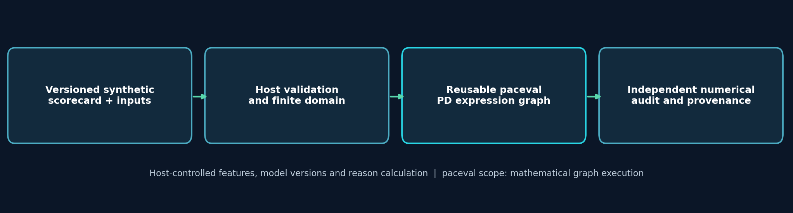
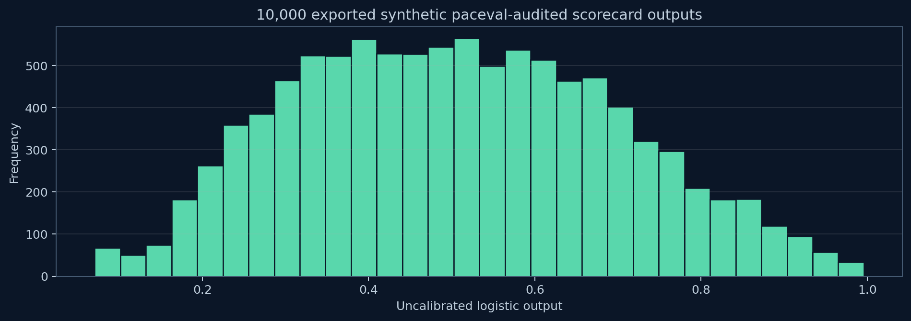
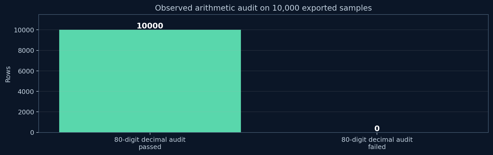

# paceval. | Reusable Credit Risk Decision Mathematics


**An executable, independently audited paceval C++ feasibility demonstrator for reusable synthetic credit-scorecard mathematics.** It uses the original `paceval_main.h` and `paceval_main.cpp` API files, a compatible external Linux engine, reproducible formula graphs and an independent high-precision audit. The project demonstrates arithmetic execution, not a trained probability-of-default model, live credit assessment or regulatory compliance.

[English research whitepaper (PDF)](paceval_Credit_Risk_Scorecard_Whitepaper_EN.pdf) · [C++ source](src/credit_scorecard.cpp) · [CMake build](src/CMakeLists.txt) · [Official SDK facade](src/paceval_main.cpp) · [Results log](results/paceval_sdk_verified.txt)

## 1. Verified research scope

The originating WP-018 proposal suggested evaluating a logistic scorecard expression repeatedly. This executable research project defines **100 synthetic, independent coefficient sets** and evaluates **100 deterministic feature vectors per model**. The program constructs each formula once as a persistent paceval computation object, reuses it for scalar evaluation, verifies additional batched results using the official SDK and independently calculates the same mathematical function in native C++.

| Mathematical component | Contract | Implementation |
|---|---|---|
| Linear predictor | `z = b0 + sum(beta[j] * x[j], j=0..4)` | Fixed synthetic parameters and host reference |
| Logistic result | `1 / (1 + exp(-z))` | Direct paceval mathematical expression graph |
| Feature contributions | `beta[j] * x[j]` | Host reference, exact additive log-odds decomposition |
| Leading contribution index | First index with maximal `beta[j] * x[j]` | Host-side explanatory illustration |
| Scalar reuse | One graph per coefficient set | `paceval_CreateComputation` then `paceval_dGetComputationResult` |
| Batch reuse | 64 feature vectors per graph | `paceval_dGetComputationResultExt` |

The five synthetic features lie in `[0,1]`. The coefficients are **not trained from observations**, and the logistic outputs are *uncalibrated numerical scores*, not evidenced real-world probabilities of default. Contribution indices are not legally sufficient adverse-action reason codes.



## 2. Reproduced paceval SDK results (Linux x86-64)

| Verified operation | Observed result |
|---|---:|
| Scorecard computation graphs | 100 created and reused |
| paceval scalar calculations checked against C++ | **10,000 / 10,000** |
| paceval batch calculations checked against C++ | **6,400 / 6,400** |
| Independently checked CSV outputs | **10,000 / 10,000** |
| Independent arithmetic reference | Python `Decimal`, 80-digit precision |
| Maximum absolute difference in exported Decimal score audit | **1.9811 × 10⁻¹⁶** |
| Absolute acceptance tolerance | `1e-10` paceval-vs-native; `1e-12` Decimal-vs-export |
| CTest using the actual supplied SDK | **1 / 1 passed** |

The numerical results were reproduced using the supplied public C/C++ facade (version 4.25) and a compatible supplied x86-64 Linux `libpaceval_linux_sharedLIB.so`. Each graph is evaluated with fixed inputs and explicitly checked for errors. Scalar and batch results agree with the separately coded native mathematical reference under the declared tolerances. These observations do not demonstrate predictive discrimination, calibration or suitability for lending decisions.

[Recorded SDK execution](results/paceval_sdk_verified.txt) · [10,000 synthetic samples](examples/scorecard_samples.csv) · [80-digit audit result](results/high_precision_audit.json)



## 3. Build and execute with the original paceval C/C++ SDK

The repository contains the original public SDK API declaration `src/paceval_main.h` and implementation `src/paceval_main.cpp`, with only the implementation's relative header include adjusted for this flat `src/` layout. **Its upstream copyright/AGPL notices remain in place.** The executable compiles both `credit_scorecard.cpp` and the official `paceval_main.cpp`, and links a separately supplied, matching Linux shared library. The binary `.so` is **not included** in the GitHub ZIP.

```bash
cmake -S src -B build -DCMAKE_BUILD_TYPE=Release \
  -DPACEVAL_RUNTIME=/absolute/path/to/libpaceval_linux_sharedLIB.so
cmake --build build -j
ctest --test-dir build --output-on-failure
mkdir -p reproduced
./build/credit_scorecard --models 100 --cases 100 \
  --out reproduced/scorecard_samples.csv
python3 src/high_precision_reference.py reproduced/scorecard_samples.csv
```

CMake lives under `src/CMakeLists.txt`. The runtime path must be an **absolute path to an x86-64 compatible library**. Nothing is silently downloaded. To run a different number of synthetic cases use `--models` and `--cases` (within the bounds documented in the C++ source); these are separate experiments and do not alter the recorded reference results.

## 4. Independent numerical verification and research figures

The native C++ reference explicitly computes the five additive terms and a numerically stable logistic function. The research executable rejects scalar and batch mismatches and non-finite values. The independent [`high_precision_reference.py`](src/high_precision_reference.py) does not call the paceval engine or native scoring routine; it reconstructs the equations from the exported CSV using 80-digit `Decimal` arithmetic. It also checks the leading contribution index with deterministic first-index tie-breaking.



The paper includes the following analytical visualizations, supplied as PNG and vector PDF:

- [Logistic expression](figures/02_logistic_kernel.png)
- [Synthetic score distribution](figures/03_synthetic_output_distribution.png)
- [Additive score contributions](figures/04_logodds_contributions.png)
- [Controlled numerical sensitivity](figures/05_single_feature_sensitivity.png)
- [Evidence and application boundaries](figures/07_evidence_boundary.png)

Regenerate figures using [`src/make_figures.py`](src/make_figures.py) (Matplotlib) and the English PDF using [`src/make_whitepaper.py`](src/make_whitepaper.py) (ReportLab/Pillow). These are authoring scripts, not dependencies of the C++ mathematical runtime.

## 5. Formula reuse, versioning and application scope

Each fixed coefficient set identifies one distinct **research** scorecard and one reusable computation handle. A production model registry would additionally require documented provenance, approval states, version signatures, model monitoring and change control; this demonstration makes no claims that those procedures are implemented. The numerical sensitivity plot changes one synthetic feature while holding all others fixed; it is not causal credit-risk analysis.

Creditworthiness assessment and monitoring are governed by domain-specific obligations that cannot be established from correct arithmetic alone. The [EBA loan-origination guidance](https://www.eba.europa.eu/activities/single-rulebook/regulatory-activities/credit-risk/guidelines-loan-origination-and-monitoring), [EU AI Act](https://eur-lex.europa.eu/eli/reg/2024/1689/oj/eng) and [US Regulation B §1002.9](https://www.consumerfinance.gov/rules-policy/regulations/1002/9/) provide context but are **not certifications** for this prototype. No personal borrower data is used. The [UCI German Credit dataset](https://archive.ics.uci.edu/dataset/144/statlog+german+credit+data) is not distributed or analyzed here.

## 6. Sources and reproducibility notes

The API signatures and object-lifetime protocol are based on the [official paceval C/C++ API](https://paceval.com/api/) and [public source repository](https://github.com/paceval/paceval). Code and research data are included to permit a repeat of the numerical feasibility checks. The external engine binary must be supplied separately and be compatible with the host. The original SDK source files retain their copyright and AGPL notices; **review upstream licensing requirements before redistribution, linking or deployment**. No separate `LICENSE_NOTICE.md` and no Markdown version of the whitepaper are included.

**Conclusion.** The supplied SDK executable successfully constructed and reused mathematical scorecard graphs and passed both scalar and batch arithmetic checks on a reproducible synthetic workload. The independently calculated high-precision outputs also passed. This establishes **technical feasibility of the defined paceval arithmetic use case**, not validity of credit decisions.
