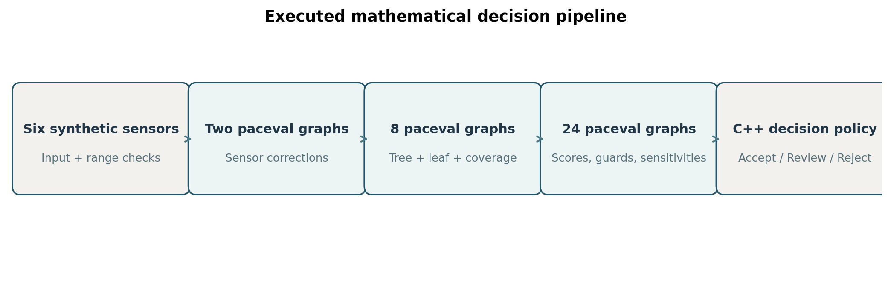
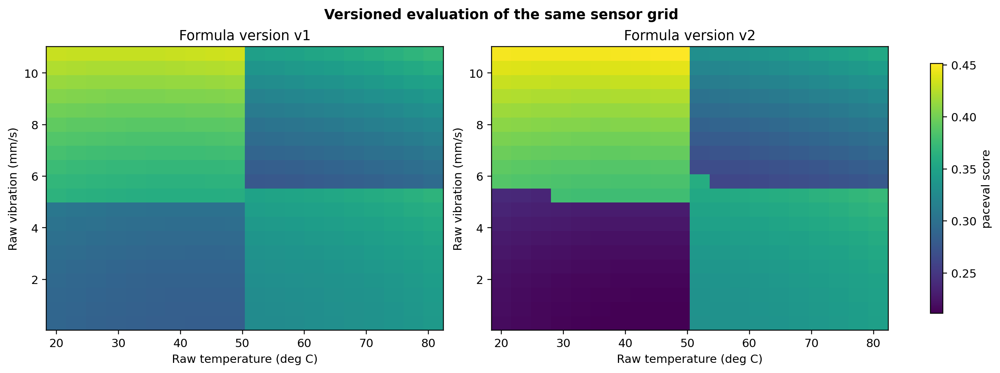
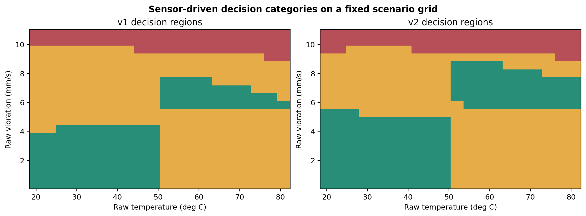
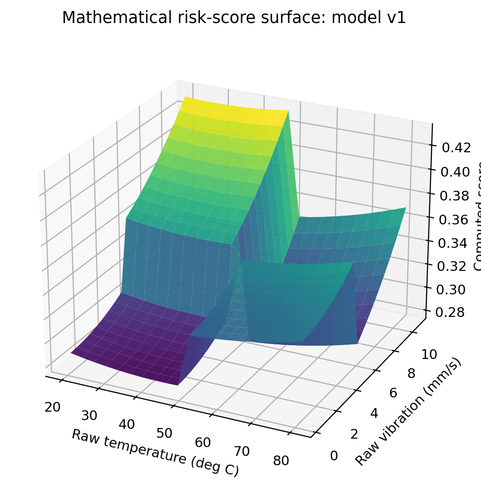

# Industrial Decision Trees as Reusable Mathematical Execution Graphs


*Concept illustration; not a computed research result.*

This reproducible C++/paceval research demonstrator converts an explicit decision tree into mathematical expressions that are actually executed through the original paceval Mathematical Engine 4.25. It extends a four-leaf example into two simultaneously available 64-leaf industrial rule models, followed by reusable mathematical score, guard, and sensitivity graphs. **The study is about mathematical functionality and engineering feasibility, not runtime performance or clinical/safety certification.**

[Scientific whitepaper (PDF)](paceval_Decision_Tree_Mathematical_Execution_Whitepaper_EN.pdf) · [C++ program](src/decision_tree.cpp) · [Mathematical execution inventory](results/math_execution_inventory.csv) · [Independent high-precision audit](results/independent_80digit_audit.json)

## 1. Industrial use case and current state of the art

A production line may combine temperature, vibration, pressure, load, current, and drift indicators to decide whether a component should proceed, be reviewed, or be rejected for further inspection. Such decisions can be formulated as transparent threshold rules. A structured decision tree may originate from a domain engineer or an independently trained model; this study deliberately uses **synthetic, explicitly authored mathematical rules** rather than a trained fault classifier.

Decision-tree models are established tools for classification and regression. The official [scikit-learn decision-tree guide](https://scikit-learn.org/stable/modules/tree.html) explains that trees learn piecewise rules, while [export_text](https://scikit-learn.org/stable/modules/generated/sklearn.tree.export_text.html) illustrates how rules can be documented. Recent research also examines compact additive rule ensembles and decision-tree compilation for embedded execution ([Behzadimanesh et al., 2026](https://doi.org/10.1007/s10618-026-01241-8); [Su et al., 2024](https://doi.org/10.1145/3704727)). Industrial deployment additionally requires documented input validity, revision control, independent checks, and appropriate cybersecurity practice such as the [ISA/IEC 62443 series](https://www.isa.org/standards-and-publications/isa-standards/isa-iec-62443-series-of-standards).

The question investigated here is whether a domain-specific decision tree can be represented and evaluated **as actual mathematical paceval expressions**, with multiple models and numerical companion functions sharing a consistent interface. It does not propose that paceval trains the tree, interprets unsafe data automatically, or replaces a safety controller.

## 2. From the supplied diagram to a complete expression

The supplied four-leaf example first tests `a < 0`; the left branch tests `b < 30`, and the right branch tests `b < 10`. The four leaf costs are 8, 11, 7, and 9. The model is:

```math
f(a,b)=
\begin{cases}
8, & a<0,\ b<30,\\
11, & a<0,\ b\geq30,\\
7, & a\geq0,\ b<10,\\
9, & a\geq0,\ b\geq10.
\end{cases}
```

The implemented paceval expression represents every mutually exclusive path as a Boolean indicator multiplied by its numerical leaf value. The four-leaf output is tested at 12 points, including exact branch boundaries, in [original_tree_example.csv](results/original_tree_example.csv). A zero indicator must not be confused with lazy, guarded branch evaluation: unsafe functions in inactive algebraic branches are **not** automatically protected by multiplication with zero.

## 3. Expanded production-quality experiment

The synthetic full-depth tree has six successive threshold levels and 64 terminal leaves. Each path uses one variable from the ordered list `t, v, p, l, i, d`. Version v2 changes branch thresholds and selected leaf scores while keeping v1 available. For the experiment, the variables are temperature (degrees C), vibration (mm/s), pressure (bar), load (%), current (A), and a dimensionless drift indicator.

The pipeline applies two **actual paceval correction graphs** to raw sensor values before passing the corrected six-element feature vector to the tree:

```math
v_{c}=v_{\mathrm{raw}}\left(1+0.002(t-25)\right),\qquad
p_{c}=p_{\mathrm{raw}}-0.006(t-25).
```

Let each leaf path have a predicate $P_k(x)$ taking the value zero or one, and let $c_{k,m}$ be the stored cost for leaf $k$ in model version $m$. The actual mathematical tree output is:

```math
B_m(x)=\sum_{k=0}^{63}P_{k,m}(x)c_{k,m},\qquad
\sum_{k=0}^{63}P_{k,m}(x)=1.
```

A second independent **nested binary-expression encoding** is evaluated by paceval on the same inputs. The leaf index and the path-coverage sum are also calculated by paceval, not inferred only from a host traversal.

The model output enters another paceval graph that computes a composite quality score:

```math
S_m=B_m+0.11\left(\frac{v_c}{12}\right)^2
+0.035\left(\frac{t-45}{55}\right)^2
+0.04\left(\frac{i}{30}\right)^2+0.03d+\Delta_m,
```

where $\Delta_1=0$ and $\Delta_2=0.012((p_c-7)/8)^2$. Additional paceval graphs compute the signed threshold margins $0.30-S_m$, $0.43-S_m$, and six physical guard margins. The **C++ host** then maps these numbers to the hypothetical `ACCEPT`, `REVIEW`, and `REJECT` states. These are study labels, not an industrial release or safety authorization.

## 4. Verified mathematical function ownership

| Mathematical function / industrial purpose | Actual execution | Graph/version or rationale |
|---|---|---|
| Temperature correction of vibration | **paceval** | `vibration_temperature_correction` |
| Temperature correction of pressure | **paceval** | `pressure_temperature_correction` |
| Original supplied four-leaf cost tree | **paceval** | `original_four_leaf_tree` |
| Full 64-leaf tree, explicit path masks | **paceval** | `v1_masked_tree`, `v2_masked_tree` |
| Equivalent nested binary expression | **paceval** | `v1_nested_tree`, `v2_nested_tree` |
| Selected leaf number and path coverage | **paceval** | `*_leaf_index`, `*_coverage` |
| Combined sensor/condition risk scores | **paceval** | `*_risk` |
| Acceptance, rejection and sensor-validity margins | **paceval** | `*_margin`, `*_guard_*` |
| Analytic within-leaf partial sensitivities | **paceval** | `*_sensitivity_*` |
| Select final discrete label from mathematical margins | C++ host | Discrete policy mapping |
| Input generation, checks, version state, file writing | C++ host | Stateful orchestration |
| Numerical comparison and high-precision oracle | Independent C++ / Python | Validation only |

The complete, machine-readable graph inventory and exact formula strings are retained under [results/](results/math_execution_inventory.csv) and [graph_registry.csv](results/graph_registry.csv). The host does **not** precompute the tree, score or signed margins for subsequent trivial pass-through; native C++ calculates independent control values solely for validation.

## 5. Verified results and demonstrated scope

The actual Linux run used the original paceval shared library and C/C++ API. Graph objects were constructed once, persisted, evaluated in a documented multi-graph batch API, and released correctly.

| Executed outcome | Verified |
|---|---:|
| Registered, executed paceval graphs | 35 |
| Different complete tree versions | 2 |
| Leaf rules per version | 64 |
| Distinct synthetic sensor inputs | 1,692 |
| Version-specific decisions evaluated | 3,384 |
| Actual paceval graph outputs | 57,540 |
| Multi-graph batch calls | 6 |
| Independently checked high-precision values | 60,912 |
| Independently verified complete decisions | 3,384 |
| Original four-leaf control evaluations | 12 |

The verification uses separately coded tree traversal and `mpmath` at 80-decimal-digit working precision. Numerical comparison details remain in [the technical audit file](results/independent_80digit_audit.json), not in the scientific outcome diagrams. Sensor values, thresholds, leaf weights and guard thresholds are synthetic, not experimentally fitted or traceable measurement functions.

**Executed complete depth-20 tree.** A second, independent executable in this repository (`depth20_exhaustive`) has **actually evaluated all $2^{20}=1,048,576$ terminal paths** with the original paceval SDK. Its twenty binary predicates use controlled, unambiguous input values 0 or 1. Four persistent paceval graphs compute the path index, number of positive decisions and two separately versioned leaf-score functions. The complete run produced **4,194,304 graph outputs in 256 multi-graph batches**; all leaf indices and scores passed separately coded native C++ checks. An additional high-precision audit verified 30 scores at 15 representative path indices. The precisely registered formula strings and audits are in [depth20_graph_registry.csv](results/depth20_graph_registry.csv), [depth20_exhaustive_audit.txt](results/depth20_exhaustive_audit.txt) and [depth20_80digit_audit.json](results/depth20_80digit_audit.json).

The experiment evaluates a **structured complete tree** whose leaves can be described by a factored mathematical expression. It **does not** generate or execute a single explicitly expanded sum containing one million independent leaf terms. It therefore demonstrates exhaustive mathematical functionality on this entire structured tree, not universal compact representation of arbitrary million-entry lookup tables. Both tested representations and the exact scope of the result are explained in the whitepaper.

## 6. Scientific diagrams from executed paceval data

The figures below are generated from the delivered result CSVs by [make_figures.py](src/make_figures.py). The first figure is an executed-system schematic; the subsequent plots are generated from actual paceval results and registered expressions.









The additional exhaustive experiment is visualized in [the verified 20-level path-coverage histogram](figures/12_depth20_verified_coverage.png) and [the two versioned leaf-score profiles](figures/13_depth20_versioned_scores.png). These diagrams are generated from stored paceval outputs with [make_depth20_figures.py](src/make_depth20_figures.py).

Additional research figures show [model revisions](figures/04_version_change_surface.png), [score distributions](figures/06_score_distribution.png), [decision counts](figures/07_decision_outcome_counts.png), [analytical sensitivities](figures/08_analytic_sensitivities.png), [guard violations](figures/09_constraint_guard_results.png), [individual margins](figures/10_selected_individual_guards.png), and [registered expression lengths](figures/11_formula_representation.png).

## 7. Reproducible build and tests

The original paceval SDK 4.25 files `paceval_main.h` and `paceval_main.cpp` are included in `src/`, with their copyright and license notices intact. The Linux runtime is provided separately and is **not** included in this public package. A compatible original paceval installation is required to reproduce the execution.

```bash
cmake -S src -B build -DCMAKE_BUILD_TYPE=Release \
  -DPACEVAL_RUNTIME=/absolute/path/to/libpaceval_linux_sharedLIB.so
cmake --build build -j
ctest --test-dir build --output-on-failure
```

To regenerate scientific figures after successful execution:

```bash
python3 src/make_figures.py .
python3 src/make_depth20_figures.py .
python3 src/independent_reference.py .
python3 src/verify_depth20_precision.py .
python3 src/verify_inventory.py .
python3 src/check_readme_math.py .
python3 src/make_whitepaper.py .
```

The high-precision validation script requires `mpmath`, and the figure-generation script requires `matplotlib` and `numpy`. Both C++ executables require no additional numerical library. The complete depth-20 path test is executed by the CTest case `depth20_all_1048576_paths`. Use explicit Python package versions where strict cross-environment reproducibility is required.

## 8. Limitations and research interpretation

This is a functional mathematical research demonstrator, not a trained industrial decision-tree classifier, validated factory quality system, safety component, or operational customer deployment. The same input variables are used in the two synthetic tree versions, and the two results do not represent an externally validated improvement in prediction quality. Discontinuous tree outputs are not differentiable at split boundaries; the reported sensitivity formulas apply only within fixed leaves to the continuous score correction. The synthetic sensor compensations are mathematical examples, not fitted instrument equations.

No performance, energy-use or hardware speedup is established or discussed. FPGA or ASIC execution of the same mathematical graphs remains a separate prospective hardware investigation. TINC is not activated, and the project makes no claim of global interval certification. Domain checking takes place in the host before calling any paceval graph.

## 9. Relevant scientific and industrial sources

1. [scikit-learn: Decision Trees](https://scikit-learn.org/stable/modules/tree.html), official documentation, accessed November 2026.
2. [scikit-learn: export_text](https://scikit-learn.org/stable/modules/generated/sklearn.tree.export_text.html), official model-rule export documentation.
3. Behzadimanesh et al. (2026), *Sparse oblique rule boosting for simpler additive rule ensembles*, *Data Mining and Knowledge Discovery*, [DOI: 10.1007/s10618-026-01241-8](https://doi.org/10.1007/s10618-026-01241-8).
4. Su et al. (2024), *TreeHouse: An MLIR-based Compilation Flow for Real-Time Tree-based Inference*, *ACM Transactions on Embedded Computing Systems*, [DOI: 10.1145/3704727](https://doi.org/10.1145/3704727).
5. [ISA/IEC 62443 industrial automation cybersecurity standards](https://www.isa.org/standards-and-publications/isa-standards/isa-iec-62443-series-of-standards).
6. [paceval public C/C++ API](https://paceval.com/api/) and [GitHub repository](https://github.com/paceval/paceval).

**Research status, 13 November 2026:** Independent, reproducible mathematical feasibility work using a hypothetical industrial scenario and the original paceval software. Not peer-reviewed or industrially certified.
