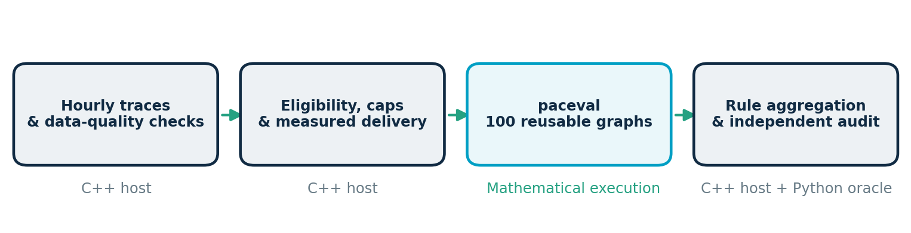
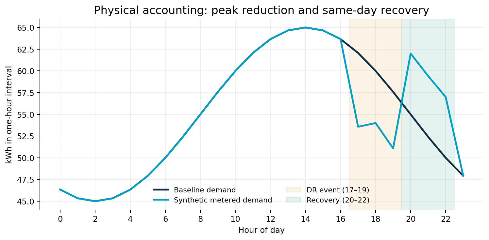

# paceval – Demand-Response Incentive Mathematics


**An executable, reproducible C++ research demonstrator** for evaluating versioned demand-response (DR) incentive expressions using persistent paceval computation graphs. The release includes the original paceval C/C++ SDK facade (`paceval_main.h` and `paceval_main.cpp`), real Linux-runtime execution results, an independent 90-digit numerical audit, mathematical diagrams, and a scientific [whitepaper](paceval_Demand_Response_Whitepaper_EN.pdf).

> **Scope:** synthetic hourly meter data and illustrative customer economics, **not** actual grid dispatch, legal settlement, customer-response prediction, a licensed tariff, or a real-world measurement-and-verification certification.

## What is implemented

The C++ host constructs **14 full days (336 one-hour intervals)** of synthetic electricity demand, a time-varying price signal, and three DR event hours per day (17:00–19:00), followed by same-day energy recovery (20:00–22:00). The aggregate daily demand is conserved: energy shifted out of the event appears later, rather than being silently discarded.

It defines and validates **100 distinct mathematical rule versions** across four families. A rule is compiled to a paceval execution graph once, then evaluated in batches for new hourly data. The research run computes **33,600 mathematical outputs** and independently checks them against native C++ and a high-precision Python/Decimal reference. A controlled update of rule 17 builds a separate version-2 graph while a different graph remains unchanged.

The host checks the event-window flag, measurement-quality flag, positive measured load reduction, stated capacity limit and requested reduction **before** invoking paceval. A deliberately false request (zero measured reduction), an event with invalid measurement quality, and an over-request capped by feasible capacity are included in the published trace. **The mathematical engine is responsible for the explicit rule formula, not eligibility decisions or network operation.**



### Reusable mathematical kernel

For a rule `m`, the illustrative net modelled value is

\[
V_m = \alpha_m d(p_e-p_r)+b_m d
      -\mathbf{1}_{f_m\ge1}q_m(r-d)^2
      -\mathbf{1}_{f_m\ge2}c_m d^2
      -\mathbf{1}_{f_m\ge3}g_m d^3.
\]

Here `d` is **verified eligible** delivered energy (kWh); `r` is requested energy (kWh); `p_e` and `p_r` are respectively event- and recovery-period price assumptions (EUR/kWh). `alpha` is dimensionless, `b` is an illustrative separate incentive (EUR/kWh), `q` and `c` are synthetic costs in EUR/kWh², `g` is EUR/kWh³, and `f` selects one of four formula families. The terms represent an *illustrative* shifted-energy price advantage, a separately modelled program reward, and possible under-delivery and comfort costs, rather than a prescribed market settlement formula.

Eligibility, computed separately by the C++ host for valid event data, is:

`d = min(requested, capacity, max(0, baseline_kWh - metered_kWh))`.

For invalid meter quality or a non-event hour the host sets both `d` and the chargeable request passed to the graph to zero. All mathematical results refer to the defined synthetic model; no statistical assessment of real baseline accuracy has been made.

## Results from the packaged reference run

| Property | Verified result |
| --- | ---: |
| Independent paceval graphs | 100 |
| Hourly trace records | 336 (14 × 24) |
| Regular paceval evaluations | **33,600** |
| Native C++ reference | **33,600/33,600** within tolerance |
| Independent 90-digit audit | **33,600/33,600** within tolerance |
| Largest absolute high-precision discrepancy | **6.95 × 10⁻¹⁶ EUR** (rounded) |
| Controlled raw TINC samples (binary-exact price-spread inputs) | **24/24** contain reference |
| Quality-excluded event hours | 1 |
| Deliberately false reduction claims detected | 1 |
| Event hours with requested energy above declared cap | 2 |
| Daily shifted-energy reconciliation | 14/14 days |
| Formula-version update | Rule 17 updated independently; rule 18 unchanged |

The 24 TINC samples exercise a **separate smooth price-spread expression on exactly representable binary64 values**. They are not a certification of all 100 nonlinear rule expressions. The 90-digit high-precision audit evaluates the binary floating-point values actually sent to paceval.



## Build (Linux x86-64, validated configuration)

Supply the correct **external** paceval Linux runtime for the architecture. The proprietary `.so` is deliberately **not shipped**. The official API facade in `src/paceval_main.cpp` is compiled and linked with the host; there is no custom `dlopen`/`dlsym` adapter.

```bash
cmake -S src -B build -DCMAKE_BUILD_TYPE=Release \
  -DPACEVAL_RUNTIME=/absolute/path/to/libpaceval_linux_sharedLIB.so
cmake --build build -j
ctest --test-dir build --output-on-failure
./build/demand_response --rules 100 --days 14 --batch 128 --out reproduced
python3 src/validate_outputs.py --dir reproduced
```

The original validation used **Debian Linux x86-64, GCC 14.2**, and the compatible original paceval runtime. Additional Clang and compiler-sanitizer checks are described in the whitepaper. Re-run the command on your own installation with a compatible library. No ARM or real-time behavior is asserted by this package.

**CSV-input mode** accepts hourly traces conforming to the [published trace schema](examples/hourly_trace.csv):

```bash
./build/demand_response --rules 100 --input examples/hourly_trace.csv --batch 37 --out imported
python3 src/validate_outputs.py --dir imported
```

Input rows must form ordered, full 24-hour days and satisfy event flags, finite numbers, energy balance and price/cap constraints. This is a strict **research trace import**, not a live OpenADR/MQTT/IEC/SCADA adapter. The [intentionally invalid trace](examples/invalid_trace.csv) demonstrates rejection.

### Reproduce the diagrams and PDF

```bash
python3 -m pip install -r src/requirements.txt
python3 src/make_figures.py
python3 src/make_whitepaper.py
```

The independent numerical audit needs only the Python standard library. Scientific figures are regenerated from exported CSVs, not synthetic illustrations of unmeasured performance. **No speed comparisons or speculative speedup claims are published.**

## All reproducible project files

| Location | Purpose |
| --- | --- |
| [Scientific whitepaper](paceval_Demand_Response_Whitepaper_EN.pdf) | Full English study and validation scope |
| [CMake build file](src/CMakeLists.txt) | Direct SDK facade and external runtime linking |
| [C++ source](src/demand_response.cpp) | Synthetic DR model, 100 graph versions, data checks and execution |
| [Official paceval header](src/paceval_main.h) / [facade implementation](src/paceval_main.cpp) | Unmodified upstream licensing notices retained |
| [Independent 90-digit audit](src/validate_outputs.py) | Checks all numeric results and raw TINC sample inclusion |
| [Scientific figure generator](src/make_figures.py) | Recreates all 9 scientific PNG/SVG plots |
| [PDF generator](src/make_whitepaper.py) | Rebuilds the scientific whitepaper |
| [Hourly input trace](examples/hourly_trace.csv) | Fully synthetic meter/price/quality data |
| [Rule definitions](examples/rules.csv) | 100 versioned formulas and explicit parameters |
| [Evaluations](examples/evaluations.csv) | All 33,600 paceval results plus native controls |
| [Rule summaries](examples/rule_summary.csv) | Aggregates by formula |
| [Controlled rule update](examples/model_update.csv) | Isolated version change |
| [Raw TINC samples](examples/tinc_samples.csv) | 24 exported unexpanded intervals |
| [Native run summary](examples/validation_summary.json) | Scope and audit counts |
| [Independent audit JSON](examples/high_precision_audit.json) | Recomputed validation status |
| [Invalid input example](examples/invalid_trace.csv) | Deliberately rejected hourly data |

The [figures folder](figures/) includes the original new marketing hero (an energy campus, **without books**), and scientific figures `01`–`09` as PNG and SVG: architecture, hourly load recovery, price signals, formula distributions, family comparison, numerical agreement, metering eligibility, rule update, and TINC sample audit.

## Scientific literature / use-case grounding

The original user-supplied WP-014 research proposal motivated a repeatable pricing-and-flexibility mathematical kernel. The executable extension follows the external distinctions made by:

* [ACER, Unlocking flexibility (2025)](https://www.acer.europa.eu/monitoring/MMR/barriers-demand-response-2025), emphasizing measurement, aggregation, effective incentives, and flexible demand.
* [ACER, Demand Response Network Code recommendation (2025)](https://www.acer.europa.eu/sites/default/files/documents/Recommendations_annex/ACER_Recommendation_01-2025_DR_NC-Annex1_Amended_DR_NC.pdf), addressing baseline methods and settlement contexts.
* [U.S. DOE, Measurement and Verification for Demand Response (2013)](https://www.energy.gov/sites/prod/files/NAPDR%20M%26V.pdf), separating actual performance estimation from financial reward evaluation.
* [OpenADR Alliance, OpenADR 3](https://www.openadr.org/index.php?Itemid=194&id=210%3Aopenadr-3.0&option=com_content&view=article) and its [public guide](https://github.com/grid-coordination/openadr3-specification/blob/main/3.1.0/User_Guide.md), describing machine-readable flexibility events and dynamic price signaling.
* [EU JRC (2022), DR baseline load estimation](https://ses.jrc.ec.europa.eu/publications-list/demand-response-impact-evaluation-review-methods-estimating-customer-baseline), discussing the difficulty of accurate counterfactual baselines.

**Important:** Baseline methodology, customer response, double compensation, grid feasibility, data licensing and applicable market rules must be studied independently before any operational deployment. This package demonstrates mathematically valid execution of *specified* rules with paceval; it does not prove that the hypothetical incentives will change real electricity consumption.
