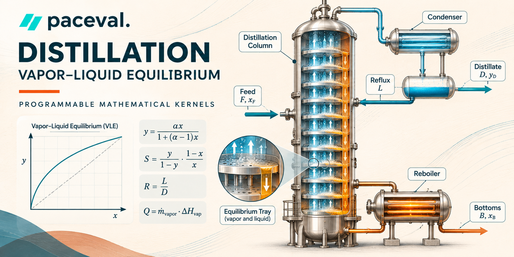

# Distillation Column Vapor-Liquid Equilibrium Kernels with paceval



*Concept illustration; not a computed research result.*

This executable, English-language research project demonstrates how the original **paceval Mathematical Engine** can evaluate reusable and versioned vapor-liquid equilibrium (VLE), sensitivity, mass-balance, reflux, heat-duty and operating-margin formulas for a binary distillation screening problem. It uses real numerical execution graphs and an independent reference. It is **not** a validated column design, a full MESH simulation or an operational plant controller.

**[Read the scientific whitepaper](paceval_Distillation_VLE_Kernels_Whitepaper_EN.pdf)** · **[C++ source](src/distillation_kernels.cpp)** · **[Execution evidence](results/execution_evidence.json)** · **[Independent validation](results/independent_validation.json)**

## 1. Industrial use case and current state of the art

Distillation separates liquids by repeated contact between rising vapor and descending liquid. Column engineers choose feed location, pressure, reflux ratio, heating and condensation duties, and product purity targets while considering thermodynamic phase equilibrium. Even binary distillation can require repeated calculations when composition, temperature, column operating conditions or thermodynamic-model assumptions change.

VLE describes the liquid composition $x$ and equilibrium vapor composition $y$ for the more volatile component. A simple constant-relative-volatility expression can illustrate the separation mechanism, but real separation calculations depend on temperature-dependent pure-component vapor pressures and sometimes non-ideal liquid activity coefficients. Established commercial and open-source process simulators use property packages and coupled mass, equilibrium, summation and enthalpy (MESH) equations. DWSIM documents Raoult, Wilson, NRTL and other methods, while recent research treats uncertainty and complexity in the thermodynamic models. This demonstrator deliberately isolates the repeated mathematical expression layer that paceval can execute, rather than replacing an industrial thermodynamic property system or a rigorous column solver.

The illustrative chemical pair is **benzene/toluene**. The vapor-pressure relations use published NIST Antoine coefficients in their common temperature validity interval of **333.4 to 373.5 K**. A weak positive Margules parameter $A=0.18$ is a **hypothetical research parameter**, not a fitted property parameter or measured validation of benzene/toluene phase behavior. Heat of vaporization is also a fixed synthetic proxy, not a detailed enthalpy correlation. All input data and column scenarios are synthetic.

## 2. Verified functionality and model versions

**Model v1: constant relative volatility.** At $\alpha=2.6$:

```math
y_1(x)=\frac{\alpha x}{1+(\alpha-1)x}.
```

**Model v2: Antoine pressure plus a hypothetical one-parameter Margules correction.** With $P_i^{sat}$ taken from the NIST Antoine form and liquid activity coefficients $\gamma_A=\exp[A(1-x)^2]$, $\gamma_B=\exp[Ax^2]$:

```math
y_2(x,T)=\frac{x\gamma_A P_A^{sat}(T)}{x\gamma_A P_A^{sat}(T)+(1-x)\gamma_B P_B^{sat}(T)}.
```

The corresponding bubble-pressure expression is $P_{bubble}=x\gamma_A P_A^{sat}+(1-x)\gamma_B P_B^{sat}$. In an isobaric stage-screening example, the host finds each bubble-point temperature by bisection on a **paceval** bubble-pressure graph at **0.60 bar**. Version v1 uses this same temperature profile only as a common visual context. Its constant-volatility equilibrium model is a separate shortcut and is **not** a temperature-dependent thermodynamic closure.

The original four proposed formulas, the temperature-dependent vapor fractions, analytical derivatives, a robust separation-factor representation, component and overall material balances, operating lines, heat-duty proxies and composite logical guards are all included. The process stream calculations are explicitly chained: the output of one paceval graph becomes the input of the next. No native precalculation of the reported process-stream values is hidden inside the production path.

| Mathematical function and industrial purpose | Actual execution | Graph/version or rationale |
|---|---|---|
| Binary VLE vapor fraction and enrichment | paceval | v1 fixed $\alpha$; v2 Antoine/Margules |
| Pure-component vapor pressures, activity factors, bubble-pressure residual | paceval | v2 and shared physical diagnostic |
| Composition and temperature sensitivities | paceval | Explicit, independently checked formula graphs |
| Distillate, bottoms and total/component balances | paceval | Both versions, chained outputs |
| Reflux liquid and vapor flow, idealized operating lines | paceval | Both versions |
| Reboiler/condenser duty proxies, energy and purity margins | paceval | Both versions |
| Composite 0/1 decision indicators and mathematical scores | paceval | Both versions |
| Isobaric bubble-temperature root finder | C++ host calling paceval | Iterative solver orchestration |
| Simplified McCabe-Thiele stage stepping | C++ host using paceval VLE table | Stateful stage iteration and interpolation |
| CSV schema validation and result recording | C++ host and paceval conversions | Controlled I/O, not thermodynamic mathematics |
| Independent reference and high-precision tests | Native C++ and Python | Validation only, not the published execution path |

### Important scope of the stage calculation

The stagewise illustration assumes a total condenser, saturated-liquid feed, constant molar overflow and ideal equilibrium stages. Rectifying and stripping operating lines are assembled from a material-balanced product split, and stage stepping uses the cached isobaric paceval VLE curve. This is **McCabe-Thiele-style screening only**. It does not calculate tray hydraulics, feed enthalpy, energy conservation at each actual tray, rigorous mass-transfer efficiencies, reboiler material hold-up or a fully solved MESH network.

## 3. Verified numerical experiment

The [machine-readable execution evidence](results/execution_evidence.json) is generated by the executable. The archived full-scale run used 250,000 synthetic input pairs per model, giving 500,000 versioned model-point evaluations, together with 3,000 column screening configurations. The whole run executed **73 distinct paceval graphs**, consisting of **63 domain and decision graphs** recorded in the formula registry and **10 additional SDK operator/layout self-test graphs**; it produced **17,804,053 graph-point outputs** and completed **7,003,000 native mathematical reference checks**. The numerical validity of all 3,000 material-balanced configuration outputs and selected bubble-temperature root solutions has also been independently tested.

Model v1 yielded a mean predicted vapor benzene fraction of **0.660240**, and model v2 **0.665443**, on the same synthetic input set. These are comparisons of explicitly different mathematical models, not measured separation performance or evidence that the hypothetical v2 correction is more physically accurate. All 3,000 selected column scenarios produced a finite idealized stage count under the selected conditions; this is **not** evidence of industrial viability.

The independent Python audit uses **80 decimal digits** for selected VLE outputs and independently solves isobaric bubble temperatures with a separate numerical algorithm. Detailed numerical differences are confined to technical result files, not this public summary.

## 4. Scientific result figures

The following figures are generated from recorded outputs of the original paceval SDK. They are not illustrations from a model-only plotting program.

| Phase equilibrium | Column consequences |
|---|---|
| [Isobaric VLE](figures/01_isobaric_vle.png) | [Heat duty versus reflux](figures/07_heat_duty_reflux.png) |
| [Bubble-point temperature](figures/02_bubble_temperature.png) | [Idealized stage distribution](figures/08_stage_count_distribution.png) |
| [Relative volatility](figures/03_relative_volatility.png) | [Stages versus reflux](figures/09_stage_count_reflux.png) |
| [3D VLE surface](figures/04_vle_surface.png) | [Heat-duty constraint margin](figures/10_heat_margin.png) |
| [Composition sensitivity](figures/05_vle_composition_sensitivity.png) | [Combined guards](figures/11_guard_decisions.png) |
| [Vapor enrichment](figures/06_vapor_enrichment.png) | [Material-balanced stream split](figures/12_mass_balance.png) |

The diagrams are also provided as vector PDF files under `figures/` for scientific publishing. See [model assumptions](docs/MODEL_ASSUMPTIONS.md) for equations, units, validity, and known limitations.

## 5. Build and reproduce

A compatible original Linux paceval shared library is **required externally** and deliberately **not shipped** in the ZIP. Public original SDK interface sources `paceval_main.h` and `paceval_main.cpp` are included under `src/`, retaining their copyright information.

```bash
python3 -m pip install -r src/requirements.txt
cmake -S src -B build -DCMAKE_BUILD_TYPE=Release \
  -DPACEVAL_RUNTIME=/absolute/path/to/libpaceval_linux_sharedLIB.so
cmake --build build -j
ctest --test-dir build --output-on-failure
./build/distillation_kernels --run 250000 1500 ./results
python3 validation/validate_results.py ./results
python3 src/make_figures.py
python3 src/check_archive_markdown.py
```

For a small real-SDK smoke test, execute `./build/distillation_kernels --run 64 16 ./example_results`. The executable generates numeric CSV inputs, **reads them back using `paceval_dConvertStringToFloat`**, evaluates real persistent graphs, and serializes results with `paceval_dConvertFloatToString`. A strict decimal-literal parser rejects formulas or malformed values in numeric CSV fields. Numeric text is not assumed to be bit-exact IEEE-754 archival serialization.

The source tree contains CTest tests for SDK integration, combined operator semantics, CSV conversion, scalar/multi-graph layout, complete chained paths, independent reference validation, publication integrity and archive-wide Markdown mathematics. The GitHub mathematics preflight checks every `.md` file, blocks raw `\(...\)` and `\[...\]` math delimiters outside code, requires separate `$$` lines or `math` fences, rejects the unsupported operator-name macro, checks local image links, and executes deliberate negative regression cases.

For step-by-step reproduction see [docs/REPRODUCIBILITY.md](docs/REPRODUCIBILITY.md). All public artifact metrics must come from archived executable evidence, not from unexecuted plans.

## 6. Scientific limitations and interpretation

The constant-volatility law is a useful screening approximation. The second model uses literature-based pure-component vapor-pressure correlations **but not literature-fitted binary interaction parameters**. It is therefore not a complete validated property package. The chosen Antoine coefficients must not be extrapolated outside the stated overlapping temperature range. The stage count is a simplified theoretical stage screening result. Duty uses a constant latent heat and idealized flow, not the stagewise enthalpy balance. None of these graphs demonstrates process certification, equipment-sizing readiness, operational safety or real-plant deployment.

**No performance, energy-saving, throughput, or unmeasured hardware acceleration comparisons** are reported. The result establishes functionality and numerical feasibility for the stated mathematical expressions using original paceval graph execution.

## 7. External references

- [NIST Chemistry WebBook, benzene Antoine coefficients](https://webbook.nist.gov/cgi/cbook.cgi?ID=C71432&Type=ANTOINE)
- [NIST Chemistry WebBook, toluene Antoine coefficients](https://webbook.nist.gov/cgi/cbook.cgi?ID=C108883&Type=ANTOINE)
- [DWSIM thermodynamic-model selection](https://dwsim.org/tutorials/en/fundamentals/04-choosing-a-thermodynamic-model.html)
- [DWSIM thermodynamic properties and activity-coefficient models](https://dwsim.org/help/main/40-thermodynamic-properties.html)
- [Werner et al., 2025, VLE model multiplicities and rigorous batch distillation](https://www.sciencedirect.com/science/article/pii/S0378381225001359)
- [Kong et al., 2019, McCabe-Thiele-inspired distillation design](https://aiche.onlinelibrary.wiley.com/doi/10.1002/aic.16731)
- [Official paceval Mathematical Engine API](https://paceval.com/api/)

**Publication status:** Independently checked synthetic mathematical research demonstrator, not a production-grade distillation simulator.
