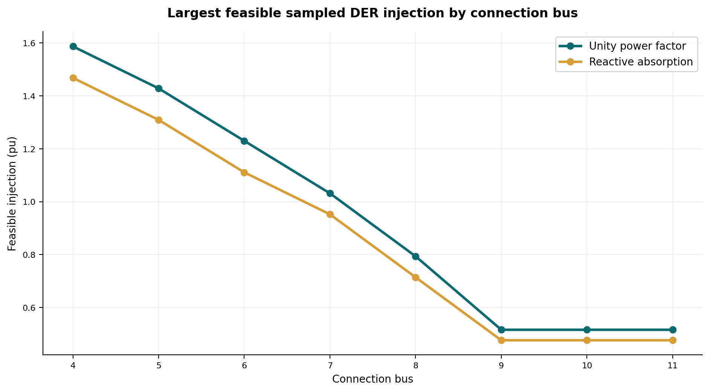
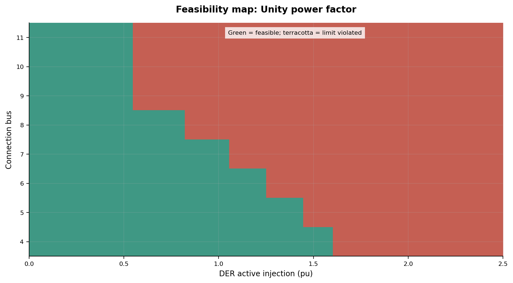

# Distribution Grid Hosting Capacity Constraint Kernels with paceval


*Concept illustration; not a computed research result or a real distribution network.*

**A reproducible C++ research demonstrator using the original paceval Mathematical Engine to calculate the explicit network mathematics and enforce voltage, current, and loss-related constraints around a balanced AC power-flow solver.** The study uses a clearly marked synthetic 12-bus feeder and two controllable inverter modes. It does **not** represent a utility interconnection decision or an official IEEE test feeder.

[English research whitepaper (PDF)](paceval_Distribution_Grid_Hosting_Capacity_Whitepaper_EN.pdf) | [Main C++ implementation](src/grid_hosting.cpp) | [Original WP11 research proposal](docs/original_WP11_proposal.pdf) | [Execution evidence](results/execution_evidence.json) | [Independent audit](results/independent_validation_audit.json)

## 1. Industrial use case and current state of the art

Distribution-system operators must decide where photovoltaic (PV) plants, storage systems and other distributed energy resources can inject power without violating branch thermal ratings or local voltage limits. An assessment must depend on **the candidate connection bus**, active and reactive injections, background consumption, network topology and the specified planning criteria. The result is not a single fixed rating for an entire distribution network.

The present industry practice uses network-model-based AC power flow and often time-series simulations, with extensions to volt-var/volt-watt inverter strategies, network reconfiguration and protection checks. The [US Department of Energy integrated distribution planning](https://www.energy.gov/oe/integrated-distribution-system-planning) guidance establishes the planning context. A [2026 hosting-capacity assessment with reactive power and reconfiguration](https://doi.org/10.3390/electronics15091867) discusses voltage and thermal limits together. A [2026 topology-aware hosting capacity study](https://www.mdpi.com/2673-4826/7/3/78) emphasizes testing the feasible intervals rather than presuming global monotonicity; [2025 Lawrence Berkeley National Laboratory research](https://eta.lbl.gov/publications/bridging-gap-data-and-analysis) identifies the data needed for auditable distribution planning.

This demonstrator examines a narrow but useful research hypothesis: **a host-controlled physical AC solver can supply its intermediate results to persistent, versioned paceval graphs for the mathematical constraint and decision layer**, while the same paceval engine can evaluate the algebraic current and voltage updates used inside the solver.

## 2. Verified research scope and outcomes

The original local paceval SDK 4.25 and compatible Linux shared library were used for the recorded calculations. This release includes **29 successfully created and executed graphs**, the synthetic **12-bus radial feeder**, **8 candidate DER connection buses**, **64 discrete injection levels** from 0 to 2.5 per-unit per site and **2 inverter control modes**. That produces **1,024 evaluated scenarios**; all AC load-flow runs converged. Of these, **384** met the selected voltage and branch-current limits and **640** violated at least one limit. The recorded main calculation includes **783,596 graph-point evaluations**. These are counts of mathematical outputs, not timing or performance claims.

Independent verification includes C++ KCL, branch-voltage and metric assertions; a fully independent Python complex AC formulation across all 1,024 cases; **32 selected nonlinear nodal equation solves using SciPy**; and **512 selected 80-digit reference checks**. The detailed numerical audit (including tolerances and residuals) remains in [independent_validation_audit.json](results/independent_validation_audit.json) rather than in this public discussion.

The two simultaneously accessible control models are **unity power factor** (`Q_DER = 0`) and **fixed proportional reactive absorption** (`Q_DER = -0.25 P_DER`, with positive demand as the sign convention). The second mode is a deliberately simplified synthetic control profile, not an implemented voltage-dependent IEEE 1547 Volt-VAR characteristic. Under these assumptions, reactive absorption may worsen branch current limits even when it mitigates some local overvoltage.

## 3. Mathematical model, units, and application assumptions

The feeder is balanced, single-phase-equivalent, radial and represented in per-unit. Bus 0 is a fixed 1.0 + j0 slack source. Each of the other 11 buses has a constant net complex power `S = (P_load - P_DER) + j(Q_load - Q_DER)`. Positive P and Q represent consumption, and export reduces net demand. For every branch `(parent, child)` the iteration evaluates:

$$
I_{\mathrm{inj},i}=\overline{S_i/V_i}, \qquad
I_{ij}=I_{\mathrm{inj},j}+\sum_{k\in\mathrm{children}(j)}I_{jk},
$$

$$
V_j=V_i-(R_{ij}+\mathrm{j}X_{ij})I_{ij},\qquad
P_{\mathrm{loss},ij}=R_{ij}|I_{ij}|^2.
$$

C++ orchestrates the backward/forward topology and convergence checks. **The current and voltage-update algebra is evaluated by paceval**, as are voltage and current magnitudes, real/reactive line losses and all mathematical constraint expressions.

The main operating margins are:

$$
m_{V,i}=\min\big(|V_i|-V_{\min},V_{\max}-|V_i|\big),\qquad
m_{I,ij}=I_{\max,ij}-|I_{ij}|.
$$

A scenario is **feasible** exactly when all evaluated bus/branch constraints pass. The model uses `V_min = 0.95 pu`, `V_max = 1.05 pu`, and **synthetic branch ratings and impedances**, all archived in [network_branches.csv](results/network_branches.csv). The returned hosting value is the **largest feasible tested discrete injection** in the documented 0-to-2.5-pu sweep. It is not necessarily a continuous optimum, and there is no assumed globally monotonic feasibility transition.

The linearized voltage-drop proxy from the proposal, `dV ≈ (R P + X Q) / Vref`, is also executed as a distinct graph. It is **not** misrepresented as the nonlinear AC voltage solution. Formula versions v1/v2 of the explicit branch violation penalty remain accessible independently.

## 4. Actual paceval execution ownership

| Mathematical function / industrial purpose | Actual implementation | Graph or rationale |
|---|---|---|
| PV reactive setpoint and net complex demand | paceval | `der_q_unity`, `der_q_absorb`, `net_p`, `net_q` |
| Complex injection current, real and imaginary | paceval | `injection_current_real`, `injection_current_imag` |
| Complex branch voltage update | paceval | `ohmic_voltage_real`, `ohmic_voltage_imag` |
| Bus and branch magnitudes, P and Q flows | paceval | `bus_voltage_magnitude`, `branch_current_magnitude`, `line_active_power`, `line_reactive_power` |
| Real and reactive branch loss | paceval | `real_line_loss`, `reactive_line_loss` |
| Voltage-drop proxy and local fixed-voltage sensitivities | paceval | `linear_voltage_drop_proxy`, `voltage_sensitivity_approx_P`, `voltage_sensitivity_approx_Q` |
| Voltage and thermal margins, utilization | paceval | `low_voltage_margin`, `high_voltage_margin`, `voltage_margin`, `current_margin`, `thermal_utilization`, `normalized_voltage_margin`, `current_limit_ratio` |
| Combined logical pass/fail and penalties | paceval | `branch_feasible`, `branch_violated`, `branch_penalty_v1`, `branch_penalty_v2`, `branch_quality_score` |
| Parent/child aggregation, iterative convergence and final case classification | C++ host | Topology-dependent orchestration; independently checked |
| Numerical parsing and formatting of CSV scientific values | original paceval SDK | `paceval_dConvertStringToFloat`, `paceval_dConvertFloatToString` |
| Independently computed AC and mathematical references | Python/NumPy/SciPy/mpmath and C++ | Validation only, not substituted for productive paceval results |

The [full mathematical execution inventory](results/math_execution_inventory.csv) and [formula registry](results/formula_registry.csv) identify the 29 actual expressions, not merely proposed ones. The core batches use the original `paceval_dGetMultipleComputationsResultsExt` API with runtime-checked per-result errors and a separate scalar layout test. Reusing graph handles is part of the actual execution. The complete [end-to-end trace](results/end_to_end_trace.csv) records each site's measured model chain and decision. No automatic differentiation, interval certification or MCP service usage is claimed.

## 5. Numerical data, analyses, and reproducible visualizations

All scenario rows, network parameters, formula IDs, and calculated hosting margins are stored as CSV/JSON in [`results/`](results/scenario_results.csv). Important results include [hosting_capacity.csv](results/hosting_capacity.csv), [scenario_results.csv](results/scenario_results.csv), [branch_samples.csv](results/branch_samples.csv), and [end_to_end_trace.csv](results/end_to_end_trace.csv). The strict CSV pipeline generates text with `paceval_dConvertFloatToString`, reads the active-power text back using `paceval_dConvertStringToFloat`, and rejects mathematical expression strings in ordinary numeric columns before invoking paceval.

The following images are created by [src/make_figures.py](src/make_figures.py) **from recorded paceval result files**. The only conceptual visualization is [figure 01](figures/01_execution_architecture.png), which is labeled as such, and the independent title artwork.

[Feeder topology](figures/02_feeder_topology.png) · [Hosting by bus](figures/03_discrete_hosting_by_site.png) · [Feasibility map](figures/04_feasibility_unity.png) · [Reactive-control map](figures/05_feasibility_reactive.png) · [Voltage response](figures/06_maximum_bus_voltage.png) · [Thermal margin](figures/07_thermal_margin_vs_export.png) · [Line losses](figures/08_grid_losses_vs_der.png) · [3D voltage surface](figures/09_three_dimensional_voltage_surface.png) · [Versioned score](figures/10_versioned_penalty_functions.png) · [Voltage profile](figures/11_bus_voltage_profile.png) · [Branch utilization](figures/12_branch_current_utilization.png) · [Feasible share](figures/13_feasible_share_by_bus.png) · [Reactive effect](figures/14_reactive_control_impact.png) · [Violating branches](figures/15_constraint_violation_count.png).



*Largest feasible tested injection, not a global optimum or real grid approval.*



*Model-computed constraint result for the unity-power-factor configuration.*

## 6. Build and reproduce

Prerequisites: Linux x86-64, C++17, CMake >=3.16, Python 3 with NumPy, SciPy, mpmath, Matplotlib, Pandas and ReportLab, and **a separately obtained, compatible original paceval Linux shared library**. The project includes the original `paceval_main.h` and `paceval_main.cpp` with their license notices, but does **not** redistribute the external shared object.

```bash
cmake -S src -B build -DCMAKE_BUILD_TYPE=Release \
  -DPACEVAL_RUNTIME=/absolute/path/to/libpaceval_linux_sharedLIB.so
cmake --build build -j
ctest --test-dir build --output-on-failure

# Recompute the full 1,024-scenario study in a new directory:
./build/grid_hosting --run --steps 64 --out results/reproduced
python3 validation/verify_reference.py results/reproduced
python3 src/make_figures.py --results results/reproduced --figures figures
```

To regenerate the PDF with layout checks, see [src/make_whitepaper.py](src/make_whitepaper.py) and [the existing released PDF](paceval_Distribution_Grid_Hosting_Capacity_Whitepaper_EN.pdf). Audit tests run via CTest and the independent Python reference checker. To validate the repository checksum list: `python3 src/verify_manifest.py`.

## 7. Technical limitations and interpretation

All data are synthetic. The study contains a balanced constant-power radial feeder with a fixed slack voltage and simple controlled DER power factors, not a field-calibrated three-phase feeder. It does not cover full IEC/IEEE interconnection compliance, voltage regulators, time-dependent weather and consumption, harmonics, dynamic inverter response, fault currents, feeder protection, network reconfiguration or N-1 security. Sensitivity graphs for the approximate local voltage-drop formula are **not** sensitivities of the full nonlinear power-flow equations.

The physical host power flow and the mathematical paceval execution are different layers, both independently checked. An external reference calculation supports numerical consistency under the modeled assumptions. No claims of industrial approval, certified interval guarantees, speed advantages or measured hardware acceleration are made. A future FPGA/ASIC execution graph is a technical perspective, not an executed benchmark.

## 8. References

- [US DOE: Integrated Distribution System Planning](https://www.energy.gov/oe/integrated-distribution-system-planning)
- [2025 LBNL: Distribution planning data and analysis](https://eta.lbl.gov/publications/bridging-gap-data-and-analysis)
- [2026: Hosting capacity considering inverter VAR and network reconfiguration](https://doi.org/10.3390/electronics15091867)
- [2026: Topology-aware PV hosting capacity with smart inverter controls](https://www.mdpi.com/2673-4826/7/3/78)
- [2026: From droop to optimality in volt/VAR control](https://doi.org/10.1016/j.segan.2026.102379)
- [paceval API](https://paceval.com/api/) and [paceval Product Brief](https://paceval.com/product-brief/)
