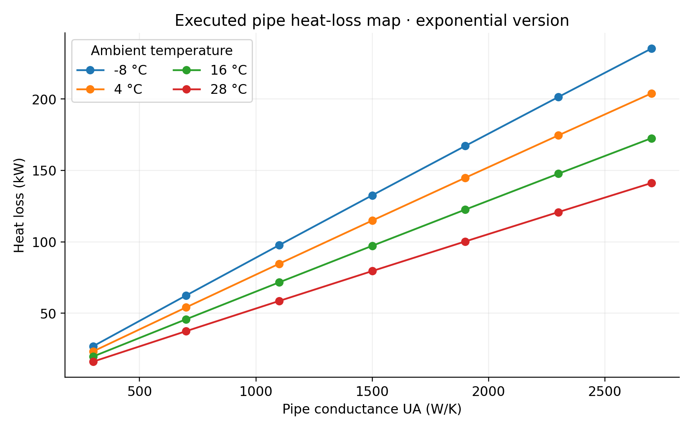
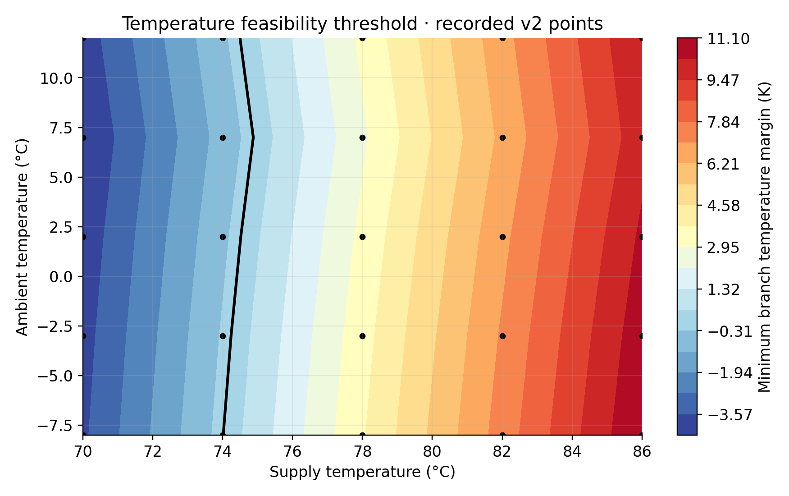
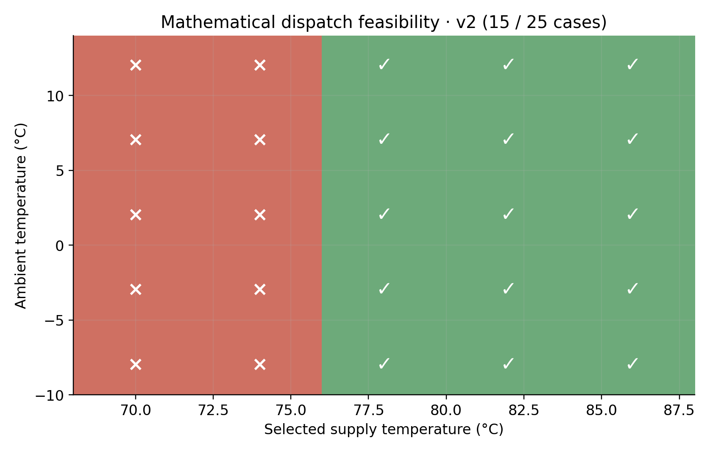
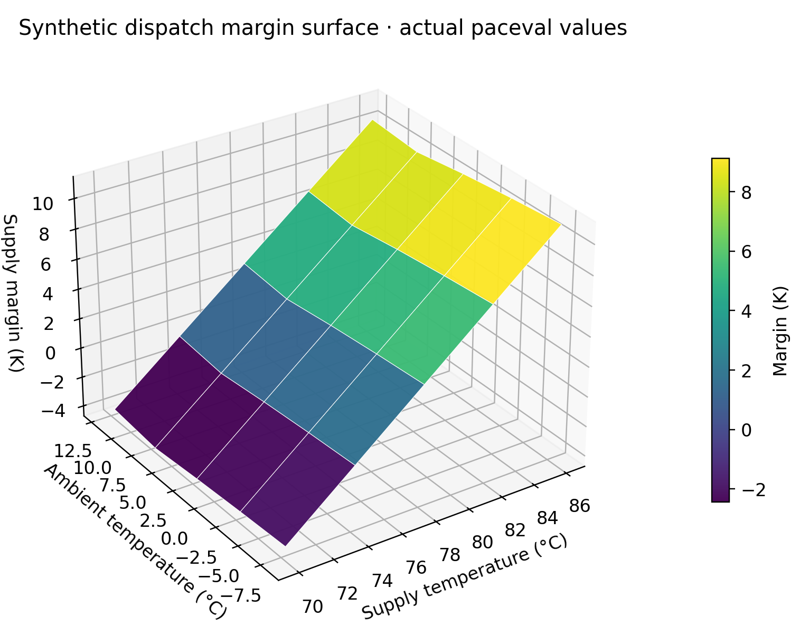

# Programmable District Heating Thermal Loss and Dispatch Maps with paceval


*Concept illustration; not a computed research result.*

**Scientific mathematical functionality demonstrator | WP 13 | 14 November 2026**

The project demonstrates actual, reusable mathematical execution of single-pipe and three-edge district-heating network models through the original paceval Mathematical Engine. The study contains independently verified synthetic heat-network scenarios, two distinct thermal model versions, interpretable constraints, reproducible research graphics, an original SDK C++ application and independent numerical references. The remotely executed paceval service reports **version 4.26**; an original local SDK 4.25 source bridge is provided as a separately identified, not-yet-executed runtime path.

**[Download/read the English 14-page scientific whitepaper](paceval_District_Heating_Thermal_Dispatch_Whitepaper_EN.pdf).**

## 1. Industrial use case and current state of the art

District heating transports thermal energy from centralized production through insulated water pipes to buildings. A district operator must coordinate supply temperature and flow with weather-dependent consumer demand. A poorly selected operating point can fail to deliver sufficiently hot water to the most distant consumer, while a higher supply temperature influences pipe heat loss and hydraulic requirements. Engineers often need to explore alternative source temperatures, pipe conductances, ambient conditions and consumer heat loads.

This demonstrator uses a **hypothetical three-edge radial network** comprising one main trunk and two customer branches. Prescribed water mass flows enter the trunk, divide into branch A and branch B, and deliver heat at two consumers. The network is explicitly synthetic. There is no surveyed location, measured SCADA data, calibrated pipe section or validated control recommendation.

Modern network tools such as **DHNx**, **pandapipes**, **HeatNetSim**, and **DistrictHeatingSim** calculate thermohydraulic quantities, often within GIS, optimization and heat-source modeling workflows. A 2024 review compares relevant network simulation tools, a 2025 study incorporates thermal propagation delay, and 2026 research extends the study of dynamic temperature transfer and integrated source-network-load optimization. This paceval experiment does not replace those established network solvers. It examines an embeddable, programmable mathematical layer for reused calculations and version-controlled decision expressions. References are provided below.

The end-to-end calculation is: validated source, weather, mass-flow and pipe inputs → **paceval** pipe-temperature and pressure functions → **paceval** complete trunk/branch heat delivery, losses and constraints → C++ selection of feasible synthetic operating candidates → archived result tables and scientific diagrams.

## 2. Scientific question and scope

Can the original paceval engine register two well-defined thermal pipe models, reuse their handles over a parameter grid, and evaluate composed whole-network thermal and hydraulic decision functions without routing the actual output mathematics through native C++? The main demonstration is functional: explicit mathematical definitions, real remote execution and independent checks. The purpose is **not** a speed, energy, cost or accuracy contest between computing engines.

The model assumes steady-state thermal transport; fixed water heat capacity, density and pipe conductances; positive mass flow; prescribed branch mass flows; fixed return temperature; Darcy friction factors supplied as inputs; and a simplified pump path head. It excludes hydraulic flow solving, heat exchanger control, transient temperature fronts, variable insulation properties, pressure-minor-loss elements, return-pipe heat loss and power-plant capacity constraints. No supervisory control actuation is included.

## 3. Mathematical formulation and two model versions

For a pipe section with positive mass flow $m$, heat capacity $c_p$, total thermal conductance $UA$, inlet temperature $T_{in}$ and ambient temperature $T_{amb}$, define:

```math
h = \frac{UA}{m c_p}.
```

A midpoint-lumped **v1** thermal model and a distributed steady-state **v2** model are explicitly registered in paceval:

```math
T_{out,v1}=T_{in}-(T_{in}-T_{amb})\frac{h}{1+h/2},
```

```math
T_{out,v2}=T_{amb}+(T_{in}-T_{amb})e^{-h}.
```

The corresponding heat delivery, thermal pipe losses, water velocity and Darcy pressure loss are:

```math
Q_{delivered}=m c_p(T_{out}-T_{return}), \qquad
Q_{loss}=m c_p(T_{in}-T_{out}),
```

```math
u=\frac{4m}{\rho\pi D^2}, \qquad
\Delta p=f\frac{L}{D}\frac{\rho u^2}{2}.
```

The network source flow is the sum of the two branch flows. The composed graph calculates trunk temperature, both branch temperatures, useful thermal power at both customers, loss along three pipes, pressure head and a conservative pump-power proxy. The mathematical feasibility rule combines **all three** conditions: minimum customer temperature, delivered heat above required heat and pump-power proxy below a supplied bound.

```math
M_T=\min(T_{A,out},T_{B,out})-T_{min},
```

```math
M_Q=(Q_A+Q_B)-Q_{required},
```

```math
\mathrm{Guard}=(M_T\ge 0)\;\mathrm{AND}\;(M_Q\ge 0)\;\mathrm{AND}\;(P_{pump}\le P_{limit}).
```

The actual parser uses **infix** `min`/`max` and explicitly parenthesized relational/logical operations. Expressions are not interpreted using Python syntax. The `v1` model is restricted to the small-loss domain defined in the C++ validation function. A model version difference is not a claim of superior numerical engine precision.

## 4. Which mathematics was genuinely executed by paceval?

The C++ application stores stable formulas in [src/formula_manifest.json](src/formula_manifest.json), regenerates the exact C++ formula table through [src/generate_formulas.py](src/generate_formulas.py), creates original paceval computation objects once, and reuses them in scalar, single-graph batch, and multi-graph batch paths. The following mathematical families were executed on the **real remote paceval MCP** service; the corresponding local SDK path is implemented but not executed in this package.

| Mathematical function / industrial purpose | Actual implementation | Graph family / version or responsibility |
|---|---|---|
| Exponential and midpoint-lumped pipe temperatures | paceval | `edge: outlet_v1`, `outlet_v2` |
| Pipe loss, delivery, velocity and pressure | paceval | `edge: heat_loss_*`, `heat_delivery_*`, `velocity`, `pressure_drop` |
| Pressure, thermal and delivery guards | paceval | `edge: *margin*`, `guard_v1`, `guard_v2` |
| Physical sensitivity to thermal conductance, flow and ambient | paceval | `edge: sensitivity_outlet_*_v2` |
| Composed trunk and branch temperatures, including both versions | paceval | `network: trunk_out_*`, `branchA_out_*`, `branchB_out_*` |
| Total delivery, network losses and explicit heat balance | paceval | `network: delivered_total_*`, `loss_total_*`, `heat_balance_*` |
| Combined dispatch scores and binary feasibility | paceval | `network: dispatch_score_v2`, `guard_v1`, `guard_v2` |
| Candidate enumeration, input safety, CSV processing, lifecycle | C++ host | Orchestration; not misattributed as graph mathematics |
| High-precision physical and algebraic reference calculations | independent Python / C++ | Verification only, not source of published paceval output |

The full mapping is recorded under [results/math_execution_inventory.csv](results/math_execution_inventory.csv); API handles, exact input dimensions and known verification boundaries are in [results/execution_evidence.json](results/execution_evidence.json).

## 5. Executed research results and meaningful operating scenarios

The real service reported version 4.26 and returned no calculation errors in the 49-pipe-case and 25-network-case multi-graph experiments. There are **22 separate pipe graphs** reused across 49 cases and **25 separate whole-network graphs** reused across 25 cases. These represent **1,078** and **625** executed graph-point combinations respectively, not independent physical experiments or production workloads.

On the stated synthetic network: ambient temperatures are −8, −3, 2, 7 and 12 °C; source supply choices are 70, 74, 78, 82 and 86 °C; the stipulated minimum delivered supply temperature is 68 °C. **15 of the 25** candidate combinations satisfy all three model guards. The other **10** do not. These constraints are hypothetical, not normative or plant-validated.

For the candidate with ambient −8 °C and source supply 78 °C, the v2 model calculates a cooler customer branch temperature of approximately **71.69 °C**, delivered customer heat of **2,315.95 kW**, and aggregate pipe heat loss of **407.73 kW**. These are mathematically verified outputs for the synthetic inputs, not field measurements.

An additional deliberately narrow boundary probe with −3 °C ambient, 74 °C source supply and a **67.777 °C** test threshold yields a negative temperature margin in v1 and a positive one in v2. Both formula versions therefore produce different logical guards at this special probe. This is an artificial numerical discriminating test and not a real dispatch safety margin.

The independently coded 90-digit [reference verifier](validation/high_precision_reference.py) passed **547 archived ordinary value checks**. Six additional paceval interval-enabled point evaluations were checked against the independent pointwise mathematical reference. Passing finite pointwise intervals does not demonstrate a global interval enclosure for uncertain input ranges.

**Evidence qualification:** The archived CSVs contain selected values returned in actual MCP result messages, rounded as decimal research tables. They are *not* claimed to be full raw MCP JSON responses, bitwise IEEE-754 archives or output from the unexecuted local SDK. Run provenance is carefully separated in the evidence JSON.

## 6. Scientific figures

The figures below and their vector PDFs are generated by [scripts/make_figures.py](scripts/make_figures.py) from recorded actual paceval results, except for the intentionally conceptual architecture diagram.



*Figure 2. Pipe loss versus thermal conductance and surrounding temperature, based on 49 executed paceval cases.*



*Figure 5. Most restrictive customer supply-temperature margin for the 25 executed network cases.*



*Figure 6. Green indicates mathematically accepted operating points under the specified synthetic constraints.*



*Figure 10. Three-dimensional rendering of actual recorded paceval output points. Interpolation between points is illustrative.*

Additional scientific graphics include [pipe outlet temperature](figures/03_pipe_outlet_map.png), [model-version temperature difference](figures/04_pipe_model_versions.png), [delivered heat versus demand](figures/07_delivered_vs_demand.png), [heat loss fraction](figures/08_network_loss_fraction.png), [pump-power proxy](figures/10_hydraulic_proxy.png) and [composed delivered-heat version difference](figures/11_delivery_version_delta.png). All graphics have equivalent vector PDF files inside `figures/`.

## 7. Reproduce and test

The actual input CSVs are in [examples](examples/CSV_SCHEMA.md). The [C++ main program](src/district_heating_paceval.cpp) uses [the original SDK header](src/paceval_main.h) and [the original bridge source](src/paceval_main.cpp) without a rewritten numerical engine. The SDK bridge retains its original upstream notices. An ABI-compatible local Linux x86-64 library is required separately; **it is not included in the archive**. Please review upstream licensing obligations before making a public derivative distribution.

```bash
python3 validation/high_precision_reference.py
python3 scripts/make_figures.py
python3 src/check_readme_math.py
bash scripts/build_and_test.sh /absolute/path/to/libpaceval_linux_sharedLIB.so
```

The last command is intentionally not reported as executed. It configures CMake in `src/`, builds and links the original SDK bridge, and runs the available CTest suite when a compatible library is provided. In this research environment only the syntax-only C++17 check was possible. The local SDK numerical CSV conversion and operator selftests are implemented but remain unexecuted. Remote operator semantics were independently exercised through the service and saved in the execution audit.

The original SDK `paceval_dConvertStringToFloat` accepts formulas as well as numbers. Therefore all CSV numerical fields are constrained to finite decimal literals before invoking the parser, including tests rejecting `1+2`, `NaN`, invalid exponents and locale-dependent decimal separators. The output path uses `paceval_dConvertFloatToString`; its decimal representation is **not** assumed to round-trip arbitrary binary64 values without loss. The original binary input state would need to be archived separately for a bitwise regulatory audit.

The mathematical model is independently checked for heat-balance invariants and branch-flow conservation. Hydraulic routing, pump control, flow reversal, supply/return transients and real consumer-load forecasting require specialized future work. No real operational, safety or regulatory approval is implied.

## 8. Documentation and research references

Further details and reproducibility boundaries are in [RESEARCH_VALIDATION.md](RESEARCH_VALIDATION.md) and [the execution evidence](results/execution_evidence.json). The original proposed research brief is [archived here](docs/Original_WP13_Proposal.pdf). Selected sources, verified on 14 November 2026:

1. *Design and simulation of district heating networks: A review of modeling approaches and tools*, Energy 305 (2024), 132189, [DOI](https://doi.org/10.1016/j.energy.2024.132189).
2. *A quasi-dynamic model and comprehensive simulation study of district heating networks considering temperature delay*, Energy 318 (2025), 134855, [DOI](https://doi.org/10.1016/j.energy.2025.134855).
3. *A transfer function method for thermal transient modeling in district heating networks*, Energy 351 (2026), 140834, [DOI](https://doi.org/10.1016/j.energy.2026.140834).
4. *Integrated Source-Network-Load Modeling and Optimization for District Heating Systems: Recent Advances and Future Directions*, 2026, [DOI](https://doi.org/10.1155/er/8877364).
5. [DHNx steady-state heat losses and simulation equations](https://dhnx.readthedocs.io/en/v0.0.4/simulation_models.html).
6. [DistrictHeatingSim documentation](https://districtheatingsim.readthedocs.io/en/latest/).
7. [paceval original API reference](https://paceval.com/api/) and [product brief](https://paceval.com/product-brief/).

The project is a deterministic mathematical research demonstrator. It should be considered a component-level investigation, not a substantiation of industrial dispatch savings or network qualification.
