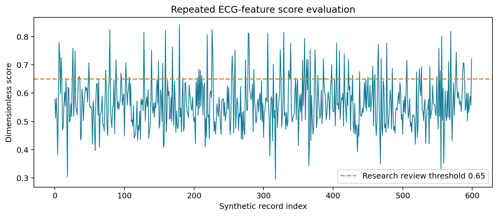
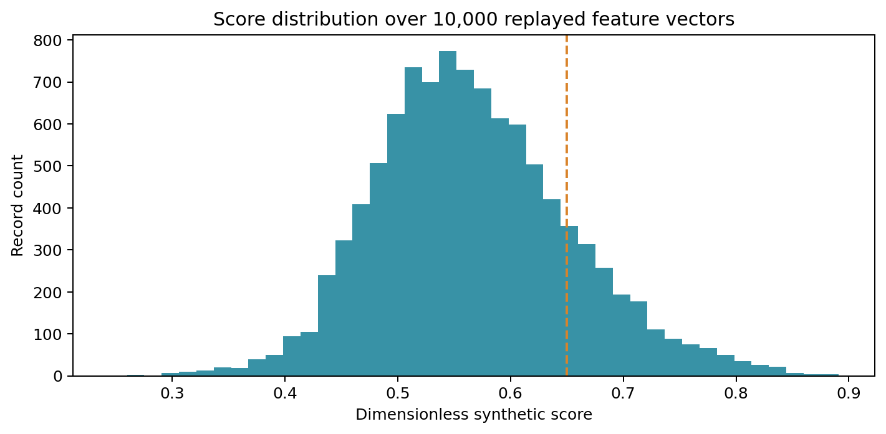
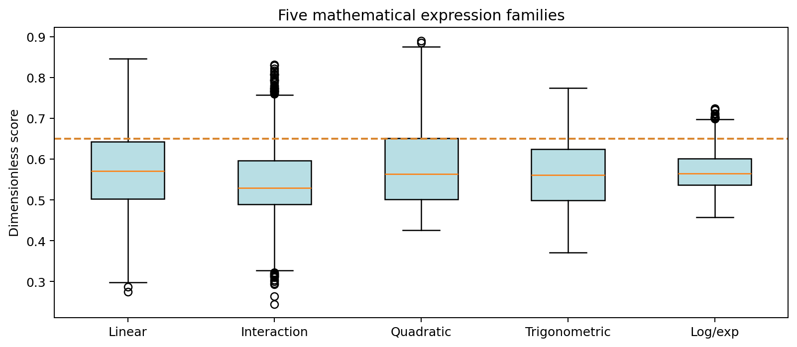
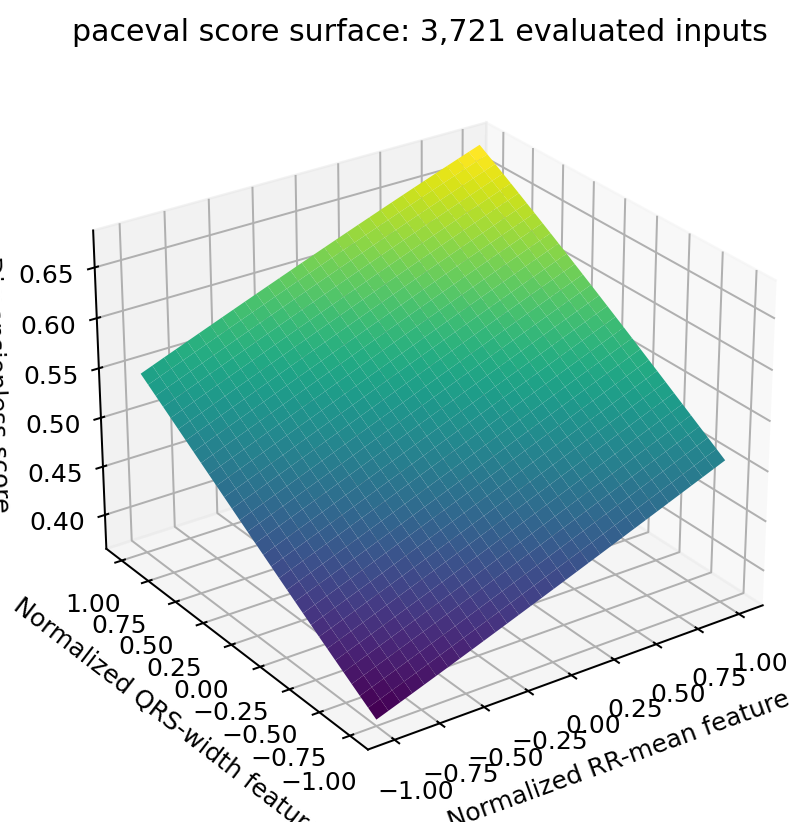
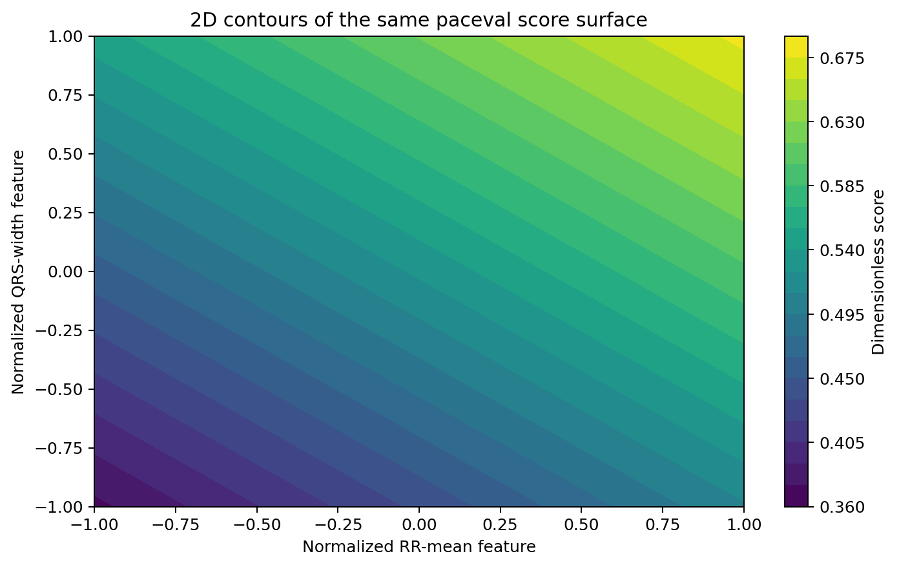
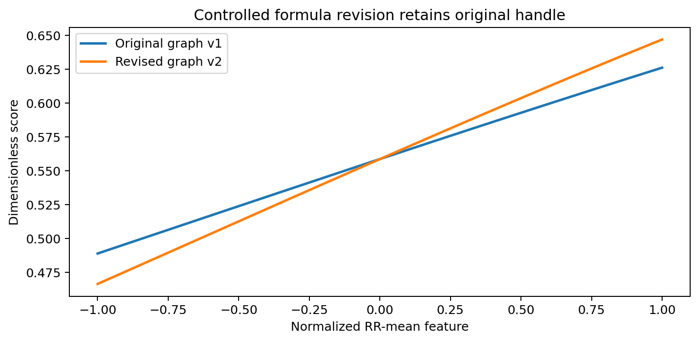
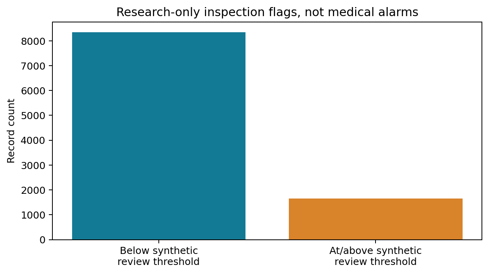
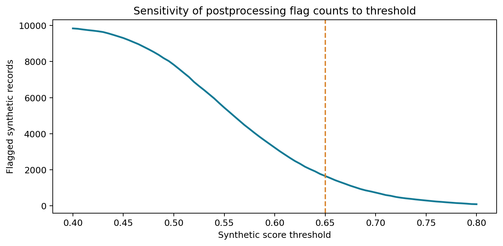

# WP_032 · ECG Feature and Rule Evaluation with paceval


*The cover is a conceptual illustration, not a patient trace or a paceval output. All eight numbered research figures are generated exclusively from the real paceval execution CSV files included in this repository.*

**A reproducible, non-clinical C++ research demonstrator:** 50 explicitly defined ECG-feature-to-score mathematical rules, 51 reusable paceval graph handles including a controlled revision, synthetic feature replay, independent numerical validation and scientific response surfaces.

**[Read the English scientific whitepaper (PDF)](paceval_ECG_Feature_Rule_Evaluation_Whitepaper_EN.pdf)** · [C++ program](src/ecg_rules.cpp) · [CMake build](src/CMakeLists.txt) · [Raw replay CSV](examples/feature_replay.csv)

## 1. Industrial use case and current state of the art

Research ECG-analysis applications typically separate waveform acquisition and preprocessing from measurement extraction and downstream interpretation. For instance, a software pipeline may identify beat locations, measure RR intervals and QRS duration, normalize measured features, and then apply several documented postprocessing rules. The rule logic may need to remain interpretable and versioned as experiments or measurement protocols change.

**This project demonstrates the mathematical postprocessing layer, not ECG acquisition or medical interpretation.** It treats previously computed features as inputs, maps them through fifty alternative mathematical expressions, and records scores and synthetic threshold flags. A biomedical software team could use this arrangement as a research architecture for deterministic, separately versioned mathematical rule evaluation.

Current ECG research has credible external reference datasets, including the [PhysioNet MIT-BIH Arrhythmia Database](https://physionet.org/content/mitdb/1.0.0/) (48 annotated half-hour recordings), [PTB-XL](https://physionet.org/content/ptb-xl/) (12-lead ECGs) and [LUDB](https://physionet.org/content/ludb/1.0.1/) (200 ten-second annotated 12-lead records for delineation research). **None of these patient-derived datasets was used in this first demonstrator.** The published data are fully synthetic and cannot support clinical sensitivity, false-alarm or diagnostic claims.

The application workflow is: **synthetic precomputed features → validated normalized variables → reusable paceval calculation graph → dimensionless score → host-managed research flag → CSV and scientific graphics**.

## 2. Defined mathematical functions

The input proposal began with a linear rule using RR mean, RR standard deviation and QRS width. We extend it with four normalized variables:

| Variable | Meaning | Definition | Input domain (synthetic) |
|---|---|---|---|
| `r` | Normalized mean RR | `(RRmean - 800 ms) / 100 ms` | -1 to 1 |
| `d` | Normalized RR spread | `(RRstd - 15 ms) / 20 ms` | 0 to 2 |
| `q` | Normalized QRS width | `(QRSwidth - 90 ms) / 15 ms` | -1 to 1 |
| `a` | Normalized amplitude surrogate | `(amplitude - 1 mV) / 0.2 mV` | -1 to 1 |

The common bounded mathematical transform is:

```math
s = \frac{1}{1+\exp(-z)}
```

Five families supply the intermediate score argument `z`; ten sets of coefficients are used in each family:

```math
\begin{aligned}
z_1 &= \alpha r + \beta d + 0.36q + 0.12a \\
z_2 &= \alpha rd + \beta qa + 0.19d \\
z_3 &= \alpha r^2 + \beta d^2 + 0.22q^2 - 0.30 \\
z_4 &= \alpha\sin(r) + \beta\cos(q) + 0.17da \\
z_5 &= \alpha\ln(1+r^2) + \beta\exp(-d^2) + 0.18qa
\end{aligned}
```

For each family index `f` from zero to four and variant index `j` from zero to nine, the coefficients are explicitly frozen:

```math
\alpha = 0.28 + 0.048j + 0.015f, \qquad \beta = 0.16 + 0.032j.
```

The bounded score is **not** a probability of disease or an ECG diagnostic score. A threshold of `0.65` is only an illustrative software-review policy.

## 3. Exactly what paceval computes

The application builds the original [paceval C/C++ SDK files](src/paceval_main.h) together with [paceval_main.cpp](src/paceval_main.cpp), using the [official API](https://paceval.com/api/). There is **no emulated paceval runtime**.

- `paceval_CreateComputation` constructs one persistent expression graph per formula. The first fifty are immutable; a fifty-first version is added without deleting the original.
- `paceval_dGetComputationResult` evaluates single feature rows repeatedly without reconstructing those graphs.
- `paceval_dGetComputationResultExt` evaluates a graph on arrays of feature rows, using the official batch-input layout.
- Host C++ checks domains, derives illustrative feature units, compares outputs to an independently coded arithmetic implementation, assigns a synthetic threshold flag, and writes result CSV files.

No digital ECG filter, QRS detector, clinical classifier, acquisition device or patient database is implemented by paceval here. Formal bounds using TINC are not claimed.

## 4. Completed research run

| Verifiable property | Completed result |
|---|---:|
| Distinct mathematical formulas | 50 |
| Persistent graphs including formula revision | 51 |
| Synthetic feature records | 10,000 |
| Scalar paceval evaluations | 13,923 |
| Independent batch results | 1,600 |
| Additional 3D response points | 3,721 |
| Independently checked 80-digit reference values | 500 / 500 passed |
| Research-only threshold flags | 1,658 |
| CMake/CTest integration test | 1 / 1 passed |

The external numerical checks and implementation-level differences are recorded in [execution logs](results/sdk_execution.txt) and the [high-precision audit](results/high_precision_audit.json), rather than being presented as accuracy comparisons in the public research story.

## 5. Scientific figures from actual paceval outputs

Every numbered figure is rebuilt by [the figure-generation script](src/make_figures.py) from the included CSV files. For each figure both PNG and vector PDF are supplied.

| Figure | Interpretation | Preview |
|---|---|---|
| 1 | [Synthetic feature replay](figures/01_feature_replay.pdf) |  |
| 2 | [Score distribution](figures/02_score_distribution.pdf) |  |
| 3 | [Five expression families](figures/03_rule_families.pdf) |  |
| 4 | [3D score response surface](figures/04_score_surface_3d.pdf) |  |
| 5 | [Score contour map](figures/05_score_contours.pdf) |  |
| 6 | [Immutable formula revisions](figures/06_formula_versions.pdf) |  |
| 7 | [Research threshold flags](figures/07_rule_flags.pdf) |  |
| 8 | [Threshold sensitivity](figures/08_threshold_sweep.pdf) |  |

## 6. Build, run and reproduce

Prerequisites: Linux x86-64, a C++17 compiler, CMake and a legally obtained compatible original paceval runtime shared library (not bundled). For the Python verification and figures, use `mpmath`, `numpy`, `matplotlib`, `Pillow` and `reportlab`.

Run these commands from the repository root:

```bash
cmake -S src -B build -DCMAKE_BUILD_TYPE=Release \
  -DPACEVAL_RUNTIME=/absolute/path/to/libpaceval_linux_sharedLIB.so
cmake --build build -j
ctest --test-dir build --output-on-failure
./build/ecg_rules --records 10000 --out examples
python3 src/high_precision_reference.py examples
python3 src/make_figures.py
python3 src/make_whitepaper.py
python3 src/check_readme_math.py
```

The source implementation is [src/ecg_rules.cpp](src/ecg_rules.cpp); [src/CMakeLists.txt](src/CMakeLists.txt) is deliberately inside `src/`.

The generated data files are [feature_replay.csv](examples/feature_replay.csv), [formula_registry.csv](examples/formula_registry.csv), [ecg_score_surface.csv](examples/ecg_score_surface.csv), [formula_version_surface.csv](examples/formula_version_surface.csv) and [execution_summary.txt](examples/execution_summary.txt).

For technical checks see [CTest output](results/ctest_sdk.txt) and [native SDK build log](results/build.log). README link and mathematics preflight is provided in [check_readme_math.py](src/check_readme_math.py), including positive and negative regression tests for invalid math macros and nested delimiters. This preflight does **not** replace a real GitHub rendering inspection.

## 7. Scientific limits and next experiment

These synthetic records contain no patient waveforms and no expert diagnostic labels. The score coefficients were not trained or calibrated, and the flags are not medical alarms. Nothing in the research establishes diagnostic accuracy, patient benefit, clinical safety, real-time device performance, regulatory clearance or suitability for patient-care decisions.

A valid next step would be a separate properly governed study using pre-extracted, independently audited features from a permitted public dataset with appropriate patient-level splitting, quality controls and clinical review. Such a study would keep signal extraction, annotation, clinical evaluation and paceval mathematical execution as explicitly distinct parts of the system.

## References

1. [PhysioNet: MIT-BIH Arrhythmia Database](https://physionet.org/content/mitdb/1.0.0/).
2. [PhysioNet: PTB-XL](https://physionet.org/content/ptb-xl/).
3. [PhysioNet: LUDB](https://physionet.org/content/ludb/1.0.1/).
4. [paceval Mathematical Engine, original C/C++ API](https://paceval.com/api/).
