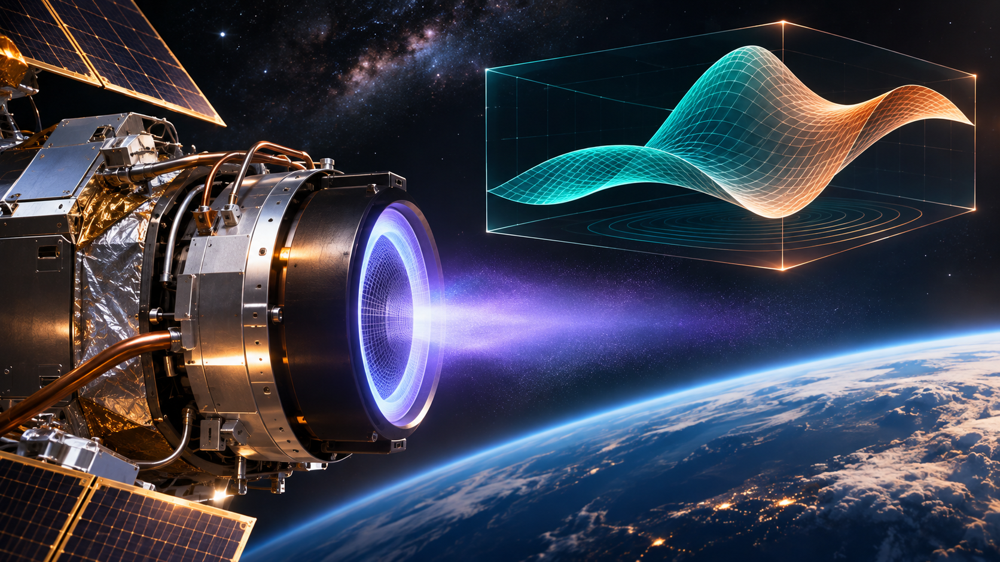
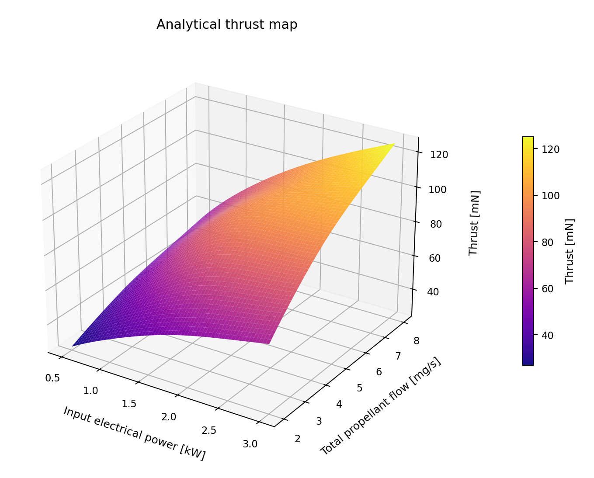
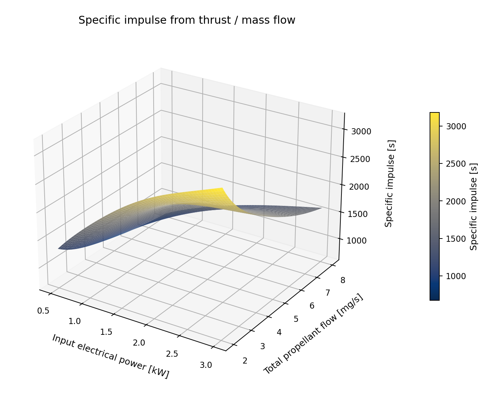

# paceval. | Electric Propulsion Performance Surface Sweeps



**A reproducible scientific C++ demonstrator for evaluating reusable electric-thruster performance functions with the original paceval C/C++ library.** The research project calculates synthetic, physically consistent analytical maps for efficiency, thrust, specific impulse, thrust-to-power ratio and electrical non-jet-power balance. The cover is a conceptual illustration, not a photograph of a tested thruster or a measured numerical result.

**Project evidence:** 51 persistent graphs (50 original expressions plus an immutable revised formula), 10,000 executed synthetic operating points, 28,767 scalar evaluations, 1,600 checked batch results, five full 3,721-point numerical maps and 500 independent 80-digit reference checks. CMake and CTest passed with the supplied external compatible Linux runtime. **No measured engine thrust maps, plasma simulations, spacecraft operations or hardware efficiency tests are claimed.**

[English research whitepaper (PDF)](paceval_Electric_Propulsion_Whitepaper_EN.pdf) · [C++ demonstrator](src/electric_propulsion.cpp) · [CMake configuration](src/CMakeLists.txt) · [Original paceval header](src/paceval_main.h) · [Original paceval facade](src/paceval_main.cpp) · [Reproduction checker](src/verify_results.py)

## 1. Industrial use case and current state of the art

Spacecraft operators use electric propulsion for orbit raising, station keeping and deep-space trajectory correction. A spacecraft propulsion engineering team must characterize a thruster across changes in electrical input power and total propellant mass flow. For each eligible operating point it needs thrust, specific impulse, electrical efficiency, thrust per kilowatt, and a quantitative statement of what is not converted into directed jet power. Typical development relies on vacuum-chamber testing, thrust stands, electrical measurements, mass-flow instrumentation, performance characterization maps, and increasingly surrogate modeling and automated experimental optimization. Such experimental or high-fidelity physics models are not replaced here.

NASA/JPL's *Fundamentals of Electric Propulsion* (second edition, 2025) describes performance definitions and contributions from auxiliary power and cathode flow; a [2026 characterization of a 6-kW-class Hall thruster](https://link.springer.com/article/10.1007/s44205-026-00178-w) defines measured total specific impulse and efficiency. More recent work investigates [thruster-in-the-loop optimization (2025)](https://link.springer.com/article/10.1007/s44205-025-00159-5) and [surrogate modeling (2026)](https://link.springer.com/article/10.1007/s44205-026-00188-8). These sources establish relevant industrial methods, not empirical validation of the synthetic map published here.

In the **hypothetical engineering workflow**, a laboratory-approved model version supplies a function of power and mass flow. A C++ host validates and records the requested operating points, paceval evaluates mathematical computation graphs with new parameters without rebuilding each graph, and the host checks illustrative engineering constraints and exports surfaces for review. No autonomous hardware command or certified thruster performance claim follows from these results.

## 2. Defined mathematical functions and paceval integration

The independent input variables are total electrical power $P$ in watts and **total** propellant mass flow $\dot m$ in kg/s. The CSVs store flow $m$ in mg/s, hence $\dot m=10^{-6}m$. Standard gravity is $g_0=9.80665\,\mathrm{m/s^2}$. The ratio of kinetic jet power to electrical input power is $\eta$, using a simplified effective-exhaust-velocity model:

```math
\eta=\frac{T^2}{2\dot m P},\qquad
T=\sqrt{2\eta P\dot m},\qquad
I_{\mathrm{sp}}=\frac{T}{\dot m g_0}.
```

The **synthetic efficiency surface** is explicitly chosen for testing expression graphs, and is **not fitted to NASA, ESA, or a laboratory Hall-thruster dataset**:

```math
\eta_j(P,m)=b_j+a_j\exp\left[-\left(\frac{P-1700}{900}\right)^2-\left(\frac{m-4.5}{2}\right)^2\right].
```

For each of ten variants $j=0,\ldots,9$, the coefficients are $b_j=0.33+0.005j$ and $a_j=0.17-0.003j$. The fixed research domain is $500\leq P\leq3000\,\mathrm{W}$ and $2\leq m\leq8\,\mathrm{mg/s}$, yielding strictly positive flow, positive power and bounded $0<\eta<1$.

The five registered expression families are: (1) $\eta_j$, (2) $1000\,T_j$ in mN, (3) $I_{\mathrm{sp},j}$ in seconds, (4) $10^6 T_j/P$ in mN/kW, and (5) $P(1-\eta_j)$ in W. The last is the **non-jet-power balance proxy**, *not* a measured thermal load. Each family has ten expressions, and a controlled mathematical revision introduces a separate 51st handle without changing the original.

`paceval_CreateComputation` creates expression handles; `paceval_dGetComputationResult` evaluates scalar inputs; `paceval_dGetComputationResultExt` evaluates packed batch inputs; and `paceval_DeleteComputation` releases handles. The host retains input contracts, deterministic replay generation, result export, numerical audits and any future engineering approval policy. [Architecture graphic](figures/09_execution_architecture.png).

## 3. Executed research workload

| Verified research item | Completed result |
|---|---:|
| Distinct mathematical expressions | 50 |
| Persistent handles including immutable revision | 51 |
| Deterministic synthetic operating points | 10,000 |
| Scalar paceval function evaluations | 28,767 |
| Verified packed batch outputs | 1,600 |
| Full operating-grid samples for each metric | 3,721 |
| Full distinct operating surfaces | 5 |
| Independent 80-digit decimal checks | 500 / 500 passed |
| Invalid host-input tests | 4 / 4 rejected |
| SDK build and CTest | 1 / 1 passed |

The five datasets are related by the physical definitions, and an independent cross-surface identity audit checks thrust, power, total mass flow, specific impulse and efficiency for all 3,721 operating points. A numerical test of the formula graph is **not** a validation of a physical propulsion model against measured hardware.

## 4. Scientific diagrams and raw data

All numbered performance-result figures are rendered from **actual released paceval output CSV files**; the architecture graphic illustrates the implemented software boundaries. The images are available as PNG and vector PDF.

| Figure | Interpretation | Files |
|---|---|---|
| 1 | Efficiency surface across power and mass flow | [PNG](figures/01_efficiency_surface.png) · [PDF](figures/01_efficiency_surface.pdf) |
| 2 | Analytical thrust operating surface | [PNG](figures/02_thrust_surface.png) · [PDF](figures/02_thrust_surface.pdf) |
| 3 | Specific impulse operating surface | [PNG](figures/03_specific_impulse_surface.png) · [PDF](figures/03_specific_impulse_surface.pdf) |
| 4 | Efficiency contour map and operating region | [PNG](figures/04_efficiency_contours.png) · [PDF](figures/04_efficiency_contours.pdf) |
| 5 | Thrust per electrical kilowatt | [PNG](figures/05_thrust_to_power_surface.png) · [PDF](figures/05_thrust_to_power_surface.pdf) |
| 6 | Electrical non-jet-power balance, not measured heat | [PNG](figures/06_nonjet_power_surface.png) · [PDF](figures/06_nonjet_power_surface.pdf) |
| 7 | Operating-point Isp vs thrust/power trade-off | [PNG](figures/07_tradeoff_cross_section.png) · [PDF](figures/07_tradeoff_cross_section.pdf) |
| 8 | Comparison of retained formula versions | [PNG](figures/08_formula_revision.png) · [PDF](figures/08_formula_revision.pdf) |
| 9 | Implemented C++ / paceval architecture | [PNG](figures/09_execution_architecture.png) · [PDF](figures/09_execution_architecture.pdf) |





Data: [rule registry](examples/rule_registry.csv) · [recorded operating points](examples/performance_replay.csv) · [efficiency](examples/efficiency_surface.csv) · [thrust](examples/thrust_surface.csv) · [specific impulse](examples/specific_impulse_surface.csv) · [thrust per power](examples/thrust_to_power_surface.csv) · [non-jet power](examples/waste_power_surface.csv) · [formula revision](examples/formula_revision.csv) · [SDK execution log](examples/sdk_execution.txt).

## 5. Build and reproduce

The project includes the original `paceval_main.h` and `paceval_main.cpp`, preserving their supplied license notices. The ABI-compatible Linux shared library is **external** and is not redistributed in the GitHub package.

```bash
cmake -S src -B build -DCMAKE_BUILD_TYPE=Release \
  -DPACEVAL_RUNTIME=/absolute/path/to/libpaceval_linux_sharedLIB.so
cmake --build build -j
ctest --test-dir build --output-on-failure
./build/electric_propulsion --out reproduced --updates 10000
python3 src/verify_results.py
python3 src/high_precision_reference.py
python3 src/make_figures.py
python3 src/make_whitepaper.py
python3 src/check_readme_math.py
```

**Reproduction note:** The Python scripts use the released `examples/` data. The command with `--out reproduced` writes a fresh comparison run without overwriting the published CSVs. To regenerate all published graphics and audit files, execute the C++ application with `--out examples` first. The C++ executable needs C++17, CMake and the compatible paceval runtime. The figure script needs `numpy`, `pandas`, `matplotlib`; the whitepaper generator needs `reportlab` and `Pillow`.

[Independent decimal audit](results/high_precision_audit.json) · [CTest result](results/ctest_sdk.txt) · [numerical verification source](src/high_precision_reference.py) · [figure generator](src/make_figures.py) · [whitepaper generator](src/make_whitepaper.py) · [math / link / regression checker](src/check_readme_math.py).

## 6. Scientific limitations and industrial interpretation

This is a **mathematical execution feasibility demonstrator**, not a flight-qualified Hall thruster model, an experimental performance calibration, plasma simulation, measured lifetime model, thermal design or spacecraft mission optimizer. Although the fundamental derived-performance identities are physical definitions, the efficiency map and its coefficients are synthetic. The computed performance maps are thus mathematical illustrations of the chosen analytical model, not performance predictions for actual propulsion hardware. The host does not implement a live propulsion controller.

No processing-speed comparison, numerical C++–paceval difference statistic, or claimed industrial acceleration is presented here; detailed independent calculation tests remain reproducible in the bundled technical audit files.

## 7. References

- Goebel and Katz, [*Fundamentals of Electric Propulsion*, second edition, NASA/JPL (2025)](https://descanso.jpl.nasa.gov/SciTechBook/series4/Electric_Propulsion_2nd_edition.pdf).
- Thoreau et al., [Rapid thruster-in-the-loop optimization for Hall thrusters (2025)](https://link.springer.com/article/10.1007/s44205-025-00159-5).
- Thoreau et al., [Surrogate modeling and real-time optimization of propellant mixtures for Hall thrusters (2026)](https://link.springer.com/article/10.1007/s44205-026-00188-8).
- [Characterization of a 6-kW-class Hall-thruster subsystem (2026)](https://link.springer.com/article/10.1007/s44205-026-00178-w).
- [NASA Hall-thruster characterization](https://ntrs.nasa.gov/api/citations/20190001137/downloads/20190001137.pdf).
- [paceval API](https://paceval.com/api/) and [original paceval project](https://github.com/paceval/paceval).
