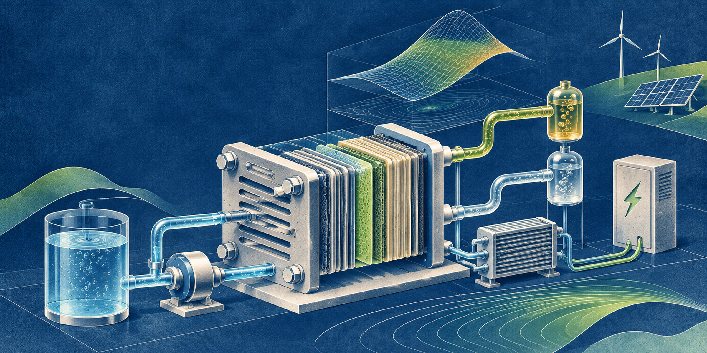
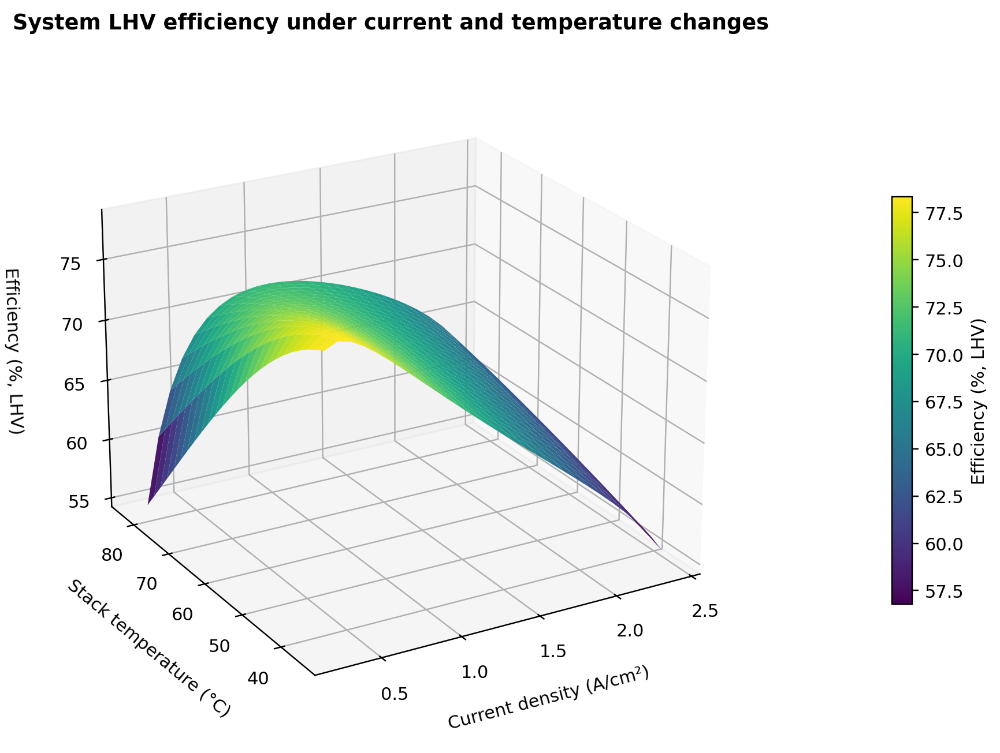

# paceval | Electrolyser Efficiency Surrogate Functions Research



*Concept illustration; not a computed research result.*

**An original paceval SDK research demonstrator for reusable electrochemical, hydrogen-production and system-efficiency expressions in a synthetic PEM water-electrolysis digital twin.** The project tests full mathematical paths, including operating-point sensitivities and multi-objective scores. It is **not** a validated commercial electrolyser model or a safety-control system.

[**Scientific whitepaper (English PDF)**](paceval_Electrolyser_Efficiency_Surrogate_Functions_Whitepaper_EN.pdf) · [**C++ main program**](src/electrolyser_twin.cpp) · [**Formula inventory**](results/math_execution_inventory.csv) · [**Original execution record**](results/sdk_execution.txt)

## 1. Industrial use case and current state of the art

A PEM water electrolyser converts electric power and purified water into hydrogen and oxygen. Inside a stack, many individual cells are connected in series. At each operating point, current density, stack temperature, gas pressure, membrane and electrode losses determine the cell voltage. An industrial system also consumes electricity for pumps, cooling, controls and other balance-of-plant equipment. Consequently, *stack efficiency* and *electricity-to-hydrogen system efficiency* are different quantities, and a decision based only on a simplified voltage or hydrogen-flow expression can be misleading.

A typical engineering workflow uses measured polarization curves and hydrogen flow to identify a calibrated model, then repeatedly evaluates that model under different load profiles, pressures, temperatures and equipment configurations. Relevant current research includes experimentally validated dynamic PEM behavior under fluctuating loads (2025), a 55 kW PEM performance study (2026), and 2026 research on partial-load and ramp-dependent degradation. The U.S. DOE H2NEW program provides public performance and durability research targets. ISO 22734-1:2025 specifies safety requirements for hydrogen generators, but this demonstration neither implements nor certifies compliance. References [1]-[7] are provided below.

The mathematical portion targeted by **paceval** consists of persistent computation graphs for polarization, faradaic hydrogen production, LHV efficiency including auxiliary consumption, thermal-state updates, analytical sensitivities, operating-constraint margins, and composite scenario scores. C++ retains only the stateful driving schedule, graph-result routing, accumulation, decisions and files. This division is audited function by function, not inferred from the number of graph handles.

## 2. Research question and executed scope

Can the original paceval Mathematical Engine express and repeatedly execute the scientifically meaningful mathematical kernel of a **versioned electrolysis surrogate**, with independent validation of its complete outputs rather than validation of just one scalar equation?

The demonstrator uses a deliberately **synthetic** PEM stack with 70 series cells and 300 cm² nominal active area per cell. It simulates three deterministic renewable-power-inspired current-density schedules, three gas-pressure settings (3, 10, 20 bar), and two immutable model versions. The resulting **18 scenarios each contain 240 steps of 60 seconds**. Operating variables, coefficient ranges and physical scope are specified in the source, CSV registry and whitepaper.

The two formula versions are:

- **v1:** reversible-potential approximation, activation polarization and ohmic loss.
- **v2:** same expressions plus an independently retained, bounded synthetic concentration/transport-overpotential term.

The models intentionally share all other assumptions. Both are available in parallel; a revised formula never silently replaces an existing graph. The extra transport term is a model-complexity study, *not* evidence that v2 is better without experiments.

## 3. Mathematical models and units

The synthetic cell-voltage model, in volts, is

```math
V_{\mathrm{cell}}(j,T,p)=E_{\mathrm{rev}}(T,p)+\eta_{\mathrm{act}}(j,T)+\eta_{\mathrm{ohm}}(j,T,a)+\eta_{\mathrm{tr}}(j,w),
```

where the transport term is omitted in v1. Here $j$ is current density (A/cm²), $T$ temperature (°C), $p$ pressure (bar), $a$ a synthetic resistance factor, and $w$ a synthetic water-availability modifier. The exact numerical functions and fixed coefficients are published in [formula_registry.csv](results/formula_registry.csv). Pressure enters the reversible-potential approximation through the dimensionless ratio $p/(1\,\mathrm{bar})$.

Faraday's law is used with a declared empirical current-yield factor $f_F$:

```math
\dot m_{\mathrm{H_2}}=\frac{N A j M_{\mathrm{H_2}} f_F}{2F},\qquad P_{\mathrm{sys}}=\frac{N A j V_{\mathrm{cell}}}{1000}+P_{\mathrm{aux}},
```

with $N=70$, $A=300$ cm², and $F=96485.33212$ C/mol. Hydrogen mass flow is in kg/s and system power in kW. The **system LHV efficiency** is calculated without an arbitrary denominator epsilon; the program rejects invalid or zero-power inputs:

```math
\eta_{\mathrm{LHV}}=\frac{\dot m_{\mathrm{H_2}}\,120\times10^6}{1000 P_{\mathrm{sys}}},\qquad e_{\mathrm{spec}}=\frac{P_{\mathrm{sys}}}{3600\dot m_{\mathrm{H_2}}}\;\mathrm{kWh/kg}.
```

The thermal update is a *lumped, explicitly integrated surrogate* using a signed thermoneutral stack heat proxy, fixed heat-capacity parameter and hypothetical cooling terms. These terms do not include detailed phase change, compressor work, water management, contamination, gas crossover or spatial multiphysics. **Electrical input minus hydrogen LHV output is not presented as stack waste heat.**

## 4. Actual paceval versus host execution

| Mathematical function / industrial purpose | Actual implementation | Graph/version or rationale |
|---|---|---|
| Reversible, activation, ohmic and transport polarization | paceval | `reversible_voltage`, `activation_overpotential`, `ohmic_overpotential`, `transport_overpotential` |
| Hydrogen, oxygen and minimum stoichiometric water requirements | paceval | `hydrogen_rate`, `oxygen_rate`, `water_consumption_rate` |
| Auxiliary consumption, stack/system power and LHV hydrogen power | paceval | `auxiliary_power`, `stack_power_v1/v2`, `total_system_power_v1/v2`, `chemical_lhv_power_v1/v2` |
| Full system LHV efficiency and specific electricity | paceval | `system_lhv_efficiency_v1/v2`, `specific_electricity_v1/v2` |
| Signed thermoneutral thermal proxy and next temperature state | paceval | `thermoneutral_heat_proxy_v1/v2`, `next_stack_temperature_v1/v2` |
| Full mathematical current-density and temperature sensitivities | paceval | `d_voltage_d_*`, `d_system_power_d_j_*`, `d_system_efficiency_d_j_*` |
| Continuous operating margins, algebraic power and LHV checks | paceval | `*_margin`, `power_identity_residual_*`, `lhv_specific_identity_residual_*` |
| 20 nontrivial multi-term decision-score formulas | paceval | `composite_cost_v1_01...10`, `composite_cost_v2_01...10` |
| Versioned fixed-state voltage and power differences | paceval | `version2_minus_version1_voltage`, `version2_minus_version1_power` |
| Synthetic load steps, state routing, history summation and CSV | C++ host | Stateful orchestration and input/output, not falsely described as paceval |
| Full simulation reconstruction and 80-decimal independent oracle | Python and native C++ references | `verify_results.py`, `high_precision_reference.py` (validation only) |

The original 4.25 SDK functions `paceval_CreateComputation`, `paceval_dGetComputationResult` and `paceval_dGetMultipleComputationsResultsExt` are called directly from the C++ program. Graph handles are retained across all scenarios and reused for successive batches. All 90 graph IDs appear in actual executed probe rows. The independent reference functions are not used to produce the published experimental results.

## 5. Verified scenario results

The results below are produced by the **actual original paceval Linux shared library** with the v2 model, not generated by Python numerical replacements.

| Illustrative profile at 10 bar | H₂ produced over 4 h | System electricity | Integrated LHV efficiency |
|---|---:|---:|---:|
| Step-load | 3.855 kg | 184.01 kWh | 69.84% |
| Renewable tracking | 3.838 kg | 189.61 kWh | 67.47% |
| High-variability | 4.098 kg | 211.79 kWh | 64.50% |

The distinct production levels reflect **different programmed electrical inputs**, not necessarily better conversion performance. For the high-variability schedule, the synthetic 82 kW operating-power threshold is exceeded during parts of the trace. Such a hypothetical negative margin is not a validated device hazard or a substitute for a real industrial control interlock.

The completed study records **90 executed paceval graphs**, **244 Multi-Graph Batch API calls**, **152,550 returned mathematical graph values**, **2,305 native C++ sample checks**, **10,152 independent complete-trajectory and balance checks**, and **4,860 80-decimal graph checks**. The complete machine-readable results, details of the test tolerances and model input domains are in [`results/`](results/sdk_execution.txt).

## 6. Scientific diagrams

Every quantitative graph below is reconstructed from recorded paceval-generated outputs using [`src/make_figures.py`](src/make_figures.py). The workflow drawing is explicitly schematic. The cover is a concept illustration.

| Figure | Scientific content |
|---|---|
| [01](figures/01_workflow.png) | Model execution architecture and audit boundaries |
| [02](figures/02_load_profiles.png) | Synthetic input current-density sequences |
| [03](figures/03_voltage_response.png) | Model v1/v2 cell-voltage response |
| [04](figures/04_efficiency_surface_3d.png) | Three-dimensional system LHV efficiency surface |
| [05](figures/05_hydrogen_rate_map.png) | Hydrogen production in the current/temperature design plane |
| [06](figures/06_integrated_efficiency.png) | Pressure and schedule effects on integrated efficiency |
| [07](figures/07_hydrogen_accumulation.png) | Integrated hydrogen production by load program |
| [08](figures/08_thermal_response.png) | Explicit lumped temperature trajectories |
| [09](figures/09_local_sensitivity.png) | Analytical paceval efficiency sensitivity to current density |
| [10](figures/10_versioned_difference.png) | Transport correction in the two retained voltage models |
| [11](figures/11_power_and_thermal_distinction.png) | Electrical–LHV energy gap versus thermoneutral heat proxy |



*Figure 4. Original paceval-calculated system LHV efficiency as a function of current density and temperature at 10 bar, using the synthetic v2 parameters.*

## 7. Reproduce on Linux x86-64

Use the original paceval SDK files supplied in `src/`, plus a **separately supplied**, binary-compatible original Linux shared library (intentionally omitted from this repository):

```bash
cmake -S src -B build -DCMAKE_BUILD_TYPE=Release \
  -DPACEVAL_RUNTIME=/absolute/path/to/libpaceval_linux_sharedLIB.so
cmake --build build -j
ctest --test-dir build --output-on-failure
./build/electrolyser_twin --out . --steps 240
python3 src/verify_results.py --root .
python3 src/high_precision_reference.py --root .
python3 src/make_figures.py --root .
python3 src/check_readme_math.py
python3 src/make_whitepaper.py --root .
```

`src/reproduce.sh /absolute/path/to/libpaceval_linux_sharedLIB.so` runs this sequence. Plotting and PDF reproduction use Python `numpy`, `matplotlib`, `mpmath`, `Pillow`, and `reportlab`; the C++ engine uses standard C++17 and the original paceval API. The build artifacts and external `.so` are not distributed.

The results directory contains the full actual formula registry, `math_execution_inventory.csv`, recorded probes, 4-hour scenarios, parameter surfaces, SDK/CTest logs, numerical audits and a reproducibility manifest. The raw trace rows and all plot inputs are CSV. The 80-decimal oracle reads **the exact finite IEEE-754 input values**. Numerical differences belong in audit JSON files rather than comparative public plots.

## 8. Interpretation and limitations

The case is a **scientifically traceable mathematics integration**, not a validated electrolysis plant. It does not certify stack efficiency, pressure containment, gas purity, gas crossover, startup behavior, degradation kinetics, water-treatment requirements or ISO compliance. The reversible-voltage, polarization, yield-factor, auxiliary-load and thermal parameterizations are illustrative and require experimental calibration. Synthetic operating constraints are not manufacturer limits. An accurate graph calculation does **not** imply an accurate physical surrogate. Interval certification (TINC), measured equipment performance, hardware benefits and economic savings are not claimed.

The original C++ API wrapper copyright and AGPL notices are preserved in the package. Any public redistribution must respect the upstream terms and separately supplied shared-library licensing.

## 9. Selected scientific references and standards

1. <https://doi.org/10.1016/j.ecmx.2024.100610> — 2024, dynamic mathematical PEM model, voltage-loss decomposition.
2. <https://doi.org/10.1016/j.ijhydene.2025.01.243> — 2025, experimentally investigated PEM behavior under fluctuating loads.
3. <https://doi.org/10.1016/j.ijhydene.2026.155487> — 2026, performance modeling of an industrial 55 kW PEM electrolyser under intermittent operation.
4. <https://doi.org/10.1016/j.egyai.2026.100790> — 2026, data-driven degradation under dynamic PEM stack loads.
5. <https://doi.org/10.1016/j.ijhydene.2025.03.387> — 2025, extraction of dynamic PEM and alkaline electrolysis performance data.
6. <https://h2new.energy.gov/research> — US DOE H2NEW research on electrolyzer efficiency, performance and durability.
7. <https://www.iso.org/standard/82766.html> — ISO 22734-1:2025, safety requirements for hydrogen generators.
8. <https://doi.org/10.1016/j.enconman.2024.119338> — 2025, PEM temperature/pressure process optimization.
9. <https://github.com/paceval/paceval> — paceval Mathematical Engine and original C/C++ API.

**Publication date:** November 2026. **Evidence status:** original SDK executed and independent synthetic numerical verification passed; experimental engineering validation not performed.
