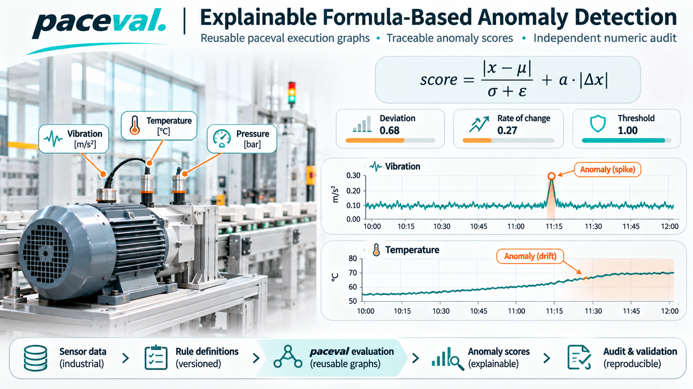
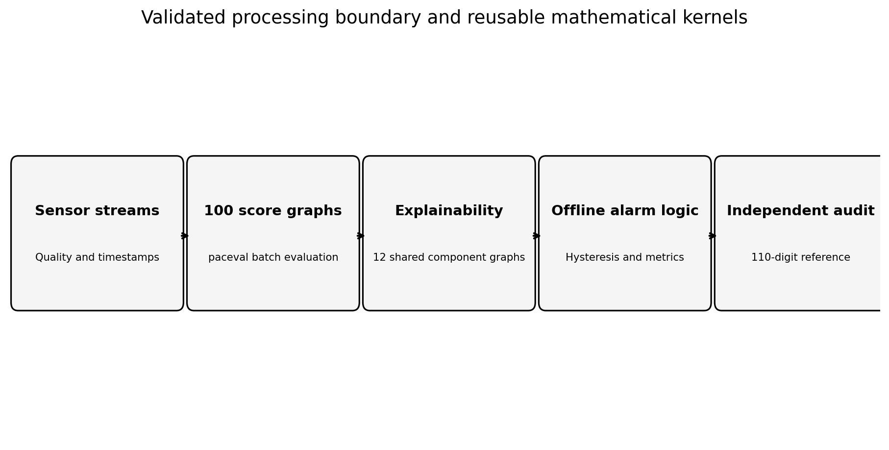
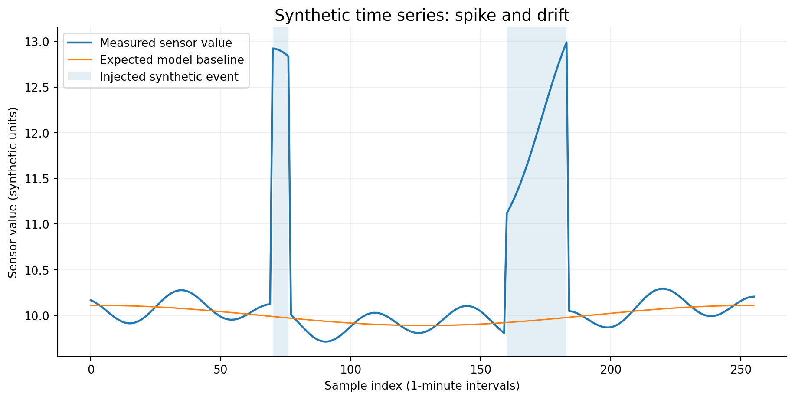
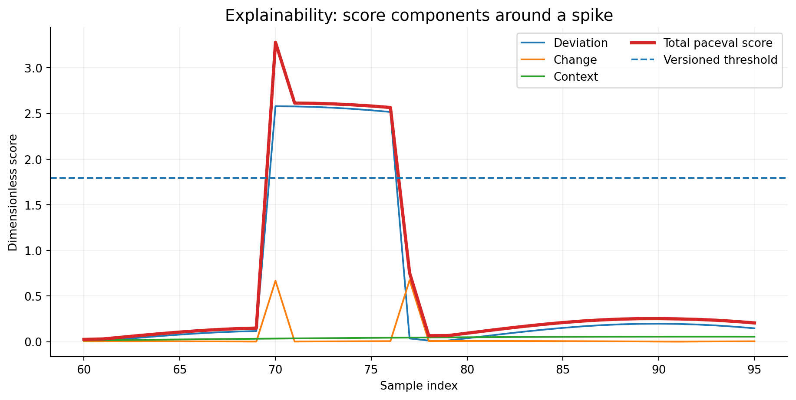

# paceval | Explainable Formula-Based Anomaly Detection



**An independently audited C++ research demonstrator for reusable mathematical anomaly scores in industrial sensor streams.** This project turns the WP-017 research proposal into a fully executable, *synthetic* experiment with formula versioning, explicit score explanations, signal-quality screening, alarm-state handling, and held-out anomaly-event evaluation.

[**Scientific whitepaper (PDF)**](paceval_Explainable_Anomaly_Detection_Whitepaper_EN.pdf) · [Source code and CMake](src/anomaly_detection.cpp) · [Reproducible examples](examples/validation.json) · [Independent audit](examples/independent_audit.json)

## What was actually demonstrated

The original paceval Linux mathematical runtime evaluates **100 separately created, versioned score graphs** over **4,080 accepted sensor samples**. This represents **408,000 evaluated scores** across 16 synthetic channels and 256 time steps per channel. **Sixteen input records with explicitly bad, missing, or stale quality** are screened out by the C++ host before computation. Twelve additional shared graphs calculate interpretable score terms; one separate TINC graph is used for a precisely described interval diagnostic.

The native C++ implementation independently checked all 408,000 scores within the prescribed tolerance. A separate **110-digit, exact-binary-input** Decimal audit checked 200 chosen rule/sample pairs and all 4,080 selected scores *and their component terms*. All 24 observations of the separate smooth TINC test `x*x+1` enclose their exact dyadic reference results. The largest 110-digit error among the 200 scored pairs was approximately **1.22 × 10⁻¹⁵** (dimensionless).

The model-selection procedure uses **validation sensors only**. The four chosen rules are then evaluated on held-out channels; the synthetic fault generator includes two labeled events (a spike and a drift) per channel. The *stateful* alarm path detected **8/8 test events**. The raw pointwise threshold decisions gave **100 true positives, 0 false positives, and 24 false negatives** on the held-out samples. Stateful alarms are separately evaluated: a short post-event hold can count as point-level false positives even when the event itself was detected correctly. These results are limited to the explicitly constructed synthetic dataset.



## Scientific model and why paceval is used

The proposal's starting point is a normalized deviation combined with a change-rate term:

`score = abs(x - mu)/(sigma + eps) + a * abs(dx)`

Our extended implementation includes **four transparent, parameterized formula families** with additive contributions:

| Family | Deviation term | Change term | Context term |
|---|---|---|---|
| 0 | `w0*abs(z)` | `w1*abs(d)` | `w2*abs(cn)` |
| 1 | `w0*abs(z)` | `w1*d*d` | `w2*abs(cn)` |
| 2 | `w0*z*z` | `w1*abs(d)` | `w2*abs(cn)` |
| 3 | `w0*abs(z)` | `w1*abs(d)` | `w2*cn*cn` |

Here `z = (x-mu)/(sigma+eps)`, `d = dx/(ds+eps)`, and `cn = c/(cs+eps)` are dimensionless normalized sensor deviation, signal change, and auxiliary context respectively. The 100 rules contain separately frozen numeric coefficients and an independently versioned alarm threshold. **All three terms as well as the total are evaluated by paceval**. The host checks that their sum reproduces the selected score. This makes every recorded detection traceable to the mathematical contributions that triggered it.

`paceval_CreateComputation` creates the reusable objects. `paceval_dGetMultipleComputationsResultsExt` batches evaluations of the 100 formulas as well as the 12 explanation formulas. `paceval_dGetComputationResult` is also used for the separately reported interval and changed-rule tests. All numerical results are inspected for errors and finite values, and original SDK sources are compiled directly from [`src/paceval_main.cpp`](src/paceval_main.cpp) and [`src/paceval_main.h`](src/paceval_main.h).

**Engine capabilities vs application constraints:** The simulated sensor count, 100 formula versions, the quality policy and permitted input ranges are *demonstrator choices*, not fixed capacity limitations of paceval. They can be adjusted independently of the underlying engine.

## Workflow, data boundaries and risk of leakage

The deterministic generator creates four classes of synthetic signals, with four channels per class. Each class provides two training streams, one validation stream and one independently held-out test stream. The candidate formulas are chosen solely from the validation streams after their coefficients and thresholds have been fixed. The source code evaluates other candidate rules on the test streams for an independent mathematical audit, but the selected model IDs **do not depend on any test labels**.

Each channel contains 256 one-minute samples. A spike is injected at samples 70–76, and a gradual drift at 160–183. Labels are assigned by the generator, not inferred by paceval. This design permits precise recall and detection-delay checks but does not establish industrial predictive accuracy.

The C++ host checks the strict record schema, units, time ordering, finite input fields, allowed denominator ranges and quality status. Invalid-quality samples do not enter paceval and cannot raise a positive alarm. Two consecutive scores above the rule threshold activate the persistent alarm, while two consecutive scores below 70% of the threshold clear it; the state resets on a quality failure. This policy is a demonstrator-specific monitoring decision, not part of the mathematical engine.




## Build and run (Linux x86-64)

The ZIP intentionally **does not contain the proprietary Linux shared library**. Obtain a licensed compatible paceval Linux `.so` and set its absolute path. A C++17 compiler and CMake 3.16+ are required. Python 3 is used by the independent tests, and NumPy/Matplotlib are only needed when regenerating scientific figures.

```bash
cmake -S src -B build -DCMAKE_BUILD_TYPE=Release \
  -DPACEVAL_RUNTIME=/absolute/path/to/libpaceval_linux_sharedLIB.so
cmake --build build --parallel
ctest --test-dir build --output-on-failure
./build/anomaly_detection --out regenerated --batch 37
python3 src/validate_outputs.py --examples regenerated
./build/anomaly_detection --input examples/signals.csv --out replay --batch 1
```

Both `--batch 1` and `--batch 37` produce identical mathematical CSV results on the tested environment. To use a custom CSV, preserve the header, 16 complete monotonic 256-sample streams, stated units, and the fixed train/validation/test partitions. Input parsing rejects nonfinite fields, duplicate timestamps, invalid normalization and unauthorized split changes. The example signals are fully synthetic and contain no private industrial data.

## Reproducible project resources

| Resource | Purpose |
|---|---|
| [`src/anomaly_detection.cpp`](src/anomaly_detection.cpp) | C++17 generator, 100 graph creation, multi-graph batching, stateful alarm simulation and exports |
| [`src/CMakeLists.txt`](src/CMakeLists.txt) | Linux build and automated tests |
| [`src/validate_outputs.py`](src/validate_outputs.py) | 110-digit audit, score decomposition, held-out confusion statistics and exact-input TINC inclusion |
| [`src/test_csv.py`](src/test_csv.py) | Byte-identical CSV replay and deliberate input corruption tests |
| [`src/make_figures.py`](src/make_figures.py) | Rebuild ten scientific figure pairs from published examples |
| [`src/make_whitepaper.py`](src/make_whitepaper.py) | Rebuild the English scientific whitepaper |
| [`examples/signals.csv`](examples/signals.csv) | Synthetic time-series sensor inputs and independently determined labels |
| [`examples/rules.csv`](examples/rules.csv) | Frozen expression strings, weights and thresholds for 100 models |
| [`examples/model_diagnostics.csv`](examples/model_diagnostics.csv) | Per-version validation and held-out pointwise metrics |
| [`examples/selection.csv`](examples/selection.csv) | Validation-selected models and held-out scores |
| [`examples/selected_scores.csv`](examples/selected_scores.csv) | Every sample: score, component attribution and alarm state |
| [`examples/event_detection.csv`](examples/event_detection.csv) | Event-level detection latency and outcome for spike/drift events |
| [`examples/rule_update.csv`](examples/rule_update.csv) | Numerically checked graph revision of rule 17 |
| [`examples/audit_samples.csv`](examples/audit_samples.csv) | 200 frozen rule/sample combinations for independent arithmetic |
| [`examples/tinc_samples.csv`](examples/tinc_samples.csv) | Raw bounds for the separate smooth diagnostic `x*x+1` |
| [`examples/validation.json`](examples/validation.json) | Native C++ comparison counts and offline evaluation summary |
| [`examples/independent_audit.json`](examples/independent_audit.json) | High-precision and interval validation summary |

### Published scientific figures

| Figure | Subject |
|---|---|
| [01 — Injected anomalies](figures/01_sensor_events.png) | Spike and drift relative to the baseline |
| [02 — Math architecture](figures/02_execution_architecture.png) | Input gating, paceval graph batches and offline audit |
| [03 — Score explanations](figures/03_explainable_components.png) | Deviation, change, context and threshold |
| [04 — Held-out F1](figures/04_holdout_f1.png) | Validation compared with independent test |
| [05 — Candidate score map](figures/05_candidate_score_map.png) | Validation F1 of 100 formula versions |
| [06 — Detection delays](figures/06_event_detection_delays.png) | Time to detection for eight test events |
| [07 — Version update](figures/07_model_version_update.png) | Controlled modification of rule 17 |
| [08 — Numerical accuracy](figures/08_numerical_accuracy.png) | 110-digit audit residuals |
| [09 — TINC control](figures/09_tinc_control.png) | Separately tested smooth dyadic polynomial |
| [10 — Quality gating](figures/10_quality_gating.png) | Missing, bad and stale input screening |

The ten scientific diagrams are available as both PNG and SVG. The title illustration is illustrative and its plotted visual elements are *not* empirical sensor measurements; the science figures instead come from the actual saved CSV files.

## What the study demonstrates, and what it does not

The completed experiment establishes **numerically correct, reusable and explainable formula execution** for this fully specified synthetic industrial-monitoring workload. The threshold model, known anomaly generator, data-quality policy and choice of scoring rules are independently reproducible. TINC observation on `x*x+1` is evidence about these 24 inputs only and is not a general interval guarantee for the nonsmooth scoring formulas. The result is not a claim of live industrial accuracy, certification, streaming p99 latency or end-to-end real-time performance.

The original proposal's performance hypothesis is intentionally not converted into an unsupported speedup statement. A subsequent study should test archived and genuinely labeled plant failures, pre-agreed baselines, drift and operating-regime changes, prevalence-sensitive false-alarm costs, and the latency and robustness of a live ingestion system.

**External technical references:** [paceval API](https://paceval.com/api/), [Numenta Anomaly Benchmark](https://github.com/numenta/NAB), [IEEE NAB methodology](https://doi.org/10.1109/ICMLA.2015.141), [OPC UA DataValue quality and timestamps](https://reference.opcfoundation.org/specs/OPC-10000-4/7.11). These inform the experimental architecture, but no external dataset is redistributed or claimed to have been tested here.

**Licensing:** The original notices in `src/paceval_main.h` and `src/paceval_main.cpp` are retained. No separate `LICENSE_NOTICE.md` file is generated.
