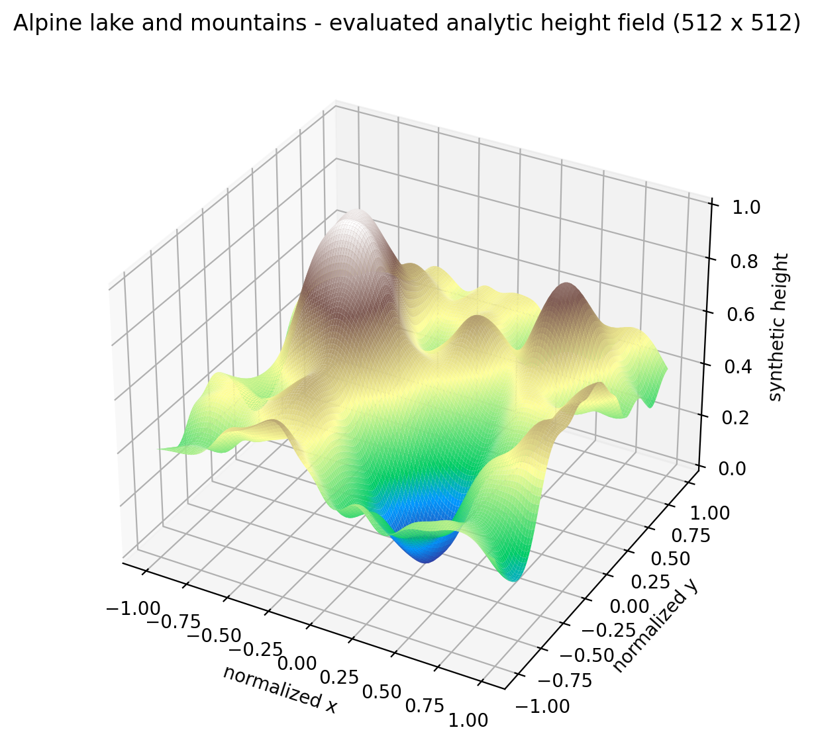
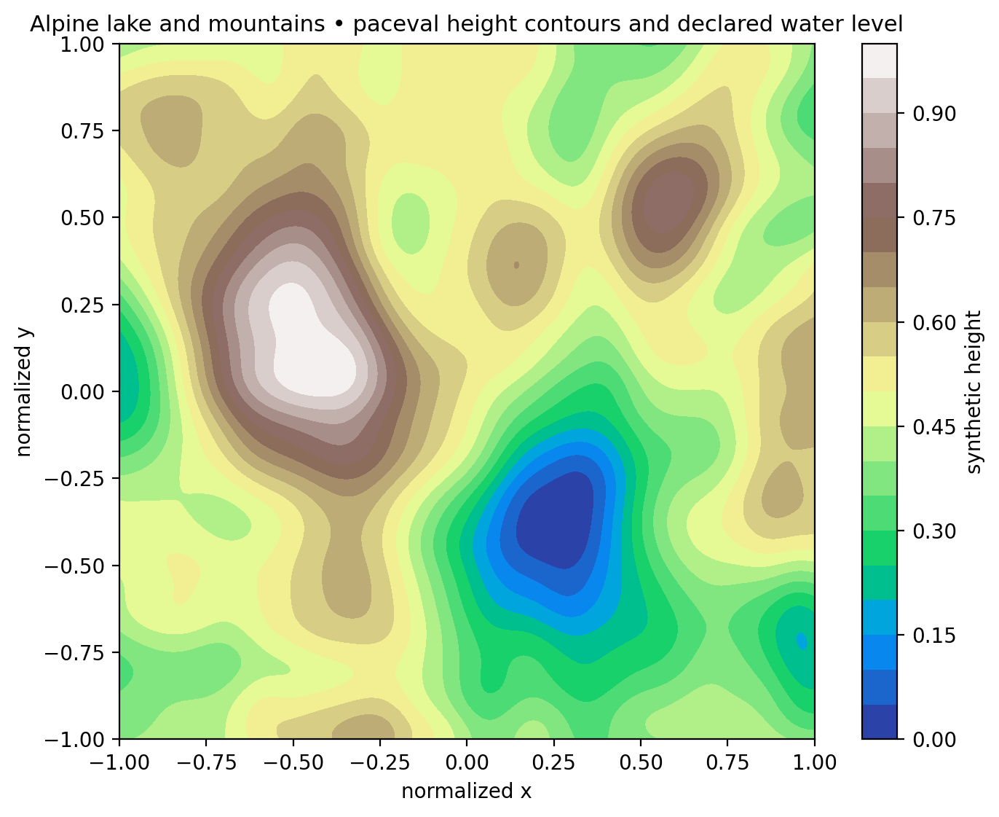
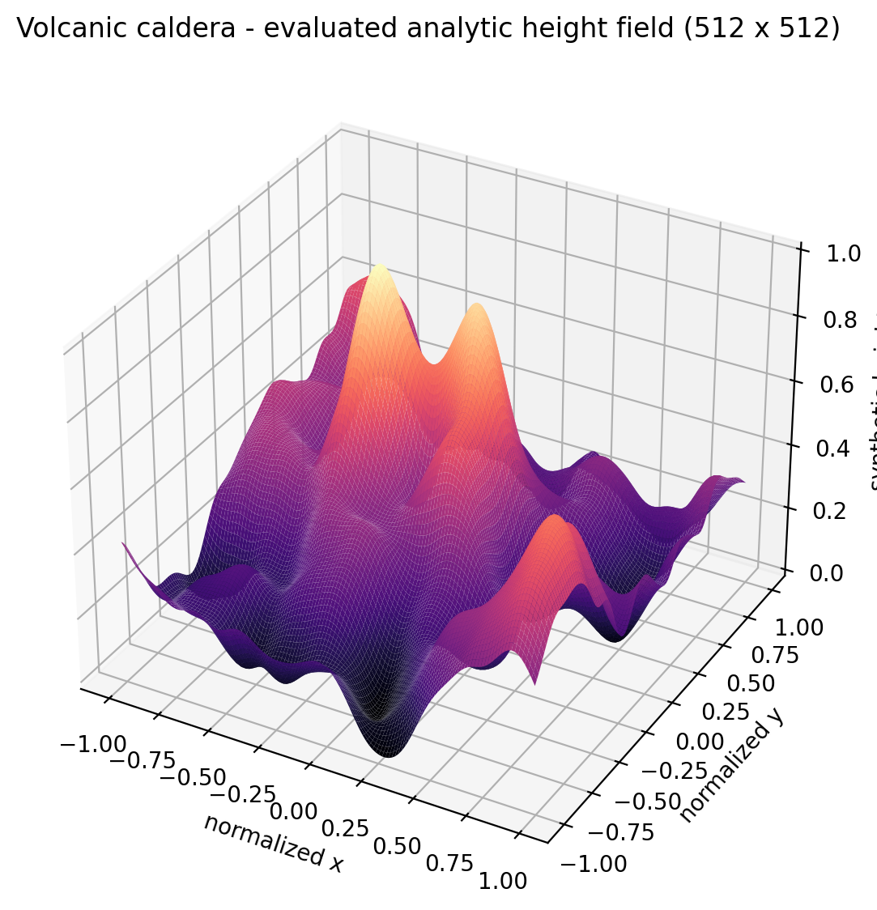
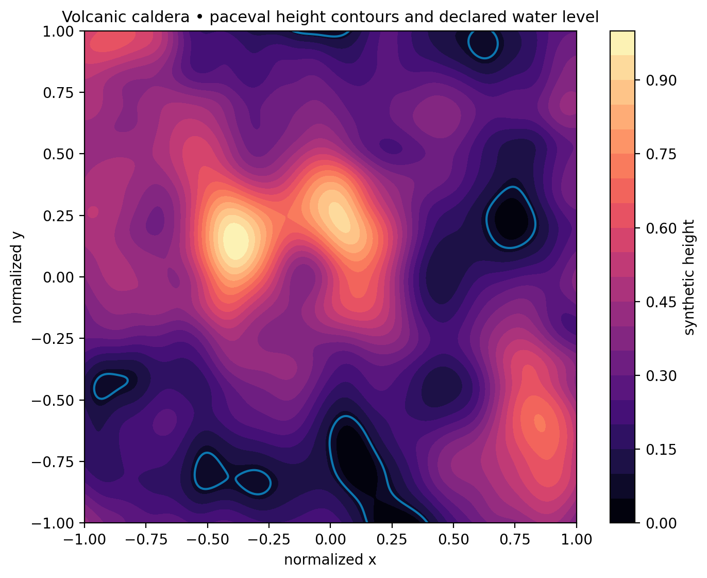
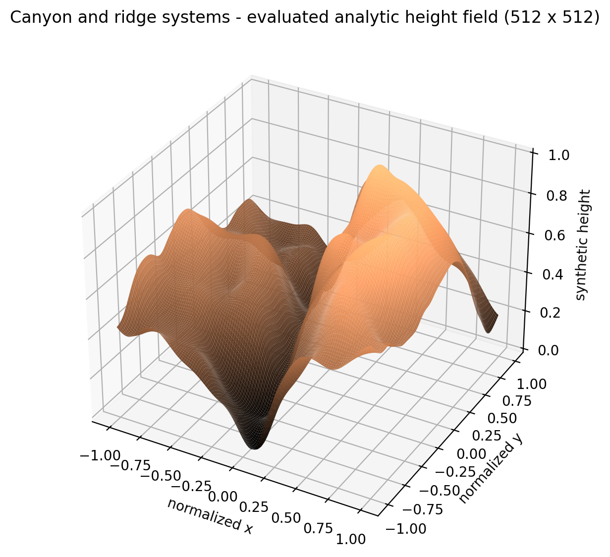
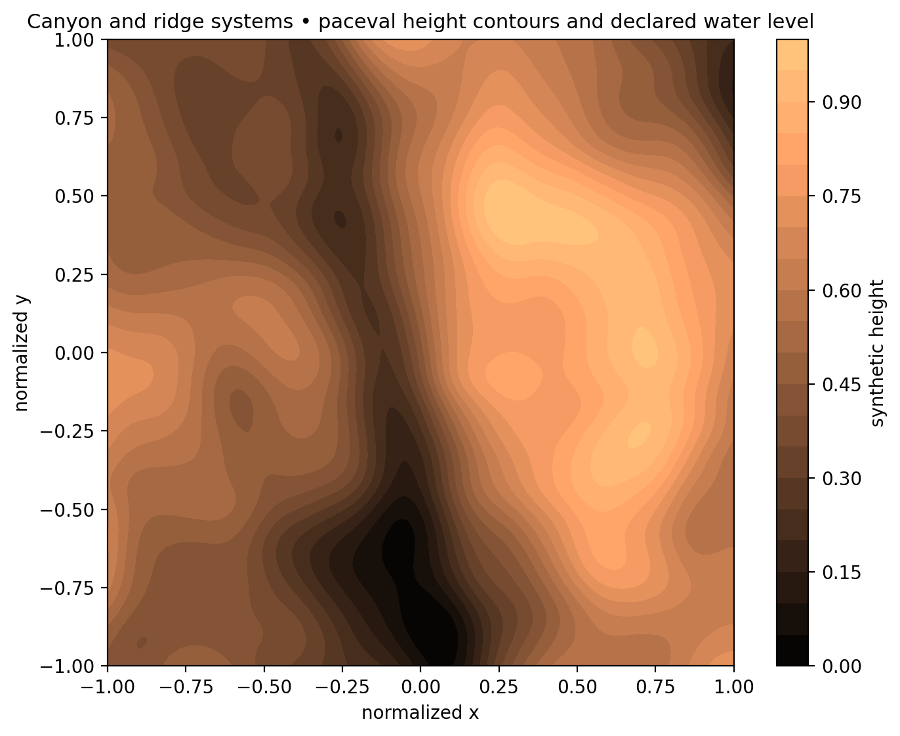
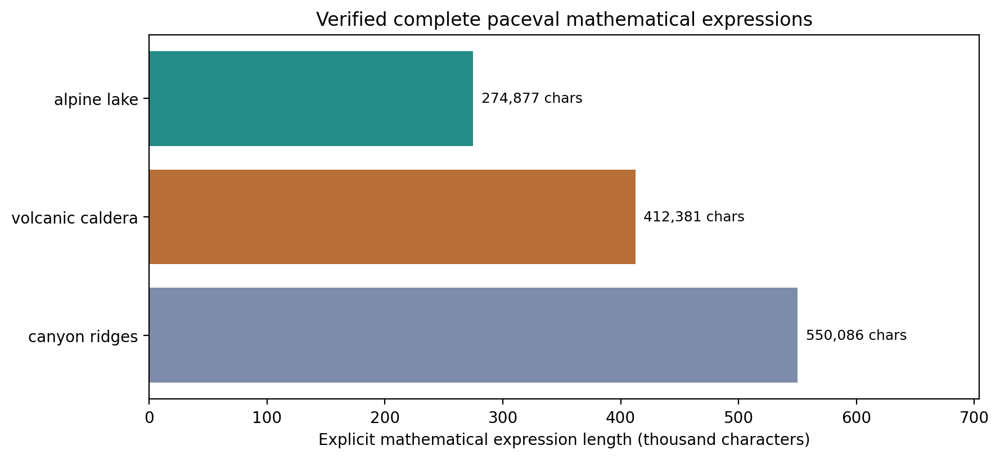

# Extreme-Length Analytic Terrain Functions with paceval


*Concept illustration; not a computed research result. The terrain figures below are derived directly from the actual paceval computation outputs.*

**Three distinct, explicitly serialized mathematical terrain functions. All exceed 250,000 characters, were created as real monolithic paceval computation handles, and were also evaluated with large paceval batch calls to produce genuine 3D terrain assets at 512 × 512 resolution.**

[**English research whitepaper (PDF)**](paceval_Extreme_Analytic_Terrain_Whitepaper_EN.pdf) · [C++ source](src/extreme_terrain.cpp) · [CMake project](src/CMakeLists.txt) · [Formula files](expressions/) · [GLB/OBJ terrain models](examples/) · [Numerical audits](results/)

## 1. Industrial use case and current state of the art

A developer building a geographic digital twin, terrain visualization tool, simulation scene or procedural authoring product may need to construct, revise and reuse the **same analytical terrain definition** across a number of renderers or numerical workflows. Rather than committing every change to an elevation raster, the developer can store a mathematical height expression and sample it deterministically at any requested resolution.

In geospatial production, real measured DEM and lidar elevation products remain essential, with datum, resolution, provenance and accuracy specifications. The [USGS 3DEP specifications](https://www.usgs.gov/ngp-standards-and-specifications/3d-elevation-program-standards-and-specifications) are a reference for real-world elevation products. For large geospatial 3D content, [OGC 3D Tiles](https://www.ogc.org/standards/3DTiles/) defines a streaming standard. Recent scientific work also studies [physically based analytical erosion](https://doi.org/10.1111/cgf.15033), a research problem well beyond the present synthetic functions.

**Here, paceval evaluates the explicitly defined mathematical functions.** The C++ host builds and versions the formulas, manages the coordinate grid, combines mathematical subexpressions and exports results as CSV. Python reads these *actually computed* heights and produces previews and triangulated 3D geometry. The resulting assets are not reconstructive DEM products and do not establish any geological or hydrological validity.

## 2. Verified execution and explicit formula sizes

| Scene | Gaussian feature terms | Full formula size | Complete paceval grid | Real geometry |
|---|---:|---:|---:|---|
| Alpine Lake | 2,048 | **274,877 characters** | 512 × 512 | [GLB](examples/alpine_lake_terrain.glb), [terrain OBJ](examples/alpine_lake_terrain.obj), [water OBJ](examples/alpine_lake_water.obj) |
| Volcanic Caldera | 3,072 | **412,381 characters** | 512 × 512 | [GLB](examples/volcanic_caldera_terrain.glb), [terrain OBJ](examples/volcanic_caldera_terrain.obj), [water OBJ](examples/volcanic_caldera_water.obj) |
| Canyon Ridges | 4,096 | **550,086 characters** | 512 × 512 | [GLB](examples/canyon_ridges_terrain.glb), [terrain OBJ](examples/canyon_ridges_terrain.obj), [water OBJ](examples/canyon_ridges_water.obj) |

A total of **42 real paceval computation graphs** were constructed: three monolithic complete formulas plus their reusable grouped expressions. Each full expression was independently created and evaluated at five test coordinates. Complete terrain rasters were evaluated through `paceval_dGetMultipleComputationsResultsExt` using a background graph and reusable blocks of 256 Gaussian terms. This 512 × 512 release exports **786,432 derived height values** across three scenes. The demonstrator uses the original multi-graph batch API for the full non-separable background on the 512 × 512 grid, and uses paceval batch calls for separately evaluated one-dimensional Gaussian factors. The C++ host then composes and sums their outer products. The mathematically equivalent original full-function grouped graphs are independently checked at 64 coordinate pairs, and the three monolithic formulas are independently created and sampled. Thus **factor evaluation is performed by paceval**, whereas two-dimensional composition and mesh export are host operations.

The deterministic C++ reference tests, additional nine independent 55-decimal-digit `mpmath` calculations, and CTest passed for the released workload. Technical audit details remain under [`results/`](results/).

### Does paceval impose a limit on expression length?

The paceval [Product Brief](https://paceval.com/product-brief/) states that **there is no fixed product-level limit on expression length or number of variables: the hardware and development environment determine practical limits**. This is *not* proof of unlimited resources or successful execution of every arbitrary expression. A billion-character formula could be considered in principle if sufficient memory, graph storage, parsing capacity and computational resources were available; **one billion characters have not been demonstrated in this project**.

The previous [source study](https://paceval.com/developers/) already documented a separate paceval monolithic test exceeding three million characters. This project independently demonstrates three distinct landscapes of 274k to 550k characters at 512 × 512 spatial resolution, not a new maximum-length record. Long text alone is not a proxy for physical realism or useful computational throughput.

## 3. Mathematical terrain specification

The three functions are deterministic 2.5D height fields defined on normalized coordinates in the square `[-1,1] × [-1,1]`:

```math
h_N(x,y)=h_0(x,y)+\sum_{j=1}^{N}a_j\exp\left(-\frac{(x-c_{x,j})^2}{s_{x,j}}-\frac{(y-c_{y,j})^2}{s_{y,j}}\right).
```

The background $h_0$ determines each landscape's general shape, while the 2,048–4,096 signed analytic Gaussian features add deterministic local relief. All coefficients are explicitly included as 17-significant-digit literals in the **actual expression files**, not synthesized inside the paceval evaluator.

- [Exact 274,877-character Alpine Lake formula](expressions/alpine_lake_full_formula.txt)
- [Exact 412,381-character Volcanic Caldera formula](expressions/volcanic_caldera_full_formula.txt)
- [Exact 550,086-character Canyon Ridges formula](expressions/canyon_ridges_full_formula.txt)

A water layer is created by offline mesh geometry at a fixed synthetic level for cells whose four sampled corners fall below the declared threshold. It is **not** a clipped, topologically proven lake shoreline, a connected flood basin or a hydrological simulation. GLB and OBJ are genuine mesh files, not static image substitutes.

## 4. Genuine computed scientific figures

Each chart below uses actual exported paceval height-grid values, not AI-generated scientific data.

| Terrain model | Computed 3D height surface | Contour and level map |
|---|---|---|
| **Alpine Lake** |  |  |
| **Volcanic Caldera** |  |  |
| **Canyon Ridges** |  |  |



All seven scientific graphics are supplied as high-resolution PNG and vector PDF in [`figures/`](figures/). The 2:1 title artwork is exactly **2400 × 1200 pixels** and is used without distortion in the README and whitepaper.

## 5. Compile, execute and reproduce

**Required:** Linux x86-64, a compatible external paceval runtime library, CMake ≥3.16, a C++17 compiler. `src/paceval_main.h` and `src/paceval_main.cpp` are the original SDK interface files. The dynamic library is intentionally not redistributed in this repository.

```bash
cmake -S src -B build -DCMAKE_BUILD_TYPE=Release \
  -DPACEVAL_RUNTIME=/absolute/path/to/libpaceval_linux_sharedLIB.so
cmake --build build -j
ctest --test-dir build --output-on-failure
./build/extreme_terrain --out . --grid 512
python3 src/high_precision_reference.py
python3 src/make_figures.py
python3 src/make_whitepaper.py
python3 src/make_readme_512.py
python3 src/check_readme_math.py
```

Python diagram and export scripts use `numpy`, `matplotlib`, `trimesh`, `Pillow` and `mpmath`. The whitepaper generator additionally uses `reportlab`.

A complete SDK run writes [`results/execution_summary.csv`](results/execution_summary.csv), three [`examples/*_height_grid.csv`](examples/) files and exact formulas to [`expressions/`](expressions/). `src/make_figures.py` exports GLB/OBJ terrain models and the scientific figures from those recorded values. CTest uses the actual SDK with one smaller numerical grid, **not** a simulated paceval substitute.

### Independent checks and release packaging

The numerical replay checks both the complete monolithic mathematical expression and grouped multi-graph evaluations. A C++ native mathematical oracle, independently reimplemented coefficient generation in Python and high-precision `mpmath` checks test selected samples. [`results/high_precision_audit.json`](results/high_precision_audit.json) and [`results/mesh_validation.json`](results/mesh_validation.json) document those checks. All terrain and water mesh geometry can be opened with a GLB/OBJ-compatible viewer.

The script [`src/check_readme_math.py`](src/check_readme_math.py) checks GitHub `math` blocks, disallowed advanced math macros, nested math delimiters and every local README link. It includes positive and negative regression tests. A real GitHub browser/MathJax rendering check is still an additional step; the static syntax checker is not a browser.

## 6. Scope and interpretation

This is a verified **mathematical expression execution and geometry export** demonstration. It does not model erosion, real lake hydrology, geological material properties, rainfall, measured elevation data or volumetric terrain. Water is a separately constructed geometric surface; the meshes are 2.5D height fields. The results demonstrate feasibility and reproducibility, **not** a numerical-speed or energy advantage over optimized native/GPU terrain rendering.

At 512 × 512, every terrain mesh contains **262,144 vertices** and **522,242 triangles**, which makes the geometric presentation substantially stronger than the original 40 × 40 preview release while leaving the explicit formula lengths unchanged.

Industrial follow-up would include fitting analytically represented terrain to measured DEMs, preserving geographical reference systems, testing spatially independent validation tiles and evaluating slopes, curvature, drainage and multiresolution tiled geometry.

## 7. External research references

1. [Physically-based analytical erosion for fast terrain generation, Computer Graphics Forum, 2024](https://doi.org/10.1111/cgf.15033).
2. [USGS 3D Elevation Program, standards and specifications](https://www.usgs.gov/ngp-standards-and-specifications/3d-elevation-program-standards-and-specifications).
3. [OGC 3D Tiles Standard](https://www.ogc.org/standards/3DTiles/).
4. [paceval Mathematical Engine – Product Brief](https://paceval.com/product-brief/).
5. [paceval API documentation](https://paceval.com/api/).

**Publication scope:** reproducible research demonstrator, 12 November 2026. No industrial deployment or certified geospatial validity is claimed.
