# Factory-Line Digital Twin Formula Modules with paceval

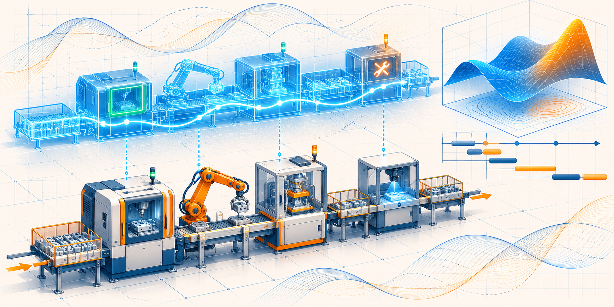

*Figure 0. Independently styled 2400 × 1200 concept artwork. All numbered scientific charts below are generated from **executed original paceval SDK** outputs and deterministic C++ simulation events. The illustration is not an observed factory or actual sensor image.*

**WP_040 · Reproducible C++ manufacturing-simulation demonstrator · 13 November 2026**

[**Scientific whitepaper (English PDF)**](paceval_Factory_Line_Digital_Twin_Whitepaper_EN.pdf) · [C++ implementation](src/factory_line_twin.cpp) · [CMake project](src/CMakeLists.txt) · [Formal formula registry](examples/formula_registry.csv) · [Function execution ownership](results/math_execution_inventory.csv) · [Input proposal](references/WP_040_Original_Research_Proposal.pdf)

## 1. Industrial motivation and state of the art

Industrial production-line digital twins represent operational flow, individual machines, disruptions, production queues and machine performance. Useful scenarios include bottleneck analysis, buffers and line balancing, conditional downtime, and evaluation of alternative local process-time formulas without rewriting the simulation's discrete-event scheduler. The original WP_040 proposes one basic equation, `throughput = rate*(1-downtime_fraction)`, and a public synthetic event trace with **20 interchangeable local mathematical formulas**. The expanded project provides a **four-station finite-buffer discrete-event simulator** and uses real paceval computation handles for those 20 formula versions plus quality, energy and KPI calculations.

This is informed by current public frameworks, not a claim of industrial conformity: the [NIST introduction to ISO 23247 manufacturing digital twins](https://www.nist.gov/publications/use-case-scenarios-digital-twin-implementation-based-iso-23247), [ISO 23247-6:2026 digital twin composition](https://www.iso.org/standard/87426.html), and the [FMI 3.0 implementers guide](https://modelica.github.io/fmi-guides/main/fmi-guide/) are useful context. Unlike a full industrial twin, this package contains **synthetic traces**, no live plant connectivity, no real controller integration, and no co-simulation FMU. It does not claim ISO 23247 or FMI certification.

The synthetic workflow demonstrates source arrival, station operations, a serial four-station routing, buffer capacities of 3/4/3 between stations, temporary equipment shutdown intervals, after-service blocking, fixed-seed quality outcomes, and final part counts. Its purpose is to demonstrate mathematically reusable modules in a credible, explicitly bounded **event-driven** host workflow.

## 2. Executed result and clear measurement boundary

| Actually executed test | Result |
|---|---:|
| Original paceval mathematical graphs | **38** |
| Independently registered process-time formula variants | **20** |
| Actual paceval multi-graph batch results | **209,798** |
| Actual paceval batch API invocations | **98** |
| Synthetic incoming jobs per scenario | **440** |
| Completed simulation scenarios | **20** |
| Workstations | **4** |
| Independently checked native C++ mathematical values | **16,302** |
| Additional 80-decimal-digit independent Python checks | **1,122** |
| First module: completed good jobs / simulated scraps | **426 / 14** |
| Original SDK CMake/CTest | **Passed** |

All numerical results above were actually obtained from the original paceval SDK runtime, except the independent host event scheduling, counts and validation methods, which are clearly attributed. [Raw run summary](results/execution_summary.csv), [high-precision audit](results/high_precision_audit.json) and [event integrity checks](results/trace_integrity_audit.json) document the actual evidence.

**No performance-speedup, cost reduction, customer deployment or industrial production fidelity is claimed.** The original proposal's timing/break-even discussion is retained as background research, but not converted into unsupported performance statements.

## 3. Exact mathematical model and paceval execution

Each station `s` has a declared nominal process time `b_s` in minutes; jobs have synthetic wear `w`, temperature `T` (°C), utilization/load proxy `L`, and phase `φ`. The actual code serializes the following **20 distinct** expression strings, each created once as a reusable paceval graph:

```math
 t_{k,s,j}=b_s\left[1+\beta_k+0.011w_j+0.0009(T_j-22)^2+0.014L_j+\alpha_k\sin(\varphi_j+0.09k)+\delta_k w_jL_j\right]
```

```math
 \beta_k=0.010(k-9.5),\quad \alpha_k=0.003((k\bmod 4)+1),\quad \delta_k=0.006((k\bmod 5)-2),\quad k=0,\ldots,19.
```

A separate physical accuracy claim would require real commissioning data, process physics and calibration. These local functions are deliberately specified synthetic numerical test expressions, not actual machine cycle-time models.

Two more real paceval expressions determine synthetic rejection probability and energy demand:

```math
 p_{\mathrm{reject}}=0.006+0.010w+0.00007(T-22)^2,\qquad E_{\mathrm{operation}}=0.018b(1+0.2L)\;\mathrm{kWh}.
```

For the simulations, the host assigns the same deterministic quality-draw sequence to all formula variants and processes the real paceval results as the operation-time, rejection-risk and energy inputs to its event calendar.

Following that, paceval also evaluates throughput, yield, energy per good unit, electricity cost, running-time fraction, calendar uptime, performance ratio, first-pass station quality, illustrative OEE-like combined metrics, blocking fraction and target-rate margin. For example:

```math
 R_{\mathrm{good}}=\frac{60N_{\mathrm{good}}}{T_{\mathrm{line}}},\quad Y=\frac{N_{\mathrm{good}}}{N_{\mathrm{arrived}}},\quad C_{\mathrm{electricity}}=p_E\,E_{\mathrm{total}}.
```

**OEE-style result:** The published station-two composite multiplies `(active processing minutes / line horizon) × (ideal minutes × processed jobs / active processing minutes) × (station passed / station processed)`. It is an explicitly documented synthetic decomposition, not a certified industrial OEE value. A plant deployment would need site-specific planned-production rules, definitions and data quality controls.

The nonmathematical **C++ host** alone determines the chronological sequence, finite-buffer events, stop/restart times, queue occupancy, completion routing and fixed-seed draws. Its mathematical calculations in the independent regression tests are **validation oracles, not alternate outputs silently substituted for paceval**. The complete [machine-readable function inventory](results/math_execution_inventory.csv) names every graph and its execution owner.

## 4. Numbered scientific figures from actual run outputs

### Factory event sequence and module replacement

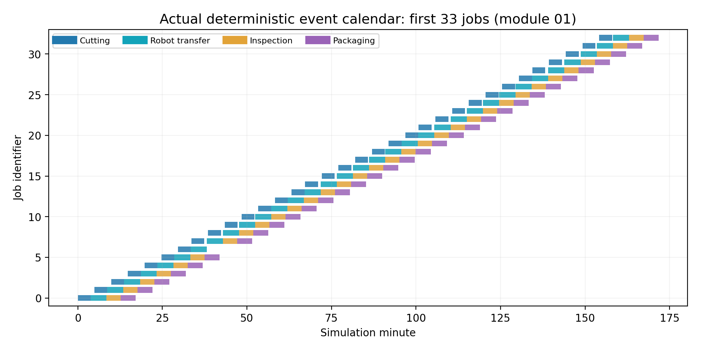

*Figure 1. Baseline module: real simulation events using mathematical paceval operation durations.*

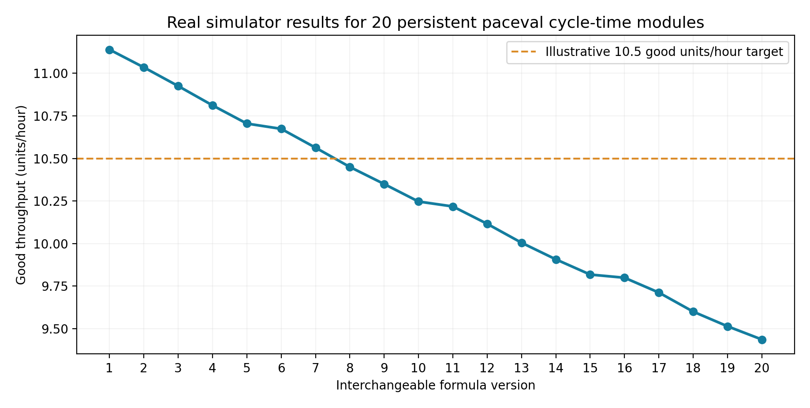

*Figure 2. Identical input arrivals and quality-draw sequence; only the persistent mathematical module changes.*

### Scientific 3D surfaces, gradients and operational interactions

| Computed response surface | Model replacement sensitivity |
|---|---|
| 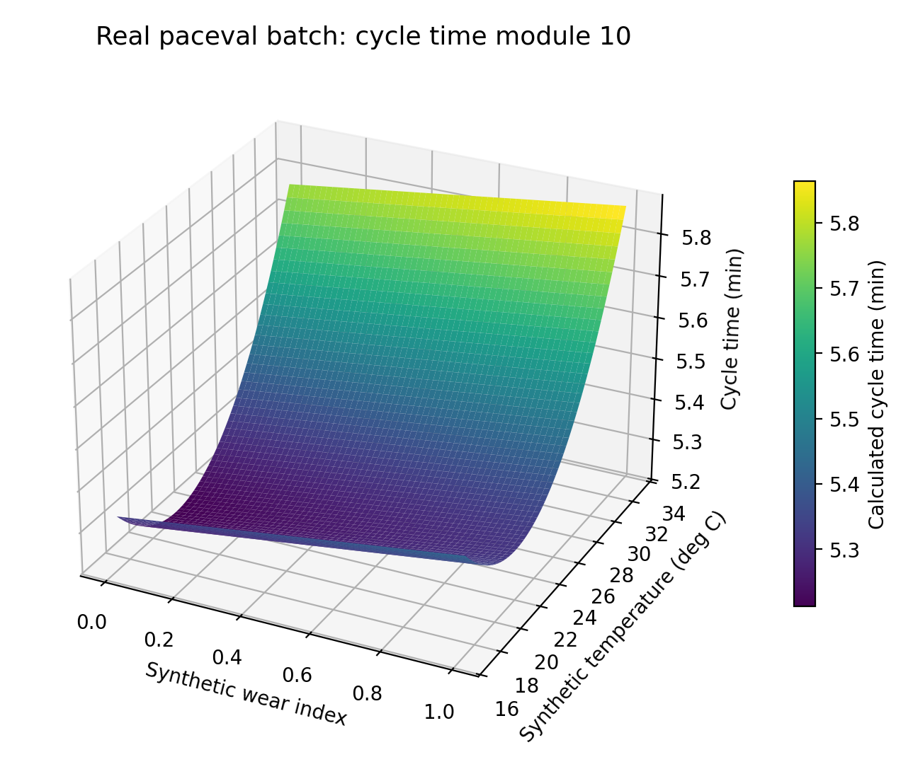 | 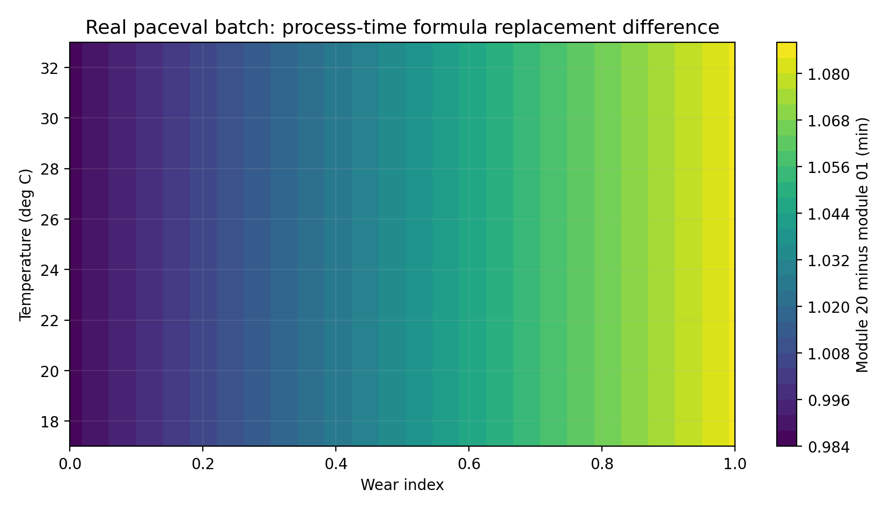 |

| Factory-line trade-off | Bottlenecks and planned shutdowns |
|---|---|
| 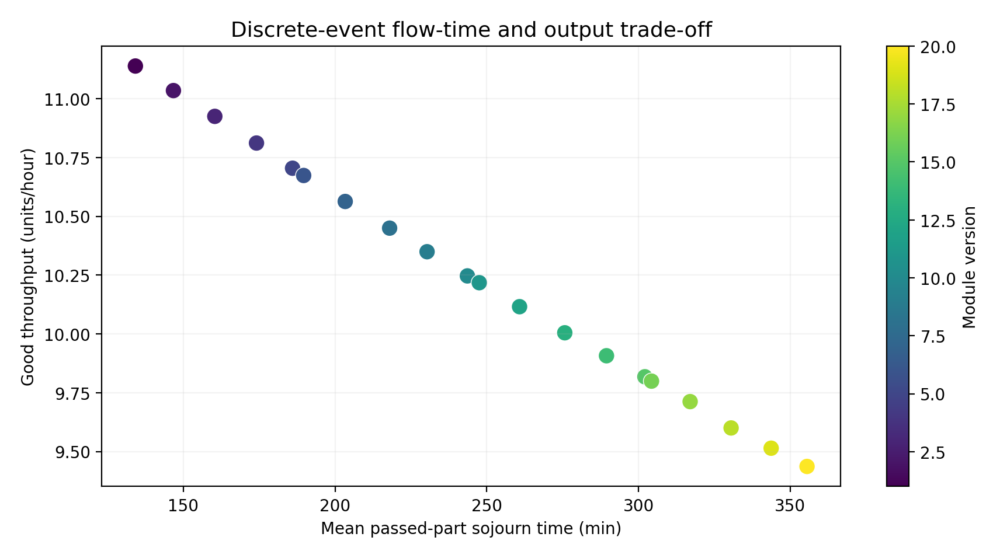 | 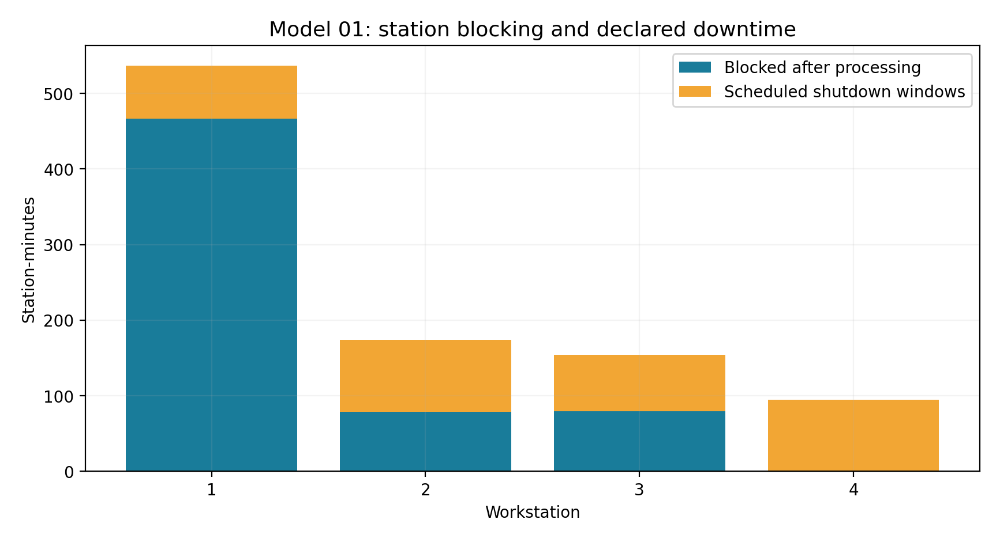 |

| Station-two declared OEE factors | Full job conservation |
|---|---|
| 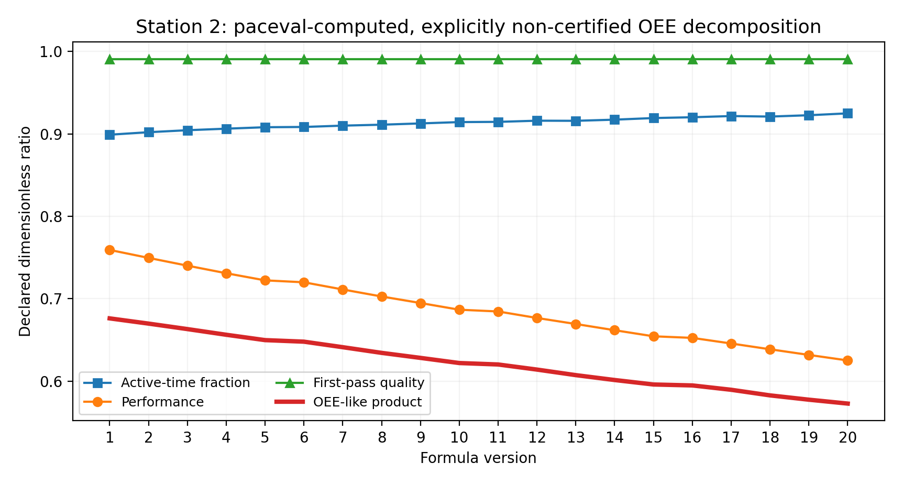 | 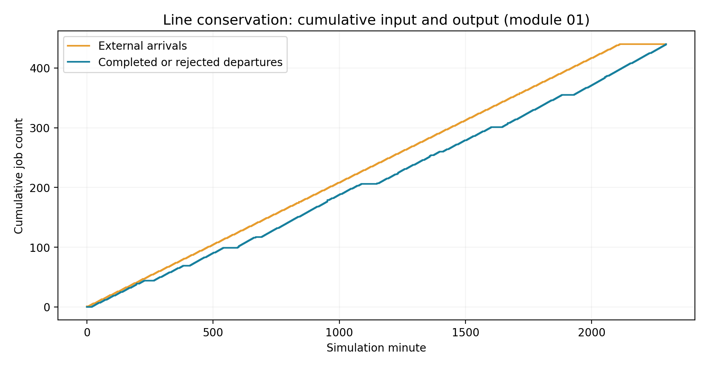 |

| Literal formula modules | Energy/cost control |
|---|---|
| 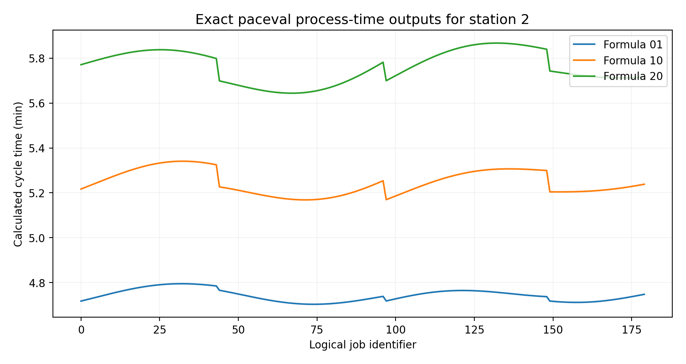 | 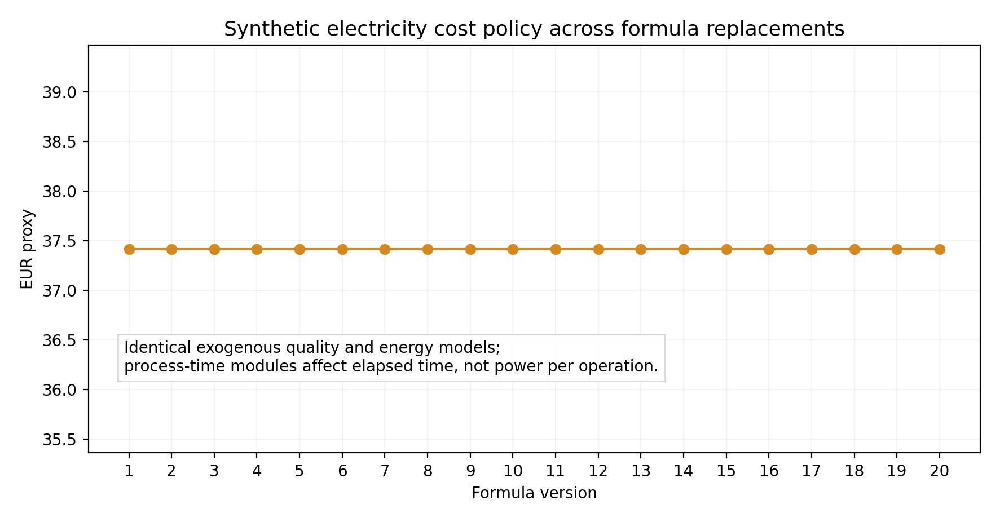 |

Every scientific chart is available as high-resolution PNG and vector PDF in [`figures/`](figures/). No AI-generated cover-image surface is used as scientific evidence. [Full source result CSV files](examples/) are shipped to recreate the plots.

## 5. Reproduce with original paceval API

**Prerequisites:** Linux x86-64, a compatible separately obtained original paceval shared library, CMake 3.16+, a C++17 compiler; for plotting and reports, Python with packages in `src/requirements.txt`. The original unmodified SDK adapter files `paceval_main.h` and `paceval_main.cpp` reside in `src/` next to `CMakeLists.txt`. The external executable runtime library is **not redistributed**.

```bash
cmake -S src -B build -DCMAKE_BUILD_TYPE=Release \
  -DPACEVAL_RUNTIME=/absolute/path/to/libpaceval_linux_sharedLIB.so
cmake --build build -j
ctest --test-dir build --output-on-failure
./build/factory_line_twin --out . --jobs 440 --variants 20 --surface 61
python3 -m pip install -r src/requirements.txt
python3 src/verify_results.py
python3 src/high_precision_reference.py
python3 src/make_figures.py
python3 src/make_whitepaper.py
python3 src/check_readme_math.py
```

**Important:** The original SDK's `paceval_dGetMultipleComputationsResultsExt` status semantics are checked against this actual runtime; for this release a `false` batch return indicates success and individual `errorTypes[]` values must still be tested. The C++ source uses original persistent computation handles and explicitly validates every batch output. It does not replace the paceval calculations with an unmarked C++ alternative.

## 6. Reproducibility and scientific boundaries

[Input event trace](examples/synthetic_line_event_inputs.csv), [complete evaluated operation matrix](examples/paceval_operation_results.csv), [scenario summary](examples/scenario_summary.csv), [baseline Gantt events](examples/selected_event_timeline.csv), [station statistics](examples/station_performance.csv), [actual response surface](examples/paceval_cycle_response_surface.csv), [C++ SDK execution log](results/sdk_execution.txt), [CMake integration log](results/ctest_execution.txt) and [SHA-256 manifest](SHA256SUMS.txt) are included.

The work demonstrates **functional mathematical integration**, formula maintainability, genuine 20-variant reuse, a reproducible event-line workflow, and audited numerical calculations. It does **not** demonstrate accurate equipment failure distributions, root-cause analysis, a validated factory throughput forecast, shop-floor digital-twin interoperation, calibrated quality loss, or real machine electricity costs. Queue dynamics, event sequencing, failures and event priorities cannot meaningfully be represented as one scalar mathematical expression and remain in the host.

Further practical investigation should apply the same 20 persistent formula handles to plant-verified timestamps and machine-state data, test failure distributions and mixed-product routing, validate external systems with FMI or an equivalent integration standard when appropriate, and separately quantify fidelity and uncertainty.

## 7. Primary references and provenance

1. [Original independent WP_040 proposal](references/WP_040_Original_Research_Proposal.pdf), November 2026, supplied by the user.
2. [NIST: Use Case Scenarios for Digital Twin Implementation Based on ISO 23247](https://www.nist.gov/publications/use-case-scenarios-digital-twin-implementation-based-iso-23247).
3. [ISO 23247-6:2026: Digital twin composition](https://www.iso.org/standard/87426.html).
4. [NIST: Digital Twins for Advanced Manufacturing](https://www.nist.gov/programs-projects/digital-twins-advanced-manufacturing).
5. [Modelica Association: FMI 3.0 Implementers' Guide (updated October 2026)](https://modelica.github.io/fmi-guides/main/fmi-guide/).
6. [paceval: original mathematical engine API](https://paceval.com/api/).

*Publication scope: reproducible mathematical and discrete-event research demonstration. Original SDK and runtime usage, not a third-party commercial endorsement.*
