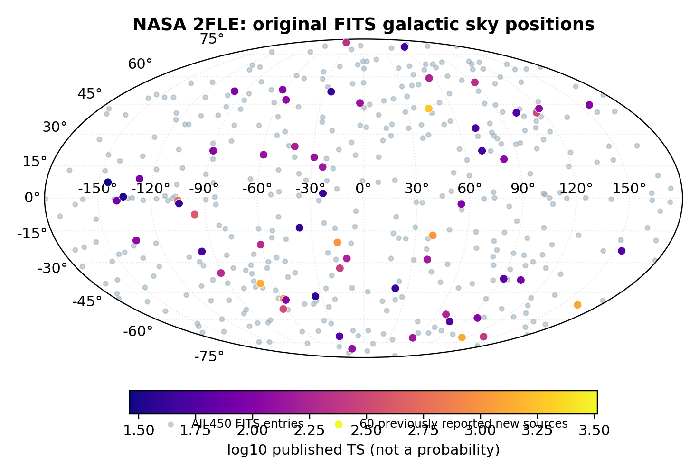
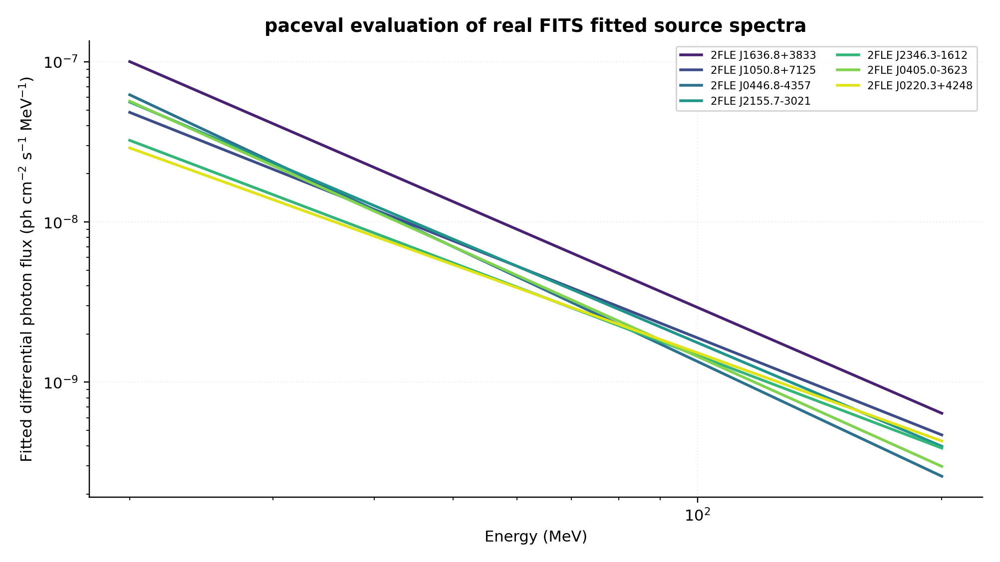
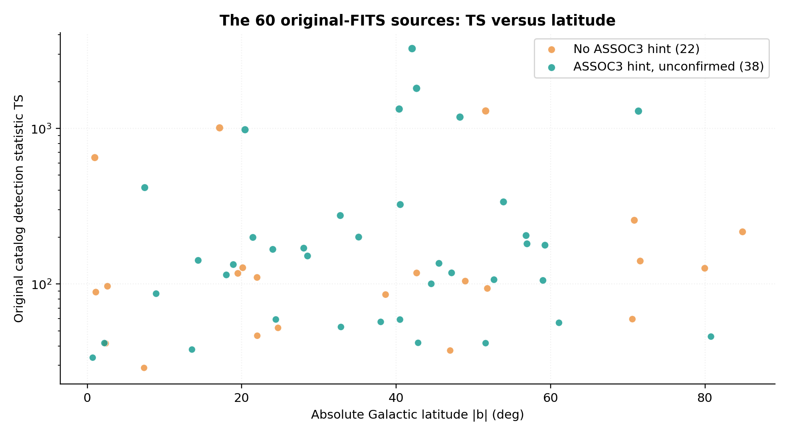
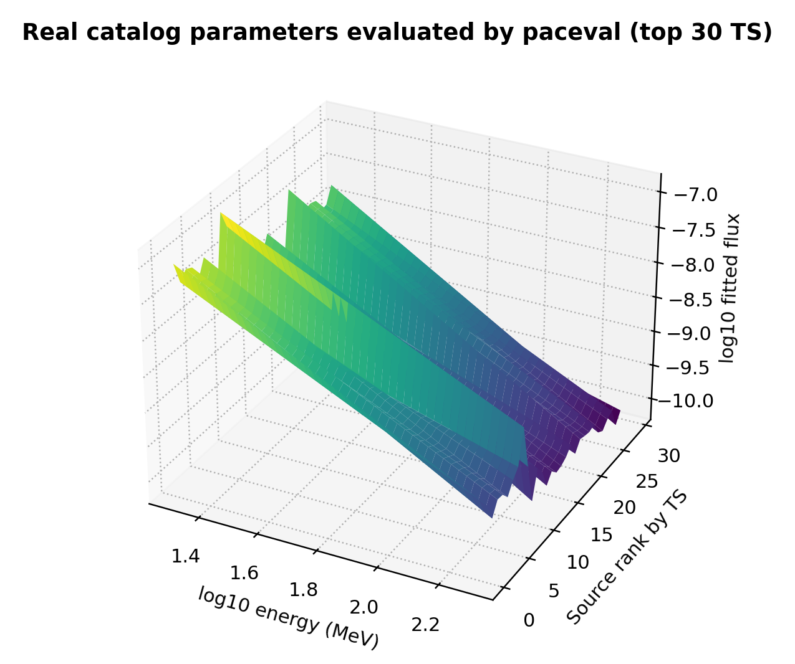
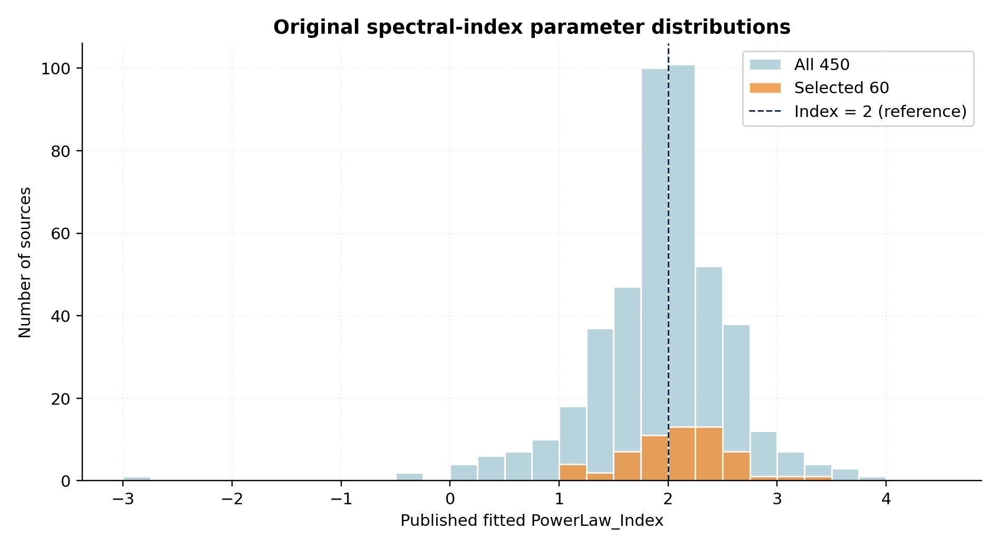
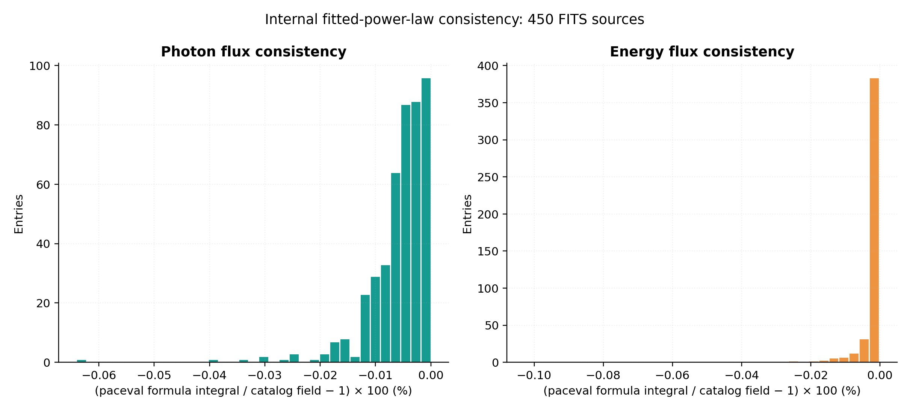
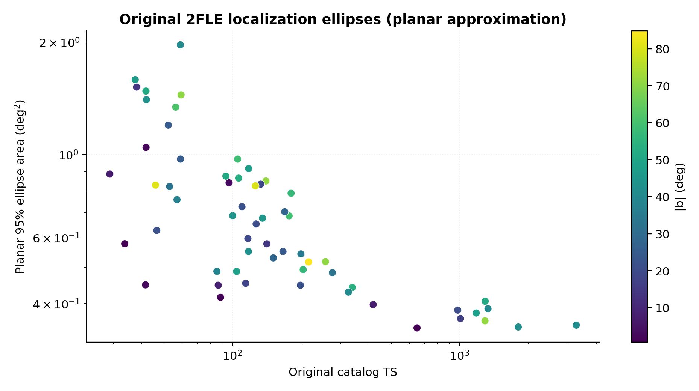
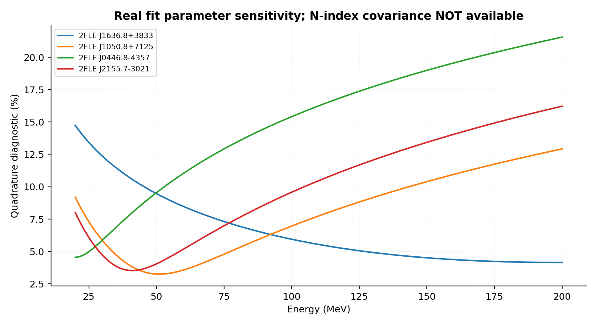
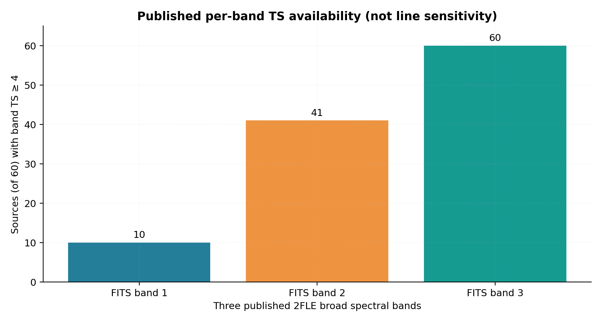
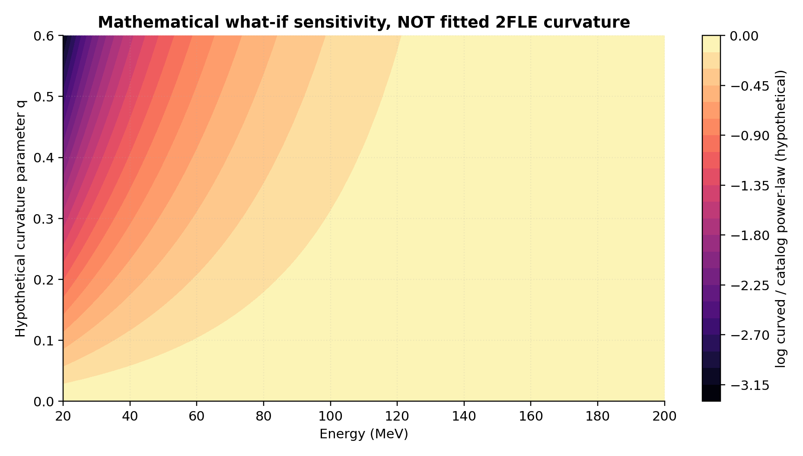

# Fermi-LAT 2FLE — Real-Catalog Spectral Mathematics with paceval


**A genuinely executed, reproducible C++ follow-up to the synthetic [paceval Fermi-2FLE Spectral Screening whitepaper](docs/Previous_Spectral_Screening_Whitepaper_EN.pdf). This successor directly reads the original NASA `2FLE_psc_v8.fits` file using CFITSIO and evaluates the actual published 450 power-law fits, including the 60 previously selected unassociated/new source names, via 16 reusable paceval graphs and its real Multi-Graph-Batch API.**

[**Research whitepaper (English PDF)**](paceval_Fermi_2FLE_Real_Catalog_Whitepaper_EN.pdf) · [Original FITS input](data/2FLE_psc_v8.fits) · [C++ main](src/fermi_real_catalog.cpp) · [CMake project](src/CMakeLists.txt) · [Mathematical execution inventory](results/math_execution_inventory.csv) · [Original published catalog](https://fermi.gsfc.nasa.gov/ssc/data/access/lat/2FLE/)

> **Scientific boundary.** This is a real **published-catalog fit re-evaluation**, not a new astrophysical fit of photon events, a LAT instrument response reconstruction, a source classification, a measurement of an anomalous new spectrum, or a technosignature detection. All 450 measurements and their fit parameters are authentic FITS catalog entries. The numerical flux curves are model evaluations *derived from those fits*, not new measured photon events. The one illustrative curvature experiment is **hypothetical and not fitted to Fermi data**. The title artwork is clearly a concept illustration rather than a measured gamma-ray sky map.

## 1. Scientific introduction and practical application

The **Second Fermi-LAT Low-Energy Source Catalog (2FLE)** reports gamma-ray sources detected at **20–200 MeV** over 14 years. Published in *The Astrophysical Journal Supplement Series* on **12 November 2026**, the catalog includes **450 sources**, with 377 associated with known multiwavelength counterparts and **60 new gamma-ray sources** without confirmed associations. The instrument's energy dispersion is substantial in this energy range, so a true source-level new likelihood analysis needs LAT photon and spacecraft files, IRFs, energy-dispersion corrections, diffuse background models, and independent multiband checks.

The present real-data computational task is narrower and independently reproducible: **re-evaluate published spectral fits as analytical functions, inspect source parameter variation and sensitivity, cross-check catalog-integrated fluxes, and make mathematical what-if comparisons without claiming new physical evidence.** This is a useful reusable mathematical building block for analysis pipelines, training, catalog QA, inspection and downstream digital scientific workflows.

Sources: [official NASA 2FLE release](https://fermi.gsfc.nasa.gov/ssc/data/access/lat/2FLE/), [peer-reviewed 2FLE paper](https://doi.org/10.3847/1538-4365/aeb54d), [NASA Pass-8 energy-dispersion guidance](https://fermi.gsfc.nasa.gov/ssc/data/analysis/documentation/Pass8_edisp_usage.html), and [Fermipy science workflow](https://fermipy.readthedocs.io/en/latest/).

## 2. Actual measurements and reproducibility

| Verified item | Outcome | Provenance |
|---|---:|---|
| Original FITS sources / columns | **450 / 38** | Read directly by CFITSIO from the included original FITS |
| The 60 previously documented source names | **60 / 60 matched** | Cross-checked against original FITS identifiers |
| Additional unconfirmed ASSOC3 information | **38** | FITS ASSOC3 column |
| No ASSOC3 hint among the 60 | **22** | FITS ASSOC3 column |
| Three bands with TS ≥ 4 | **10** | Original FITS TS_Band array |
| Absolute Galactic latitude above 10° | **51 / 60** | Original FITS GLAT |
| Registered reusable mathematical paceval graphs | **16** | Real SDK run |
| Multi-Graph batch outputs | **152,560** | Real SDK run |
| Multi-Graph batch calls | **76** | Real SDK run |
| Independent C++ values checked | **7,216** | Real SDK run, source-level oracle |
| Independent 80-decimal-digit values checked | **752** | `mpmath` recomputation |
| Byte-identical repeat files | **8 / 8** | Repeated full SDK execution |
| Integration test | **CTest 1 / 1** | Real FITS and genuine paceval runtime |

The model-integrated 20–200 MeV photon flux and energy flux agree with the corresponding catalog fitted flux fields at all 450 sources within **0.11%** relative deviation; this is an **internal check of the same catalog power-law fit**, not an independent astrophysical validation or a standalone error estimate. See [`examples/real_450_paceval_consistency.csv`](examples/real_450_paceval_consistency.csv).

## 3. Mathematical model and paceval ownership

For photon energy `E` in MeV, the actual catalog parameters are the differential normalization `N` (photons cm⁻² s⁻¹ MeV⁻¹), fitted pivot energy `P` (MeV), and fitted photon index `g`:

```math
F(E)=N\exp\!\left[-g\ln\!\left(\frac{E}{P}\right)\right].
```

The published fit integrated photon flux is evaluated by paceval as:

```math
I_{20:200}=\frac{NP}{1-g}\left[\left(\frac{200}{P}\right)^{1-g}-\left(\frac{20}{P}\right)^{1-g}\right].
```

The corresponding fitted energy flux in erg cm⁻² s⁻¹ is:

```math
J_{20:200}=1.602176634\times10^{-6}\frac{NP^2}{2-g}\left[\left(\frac{200}{P}\right)^{2-g}-\left(\frac{20}{P}\right)^{2-g}\right].
```

These explicit analytic expressions require the logarithmic limit if a fitted photon index is exactly 1 or 2; none of the 450 input rows hits either singular value. The included C++ implementation validates this before evaluating the expressions.

For a *diagnostic only*, paceval also computes a covariance-free error estimate:

```math
r(E)=\sqrt{\left(\frac{\sigma_N}{N}\right)^2+\left[\sigma_g\ln(E/P)\right]^2}.
```

The covariance between fitted normalization and index is not included in the FITS fields, so `r(E)` is **not a calibrated one-sigma confidence band**. Source-specific uncertainty quantification requires the full likelihood and covariance. Additional paceval graphs calculate E²F(E), logarithmic slopes, index-shift sensitivity, planar 95%-ellipse areas, and one explicitly *hypothetical* log-parabola function with a user-defined q. **No real-data curvature fit is performed.**

All 16 exact graph expressions, units, versions and ownership are in the [formula registry](examples/paceval_formula_registry.csv). Their verified execution ownership is in [the inventory](results/math_execution_inventory.csv). CFITSIO loads rows and C++ performs the stateful loop, source-name comparison, selection and file export. It does not silently replace paceval expressions with native C++ results; the C++ formulas are used solely as an independent audit oracle.

## 4. Scientific figures from original FITS and executed paceval outputs

| Real observational catalog metadata | Genuine paceval analysis of published FITS fits |
|---|---|
|  |  |
|  |  |
|  |  |
|  |  |



**Mathematical what-if, not measured curvature:**



Every scientific image is provided as a high-resolution PNG and as a vector PDF in [`figures/`](figures/). Unlike the concept title artwork, these scientific figures have traceable CSV inputs and generating Python code.

## 5. Reproduce everything

Prerequisites: Linux, a C++17 compiler, CMake >= 3.16, `libcfitsio`/CFITSIO headers, and your separately obtained compatible original paceval Linux shared runtime. The original `paceval_main.h` and `paceval_main.cpp` interface files are included in `src/`, retaining their original notices. The external proprietary runtime itself is **not redistributed**.

```bash
cmake -S src -B build -DCMAKE_BUILD_TYPE=Release \
  -DPACEVAL_RUNTIME=/absolute/path/to/libpaceval_linux_sharedLIB.so
cmake --build build -j
ctest --test-dir build --output-on-failure
./build/fermi_real_catalog \
  --fits data/2FLE_psc_v8.fits \
  --legacy data/legacy_60_report_metadata.csv \
  --out .
python3 src/high_precision_reference.py
python3 src/make_figures.py
python3 src/make_whitepaper.py
python3 src/check_readme_math.py
```

The Python plotting and whitepaper tools require `numpy`, `pandas`, `matplotlib`, `Pillow`, `mpmath`, and `reportlab` (documented in [`src/requirements.txt`](src/requirements.txt)). The exact original FITS bytes are shipped under [`data/`](data/), plus [SHA256 checksums](results/SHA256SUMS.txt) for verified distribution.

**Input/data boundaries:** [`real_450_original_fits.csv`](examples/real_450_original_fits.csv) and [`real_60_original_fits.csv`](examples/real_60_original_fits.csv) are extracted directly from the original file; [`real_60_paceval_spectral_samples.csv`](examples/real_60_paceval_spectral_samples.csv) and [`real_450_paceval_consistency.csv`](examples/real_450_paceval_consistency.csv) are evaluated from those actual published fit parameters; [`paceval_curvature_sensitivity_surface_HYPOTHETICAL.csv`](examples/paceval_curvature_sensitivity_surface_HYPOTHETICAL.csv) is an illustrative mathematical sensitivity scan only.

## 6. Scientific boundaries and next steps

This research **does not** do any new photon event fitting, source-dependent diffuse-background testing, sky-map extraction, Fermi IRF/energy dispersion folding, barycentric timing, multiwavelength cross-survey association, or technosignature searches. **None of the 60 sources has been newly classified.** An absence of confirmed counterpart is not evidence of artificiality or unknown physics.

The next defensible full astrophysical stage is to obtain event and spacecraft data for a limited, preselected set of independent ROIs, reproduce the published LAT likelihoods using calibrated energy dispersion, diffuse backgrounds and IRFs, verify stability across time and selection cuts, then benchmark additional mathematical spectral families *out of sample*. Only after power-calibrated injection-recovery and appropriate trials corrections can anomalous effects be assessed; no conclusion about technological origins follows from a generic improved spectral fit.

References: [Adelfio et al. 2026, ApJS 287(2), 40](https://doi.org/10.3847/1538-4365/aeb54d) · [NASA FSSC 2FLE products](https://fermi.gsfc.nasa.gov/ssc/data/access/lat/2FLE/) · [NASA Pass-8 dispersion guidance](https://fermi.gsfc.nasa.gov/ssc/data/analysis/documentation/Pass8_edisp_usage.html) · [Fermipy documentation](https://fermipy.readthedocs.io/en/latest/) · [Official Fermi data access](https://fermi.gsfc.nasa.gov/ssc/data/access/).

*Research demonstration, 13 November 2026. Reproducible mathematical catalog-model evaluation with original FITS and paceval, not a detector-calibrated astrophysical discovery.*
